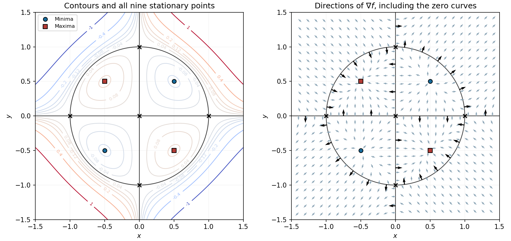

<h1 id="12/d/solution">Solution</h1>

↑ **Parent:** [D](../d.md)

The zero [level set](../../../../../level-set.md) is especially simple:

$$
\boxed{f=0\iff x=0\quad\text{or}\quad y=0\quad\text{or}\quad x^2+y^2=1}.
$$

The two axes and the unit [circle](../../../../../circle.md) divide the [plane](../../../../../plane.md) into regions where the signs alternate. Inside the [circle](../../../../../circle.md), $f$ has the opposite sign to $xy$; outside it has the same sign. Closed [level curves](../../../../../level-curve.md) surround the two interior [local minima](../../../../../local-minimum.md) and two interior [local maxima](../../../../../local-maximum.md); the zero curves cross at the five [saddle points of a scalar function](../../../../../saddle-point-of-a-scalar-function.md). Farther out, the nonzero [level curves](../../../../../level-curve.md) are open within the displayed square.

**[Figure 1](#12/d/image-contours-stationary-points-and-gradient-directions-of-the-quartic-surface). Contours, stationary points and gradient directions of the quartic surface**. Left: signed [level curves](../../../../../level-curve.md) and the exact zero set consisting of both axes and the unit [circle](../../../../../circle.md). Right: normalized [gradient](../../../../../gradient.md) directions, including arrows on the zero curves. The nine [stationary points](../../../../../stationary-point.md) are marked in both panels.

## ↑ Ancestors (13)

1. [D](../d.md)
2. [12](../../12.md)
3. [Paper 2](../../../paper-2-split.md)
4. [2022](../../../split.md)
5. [Past exam of the mathematics course of the year 1 of the natural sciences course of the University of Cambridge](../../../../split.md)
6. [Mathematics course of the year 1 of the natural sciences course of the University of Cambridge](../../../../../mathematics-course-of-the-year-1-of-the-natural-sciences-course-of-the-university-of-cambridge.md)
7. [Year 1 of the natural sciences course of the University of Cambridge](../../../../../year-1-of-the-natural-sciences-course-of-the-university-of-cambridge.md)
8. [Year of the natural sciences course of the University of Cambridge](../../../../../year-of-the-natural-sciences-course-of-the-university-of-cambridge.md)
9. [Natural sciences course of the University of Cambridge](../../../../../natural-sciences-course-of-the-university-of-cambridge.md)
10. [Course of the University of Cambridge](../../../../../course-of-the-university-of-cambridge.md)
11. [University of Cambridge](../../../../../university-of-cambridge-split.md)
12. [List of universities](../../../../../list-of-universities.md)
13. [Codex Wiki](../../../../../split.md)
