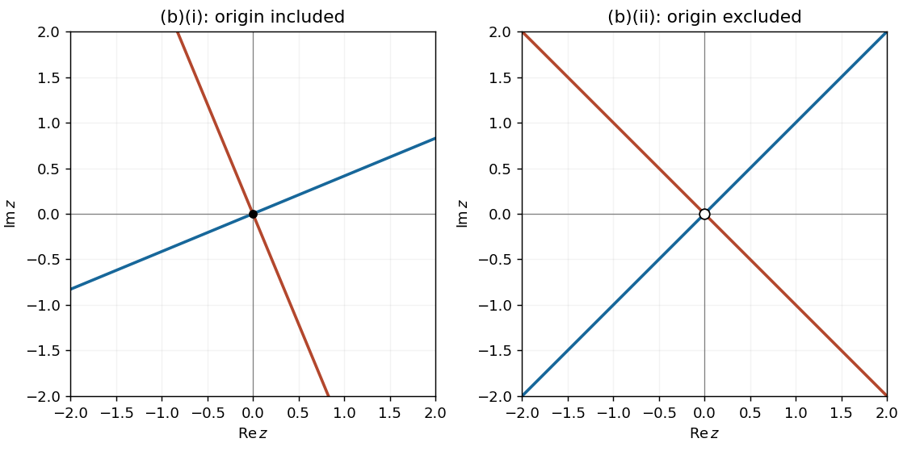
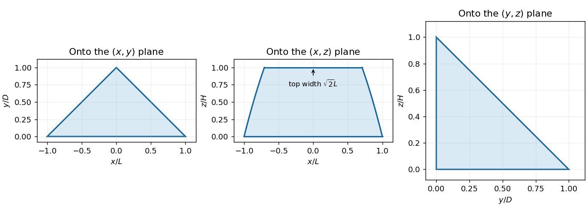
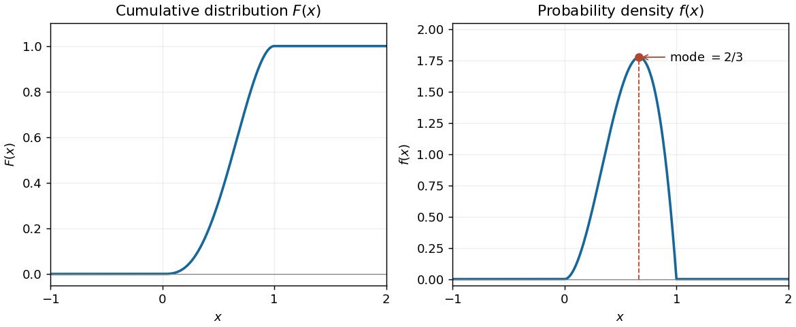
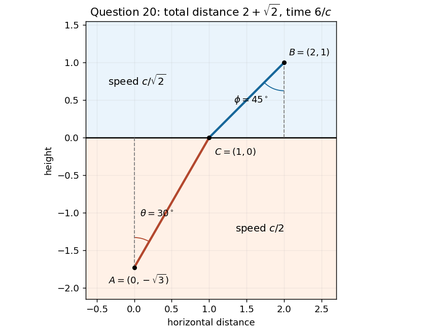

# Paper 1

↑ **Parent:** [2023](../2023.md)

[https://www.maths.cam.ac.uk/undergradnst/files/2023/papernst_ia_1_2023.pdf](https://www.maths.cam.ac.uk/undergradnst/files/2023/papernst_ia_1_2023.pdf)

**Table of contents**

- [1](#1)
  - [Solution](#1/solution)
- [2](#2)
  - [Solution](#2/solution)
- [3](#3)
  - [Solution](#3/solution)
- [4](#4)
  - [Solution](#4/solution)
- [5](#5)
  - [Solution](#5/solution)
- [6](#6)
  - [Solution](#6/solution)
- [7](#7)
  - [Solution](#7/solution)
- [8](#8)
  - [Solution](#8/solution)
- [9](#9)
  - [Solution](#9/solution)
- [10](#10)
  - [Solution](#10/solution)
- [11](#11)
  - [a](#11/a)
    - [i](#11/a/i)
      - [Solution](#11/a/i/solution)
    - [ii](#11/a/ii)
      - [Solution](#11/a/ii/solution)
  - [b](#11/b)
    - [i](#11/b/i)
      - [Solution](#11/b/i/solution)
    - [ii](#11/b/ii)
      - [Solution](#11/b/ii/solution)
  - [c](#11/c)
    - [Solution](#11/c/solution)
  - [d](#11/d)
    - [Solution](#11/d/solution)
- [12](#12)
  - [a](#12/a)
    - [i](#12/a/i)
      - [Solution](#12/a/i/solution)
    - [ii](#12/a/ii)
      - [Solution](#12/a/ii/solution)
  - [b](#12/b)
    - [i](#12/b/i)
      - [Solution](#12/b/i/solution)
    - [ii](#12/b/ii)
      - [Solution](#12/b/ii/solution)
- [13](#13)
  - [a](#13/a)
    - [Solution](#13/a/solution)
  - [b](#13/b)
    - [Solution](#13/b/solution)
  - [c](#13/c)
    - [i](#13/c/i)
      - [Solution](#13/c/i/solution)
    - [ii](#13/c/ii)
      - [Solution](#13/c/ii/solution)
    - [iii](#13/c/iii)
      - [Solution](#13/c/iii/solution)
- [14](#14)
  - [a](#14/a)
    - [Solution](#14/a/solution)
  - [b](#14/b)
    - [Solution](#14/b/solution)
  - [c](#14/c)
    - [Solution](#14/c/solution)
  - [d](#14/d)
    - [Solution](#14/d/solution)
- [15](#15)
  - [a](#15/a)
    - [Solution](#15/a/solution)
  - [b](#15/b)
    - [Solution](#15/b/solution)
  - [c](#15/c)
    - [Solution](#15/c/solution)
- [16](#16)
  - [a](#16/a)
    - [Solution](#16/a/solution)
  - [b](#16/b)
    - [Solution](#16/b/solution)
  - [c](#16/c)
    - [Solution](#16/c/solution)
  - [d](#16/d)
    - [Solution](#16/d/solution)
  - [e](#16/e)
    - [Solution](#16/e/solution)
  - [f](#16/f)
    - [Solution](#16/f/solution)
  - [g](#16/g)
    - [Solution](#16/g/solution)
  - [h](#16/h)
    - [Solution](#16/h/solution)
- [17](#17)
  - [a](#17/a)
    - [Solution](#17/a/solution)
  - [b](#17/b)
    - [Solution](#17/b/solution)
  - [c](#17/c)
    - [Solution](#17/c/solution)
  - [d](#17/d)
    - [Solution](#17/d/solution)
  - [e](#17/e)
    - [Solution](#17/e/solution)
- [18](#18)
  - [a](#18/a)
    - [Solution](#18/a/solution)
  - [b](#18/b)
    - [Solution](#18/b/solution)
  - [c](#18/c)
    - [Solution](#18/c/solution)
  - [d](#18/d)
    - [Solution](#18/d/solution)
  - [e](#18/e)
    - [Solution](#18/e/solution)
- [19](#19)
  - [a](#19/a)
    - [Solution](#19/a/solution)
  - [b](#19/b)
    - [i](#19/b/i)
      - [Solution](#19/b/i/solution)
    - [ii](#19/b/ii)
      - [Solution](#19/b/ii/solution)
  - [c](#19/c)
    - [Solution](#19/c/solution)
  - [d](#19/d)
    - [i](#19/d/i)
      - [Solution](#19/d/i/solution)
    - [ii](#19/d/ii)
      - [Solution](#19/d/ii/solution)
    - [iii](#19/d/iii)
      - [Solution](#19/d/iii/solution)
- [20](#20)
  - [a](#20/a)
    - [Solution](#20/a/solution)
  - [b](#20/b)
    - [i](#20/b/i)
      - [Solution](#20/b/i/solution)
    - [ii](#20/b/ii)
      - [Solution](#20/b/ii/solution)
    - [iii](#20/b/iii)
      - [Solution](#20/b/iii/solution)

## 1

↑ **Parent:** [Paper 1](paper-1.md)

<h3 id="1/solution">Solution</h3>

↑ **Parent:** [1](#1)

The [binomial theorem](../../binomial-coefficient.md#binomial-theorem) gives $(1+x)^8=\sum_{k=0}^8\binom8k x^k$. The required [binomial coefficients](../../binomial-coefficient.md) are therefore

$$
\boxed{[x^4](1+x)^8=\binom84=70,\qquad [x^5](1+x)^8=\binom85=56.}
$$

Here $[x^k]$ denotes the coefficient of $x^k$ in the [polynomial](../../polynomial.md).

## 2

↑ **Parent:** [Paper 1](paper-1.md)

<h3 id="2/solution">Solution</h3>

↑ **Parent:** [2](#2)

The given [polynomial root](../../polynomial.md#root-of-a-polynomial) supplies the factor $2x-3$. [Polynomial division](../../polynomial.md#polynomial-division) gives

$$
2x^3-5x^2+x+3=(2x-3)(x^2-x-1).
$$

Solving the remaining [quadratic equation](../../polynomial.md#quadratic-equation), the other two [polynomial roots](../../polynomial.md#root-of-a-polynomial) are

$$
\boxed{x=\frac{1+\sqrt5}{2}\quad\text{and}\quad x=\frac{1-\sqrt5}{2}.}
$$

## 3

↑ **Parent:** [Paper 1](paper-1.md)

<h3 id="3/solution">Solution</h3>

↑ **Parent:** [3](#3)

Use the first of the [simultaneous equations](../../algebra.md#system-of-equations) to put $y=1-x$. Substitution into the second gives

$$
x-x^2+2(1-x)^2=2,\qquad x^2-3x=x(x-3)=0.
$$

Thus $x=0$ or $x=3$. The corresponding values of $y$ give exactly

$$
\boxed{(x,y)=(0,1)\text{ or }(3,-2).}
$$

## 4

↑ **Parent:** [Paper 1](paper-1.md)

<h3 id="4/solution">Solution</h3>

↑ **Parent:** [4](#4)

[Completing the square](../../polynomial.md#completing-the-square) transforms the equation into

$$
(x+1)^2+(y+2)^2=9.
$$

Comparison with the standard [circle](../../topology.md#circle) equation gives

$$
\boxed{\text{centre}=(-1,-2),\qquad\text{radius}=3.}
$$

## 5

↑ **Parent:** [Paper 1](paper-1.md)

<h3 id="5/solution">Solution</h3>

↑ **Parent:** [5](#5)

The addition formula for the [sine](../../geometry-and-topology.md#sine) gives

$$
A\sin(t+\phi)=A\cos\phi\sin t+A\sin\phi\cos t.
$$

Equating the [sine](../../geometry-and-topology.md#sine) and [cosine](../../geometry-and-topology.md#cosine) coefficients gives $A\cos\phi=\sqrt3$ and $A\sin\phi=1$. Squaring and adding yields $A^2=4$, so $A=2$ because $A>0$. Both coefficients are positive, so $\phi$ is in the first quadrant. Consequently

$$
\boxed{A=2,\qquad\phi=\pi/6.}
$$

## 6

↑ **Parent:** [Paper 1](paper-1.md)

<h3 id="6/solution">Solution</h3>

↑ **Parent:** [6](#6)

This is a [finite geometric series](../../sequence-and-series.md#finite-geometric-series) with common ratio $r=1/\sqrt2$. Since $r^{10}=1/32$,

$$
\sum_{n=1}^{10}2^{-n/2}=\frac{r(1-r^{10})}{1-r}=\frac{31}{32}\frac1{\sqrt2-1}=\frac{31+31\sqrt2}{32}.
$$

Thus $\boxed{p=31,\ q=31}$.

## 7

↑ **Parent:** [Paper 1](paper-1.md)

<h3 id="7/solution">Solution</h3>

↑ **Parent:** [7](#7)

The [chain rule](../../calculus.md#chain-rule) and the [quotient rule](../../calculus.md#quotient-rule) give

$$
f'(x)=\exp\left(\frac{x}{1+x^2}\right)\frac{1-x^2}{(1+x^2)^2}.
$$

The [exponential function](../../calculus.md#exponential-function) and denominator are positive, so the [stationary points](../../calculus-of-variations.md#stationary-point) occur exactly at $x=\pm1$. Their values are

$$
\boxed{f(-1)=e^{-1/2},\qquad f(1)=e^{1/2}.}
$$

The [derivative](../../calculus.md#derivative) is negative for $|x|>1$ and positive for $|x|<1$, so $x=-1$ is a [local minimum](../../analysis.md#local-minimum) and $x=1$ a [local maximum](../../analysis.md#local-maximum). They are also global extrema, since $-1/2\leq x/(1+x^2)\leq1/2$.

## 8

↑ **Parent:** [Paper 1](paper-1.md)

<h3 id="8/solution">Solution</h3>

↑ **Parent:** [8](#8)

Apply [implicit differentiation](../../multivariable-calculus.md#implicit-differentiation), remembering that $y$ depends on $x$:

$$
1+y'+e^x+e^y y'=0.
$$

Since $1+e^y>0$, division is always legitimate. Therefore

$$
\boxed{\frac{dy}{dx}=-\frac{1+e^x}{1+e^y}.}
$$

## 9

↑ **Parent:** [Paper 1](paper-1.md)

<h3 id="9/solution">Solution</h3>

↑ **Parent:** [9](#9)

The [partial fraction decomposition](../../isolated-singularity.md#partial-fraction-decomposition) is

$$
\frac{2x+1}{x(x+1)}=\frac1x+\frac1{x+1}.
$$

Taking [antiderivatives](../../integral.md#antiderivative) and using the positive endpoints gives

$$
\int_2^3\frac{2x+1}{x(x+1)}\,dx=[\ln x+\ln(x+1)]_2^3=\ln\frac{3\cdot4}{2\cdot3}=\ln2.
$$

Hence $\boxed{n=2}$.

## 10

↑ **Parent:** [Paper 1](paper-1.md)

<h3 id="10/solution">Solution</h3>

↑ **Parent:** [10](#10)

The [function graphs](../../function.md#graph-of-a-function) intersect when $2x=4xe^{-x}$, so $x=0$ or $x=\ln2$. For $0<x<\ln2$, the [exponential function](../../calculus.md#exponential-function) satisfies $e^{-x}>1/2$, making $4xe^{-x}$ the upper graph. The enclosed [area](../../differential-geometry.md#surface-area) is therefore

$$
\begin{aligned}
A&=\int_0^{\ln2}(4xe^{-x}-2x)\,dx\\
&=[-4(x+1)e^{-x}-x^2]_0^{\ln2}\\
&=\boxed{2-2\ln2-(\ln2)^2.}
\end{aligned}
$$

The [antiderivative](../../integral.md#antiderivative) of $xe^{-x}$ follows by [integration by parts](../../calculus.md#integration-by-parts).

## 11

↑ **Parent:** [Paper 1](paper-1.md)

<h3 id="11/a">a</h3>

↑ **Parent:** [11](#11)

<h4 id="11/a/i">i</h4>

↑ **Parent:** [A](#11/a)

<h5 id="11/a/i/solution">Solution</h5>

↑ **Parent:** [I](#11/a/i)

Direct multiplication, using $i^2=-1$, gives

$$
(3-2i)(4+3i)=12+9i-8i-6i^2=18+i.
$$

Thus the [real part](../../complex-analysis.md#real-part) is $\boxed{18}$ and the [imaginary part](../../complex-analysis.md#imaginary-part) is $\boxed{1}$.

<h4 id="11/a/ii">ii</h4>

↑ **Parent:** [A](#11/a)

<h5 id="11/a/ii/solution">Solution</h5>

↑ **Parent:** [Ii](#11/a/ii)

Multiply numerator and denominator by the [complex conjugate](../../complex-analysis.md#complex-conjugate) $4-3i$:

$$
\frac{3-2i}{4+3i}=\frac{(3-2i)(4-3i)}{4^2+3^2}=\frac{6-17i}{25}.
$$

Thus the [real part](../../complex-analysis.md#real-part) is $\boxed{6/25}$ and the [imaginary part](../../complex-analysis.md#imaginary-part) is $\boxed{-17/25}$.

<h3 id="11/b">b</h3>

↑ **Parent:** [11](#11)

<h4 id="11/b/i">i</h4>

↑ **Parent:** [B](#11/b)

<h5 id="11/b/i/solution">Solution</h5>

↑ **Parent:** [I](#11/b/i)

Since $z^2=(x^2-y^2)+2ixy$, equating its [real part](../../complex-analysis.md#real-part) and [imaginary part](../../complex-analysis.md#imaginary-part) gives $x^2-y^2=2xy$, or

$$
y^2+2xy-x^2=0.
$$

The [quadratic equation](../../polynomial.md#quadratic-equation) in $y$ factors as $[y-(-1+\sqrt2)x][y-(-1-\sqrt2)x]=0$. Thus the set is the union of two [straight lines](../../euclidean-geometry.md#straight-line) through the origin:

$$
\boxed{y=(-1+\sqrt2)x\quad\text{or}\quad y=(-1-\sqrt2)x.}
$$

Their slopes multiply to $-1$, so they are perpendicular. Their [angles](../../geometry-and-topology.md#angle) to the real axis are $\pi/8$ and $-3\pi/8$, modulo $\pi$. The origin is included.

**[Figure 1](#11/b/i/image-the-two-pairs-of-lines-in-the-argand-diagrams-of-question-11). The two pairs of lines in the Argand diagrams of Question 11**.

<h4 id="11/b/ii">ii</h4>

↑ **Parent:** [B](#11/b)

<h5 id="11/b/ii/solution">Solution</h5>

↑ **Parent:** [Ii](#11/b/ii)

The denominator requires $z\ne0$. Write $z^2=u+iv$, where $u=x^2-y^2$ and $v=2xy$. Multiplication by the nonzero denominator gives

$$
v=-i(u+iv)=v-iu,
$$

so $u=0$. Conversely, if $u=0$ and $z\ne0$, then $v\ne0$ and $v/(iv)=-i$. Thus the required [Argand diagram](../../complex-analysis.md#complex-plane) consists exactly of

$$
\boxed{y=x\quad\text{or}\quad y=-x,\qquad (x,y)\ne(0,0).}
$$

These are two perpendicular [straight lines](../../euclidean-geometry.md#straight-line), with the origin removed as shown in the figure in part (i).

<h3 id="11/c">c</h3>

↑ **Parent:** [11](#11)

<h4 id="11/c/solution">Solution</h4>

↑ **Parent:** [C](#11/c)

For real $x$, $\cosh x>0$, so multiplication by the [hyperbolic cosine](../../calculus.md#hyperbolic-cosine) is reversible. The identities $\cosh x-\sinh x=e^{-x}$ and $\operatorname{sech}x=1/\cosh x$ give

$$
e^{-x}\cosh x=2,\qquad \frac{1+e^{-2x}}2=2.
$$

Thus $e^{-2x}=3$. The [exponential function](../../calculus.md#exponential-function) is injective, so the unique real solution is

$$
\boxed{x=-\frac12\ln3.}
$$

<h3 id="11/d">d</h3>

↑ **Parent:** [11](#11)

<h4 id="11/d/solution">Solution</h4>

↑ **Parent:** [D](#11/d)

Set $w=e^z\ne0$. The [hyperbolic cosine](../../calculus.md#hyperbolic-cosine) identity gives $w+w^{-1}=2i$, hence the [quadratic equation](../../polynomial.md#quadratic-equation)

$$
w^2-2iw+1=0,\qquad w=i(1\pm\sqrt2).
$$

Let $L=\ln(1+\sqrt2)>0$. The first root has modulus $1+\sqrt2$ and [complex argument](../../complex-analysis.md#argument-complex-analysis) $\pi/2$; the second has modulus $\sqrt2-1=e^{-L}$ and [complex argument](../../complex-analysis.md#argument-complex-analysis) $-\pi/2$. Taking all [complex logarithm](../../analysis.md#complex-logarithm) values gives

$$
\boxed{z=L+i\left(\frac\pi2+2k\pi\right)\quad\text{or}\quad z=-L+i\left(-\frac\pi2+2k\pi\right),\qquad k\in\mathbb Z.}
$$

The two families are distinct because their [real parts](../../complex-analysis.md#real-part) are respectively $L$ and $-L$. This exhausts the solutions because both roots for $w$ and all possible [complex arguments](../../complex-analysis.md#argument-complex-analysis) have been included.

## 12

↑ **Parent:** [Paper 1](paper-1.md)

<h3 id="12/a">a</h3>

↑ **Parent:** [12](#12)

<h4 id="12/a/i">i</h4>

↑ **Parent:** [A](#12/a)

<h5 id="12/a/i/solution">Solution</h5>

↑ **Parent:** [I](#12/a/i)

At height $z$, the [circular sector](../../topology.md#circular-sector) has [radius](../../topology.md#radius) $r(z)=Re^{-z/H}$ and [angle](../../geometry-and-topology.md#angle) $\Theta(z)=2\pi-\pi z/H$. Its [area](../../differential-geometry.md#surface-area) is $\Theta(z)r(z)^2/2$, so slicing by horizontal cross-sections gives the [volume integral](../../multivariable-calculus.md#volume-integral)

$$
V=\pi R^2\int_0^H\left(1-\frac z{2H}\right)e^{-2z/H}\,dz.
$$

Use the [substitution rule](../../integral.md#integration-by-substitution) $t=z/H$. Then

$$
V=\pi R^2H\int_0^1(1-t/2)e^{-2t}\,dt.
$$

An [integration by parts](../../calculus.md#integration-by-parts) gives the [antiderivative](../../integral.md#antiderivative) $(t/4-3/8)e^{-2t}$, whose endpoint difference is $(3-e^{-2})/8$. Therefore

$$
\boxed{V=\frac{\pi R^2H}{8}(3-e^{-2}).}
$$

<h4 id="12/a/ii">ii</h4>

↑ **Parent:** [A](#12/a)

<h5 id="12/a/ii/solution">Solution</h5>

↑ **Parent:** [Ii](#12/a/ii)

At each height, the removed [circular sector](../../topology.md#circular-sector) has the same [angle](../../geometry-and-topology.md#angle) and $4/5$ of the original [radius](../../topology.md#radius). Its [area](../../differential-geometry.md#surface-area) and hence its [volume](../../geometry-and-topology.md#volume) are therefore multiplied by $(4/5)^2=16/25$. Equating the removed [volume](../../geometry-and-topology.md#volume) to that of the reformed solid [sphere](../../euclidean-geometry.md#sphere) gives

$$
\frac43\pi a^3=\frac{16}{25}V=\frac{2\pi R^2H}{25}(3-e^{-2}).
$$

Consequently

$$
\boxed{a=\left[\frac{3R^2H}{50}(3-e^{-2})\right]^{1/3}.}
$$

<h3 id="12/b">b</h3>

↑ **Parent:** [12](#12)

<h4 id="12/b/i">i</h4>

↑ **Parent:** [B](#12/b)

<h5 id="12/b/i/solution">Solution</h5>

↑ **Parent:** [I](#12/b/i)

At height $z$, the horizontal [triangle](../../euclidean-geometry.md#triangle) has half-width $L\sqrt{1-z/(2H)}$ along $x$ and depth $D(1-z/H)$ along $y$. These shrink with $z$, so its [orthogonal projection](../../hilbert-space.md#orthogonal-projection) onto the $(x,y)$ [plane](../../geometry-and-topology.md#plane) is the base [triangle](../../euclidean-geometry.md#triangle) with vertices $(-L,0)$, $(L,0)$ and $(0,D)$:

$$
0\leq y\leq D,\qquad |x|\leq L(1-y/D).
$$

The [orthogonal projection](../../hilbert-space.md#orthogonal-projection) onto the $(y,z)$ [plane](../../geometry-and-topology.md#plane) is the [triangle](../../euclidean-geometry.md#triangle) with vertices $(0,0)$, $(D,0)$ and $(0,H)$:

$$
0\leq z\leq H,\qquad0\leq y\leq D(1-z/H).
$$

The [orthogonal projection](../../hilbert-space.md#orthogonal-projection) onto the $(x,z)$ [plane](../../geometry-and-topology.md#plane) is bounded by $z=0$, $z=H$ and the two curves

$$
\boxed{x=\pm L\sqrt{1-z/(2H)},\qquad0\leq z\leq H.}
$$

Equivalently, these curves lie on the [parabola](../../euclidean-geometry.md#parabola) $z=2H(1-x^2/L^2)$, truncated at height $H$. In particular the top width is $\sqrt2L$, so this projection has a horizontal upper edge from $-L/\sqrt2$ to $L/\sqrt2$; it is not triangular. The top horizontal cross-section has zero depth, consistent with this edge.

**[Figure 2](#12/b/i/image-the-three-coordinate-projections-of-the-triangular-section-solid-in-question-12). The three coordinate projections of the triangular-section solid in Question 12**.

<h4 id="12/b/ii">ii</h4>

↑ **Parent:** [B](#12/b)

<h5 id="12/b/ii/solution">Solution</h5>

↑ **Parent:** [Ii](#12/b/ii)

The horizontal cross-section is a [triangle](../../euclidean-geometry.md#triangle), so its [area](../../differential-geometry.md#surface-area) is half its width times its depth:

$$
A(z)=LD\left(1-\frac zH\right)\sqrt{1-\frac z{2H}}.
$$

Thus the [volume integral](../../multivariable-calculus.md#volume-integral), with $t=z/H$, is

$$
V=LDH\int_0^1(1-t)\sqrt{1-t/2}\,dt.
$$

For the [substitution rule](../../integral.md#integration-by-substitution), put $u=1-t/2$. The endpoint values are $1$ and $1/2$, and $1-t=2u-1$, giving

$$
\begin{aligned}
\frac V{LDH}&=2\int_{1/2}^1(2u-1)u^{1/2}\,du\\
&=2\left[\frac45u^{5/2}-\frac23u^{3/2}\right]_{1/2}^1\\
&=\frac{4+2\sqrt2}{15}.
\end{aligned}
$$

Therefore $\boxed{V=\dfrac{(4+2\sqrt2)LDH}{15}}$.

## 13

↑ **Parent:** [Paper 1](paper-1.md)

<h3 id="13/a">a</h3>

↑ **Parent:** [13](#13)

<h4 id="13/a/solution">Solution</h4>

↑ **Parent:** [A](#13/a)

On an [interval](../../real-analysis.md#interval-mathematics) with $x\ne0$, division by $x^2$ gives the [separable differential equation](../../differential-equation.md#separable-differential-equation) $y'=(4/x^2-1/x)y^2$. For $y\ne0$, take [antiderivatives](../../integral.md#antiderivative):

$$
\int\frac{dy}{y^2}=\int\left(\frac4{x^2}-\frac1x\right)dx,\qquad -\frac1y=-\frac4x-\ln|x|+C.
$$

Renaming the constant yields the explicit nonzero family

$$
\boxed{y(x)=\frac1{4/x+\ln|x|+C}.}
$$

For $x\ne0$, the [interval](../../real-analysis.md#interval-mathematics) of definition must avoid zeros of the denominator. Division by $y^2$ excluded the additional solution $\boxed{y(x)\equiv0}$, which must also be included.

The original undivided [differential equation](../../differential-equation.md) also makes sense at $x=0$, where it requires $y(0)=0$. For [continuation through a zero of the leading ODE coefficient](../../differential-equation.md#continuation-through-a-zero-of-the-leading-ode-coefficient), rewrite the nonzero family as

$$
y(x)=\frac{x}{4+x\ln|x|+Cx}.
$$

It extends differentiably with $y(0)=0$ and $y'(0)=1/4$, since $y(x)/x\to1/4$. One may choose the integration constants independently on the two sides of zero and obtain a differentiable solution through zero. The zero solution also extends through zero, with [derivative](../../calculus.md#derivative) $0$; joining a nonzero branch on just one side to a zero branch on the other would fail [differentiability](../../analysis.md#differentiability).

<h3 id="13/b">b</h3>

↑ **Parent:** [13](#13)

<h4 id="13/b/solution">Solution</h4>

↑ **Parent:** [B](#13/b)

For this [first-order linear differential equation](../../linear-ordinary-differential-equation.md#first-order-linear-differential-equation), an [integrating factor](../../linear-ordinary-differential-equation.md#integrating-factor) on an [interval](../../real-analysis.md#interval-mathematics) avoiding zeros of $\cos x$ is $\cos x$. The [product rule](../../calculus.md#product-rule) then gives

$$
(y\cos x)'=\cos x,\qquad y\cos x=\sin x+C.
$$

The [initial condition](../../differential-equation.md#initial-condition) gives $3/\sqrt2=1/\sqrt2+C$, hence $C=\sqrt2$. Thus

$$
\boxed{y(x)=\frac{\sin x+\sqrt2}{\cos x},\qquad-\frac\pi2<x<\frac\pi2.}
$$

The displayed [interval](../../real-analysis.md#interval-mathematics) is the maximal one containing the specified initial [point](../../geometry-and-topology.md#point-geometry), since the coefficient $\tan x$ is undefined at its endpoints.

<h3 id="13/c">c</h3>

↑ **Parent:** [13](#13)

<h4 id="13/c/i">i</h4>

↑ **Parent:** [C](#13/c)

<h5 id="13/c/i/solution">Solution</h5>

↑ **Parent:** [I](#13/c/i)

Use the substitution $v=y/x$ for a [homogeneous first-order differential equation](../../differential-equation.md#homogeneous-first-order-differential-equation). Since $y'=v+xv'$, it gives

$$
xv'=\tan v.
$$

Where $\sin v\ne0$, this [separable differential equation](../../differential-equation.md#separable-differential-equation) integrates to $\ln|\sin v|=\ln|x|+C$, hence $\sin v=C_1x$. One can obtain the same relation without division by $\sin v$: the equation gives $(\sin v)'=(\sin v)/x$, so $\sin v=C_1x$, including $\sin v\equiv0$.

All real branches of the [inverse sine](../../geometry-and-topology.md#inverse-sine) are captured by

$$
\boxed{y(x)=x\left[k\pi+(-1)^k\arcsin(Cx)\right],\qquad C\in\mathbb R,\quad k\in\mathbb Z.}
$$

Each branch is used on an [interval](../../real-analysis.md#interval-mathematics) with $x\ne0$ and $|Cx|<1$, with fixed $k$. The strict inequality excludes zeros of $\cos(y/x)$, where the original [tangent](../../geometry-and-topology.md#tangent) is undefined. When $C=0$, the formula includes all straight-line solutions $y=k\pi x$. Keeping both families of [inverse sine](../../geometry-and-topology.md#inverse-sine) branches is essential for the two different [initial conditions](../../differential-equation.md#initial-condition) below.

<h4 id="13/c/ii">ii</h4>

↑ **Parent:** [C](#13/c)

<h5 id="13/c/ii/solution">Solution</h5>

↑ **Parent:** [Ii](#13/c/ii)

The [initial condition](../../differential-equation.md#initial-condition) gives $C=\sin(\pi/3)=\sqrt3/2$. Since $\pi/3$ belongs to the principal [inverse sine](../../geometry-and-topology.md#inverse-sine) range, choose $k=0$ in part (i). The particular solution is

$$
\boxed{y(x)=x\arcsin\left(\frac{\sqrt3x}{2}\right),\qquad0<x<\frac2{\sqrt3}.}
$$

The upper endpoint is excluded because $y/x\to\pi/2$ there and the original [tangent](../../geometry-and-topology.md#tangent) ceases to be defined.

<h4 id="13/c/iii">iii</h4>

↑ **Parent:** [C](#13/c)

<h5 id="13/c/iii/solution">Solution</h5>

↑ **Parent:** [Iii](#13/c/iii)

Again $C=\sin(2\pi/3)=\sqrt3/2$, but the principal [inverse sine](../../geometry-and-topology.md#inverse-sine) would give $\pi/3$ at $x=1$. The required branch is $v=\pi-\arcsin(Cx)$, corresponding to $k=1$. Therefore

$$
\boxed{y(x)=x\left[\pi-\arcsin\left(\frac{\sqrt3x}{2}\right)\right],\qquad0<x<\frac2{\sqrt3}.}
$$

At $x=1$ the bracket is $2\pi/3$, as required. Both the [initial condition](../../differential-equation.md#initial-condition) and the original [differential equation](../../differential-equation.md) are thus satisfied on the stated branch.

## 14

↑ **Parent:** [Paper 1](paper-1.md)

<h3 id="14/a">a</h3>

↑ **Parent:** [14](#14)

<h4 id="14/a/solution">Solution</h4>

↑ **Parent:** [A](#14/a)

For an [exact differential form](../../differential-form.md#exact-differential-form), equality of the mixed [partial derivatives](../../multivariable-calculus.md#partial-derivative) requires $P_y=Q_x$. Here

$$
P_y=\frac{y}{a\sqrt x\sqrt{1+y^2}},\qquad Q_x=\frac{y}{2\sqrt x\sqrt{1+y^2}}.
$$

Equality for all $x>0$ and real $y$ forces $1/a=1/2$, so $\boxed{a=2}$. To construct the potential, integrate $P$ with respect to $x$:

$$
v(x,y)=\sqrt x\left(1+\sqrt{1+y^2}\right)+C(y).
$$

Differentiation with respect to $y$ gives $v_y=Q+C'(y)$, so $C'(y)=0$. Thus the most general potential on the connected domain $x>0$ is

$$
\boxed{v(x,y)=\sqrt x\left(1+\sqrt{1+y^2}\right)+C,\qquad C\in\mathbb R.}
$$

Its explicit [partial derivatives](../../multivariable-calculus.md#partial-derivative) verify sufficiency as well as necessity.

<h3 id="14/b">b</h3>

↑ **Parent:** [14](#14)

<h4 id="14/b/solution">Solution</h4>

↑ **Parent:** [B](#14/b)

The stated [total differential](../../multivariable-calculus.md#total-differential) is that of $\pi r^2h$, so $V=\pi r^2h+C$. The zero-volume condition gives $C=0$. For positive $r,h$, divide the [total differential](../../multivariable-calculus.md#total-differential) by this [volume](../../geometry-and-topology.md#volume) to obtain

$$
\boxed{\frac{dV}{V}=2\frac{dr}{r}+\frac{dh}{h}.}
$$

For the specified small changes, $dV/V\approx2(0.01)+0.02=0.04$, so **the volume increases by approximately $4\%$**. The fractional expression requires $V>0$; at a degenerate zero-volume state it is undefined. For finite changes, the exact multiplier is $(1.01)^2(1.02)$, whose difference from $1$ is $4.0502\%$; the [total differential](../../multivariable-calculus.md#total-differential) gives its first-order approximation.

<h3 id="14/c">c</h3>

↑ **Parent:** [14](#14)

<h4 id="14/c/solution">Solution</h4>

↑ **Parent:** [C](#14/c)

Let $t=y/x$. The [product rule](../../calculus.md#product-rule) and the [chain rule](../../calculus.md#chain-rule) give the [partial derivatives](../../multivariable-calculus.md#partial-derivative)

$$
u_x=\phi(t)+x\phi'(t)\left(-\frac y{x^2}\right)=\phi(t)-t\phi'(t),\qquad u_y=x\phi'(t)\frac1x=\phi'(t).
$$

Hence the terms containing $\phi'$ cancel:

$$
xu_x+yu_y=x\phi(t)-xt\phi'(t)+y\phi'(t)=x\phi(t)=\boxed{u}.
$$

This also follows from the [Euler theorem for homogeneous functions](../../real-analysis.md#euler-theorem-for-homogeneous-functions), because $u(\lambda x,\lambda y)=\lambda u(x,y)$ for $\lambda>0$.

<h3 id="14/d">d</h3>

↑ **Parent:** [14](#14)

<h4 id="14/d/solution">Solution</h4>

↑ **Parent:** [D](#14/d)

The [chain rule](../../calculus.md#chain-rule) expresses the coordinate [differential operators](../../analysis.md#differential-operator) as

$$
\partial_x=a\partial_\xi+b\partial_\eta,\qquad \partial_y=-b\partial_\xi+a\partial_\eta.
$$

The coefficients are constant, so a second application gives

$$
u_{xx}=a^2u_{\xi\xi}+ab(u_{\xi\eta}+u_{\eta\xi})+b^2u_{\eta\eta},
$$

and

$$
u_{yy}=b^2u_{\xi\xi}-ab(u_{\xi\eta}+u_{\eta\xi})+a^2u_{\eta\eta}.
$$

Adding cancels the mixed [partial derivatives](../../multivariable-calculus.md#partial-derivative), and $a^2+b^2=1$ gives

$$
\boxed{u_{xx}+u_{yy}=u_{\xi\xi}+u_{\eta\eta}.}
$$

The transformation has [rotation matrix](../../linear-algebra.md#rotation-matrix) $\begin{pmatrix}a&-b\\b&a\end{pmatrix}$, so this identity expresses the [rotational invariance of the Laplacian](../../multivariable-calculus.md#rotational-invariance-of-the-laplacian).

## 15

↑ **Parent:** [Paper 1](paper-1.md)

<h3 id="15/a">a</h3>

↑ **Parent:** [15](#15)

<h4 id="15/a/solution">Solution</h4>

↑ **Parent:** [A](#15/a)

The [Maclaurin series](../../calculus.md#maclaurin-series) $\sinh t=t+t^3/3!+t^5/5!+O(t^7)$, applied with $t=x^2$ and then multiplied by $x$, gives

$$
\boxed{x\sinh(x^2)=x^3+\frac{x^7}{6}+\frac{x^{11}}{120}+O(x^{15}).}
$$

These are the first three nonzero terms. The remainder is written in [Big O notation](../../real-analysis.md#big-o-notation).

<h3 id="15/b">b</h3>

↑ **Parent:** [15](#15)

<h4 id="15/b/solution">Solution</h4>

↑ **Parent:** [B](#15/b)

Put $u=\ln(1+x)=x-x^2/2+x^3/3+O(x^4)$. Since $u=O(x)$, the outer [Taylor series](../../calculus.md#taylor-series) requires $u^2=x^2-x^3+O(x^4)$ and $u^3=x^3+O(x^4)$. Therefore

$$
\begin{aligned}
\ln(1+\ln(1+x))&=u-\frac{u^2}{2}+\frac{u^3}{3}+O(u^4)\\
&=x-\frac{x^2}{2}+\frac{x^3}{3}-\frac12(x^2-x^3)+\frac{x^3}{3}+O(x^4)\\
&=\boxed{x-x^2+\frac{7x^3}{6}+O(x^4).}
\end{aligned}
$$

Both [logarithms](../../calculus.md#logarithm) are defined on a neighbourhood of zero, so this composition of [power series](../../sequence-and-series.md#power-series) is valid there.

<h3 id="15/c">c</h3>

↑ **Parent:** [15](#15)

<h4 id="15/c/solution">Solution</h4>

↑ **Parent:** [C](#15/c)

Factor the leading term out of the [Maclaurin series](../../calculus.md#maclaurin-series) for the [sine](../../geometry-and-topology.md#sine):

$$
\sin x=x\left(1-\frac{x^2}{6}+\frac{x^4}{120}+O(x^6)\right).
$$

The [binomial theorem](../../binomial-coefficient.md#binomial-theorem) gives, through degree four inside the bracket,

$$
\left(1-\frac{x^2}{6}+\frac{x^4}{120}+O(x^6)\right)^6=1+6\left(-\frac{x^2}{6}+\frac{x^4}{120}\right)+\binom62\frac{x^4}{36}+O(x^6).
$$

The coefficient of $x^4$ is $1/20+5/12=7/15$. Multiplying back by $x^6$ yields

$$
\boxed{\sin^6x=x^6-x^8+\frac7{15}x^{10}+O(x^{12}).}
$$

## 16

↑ **Parent:** [Paper 1](paper-1.md)

<h3 id="16/a">a</h3>

↑ **Parent:** [16](#16)

<h4 id="16/a/solution">Solution</h4>

↑ **Parent:** [A](#16/a)

Because $X$ takes values only in $[0,1]$, its [cumulative distribution function](../../probability-distribution.md#cumulative-distribution-function) must satisfy $F(1)=1$. Thus

$$
1=A\left(\frac13-\frac14\right)=\frac A{12},\qquad\boxed{A=12}.
$$

<h3 id="16/b">b</h3>

↑ **Parent:** [16](#16)

<h4 id="16/b/solution">Solution</h4>

↑ **Parent:** [B](#16/b)

The full [cumulative distribution function](../../probability-distribution.md#cumulative-distribution-function) is

$$
\boxed{F(x)=\begin{cases}0,&x<0,\\4x^3-3x^4,&0\leq x\leq1,\\1,&x>1.\end{cases}}
$$

Thus the [function graph](../../function.md#graph-of-a-function) is horizontal at zero for $-1\leq x\leq0$, rises continuously from $(0,0)$ to $(1,1)$, and is horizontal at one for $1\leq x\leq2$. Its [derivative](../../calculus.md#derivative) $12x^2(1-x)$ is positive on $(0,1)$ and zero at both endpoints. The second [derivative](../../calculus.md#derivative) $12x(2-3x)$ changes sign at $x=2/3$, giving an inflection [point](../../geometry-and-topology.md#point-geometry) there.

**[Figure 3](#16/b/image-cumulative-distribution-and-density-with-the-mode-marked-for-question-16). Cumulative distribution and density, with the mode marked, for Question 16**.

<h3 id="16/c">c</h3>

↑ **Parent:** [16](#16)

<h4 id="16/c/solution">Solution</h4>

↑ **Parent:** [C](#16/c)

The [probability density function](../../continuous-probability-distribution.md#probability-density-function) is the [derivative](../../calculus.md#derivative) of the [cumulative distribution function](../../probability-distribution.md#cumulative-distribution-function):

$$
\boxed{f(x)=\begin{cases}12x^2(1-x),&0\leq x\leq1,\\0,&x<0\text{ or }x>1.\end{cases}}
$$

It is nonnegative and has [integral](../../integral.md) $F(1)-F(0)=1$. This is a [beta distribution](../../probability-distribution.md#beta-distribution) with parameters $3$ and $2$.

<h3 id="16/d">d</h3>

↑ **Parent:** [16](#16)

<h4 id="16/d/solution">Solution</h4>

↑ **Parent:** [D](#16/d)

The [probability density function](../../continuous-probability-distribution.md#probability-density-function) is zero outside $[0,1]$. Inside that [interval](../../real-analysis.md#interval-mathematics), it rises from $(0,0)$, reaches its only interior maximum at $x=2/3$, and falls to $(1,0)$. The [derivative](../../calculus.md#derivative) is

$$
f'(x)=12x(2-3x),
$$

positive for $0<x<2/3$ and negative for $2/3<x<1$. Its maximum height is $f(2/3)=16/9$. The second panel of the figure in part (b) shows the [function graph](../../function.md#graph-of-a-function) on the requested full range, with this [mode](../../probability-and-statistics.md#mode-statistics) marked.

<h3 id="16/e">e</h3>

↑ **Parent:** [16](#16)

<h4 id="16/e/solution">Solution</h4>

↑ **Parent:** [E](#16/e)

The interior [stationary point](../../calculus-of-variations.md#stationary-point) of the [probability density function](../../continuous-probability-distribution.md#probability-density-function) solves $12x(2-3x)=0$ with $0<x<1$, giving $x=2/3$. The sign change of $f'$ established in part (d), together with zero endpoint values, makes this the global maximum. Thus

$$
\boxed{\text{mode}=\frac23,\qquad f(2/3)=\frac{16}{9}.}
$$

<h3 id="16/f">f</h3>

↑ **Parent:** [16](#16)

<h4 id="16/f/solution">Solution</h4>

↑ **Parent:** [F](#16/f)

At the [mode](../../probability-and-statistics.md#mode-statistics), the [cumulative distribution function](../../probability-distribution.md#cumulative-distribution-function) has value

$$
F(2/3)=4\left(\frac23\right)^3-3\left(\frac23\right)^4=\frac{16}{27}>\frac12.
$$

Since $F$ is strictly increasing on $(0,1)$, its unique crossing of $1/2$ occurs earlier. Therefore **the [median](../../probability-distribution.md#median) is less than the [mode](../../probability-and-statistics.md#mode-statistics)**.

<h3 id="16/g">g</h3>

↑ **Parent:** [16](#16)

<h4 id="16/g/solution">Solution</h4>

↑ **Parent:** [G](#16/g)

The [expected value](../../expected-value.md) is

$$
\mathbb E[X]=\int_0^1x\,12x^2(1-x)\,dx=12\left(\frac14-\frac15\right)=\frac35.
$$

The second moment is $\mathbb E[X^2]=12(1/5-1/6)=2/5$. Hence the [variance](../../variance.md) and [standard deviation](../../variance.md#standard-deviation) are

$$
\operatorname{Var}(X)=\frac25-\left(\frac35\right)^2=\frac1{25},\qquad\boxed{\mathbb E[X]=\frac35,\quad\sigma=\frac15.}
$$

<h3 id="16/h">h</h3>

↑ **Parent:** [16](#16)

<h4 id="16/h/solution">Solution</h4>

↑ **Parent:** [H](#16/h)

The requested bounds are $\mathbb E[X]-\sigma=2/5$ and $\mathbb E[X]+\sigma=4/5$, both within the support. Since the [probability distribution](../../probability-distribution.md) is continuous, endpoints have zero [probability](../../probability-theory.md#probability), and subtraction of the [cumulative distribution function](../../probability-distribution.md#cumulative-distribution-function) gives

$$
\boxed{\mathbb P\left(\mathbb E[X]-\sigma\leq X\leq\mathbb E[X]+\sigma\right)=4\left[\left(\frac45\right)^3-\left(\frac25\right)^3\right]-3\left[\left(\frac45\right)^4-\left(\frac25\right)^4\right].}
$$

This leaves the answer in rational fractions as requested.

## 17

↑ **Parent:** [Paper 1](paper-1.md)

<h3 id="17/a">a</h3>

↑ **Parent:** [17](#17)

<h4 id="17/a/solution">Solution</h4>

↑ **Parent:** [A](#17/a)

With the standard unweighted [inner product](../../inner-product.md) on real [square-integrable functions](../../measure-theory.md#square-integrable-function), orthogonality on $[-L,L]$ means

$$
\boxed{\langle f,g\rangle=\int_{-L}^Lf(x)g(x)\,dx=0.}
$$

Multiplying this [inner product](../../inner-product.md) by a common nonzero normalising constant does not change [orthogonality](../../inner-product.md#orthogonal-vectors).

<h3 id="17/b">b</h3>

↑ **Parent:** [17](#17)

<h4 id="17/b/solution">Solution</h4>

↑ **Parent:** [B](#17/b)

The [Fourier coefficients](../../fourier-series.md#fourier-coefficient) follow by multiplying the expansion by $1$, by the appropriate [cosine](../../geometry-and-topology.md#cosine), or by the appropriate [sine](../../geometry-and-topology.md#sine), then using [orthogonality](../../inner-product.md#orthogonal-vectors). In the convention with constant term $a_0/2$,

$$
\boxed{\begin{aligned}
a_0&=\frac1L\int_{-L}^Lh(x)\,dx,\\
a_n&=\frac1L\int_{-L}^Lh(x)\cos\frac{n\pi x}{L}\,dx,\qquad n\geq1,\\
b_n&=\frac1L\int_{-L}^Lh(x)\sin\frac{n\pi x}{L}\,dx,\qquad n\geq1.
\end{aligned}}
$$

The factor $1/L$ comes from the squared [norms](../../normed-vector-space.md#norm) of the nonconstant [sine](../../geometry-and-topology.md#sine) and [cosine](../../geometry-and-topology.md#cosine) functions: the [integral](../../integral.md) of each square over $[-L,L]$ is $L$. The constant [function](../../function.md) has squared [norm](../../normed-vector-space.md#norm) $2L$.

<h3 id="17/c">c</h3>

↑ **Parent:** [17](#17)

<h4 id="17/c/solution">Solution</h4>

↑ **Parent:** [C](#17/c)

For $L=1$, the [even function](../../calculus.md#even-function) $h(x)=x^2$ has $b_n=0$, because $x^2\sin(n\pi x)$ is an [odd function](../../calculus.md#odd-function). Its constant coefficient is $a_0=\int_{-1}^1x^2dx=2/3$. The remaining [Fourier coefficients](../../fourier-series.md#fourier-coefficient) are

$$
a_n=2\int_0^1x^2\cos(n\pi x)\,dx.
$$

Two applications of [integration by parts](../../calculus.md#integration-by-parts) give the [antiderivative](../../integral.md#antiderivative), with $k=n\pi$,

$$
\frac{x^2\sin(kx)}k+\frac{2x\cos(kx)}{k^2}-\frac{2\sin(kx)}{k^3}.
$$

Its endpoint difference is $2(-1)^n/(n\pi)^2$, so $a_n=4(-1)^n/(n^2\pi^2)$. Therefore

$$
\boxed{x^2=\frac13+\frac4{\pi^2}\sum_{n=1}^{\infty}\frac{(-1)^n}{n^2}\cos(n\pi x),\qquad-1\leq x\leq1.}
$$

The periodic extension is continuous and piecewise smooth, so [pointwise convergence of a piecewise smooth Fourier series](../../fourier-series.md#pointwise-convergence-of-a-piecewise-smooth-fourier-series) gives equality, including at the endpoints.

<h3 id="17/d">d</h3>

↑ **Parent:** [17](#17)

<h4 id="17/d/solution">Solution</h4>

↑ **Parent:** [D](#17/d)

[Termwise differentiation of a Fourier series](../../fourier-series.md#termwise-differentiation-of-a-fourier-series), applied to the continuous periodic extension in part (c), gives for $-1<x<1$

$$
2x=-\frac4\pi\sum_{n=1}^{\infty}\frac{(-1)^n}{n}\sin(n\pi x).
$$

Hence the required [Fourier sine series](../../fourier-series.md#fourier-sine-series) is

$$
\boxed{x=\frac2\pi\sum_{n=1}^{\infty}\frac{(-1)^{n+1}}n\sin(n\pi x),\qquad-1<x<1.}
$$

The endpoint deserves care: at $x=1$ every term is zero, so the [Fourier series](../../fourier-series.md) sums to $0$, the average of the periodic one-sided limits $1$ and $-1$. It therefore does not reproduce the specified endpoint value $g(1)=1$. Changing a value at one [point](../../geometry-and-topology.md#point-geometry) does not change any [Fourier coefficient](../../fourier-series.md#fourier-coefficient), so this is still the [Fourier series](../../fourier-series.md) of the stated [function](../../function.md) on $(-1,1]$.

<h3 id="17/e">e</h3>

↑ **Parent:** [17](#17)

<h4 id="17/e/solution">Solution</h4>

↑ **Parent:** [E](#17/e)

Evaluate the [Fourier sine series](../../fourier-series.md#fourier-sine-series) of part (d) at the interior [point](../../geometry-and-topology.md#point-geometry) $x=1/2$. Only odd indices remain, with alternating signs:

$$
\frac12=\frac2\pi\left(1-\frac13+\frac15-\cdots\right),\qquad \pi=4\sum_{k=0}^{\infty}\frac{(-1)^k}{2k+1}.
$$

Thus $\boxed{A=4}$.

For the second identity, apply [Parseval's identity](../../fourier-analysis.md#parseval-identity) to $h(x)=x^2$. From part (c), $a_0=2/3$, $a_n=4(-1)^n/(n^2\pi^2)$ and $b_n=0$, so

$$
\int_{-1}^1x^4\,dx=\frac12\left(\frac23\right)^2+\frac{16}{\pi^4}\sum_{n=1}^{\infty}\frac1{n^4}.
$$

The left side is $2/5$, giving $\frac{16}{\pi^4}\sum n^{-4}=2/5-2/9=8/45$. Consequently

$$
\boxed{\pi^4=90\sum_{n=1}^{\infty}\frac1{n^4},\qquad B=90.}
$$

The first [series](../../sequence-and-series.md#series-mathematics) is conditionally convergent, while the second converges absolutely by the [P-series](../../sequence-and-series.md#p-series) criterion.

## 18

↑ **Parent:** [Paper 1](paper-1.md)

<h3 id="18/a">a</h3>

↑ **Parent:** [18](#18)

<h4 id="18/a/solution">Solution</h4>

↑ **Parent:** [A](#18/a)

The [matrix multiplication](../../vector-space.md#matrix-multiplication) $A\mathbf c$ adds each row. Equating it to $\mathbf b$ gives the [linear system](../../linear-algebra.md#system-of-linear-equations)

$$
\alpha+\beta+\gamma=2,\qquad\alpha+3\beta+\gamma=4,\qquad2\alpha+4\beta+2\gamma=6.
$$

The last equation is the sum of the first two, so it supplies no further restriction. Subtracting the first from the second gives $2\beta=2$, hence $\beta=1$, and then $\gamma=1-\alpha$. Thus all parameter choices are

$$
\boxed{\alpha\in\mathbb R,\qquad\beta=1,\qquad\gamma=1-\alpha.}
$$

<h3 id="18/b">b</h3>

↑ **Parent:** [18](#18)

<h4 id="18/b/solution">Solution</h4>

↑ **Parent:** [B](#18/b)

Substituting $\beta=1$ and $\gamma=1-\alpha$ into the [matrix](../../vector-space.md#matrix) gives

$$
\boxed{A_\alpha=\begin{pmatrix}\alpha+1&1-\alpha&2\\2&\alpha&2-\alpha\\2-\alpha&\alpha+3&1\end{pmatrix}.}
$$

Its row sums are $4,4,6$, checking that $A_\alpha\mathbf c=\mathbf b$ for every real $\alpha$.

<h3 id="18/c">c</h3>

↑ **Parent:** [18](#18)

<h4 id="18/c/solution">Solution</h4>

↑ **Parent:** [C](#18/c)

Expand the [determinant](../../multilinear-algebra.md#determinant) along the first row:

$$
\begin{aligned}
\det A_\alpha={}&(\alpha+1)\left[\alpha-(2-\alpha)(\alpha+3)\right]\\
&-(1-\alpha)\left[2-(2-\alpha)^2\right]+2\left[2(\alpha+3)-\alpha(2-\alpha)\right]\\
={}&(\alpha+1)(\alpha^2+2\alpha-6)-(1-\alpha)(-\alpha^2+4\alpha-2)+2(\alpha^2+6)\\
={}&\boxed{10\alpha^2-10\alpha+8.}
\end{aligned}
$$

The cubic terms cancel in the expansion.

<h3 id="18/d">d</h3>

↑ **Parent:** [18](#18)

<h4 id="18/d/solution">Solution</h4>

↑ **Parent:** [D](#18/d)

[Completing the square](../../polynomial.md#completing-the-square) in the [determinant](../../multilinear-algebra.md#determinant) gives

$$
\det A_\alpha=10\left(\alpha-\frac12\right)^2+\frac{11}{2}>0
$$

for every real $\alpha$. A [square matrix](../../vector-space.md#square-matrix) is invertible exactly when its [determinant](../../multilinear-algebra.md#determinant) is nonzero, so **$A_\alpha$ is nonsingular for every real $\alpha$**.

<h3 id="18/e">e</h3>

↑ **Parent:** [18](#18)

<h4 id="18/e/solution">Solution</h4>

↑ **Parent:** [E](#18/e)

Let $p(t)=\det(tI-A_\alpha)$ be the real [characteristic polynomial](../../linear-operator-theory.md#characteristic-polynomial). It is a monic cubic, so $p(t)\to+\infty$ as $t\to+\infty$. At zero,

$$
p(0)=\det(-A_\alpha)=-\det A_\alpha<0.
$$

The [intermediate value theorem](../../calculus.md#intermediate-value-theorem) therefore gives some $t_0>0$ with $p(t_0)=0$. A root of the [characteristic polynomial](../../linear-operator-theory.md#characteristic-polynomial) is an [eigenvalue](../../linear-operator-theory.md#eigenvalue), hence **$A_\alpha$ has a positive real [eigenvalue](../../linear-operator-theory.md#eigenvalue) for every real $\alpha$**. This uses the general fact that an [odd-dimensional real matrix with positive determinant has a positive eigenvalue](../../linear-operator-theory.md#odd-dimensional-real-matrix-with-positive-determinant-has-a-positive-eigenvalue).

## 19

↑ **Parent:** [Paper 1](paper-1.md)

<h3 id="19/a">a</h3>

↑ **Parent:** [19](#19)

<h4 id="19/a/solution">Solution</h4>

↑ **Parent:** [A](#19/a)

For a [series](../../sequence-and-series.md#series-mathematics) $\sum u_k$ with eventually nonzero terms, suppose

$$
L=\lim_{k\to\infty}\left|\frac{u_{k+1}}{u_k}\right|
$$

exists, allowing $L=+\infty$. The [ratio test](../../sequence-and-series.md#ratio-test) says that **if $L<1$, the [series](../../sequence-and-series.md#series-mathematics) converges absolutely; if $L>1$, it diverges; if $L=1$, the test is inconclusive**. In the divergent case the terms fail to tend to zero. For example, the [P-series](../../sequence-and-series.md#p-series) with exponents $1$ and $2$ both have ratio limit $1$ but have different convergence behaviour.

<h3 id="19/b">b</h3>

↑ **Parent:** [19](#19)

<h4 id="19/b/i">i</h4>

↑ **Parent:** [B](#19/b)

<h5 id="19/b/i/solution">Solution</h5>

↑ **Parent:** [I](#19/b/i)

The term at $k=0$ is finite. For every $k\geq1$,

$$
0<\frac1{1+k^2}\leq\frac1{k^2}.
$$

The comparison [P-series](../../sequence-and-series.md#p-series) $\sum k^{-2}$ converges, so the [comparison test for series](../../sequence-and-series.md#comparison-test-for-series) proves that **the given [series](../../sequence-and-series.md#series-mathematics) converges absolutely**.

<h4 id="19/b/ii">ii</h4>

↑ **Parent:** [B](#19/b)

<h5 id="19/b/ii/solution">Solution</h5>

↑ **Parent:** [Ii](#19/b/ii)

For $u_k=a^{2k+1}/(2k+1)>0$, the consecutive ratio is

$$
\frac{u_{k+1}}{u_k}=a^2\frac{2k+1}{2k+3}\longrightarrow a^2.
$$

Thus the [ratio test](../../sequence-and-series.md#ratio-test) proves convergence when $0<a<1$ and divergence when $a>1$. At $a=1$, the [series](../../sequence-and-series.md#series-mathematics) is $\sum_{k\geq0}1/(2k+1)$, which diverges by comparison with $\tfrac12\sum_{k\geq0}1/(k+1)$. Therefore

$$
\boxed{\text{convergent for }0<a<1;\qquad\text{divergent for }a\geq1.}
$$

All terms are nonnegative, so convergence here is also [absolute convergence](../../sequence-and-series.md#absolute-convergence).

<h3 id="19/c">c</h3>

↑ **Parent:** [19](#19)

<h4 id="19/c/solution">Solution</h4>

↑ **Parent:** [C](#19/c)

[L'Hôpital's rule](../../calculus.md#l-hopital-s-rule) applies to a quotient $f(x)/g(x)$ of [differentiable functions](../../analysis.md#differentiable-function) near a limiting [point](../../geometry-and-topology.md#point-geometry), excluding that [point](../../geometry-and-topology.md#point-geometry) itself, provided $g'(x)\ne0$ there. If the quotient has an indeterminate form $0/0$ or $\infty/\infty$, and the [limit](../../calculus.md#limit-of-a-function) of $f'(x)/g'(x)$ exists as a finite or infinite value $L$, then

$$
\boxed{\lim_{x\to a}\frac{f(x)}{g(x)}=\lim_{x\to a}\frac{f'(x)}{g'(x)}=L.}
$$

The rule also applies to one-sided [limits](../../calculus.md#limit-of-a-function) and to limits at infinity, under the corresponding hypotheses. Existence of the derivative-ratio [limit](../../calculus.md#limit-of-a-function) and the indeterminate-form hypotheses are required; an arbitrary quotient cannot be replaced by a quotient of [derivatives](../../calculus.md#derivative).

<h3 id="19/d">d</h3>

↑ **Parent:** [19](#19)

<h4 id="19/d/i">i</h4>

↑ **Parent:** [D](#19/d)

<h5 id="19/d/i/solution">Solution</h5>

↑ **Parent:** [I](#19/d/i)

Write the product as a quotient with indeterminate form $(-\infty)/(+\infty)$. By [L'Hôpital's rule](../../calculus.md#l-hopital-s-rule),

$$
\lim_{x\to0^+}x\ln x=\lim_{x\to0^+}\frac{\ln x}{1/x}=\lim_{x\to0^+}\frac{1/x}{-1/x^2}=\lim_{x\to0^+}(-x)=\boxed{0}.
$$

<h4 id="19/d/ii">ii</h4>

↑ **Parent:** [D](#19/d)

<h5 id="19/d/ii/solution">Solution</h5>

↑ **Parent:** [Ii](#19/d/ii)

The original PDF specifies $x\to a$. The quotient is the [difference quotient](../../calculus.md#difference-quotient) for the [function](../../function.md) $f(x)=x^x=e^{x\ln x}$ at the positive [point](../../geometry-and-topology.md#point-geometry) $a$. The [chain rule](../../calculus.md#chain-rule) gives $f'(x)=x^x(\ln x+1)$, so

$$
\boxed{\lim_{x\to a}\frac{x^x-a^a}{x-a}=a^a(1+\ln a),\qquad a>0.}
$$

<h4 id="19/d/iii">iii</h4>

↑ **Parent:** [D](#19/d)

<h5 id="19/d/iii/solution">Solution</h5>

↑ **Parent:** [Iii](#19/d/iii)

Use the [root limit of a finite sum of powers](../../calculus.md#root-limit-of-a-finite-sum-of-powers). Put $M=\max\{1,a,a^2/2\}\geq1$. For every $x>0$, at least one of the three terms is $M^x$ and none is larger, so

$$
M^x\leq1+a^x+(a^2/2)^x\leq3M^x.
$$

Taking the positive $x$th root gives

$$
M\leq\left(1+a^x+(a^2/2)^x\right)^{1/x}\leq3^{1/x}M.
$$

Since $3^{1/x}\to1$, the [squeeze theorem](../../calculus.md#squeeze-theorem) gives

$$
\boxed{\lim_{x\to\infty}\left(1+a^x+(a^2/2)^x\right)^{1/x}=\begin{cases}1,&0\leq a\leq1,\\a,&1<a\leq2,\\a^2/2,&a>2.\end{cases}}
$$

Indeed, for $a\leq1$ both remaining bases are at most $1$; for $1\leq a\leq2$, $a\geq a^2/2$; and for $a\geq2$, $a^2/2\geq a$. The endpoint cases $a=0,1,2$ are included in the same bound.

## 20

↑ **Parent:** [Paper 1](paper-1.md)

<h3 id="20/a">a</h3>

↑ **Parent:** [20](#20)

<h4 id="20/a/solution">Solution</h4>

↑ **Parent:** [A](#20/a)

For a differentiable objective $f$ and regular constraint $g=r$, a constrained [stationary point](../../calculus-of-variations.md#stationary-point) satisfies

$$
\boxed{\nabla f=\lambda\nabla g,\qquad g=r,}
$$

where $\lambda$ is a [Lagrange multiplier](../../mathematical-optimization.md#lagrange-multiplier). Solve these equations for both the coordinates and $\lambda$.

Geometrically, the [gradient](../../multivariable-calculus.md#gradient) $\nabla g$ is normal to the constraint [level set](../../topology.md#level-set) when $\nabla g\ne0$. Every feasible infinitesimal displacement $\mathbf v$ is tangent to that [level set](../../topology.md#level-set), so $\nabla g\cdot\mathbf v=0$. At a constrained [stationary point](../../calculus-of-variations.md#stationary-point), the directional change $\nabla f\cdot\mathbf v$ must also vanish for every such tangent displacement. Thus $\nabla f$ is normal to the same tangent [plane](../../geometry-and-topology.md#plane) and is a [scalar multiple](../../vector-space.md#scalar-multiple) of $\nabla g$. This is the geometric basis of the [Lagrange multiplier](../../mathematical-optimization.md#lagrange-multiplier) method.

For a second constraint $h=s$, with [linearly independent vectors](../../vector-space.md#linear-independence) $\nabla g$ and $\nabla h$, the feasible tangent directions are perpendicular to both. Their normal space is the [linear span](../../vector-space.md#linear-span) of these two [gradients](../../multivariable-calculus.md#gradient), so introduce a second [Lagrange multiplier](../../mathematical-optimization.md#lagrange-multiplier):

$$
\boxed{\nabla f=\lambda\nabla g+\mu\nabla h,\qquad g=r,\quad h=s.}
$$

These equations find candidates; deciding whether they are maxima, minima or [saddle points](../../analysis.md#saddle-point) requires further analysis. Constraint [points](../../geometry-and-topology.md#point-geometry) where the required gradient independence fails must be examined separately.

<h3 id="20/b">b</h3>

↑ **Parent:** [20](#20)

<h4 id="20/b/i">i</h4>

↑ **Parent:** [B](#20/b)

<h5 id="20/b/i/solution">Solution</h5>

↑ **Parent:** [I](#20/b/i)

The [angles](../../geometry-and-topology.md#angle) in the PDF are measured from the vertical normal to the interface. The horizontal displacements of the two path segments are $d_1\tan\theta$ and $d_2\tan\phi$, while their [lengths](../../physics.md#length) are $d_1\sec\theta$ and $d_2\sec\phi$. Thus the geometric constraint and travel [time](../../classical-mechanics.md#time-in-physics) are

$$
g(\theta,\phi)=d_1\tan\theta+d_2\tan\phi=D,\qquad T(\theta,\phi)=\frac{2d_1\sec\theta+\sqrt2d_2\sec\phi}{c}.
$$

The [Lagrange multiplier](../../mathematical-optimization.md#lagrange-multiplier) equations $\nabla T=\lambda\nabla g$ give

$$
\frac{2d_1}{c}\sec\theta\tan\theta=\lambda d_1\sec^2\theta,\qquad\frac{\sqrt2d_2}{c}\sec\phi\tan\phi=\lambda d_2\sec^2\phi.
$$

Cancelling the positive geometric factors gives $\lambda=2\sin\theta/c=\sqrt2\sin\phi/c$, hence

$$
\boxed{\sin\phi=\sqrt2\sin\theta.}
$$

This is [Snell's law](../../partial-differential-equation.md#snell-s-law), $\sin\theta/(c/2)=\sin\phi/(c/\sqrt2)$. The relation depends only on the ratio of the two [speeds](../../classical-mechanics.md#speed), so changing $D,d_1,d_2$ leaves the relation unchanged; it changes which [angles](../../geometry-and-topology.md#angle) satisfy it together with the geometric constraint.

For a minimum check, let $u$ be the horizontal distance to the crossing [point](../../geometry-and-topology.md#point-geometry). Then

$$
T(u)=\frac2c\sqrt{u^2+d_1^2}+\frac{\sqrt2}{c}\sqrt{(D-u)^2+d_2^2},
$$

and

$$
T''(u)=\frac{2d_1^2}{c(u^2+d_1^2)^{3/2}}+\frac{\sqrt2d_2^2}{c((D-u)^2+d_2^2)^{3/2}}>0.
$$

Thus the travel [time](../../classical-mechanics.md#time-in-physics) is a [strictly convex function](../../real-analysis.md#strictly-convex-function) of $u$, and its [stationary point](../../calculus-of-variations.md#stationary-point) is the unique global minimum. For positive $D,d_1,d_2$, $T'(0)<0<T'(D)$, placing the crossing between the two endpoint projections.

<h4 id="20/b/ii">ii</h4>

↑ **Parent:** [B](#20/b)

<h5 id="20/b/ii/solution">Solution</h5>

↑ **Parent:** [Ii](#20/b/ii)

Put $s=\sin\theta$. By part (i), $\sin\phi=\sqrt2s$. The acute-angle geometry requires $0<s<1/\sqrt2$. Expressing the [tangents](../../geometry-and-topology.md#tangent) in terms of their [sines](../../geometry-and-topology.md#sine) in the geometric constraint gives the required [implicit equation](../../algebra.md#implicit-equation)

$$
\boxed{\frac{\sqrt3s}{\sqrt{1-s^2}}+\frac{\sqrt2s}{\sqrt{1-2s^2}}=2.}
$$

The hint suggests $s=1/m$ for an integer $m\geq2$. Testing $m=2$ gives

$$
\frac{\sqrt3/2}{\sqrt3/2}+\frac{1/\sqrt2}{1/\sqrt2}=1+1=2.
$$

Thus $\boxed{\sin\theta=1/2}$. Each term on the left is strictly increasing in $s$ over the allowed [interval](../../real-analysis.md#interval-mathematics), so this solution is unique.

<h4 id="20/b/iii">iii</h4>

↑ **Parent:** [B](#20/b)

<h5 id="20/b/iii/solution">Solution</h5>

↑ **Parent:** [Iii](#20/b/iii)

The acute [angles](../../geometry-and-topology.md#angle) follow from part (ii) and the [Snell's law](../../partial-differential-equation.md#snell-s-law) relation:

$$
\boxed{\theta=\pi/6=30^\circ,\qquad\phi=\pi/4=45^\circ.}
$$

The path [lengths](../../physics.md#length) below and above the interface are respectively

$$
\ell_1=\frac{\sqrt3}{\cos(\pi/6)}=2,\qquad\ell_2=\frac1{\cos(\pi/4)}=\sqrt2.
$$

Hence the total distance and minimum travel [time](../../classical-mechanics.md#time-in-physics) are

$$
\boxed{\ell=2+\sqrt2,\qquad T_{\min}=\frac2{c/2}+\frac{\sqrt2}{c/\sqrt2}=\frac6c.}
$$

For a sketch to scale, choose the interface as $y=0$, with $A=(0,-\sqrt3)$ and $B=(2,1)$. The crossing is $C=(1,0)$ because $d_1\tan\theta=d_2\tan\phi=1$. The figure uses equal axis scales and shows the two normal-relative [angles](../../geometry-and-topology.md#angle).

**[Figure 4](#20/b/iii/image-the-time-minimising-two-segment-path-in-question-20-drawn-with-equal-coordinate-scales). The time-minimising two-segment path in Question 20, drawn with equal coordinate scales**.

## ↑ Ancestors (10)

1. [2023](../2023.md)
2. [Past exam of the mathematics course of the year 1 of the natural sciences course of the University of Cambridge](../../past-exam-of-the-mathematics-course-of-the-year-1-of-the-natural-sciences-course-of-the-university-of-cambridge.md)
3. [Mathematics course of the year 1 of the natural sciences course of the University of Cambridge](../../university-of-cambridge.md#mathematics-course-of-the-year-1-of-the-natural-sciences-course-of-the-university-of-cambridge)
4. [Year 1 of the natural sciences course of the University of Cambridge](../../university-of-cambridge.md#year-1-of-the-natural-sciences-course-of-the-university-of-cambridge)
5. [Year of the natural sciences course of the University of Cambridge](../../university-of-cambridge.md#year-of-the-natural-sciences-course-of-the-university-of-cambridge)
6. [Natural sciences course of the University of Cambridge](../../university-of-cambridge.md#natural-sciences-course-of-the-university-of-cambridge)
7. [Course of the University of Cambridge](../../university-of-cambridge.md#course-of-the-university-of-cambridge)
8. [University of Cambridge](../../university-of-cambridge.md)
9. [List of universities](../../README.md#list-of-universities)
10. [Codex Wiki](../../README.md)
