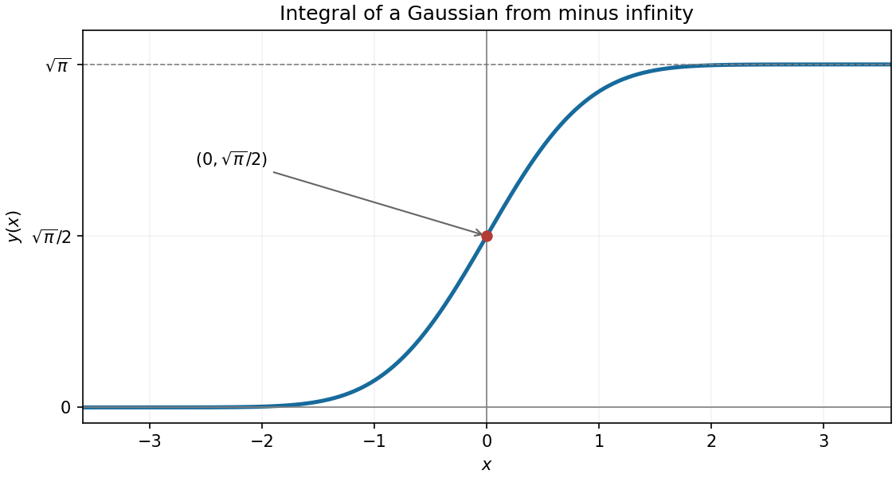
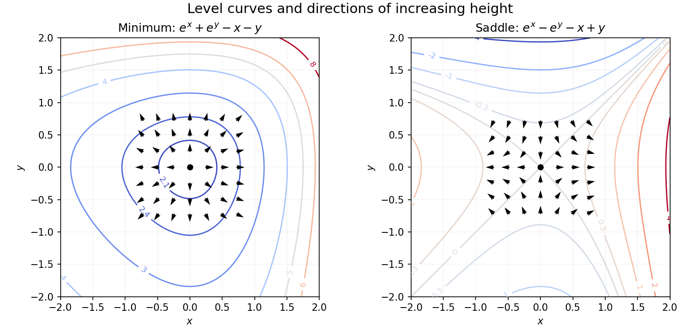

# Paper 2

↑ **Parent:** [2023](../2023.md)

[https://www.maths.cam.ac.uk/undergradnst/files/2023/papernst_ia_2_2023.pdf](https://www.maths.cam.ac.uk/undergradnst/files/2023/papernst_ia_2_2023.pdf)

**Table of contents**

- [1](#1)
  - [a](#1/a)
    - [Solution](#1/a/solution)
  - [b](#1/b)
    - [Solution](#1/b/solution)
- [2](#2)
  - [a](#2/a)
    - [Solution](#2/a/solution)
  - [b](#2/b)
    - [Solution](#2/b/solution)
- [3](#3)
  - [a](#3/a)
    - [Solution](#3/a/solution)
  - [b](#3/b)
    - [Solution](#3/b/solution)
- [4](#4)
  - [Solution](#4/solution)
- [5](#5)
  - [Solution](#5/solution)
- [6](#6)
  - [a](#6/a)
    - [Solution](#6/a/solution)
  - [b](#6/b)
    - [Solution](#6/b/solution)
- [7](#7)
  - [a](#7/a)
    - [Solution](#7/a/solution)
  - [b](#7/b)
    - [Solution](#7/b/solution)
- [8](#8)
  - [a](#8/a)
    - [Solution](#8/a/solution)
  - [b](#8/b)
    - [Solution](#8/b/solution)
- [9](#9)
  - [a](#9/a)
    - [Solution](#9/a/solution)
  - [b](#9/b)
    - [Solution](#9/b/solution)
- [10](#10)
  - [a](#10/a)
    - [Solution](#10/a/solution)
  - [b](#10/b)
    - [Solution](#10/b/solution)
- [11](#11)
  - [a](#11/a)
    - [Solution](#11/a/solution)
  - [b](#11/b)
    - [Solution](#11/b/solution)
  - [c](#11/c)
    - [i](#11/c/i)
      - [Solution](#11/c/i/solution)
    - [ii](#11/c/ii)
      - [Solution](#11/c/ii/solution)
- [12](#12)
  - [a](#12/a)
    - [Solution](#12/a/solution)
  - [b](#12/b)
    - [Solution](#12/b/solution)
  - [c](#12/c)
    - [i](#12/c/i)
      - [Solution](#12/c/i/solution)
    - [ii](#12/c/ii)
      - [Solution](#12/c/ii/solution)
  - [d](#12/d)
    - [Solution](#12/d/solution)
- [13](#13)
  - [a](#13/a)
    - [i](#13/a/i)
      - [Solution](#13/a/i/solution)
    - [ii](#13/a/ii)
      - [Solution](#13/a/ii/solution)
  - [b](#13/b)
    - [Solution](#13/b/solution)
- [14](#14)
  - [a](#14/a)
    - [i](#14/a/i)
      - [Solution](#14/a/i/solution)
    - [ii](#14/a/ii)
      - [Solution](#14/a/ii/solution)
    - [iii](#14/a/iii)
      - [Solution](#14/a/iii/solution)
    - [iv](#14/a/iv)
      - [Solution](#14/a/iv/solution)
    - [v](#14/a/v)
      - [Solution](#14/a/v/solution)
    - [vi](#14/a/vi)
      - [Solution](#14/a/vi/solution)
  - [b](#14/b)
    - [i](#14/b/i)
      - [Solution](#14/b/i/solution)
    - [ii](#14/b/ii)
      - [Solution](#14/b/ii/solution)
    - [iii](#14/b/iii)
      - [Solution](#14/b/iii/solution)
    - [iv](#14/b/iv)
      - [Solution](#14/b/iv/solution)
    - [v](#14/b/v)
      - [Solution](#14/b/v/solution)
- [15](#15)
  - [a](#15/a)
    - [Solution](#15/a/solution)
  - [b](#15/b)
    - [i](#15/b/i)
      - [Solution](#15/b/i/solution)
    - [ii](#15/b/ii)
      - [Solution](#15/b/ii/solution)
- [16](#16)
  - [a](#16/a)
    - [Solution](#16/a/solution)
  - [b](#16/b)
    - [i](#16/b/i)
      - [Solution](#16/b/i/solution)
    - [ii](#16/b/ii)
      - [Solution](#16/b/ii/solution)
  - [c](#16/c)
    - [i](#16/c/i)
      - [Solution](#16/c/i/solution)
    - [ii](#16/c/ii)
      - [Solution](#16/c/ii/solution)
- [17](#17)
  - [a](#17/a)
    - [Solution](#17/a/solution)
  - [b](#17/b)
    - [Solution](#17/b/solution)
  - [c](#17/c)
    - [i](#17/c/i)
      - [Solution](#17/c/i/solution)
    - [ii](#17/c/ii)
      - [Solution](#17/c/ii/solution)
    - [iii](#17/c/iii)
      - [Solution](#17/c/iii/solution)
    - [iv](#17/c/iv)
      - [Solution](#17/c/iv/solution)
- [18](#18)
  - [a](#18/a)
    - [Solution](#18/a/solution)
  - [b](#18/b)
    - [Solution](#18/b/solution)
- [19](#19)
  - [a](#19/a)
    - [Solution](#19/a/solution)
  - [b](#19/b)
    - [i](#19/b/i)
      - [Solution](#19/b/i/solution)
    - [ii](#19/b/ii)
      - [Solution](#19/b/ii/solution)
    - [iii](#19/b/iii)
      - [Solution](#19/b/iii/solution)
- [20](#20)
  - [a](#20/a)
    - [Solution](#20/a/solution)
  - [b](#20/b)
    - [Solution](#20/b/solution)
  - [c](#20/c)
    - [Solution](#20/c/solution)

## 1

↑ **Parent:** [Paper 2](paper-2.md)

<h3 id="1/a">a</h3>

↑ **Parent:** [1](#1)

<h4 id="1/a/solution">Solution</h4>

↑ **Parent:** [A](#1/a)

Since $A$ is a [subset](../../set.md#subset) of the [sample space](../../probability-space.md#sample-space) $\Omega$, taking its [intersection](../../set.md#set-intersection) with $\Omega$ leaves it unchanged:

$$
\boxed{X=A}.
$$

<h3 id="1/b">b</h3>

↑ **Parent:** [1](#1)

<h4 id="1/b/solution">Solution</h4>

↑ **Parent:** [B](#1/b)

The original PDF places [complement](../../set.md#complement-of-a-set) bars on the second $A$ in each parenthesis and on the final $A$. Thus the first parenthesis is the [empty set](../../set.md#empty-set), whereas the second is the whole [sample space](../../probability-space.md#sample-space). Their [union](../../set.md#set-union) with any further [subset](../../set.md#subset) is still the whole space:

$$
\boxed{Y=\Omega}.
$$

The bars are missing from the local OCR, so using its unbarred expression would give the wrong result.

## 2

↑ **Parent:** [Paper 2](paper-2.md)

<h3 id="2/a">a</h3>

↑ **Parent:** [2](#2)

<h4 id="2/a/solution">Solution</h4>

↑ **Parent:** [A](#2/a)

In the [cylindrical coordinate system](../../multivariable-calculus.md#cylindrical-coordinate-system), $r=\sqrt{x^2+y^2}=5$ and $z=-1$. The point is in the third quadrant, so a representative azimuth in $[0,2\pi)$ is $\pi+\arctan(4/3)$. Therefore

$$
\boxed{(r,\theta,z)=\left(5,\ \pi+\arctan\frac43,\ -1\right)}.
$$

The angle is defined modulo $2\pi$.

<h3 id="2/b">b</h3>

↑ **Parent:** [2](#2)

<h4 id="2/b/solution">Solution</h4>

↑ **Parent:** [B](#2/b)

For [spherical coordinates](../../multivariable-calculus.md#spherical-coordinate-system), the distance from the origin is $\sqrt{26}$ and the polar angle satisfies $\cos\theta=z/r=-1/\sqrt{26}$. The azimuth is the same as in part (a). Thus

$$
\boxed{(r,\theta,\phi)=\left(\sqrt{26},\ \arccos\left(-\frac1{\sqrt{26}}\right),\ \pi+\arctan\frac43\right)}.
$$

The polar angle is in $(\pi/2,\pi)$ because the point lies below the $xy$-[plane](../../geometry-and-topology.md#plane).

## 3

↑ **Parent:** [Paper 2](paper-2.md)

<h3 id="3/a">a</h3>

↑ **Parent:** [3](#3)

<h4 id="3/a/solution">Solution</h4>

↑ **Parent:** [A](#3/a)

The [vector triple product identity](../../multivariable-calculus.md#vector-triple-product) is

$$
\mathbf a\times(\mathbf b\times\mathbf c)
=\mathbf b(\mathbf a\cdot\mathbf c)-\mathbf c(\mathbf a\cdot\mathbf b).
$$

Consequently a choice of the requested [coefficients](../../vector-space.md#coefficient) is

$$
\boxed{\alpha=0,\qquad\beta=\mathbf a\cdot\mathbf c,\qquad\gamma=-\mathbf a\cdot\mathbf b}.
$$

These are the standard identity's [coefficients](../../vector-space.md#coefficient), even if the particular three [vectors](../../vector-space.md#vector) are [linearly dependent](../../vector-space.md#linear-dependence) and a representation need not be unique.

<h3 id="3/b">b</h3>

↑ **Parent:** [3](#3)

<h4 id="3/b/solution">Solution</h4>

↑ **Parent:** [B](#3/b)

The [cross product](../../vector-space.md#cross-product) has magnitude $|\mathbf a||\mathbf b|\sin\theta$, where $\theta$ is their angle. Therefore

**It is the area of the parallelogram spanned by the two vectors.**

The [area](../../differential-geometry.md#surface-area) is zero if the [vectors](../../vector-space.md#vector) are parallel or either is zero. The corresponding [triangle](../../euclidean-geometry.md#triangle) has half this [area](../../differential-geometry.md#surface-area).

## 4

↑ **Parent:** [Paper 2](paper-2.md)

<h3 id="4/solution">Solution</h3>

↑ **Parent:** [4](#4)

The traversal fixes the [orientation](../../algebraic-topology.md#orientation-of-a-simplex) of the [vector area](../../differential-geometry.md#vector-area) as half the [cross product](../../vector-space.md#cross-product) of the edges $AB$ and $AC$:

$$
\mathbf S_{ABCA}=\frac12(1,1,0)^T\times(1,1,1)^T
=\boxed{\frac12(1,-1,0)^T}.
$$

Its [Euclidean norm](../../normed-vector-space.md#euclidean-norm) $1/\sqrt2$ is the [area](../../differential-geometry.md#surface-area) of the [triangle](../../euclidean-geometry.md#triangle), and its direction follows the [right-hand rule](../../electromagnetism.md#right-hand-rule).

## 5

↑ **Parent:** [Paper 2](paper-2.md)

<h3 id="5/solution">Solution</h3>

↑ **Parent:** [5](#5)

The [fundamental theorem of calculus](../../calculus.md#fundamental-theorem-of-calculus) gives $y'(x)=e^{-x^2}>0$, so the graph is strictly increasing. Its second [derivative](../../calculus.md#derivative) is $y''(x)=-2xe^{-x^2}$: it curves upward for $x<0$ and downward for $x>0$, with an [inflection point](../../topology.md#inflection-point) at zero.

By the [Gaussian integral](../../integral.md#gaussian-integral) and the evenness of its [integrand](../../integral.md#integrand),

$$
\boxed{y(0)=\frac{\sqrt\pi}{2}},\qquad
\lim_{x\to-\infty}y(x)=0,\qquad
\lim_{x\to+\infty}y(x)=\sqrt\pi.
$$

Thus the only axis intersection is $(0,\sqrt\pi/2)$; there is no finite $x$-axis intersection because the [integral](../../integral.md) is strictly positive for every finite $x$. The [error function](../../integral.md#error-function) gives $y(x)=\tfrac{\sqrt\pi}{2}(1+\operatorname{erf}x)$.

**[Figure 1](#5/image-the-increasing-integral-of-a-gaussian). The increasing integral of a Gaussian**. The graph has its only axis intersection and its [inflection point](../../topology.md#inflection-point) at $(0,\sqrt\pi/2)$. The horizontal lines at zero and $\sqrt\pi$ are asymptotes.

## 6

↑ **Parent:** [Paper 2](paper-2.md)

<h3 id="6/a">a</h3>

↑ **Parent:** [6](#6)

<h4 id="6/a/solution">Solution</h4>

↑ **Parent:** [A](#6/a)

Setting the [tangent line](../../calculus.md#tangent-line) approximation equal to zero gives the [Newton root-finding iteration](../../numerical-analysis.md#newton-root-finding-iteration)

$$
\boxed{x_1=x_0-\frac{f(x_0)}{f'(x_0)}}.
$$

The step requires a nonzero [derivative](../../calculus.md#derivative) at the starting point.

<h3 id="6/b">b</h3>

↑ **Parent:** [6](#6)

<h4 id="6/b/solution">Solution</h4>

↑ **Parent:** [B](#6/b)

Here $f(1)=-1$ and $f'(x)=1+1/x$, so $f'(1)=2$. The [Newton root-finding iteration](../../numerical-analysis.md#newton-root-finding-iteration) gives

$$
\boxed{x_1=1-\frac{-1}{2}=\frac32}.
$$

## 7

↑ **Parent:** [Paper 2](paper-2.md)

<h3 id="7/a">a</h3>

↑ **Parent:** [7](#7)

<h4 id="7/a/solution">Solution</h4>

↑ **Parent:** [A](#7/a)

The [gradient](../../multivariable-calculus.md#gradient) is $(x-1,y-1,z-1)^T$. At the origin this gives

$$
\boxed{\nabla\Phi(0,0,0)=(-1,-1,-1)^T}.
$$

<h3 id="7/b">b</h3>

↑ **Parent:** [7](#7)

<h4 id="7/b/solution">Solution</h4>

↑ **Parent:** [B](#7/b)

Normalize the direction to the [unit vector](../../vector-space.md#unit-vector) $\hat{\mathbf u}=(1,1,0)^T/\sqrt2$. The [directional derivative](../../multivariable-calculus.md#directional-derivative) is the [dot product](../../inner-product.md#dot-product) of this [unit vector](../../vector-space.md#unit-vector) with the [gradient](../../multivariable-calculus.md#gradient):

$$
\boxed{D_{\hat{\mathbf u}}\Phi(0)=(-1,-1,-1)\cdot\frac{(1,1,0)}{\sqrt2}=-\sqrt2}.
$$

## 8

↑ **Parent:** [Paper 2](paper-2.md)

<h3 id="8/a">a</h3>

↑ **Parent:** [8](#8)

<h4 id="8/a/solution">Solution</h4>

↑ **Parent:** [A](#8/a)

Reflection in the $y$-axis preserves the [disk](../../topology.md#disk-mathematics) but changes the sign of the [integrand](../../integral.md#integrand) $xy$. The [double integral](../../integral.md#double-integral) is therefore its own negative and must be

$$
\boxed{0}.
$$

Equivalently, for each fixed $y$ the [integrand](../../integral.md#integrand) is an [odd function](../../calculus.md#odd-function) of $x$ on a symmetric interval.

<h3 id="8/b">b</h3>

↑ **Parent:** [8](#8)

<h4 id="8/b/solution">Solution</h4>

↑ **Parent:** [B](#8/b)

The [curl of a gradient](../../multivariable-calculus.md#curl-of-a-gradient) is zero pointwise, so its [surface integral](../../multivariable-calculus.md#surface-integral) over this [sphere](../../euclidean-geometry.md#sphere) is

$$
\boxed{0}.
$$

For this particular [polynomial](../../polynomial.md), $\nabla\Phi=2(x,y,z)^T$, whose [curl](../../multivariable-calculus.md#curl) vanishes directly as well.

## 9

↑ **Parent:** [Paper 2](paper-2.md)

<h3 id="9/a">a</h3>

↑ **Parent:** [9](#9)

<h4 id="9/a/solution">Solution</h4>

↑ **Parent:** [A](#9/a)

Contracting the [Kronecker delta](../../multilinear-algebra.md#kronecker-delta) identifies $i=k$. The remaining two independent sums are [dot products](../../inner-product.md#dot-product), so the [Einstein summation convention](../../multilinear-algebra.md#einstein-notation) gives

$$
a_i\delta_{ik}b_ma_mc_k
=\left(\sum_k a_kc_k\right)\left(\sum_m b_ma_m\right)
=\boxed{(\mathbf a\cdot\mathbf c)(\mathbf a\cdot\mathbf b)}.
$$

The index expression here is verified against the PDF because the OCR corrupts it completely.

<h3 id="9/b">b</h3>

↑ **Parent:** [9](#9)

<h4 id="9/b/solution">Solution</h4>

↑ **Parent:** [B](#9/b)

In three dimensions each contracted [Kronecker delta](../../multilinear-algebra.md#kronecker-delta) has value three, while $b_kb_k=|\mathbf b|^2$. Thus

$$
\boxed{\delta_{jj}b_kb_k+\delta_{ii}=3|\mathbf b|^2+3}.
$$

## 10

↑ **Parent:** [Paper 2](paper-2.md)

<h3 id="10/a">a</h3>

↑ **Parent:** [10](#10)

<h4 id="10/a/solution">Solution</h4>

↑ **Parent:** [A](#10/a)

All three [linear equations](../../linear-algebra.md#linear-equation) are multiples of the first, leaving the single constraint $x+y+z=0$. Choose two [real numbers](../../arithmetic.md#real-number) $s,t$ freely:

$$
\boxed{(x,y,z)=(s,t,-s-t),\qquad s,t\in\mathbb R}.
$$

A [basis](../../vector-space.md#basis) for this two-dimensional [linear subspace](../../vector-space.md#vector-subspace) is $(1,0,-1)^T,(0,1,-1)^T$.

<h3 id="10/b">b</h3>

↑ **Parent:** [10](#10)

<h4 id="10/b/solution">Solution</h4>

↑ **Parent:** [B](#10/b)

The solution set is the [plane](../../geometry-and-topology.md#plane) through the origin with [normal vector](../../differential-geometry.md#normal-vector) $(1,1,1)^T$. The three original [planes](../../geometry-and-topology.md#plane) coincide, so their common intersection is this entire [plane](../../geometry-and-topology.md#plane).

## 11

↑ **Parent:** [Paper 2](paper-2.md)

<h3 id="11/a">a</h3>

↑ **Parent:** [11](#11)

<h4 id="11/a/solution">Solution</h4>

↑ **Parent:** [A](#11/a)

For the specified [standard basis](../../vector-space.md#standard-basis) vectors, $\mathbf a\times\mathbf b=\hat{\mathbf k}$, so

$$
(\mathbf a\times\mathbf b)\times\mathbf c=\hat{\mathbf k}\times\hat{\mathbf k}=0.
$$

On the other hand, $\mathbf b\times\mathbf c=\hat{\mathbf i}-\hat{\mathbf j}$ and hence

$$
\mathbf a\times(\mathbf b\times\mathbf c)
=\hat{\mathbf i}\times(\hat{\mathbf i}-\hat{\mathbf j})=-\hat{\mathbf k}.
$$

These results are unequal, proving that the [cross product](../../vector-space.md#cross-product) does not satisfy the [associative property](../../algebraic-operation.md#associative-property).

<h3 id="11/b">b</h3>

↑ **Parent:** [11](#11)

<h4 id="11/b/solution">Solution</h4>

↑ **Parent:** [B](#11/b)

If the three [vectors](../../vector-space.md#vector) lie in one [plane](../../geometry-and-topology.md#plane) through the origin and $\mathbf u,\mathbf v$ are independent, their [cross product](../../vector-space.md#cross-product) is a [normal vector](../../differential-geometry.md#normal-vector) to that [plane](../../geometry-and-topology.md#plane), so its [dot product](../../inner-product.md#dot-product) with $\mathbf w$ is zero. If $\mathbf u,\mathbf v$ are dependent, their [cross product](../../vector-space.md#cross-product) is already zero. Thus coplanarity always forces the [scalar triple product](../../multilinear-algebra.md#scalar-triple-product) to vanish.

Taking the [contrapositive](../../mathematical-logic.md#contrapositive) proves that a nonzero [scalar triple product](../../multilinear-algebra.md#scalar-triple-product) rules out coplanarity. Geometrically its [absolute value](../../real-analysis.md#absolute-value) is the nonzero [volume](../../geometry-and-topology.md#volume) of the spanned [parallelepiped](../../euclidean-geometry.md#parallelepiped).

<h3 id="11/c">c</h3>

↑ **Parent:** [11](#11)

<h4 id="11/c/i">i</h4>

↑ **Parent:** [C](#11/c)

<h5 id="11/c/i/solution">Solution</h5>

↑ **Parent:** [I](#11/c/i)

Use displacements from $P_1$, since coplanarity of points concerns an affine [plane](../../geometry-and-topology.md#plane) that need not contain the origin. The three displacement [vectors](../../vector-space.md#vector) are

$$
\mathbf u=(0,1,1)^T,\quad\mathbf v=(1,2,1)^T,\quad\mathbf w=(2,3,2)^T.
$$

Their [cross product](../../vector-space.md#cross-product) is $\mathbf u\times\mathbf v=(-1,1,-1)^T$ and its [dot product](../../inner-product.md#dot-product) with $\mathbf w$ is $-1$. Since the [scalar triple product](../../multilinear-algebra.md#scalar-triple-product) is nonzero,

**The four points do not lie in a common plane.**

<h4 id="11/c/ii">ii</h4>

↑ **Parent:** [C](#11/c)

<h5 id="11/c/ii/solution">Solution</h5>

↑ **Parent:** [Ii](#11/c/ii)

The three displacements from $Q_1$ are

$$
\mathbf u=(1,1,1)^T,\quad\mathbf v=(-1,2,1)^T,\quad\mathbf w=(0,3,2)^T.
$$

Here $\mathbf u\times\mathbf v=(-1,-2,3)^T$ and its [dot product](../../inner-product.md#dot-product) with $\mathbf w$ is zero. Because the [cross product](../../vector-space.md#cross-product) itself is nonzero, the first three points determine a [plane](../../geometry-and-topology.md#plane) and the fourth lies on it. Explicitly all four satisfy

$$
\boxed{-x-2y+3z=3}.
$$

Thus **the four points are coplanar**.

## 12

↑ **Parent:** [Paper 2](paper-2.md)

<h3 id="12/a">a</h3>

↑ **Parent:** [12](#12)

<h4 id="12/a/solution">Solution</h4>

↑ **Parent:** [A](#12/a)

The [stationary point](../../calculus-of-variations.md#stationary-point) equations are $ae^x=c$ and $be^y=d$. The sign assumptions make both ratios positive, so each equation has exactly one real solution. Therefore

$$
\boxed{(x_*,y_*)=\left(\log\frac ca,\ \log\frac db\right)}.
$$

Substitution gives the stationary value

$$
\boxed{h_*=c+d-c\log\frac ca-d\log\frac db}.
$$

<h3 id="12/b">b</h3>

↑ **Parent:** [12](#12)

<h4 id="12/b/solution">Solution</h4>

↑ **Parent:** [B](#12/b)

The [Hessian matrix](../../multivariable-calculus.md#hessian-matrix) is diagonal:

$$
H(x,y)=\begin{pmatrix}ae^x&0\\0&be^y\end{pmatrix},\qquad
H(x_*,y_*)=\begin{pmatrix}c&0\\0&d\end{pmatrix}.
$$

Its [eigenvalues](../../linear-operator-theory.md#eigenvalue) are $c$ and $d$. Hence the [second-derivative test](../../multivariable-calculus.md#second-derivative-test) gives a strict [local minimum](../../analysis.md#local-minimum) if $c,d>0$, a strict [local maximum](../../analysis.md#local-maximum) if $c,d<0$, and a [saddle point of a scalar function](../../analysis.md#saddle-point-of-a-scalar-function) if $cd<0$. No degenerate case occurs because both are nonzero.

The [local minimum](../../analysis.md#local-minimum) is the unique [global minimum](../../analysis.md#global-minimum), since both separated summands are [strictly convex functions](../../real-analysis.md#strictly-convex-function) and tend to $+\infty$ at either end of the real line. Similarly, when both signs are negative there is a unique [global maximum](../../function.md#global-maximum).

<h3 id="12/c">c</h3>

↑ **Parent:** [12](#12)

<h4 id="12/c/i">i</h4>

↑ **Parent:** [C](#12/c)

<h5 id="12/c/i/solution">Solution</h5>

↑ **Parent:** [I](#12/c/i)

Here the [stationary point](../../calculus-of-variations.md#stationary-point) is the origin, of value two. The [Taylor expansion](../../calculus.md#taylor-expansion) is

$$
h=2+\frac{x^2+y^2}{2}+\frac{x^3+y^3}{6}+O((|x|+|y|)^4).
$$

Thus nearby [level curves](../../topology.md#level-curve) are approximately concentric circles. Globally the [level curves](../../topology.md#level-curve) above two are closed around the unique [minimum](../../set.md#minimum-of-a-subset-of-a-total-order), symmetric under interchanging $x$ and $y$, but not under changing either coordinate's sign. The faster exponential growth for positive coordinates compresses the curves on their positive sides.

**[Figure 2](#12/c/i/image-exponential-level-curves-and-gradient-directions-for-a-minimum-and-a-saddle). Exponential level curves and gradient directions for a minimum and a saddle**. Both panels show $|x|,|y|\leq2$. Left: $e^x+e^y-x-y$ has nested [level curves](../../topology.md#level-curve) around its minimum of value two. Right: $e^x-e^y-x+y$ has saddle-shaped [level curves](../../topology.md#level-curve) around value zero. Arrows show normalized [gradient](../../multivariable-calculus.md#gradient) directions near the origin.

<h4 id="12/c/ii">ii</h4>

↑ **Parent:** [C](#12/c)

<h5 id="12/c/ii/solution">Solution</h5>

↑ **Parent:** [Ii](#12/c/ii)

Now $h=e^x-e^y-x+y$ and the origin has stationary value zero. Near it,

$$
h=\frac{x^2-y^2}{2}+\frac{x^3-y^3}{6}+O((|x|+|y|)^4).
$$

The [level curves](../../topology.md#level-curve) therefore resemble hyperbolas near the [saddle point of a scalar function](../../analysis.md#saddle-point-of-a-scalar-function). Along the $x$-axis $h=e^x-x-1>0$ for $x\ne0$, while along the $y$-axis $h=1-e^y+y<0$ for $y\ne0$. The zero [level set](../../topology.md#level-set) includes the exact diagonal $x=y$ and another branch crossing it at the origin; this second branch is tangent to $y=-x$ but is curved away from the origin. The right panel of the contour figure displays these features.

<h3 id="12/d">d</h3>

↑ **Parent:** [12](#12)

<h4 id="12/d/solution">Solution</h4>

↑ **Parent:** [D](#12/d)

For case (i),

$$
\boxed{\nabla h=(e^x-1,e^y-1)^T}.
$$

Each component has the sign of its coordinate, so the [gradient](../../multivariable-calculus.md#gradient) points outward from the [minimum](../../set.md#minimum-of-a-subset-of-a-total-order). Near the origin it is $(x,y)^T+O(x^2+y^2)$.

For case (ii),

$$
\boxed{\nabla h=(e^x-1,1-e^y)^T}.
$$

Its $x$ component has the sign of $x$, while its $y$ component has the opposite sign to $y$. Thus arrows point outward on the $x$-axis and inward on the $y$-axis, with local form $(x,-y)^T+O(x^2+y^2)$. These directions are included in the contour figure; in both cases the [gradient](../../multivariable-calculus.md#gradient) is perpendicular to the [level curves](../../topology.md#level-curve) and points toward increasing $h$.

## 13

↑ **Parent:** [Paper 2](paper-2.md)

<h3 id="13/a">a</h3>

↑ **Parent:** [13](#13)

<h4 id="13/a/i">i</h4>

↑ **Parent:** [A](#13/a)

<h5 id="13/a/i/solution">Solution</h5>

↑ **Parent:** [I](#13/a/i)

On the first segment, parameterize $\mathbf r_1(t)=(t,t,0)^T$, $0\leq t\leq1$. The [dot products](../../inner-product.md#dot-product) with $\mathbf r_1'=(1,1,0)^T$ are

$$
\mathbf F(\mathbf r_1)\cdot\mathbf r_1'=2t,\qquad
\mathbf G(\mathbf r_1)\cdot\mathbf r_1'=2t\cos(t^2).
$$

Their [line integrals](../../multivariable-calculus.md#line-integral) are one and $\sin1$, respectively.

On the second segment take $\mathbf r_2(t)=(1,1,t)^T$, with [tangent vector](../../tangent-vector.md) $(0,0,1)^T$. The corresponding [integrands](../../integral.md#integrand) are $a-2+2t$ and $c$, whose [integrals](../../integral.md) are $a-1$ and $c$. Adding the segments yields

$$
\boxed{\int_{C_1}\mathbf F\cdot d\mathbf r=a,\qquad
\int_{C_1}\mathbf G\cdot d\mathbf r=\sin1+c}.
$$

<h4 id="13/a/ii">ii</h4>

↑ **Parent:** [A](#13/a)

<h5 id="13/a/ii/solution">Solution</h5>

↑ **Parent:** [Ii](#13/a/ii)

On the curved path, $\mathbf r(t)=(t,t,t^2)^T$ and $\mathbf r'=(1,1,2t)^T$. Direct substitution gives

$$
\mathbf F(\mathbf r(t))\cdot\mathbf r'(t)=2t+(3a-6)t^2+4t^3,
$$

$$
\mathbf G(\mathbf r(t))\cdot\mathbf r'(t)=2t\cos(t^2)+3ct^2.
$$

Thus

$$
\boxed{\int_{C_2}\mathbf F\cdot d\mathbf r=1+(a-2)+1=a},
\qquad
\boxed{\int_{C_2}\mathbf G\cdot d\mathbf r=\sin1+c}.
$$

Both values agree with part (i), for every $a,b,c$. Agreement on these two selected paths alone does not establish a [conservative vector field](../../multivariable-calculus.md#conservative-vector-field).

<h3 id="13/b">b</h3>

↑ **Parent:** [13](#13)

<h4 id="13/b/solution">Solution</h4>

↑ **Parent:** [B](#13/b)

For $\mathbf F$, all three [curl](../../multivariable-calculus.md#curl) components vanish for every $a$. More constructively,

$$
\mathbf F=\nabla\phi_F,\qquad
\phi_F=2x^2+y^2+z^2-2xy-2xz+ayz.
$$

Hence **$\mathbf F$ is conservative for every real $a$**. Its endpoint [vector-field potential](../../multivariable-calculus.md#potential-of-a-conservative-vector-field) difference is $a$, checking both [line integrals](../../multivariable-calculus.md#line-integral).

For the other [vector field](../../multivariable-calculus.md#vector-field), direct [partial differentiation](../../multivariable-calculus.md#partial-derivative) gives

$$
\nabla\times\mathbf G=2b(1,1,1)^T.
$$

It therefore has a [vector-field potential](../../multivariable-calculus.md#potential-of-a-conservative-vector-field) exactly when $b=0$, with no restriction on $c$:

$$
\boxed{b=0,\quad c\text{ arbitrary},\qquad
\phi_G=\sin(xy)+cxz+C}.
$$

The value of $a$ is irrelevant to $\mathbf G$. Its rotational part for general $b$ is $b(1,1,1)^T\times\mathbf r$. Both selected paths lie in $x=y$, and this rotational part has zero [dot product](../../inner-product.md#dot-product) with every [tangent vector](../../tangent-vector.md) to that [plane](../../geometry-and-topology.md#plane). That explains why these paths cannot detect its nonzero [curl](../../multivariable-calculus.md#curl) when $b\ne0$.

## 14

↑ **Parent:** [Paper 2](paper-2.md)

<h3 id="14/a">a</h3>

↑ **Parent:** [14](#14)

<h4 id="14/a/i">i</h4>

↑ **Parent:** [A](#14/a)

<h5 id="14/a/i/solution">Solution</h5>

↑ **Parent:** [I](#14/a/i)

By the [multiplication principle](../../combinatorics.md#rule-of-product), the successive places have six, five, four, three, two and one available letters. Thus the number of [permutations](../../combinatorics.md#permutation) is

$$
\boxed{6!=720}.
$$

<h4 id="14/a/ii">ii</h4>

↑ **Parent:** [A](#14/a)

<h5 id="14/a/ii/solution">Solution</h5>

↑ **Parent:** [Ii](#14/a/ii)

Fixing the last letter leaves five distinct letters to permute freely. Therefore the number is

$$
\boxed{5!=120}.
$$

<h4 id="14/a/iii">iii</h4>

↑ **Parent:** [A](#14/a)

<h5 id="14/a/iii/solution">Solution</h5>

↑ **Parent:** [Iii](#14/a/iii)

The last letter has two permitted choices, and each leaves $5!$ [permutations](../../combinatorics.md#permutation). The two classes are disjoint, so the count is

$$
\boxed{2\cdot5!=240}.
$$

<h4 id="14/a/iv">iv</h4>

↑ **Parent:** [A](#14/a)

<h5 id="14/a/iv/solution">Solution</h5>

↑ **Parent:** [Iv](#14/a/iv)

Fixing both specified positions leaves four letters to permute. Hence

$$
\boxed{4!=24}.
$$

<h4 id="14/a/v">v</h4>

↑ **Parent:** [A](#14/a)

<h5 id="14/a/v/solution">Solution</h5>

↑ **Parent:** [V](#14/a/v)

Let $E_5$ denote the [set](../../set.md) of arrangements with $E$ fifth, and $F_6$ those with $F$ sixth. Each contains $5!$ arrangements, while their [intersection](../../set.md#set-intersection) contains $4!$. The [inclusion-exclusion principle](../../combinatorics.md#inclusion-exclusion-principle) gives

$$
\boxed{|E_5\cup F_6|=5!+5!-4!=216}.
$$

<h4 id="14/a/vi">vi</h4>

↑ **Parent:** [A](#14/a)

<h5 id="14/a/vi/solution">Solution</h5>

↑ **Parent:** [Vi](#14/a/vi)

Requiring exactly one condition means taking the [symmetric difference](../../set.md#symmetric-difference) of the two [sets](../../set.md). Subtract their shared cases twice from the two individual counts:

$$
\boxed{|E_5\mathbin{\triangle}F_6|=5!+5!-2\cdot4!=192}.
$$

Equivalently, remove the twenty-four arrangements satisfying both conditions from the inclusive count $216$.

<h3 id="14/b">b</h3>

↑ **Parent:** [14](#14)

<h4 id="14/b/i">i</h4>

↑ **Parent:** [B](#14/b)

<h5 id="14/b/i/solution">Solution</h5>

↑ **Parent:** [I](#14/b/i)

The second bin is forced to contain $A,B$, leaving the other four letters in the first bin. Since order within a bin is irrelevant, this gives exactly

$$
\boxed{1}
$$

[set partition](../../combinatorics.md#set-partition) of the specified bin sizes.

<h4 id="14/b/ii">ii</h4>

↑ **Parent:** [B](#14/b)

<h5 id="14/b/ii/solution">Solution</h5>

↑ **Parent:** [Ii](#14/b/ii)

The first four letters may be permuted in $4!$ ways and the last two in $2!$ ways without changing this partition. The [multiplication principle](../../combinatorics.md#rule-of-product) therefore gives

$$
\boxed{4!\,2!=48}.
$$

<h4 id="14/b/iii">iii</h4>

↑ **Parent:** [B](#14/b)

<h5 id="14/b/iii/solution">Solution</h5>

↑ **Parent:** [Iii](#14/b/iii)

Choose the unordered pair of letters in the second bin; the first bin is then determined. The [binomial coefficient](../../binomial-coefficient.md) gives

$$
\boxed{\binom62=\frac{6!}{4!\,2!}=15}.
$$

The first and second bins are distinguished, so their roles are not interchangeable.

<h4 id="14/b/iv">iv</h4>

↑ **Parent:** [B](#14/b)

<h5 id="14/b/iv/solution">Solution</h5>

↑ **Parent:** [Iv](#14/b/iv)

The product is

$$
\boxed{48\cdot15=720=6!}.
$$

Every [permutation](../../combinatorics.md#permutation) determines exactly one bin partition, and each such partition has exactly forty-eight internal orderings. Thus the fifteen classes partition the original [sample space](../../probability-space.md#sample-space) of $720$ arrangements, without overlap or omission.

<h4 id="14/b/v">v</h4>

↑ **Parent:** [B](#14/b)

<h5 id="14/b/v/solution">Solution</h5>

↑ **Parent:** [V](#14/b/v)

For first-bin size $k$, choose its contents in $\binom6k$ ways. Each choice arises from $k!(6-k)!$ [permutations](../../combinatorics.md#permutation), obtained by ordering the two bins internally. The seven ordered size choices give

$$
\begin{array}{c|r|r|r}
\text{bin sizes}&\text{partitions}&\text{orderings per partition}&\text{product}\\\hline
\{0,6\}&1&720&720\\
\{1,5\}&6&120&720\\
\{2,4\}&15&48&720\\
\{3,3\}&20&36&720\\
\{4,2\}&15&48&720\\
\{5,1\}&6&120&720\\
\{6,0\}&1&720&720
\end{array}
$$

Here $0!=1$. Each row expresses the same [binomial coefficient](../../binomial-coefficient.md) identity $\binom6k k!(6-k)!=6!$. Even for $\{3,3\}$ the bins retain their first/second labels, so the number is twenty rather than ten; the braces denote bin sizes in the question's convention, not interchangeable bins.

## 15

↑ **Parent:** [Paper 2](paper-2.md)

<h3 id="15/a">a</h3>

↑ **Parent:** [15](#15)

<h4 id="15/a/solution">Solution</h4>

↑ **Parent:** [A](#15/a)

The [homogeneous solution](../../linear-ordinary-differential-equation.md#homogeneous-solution) is $A\cos x+B\sin x$. If $k\ne1$, the [method of undetermined coefficients](../../linear-ordinary-differential-equation.md#method-of-undetermined-coefficients) permits a [particular integral](../../linear-ordinary-differential-equation.md#particular-solution) $C\cos kx$. Substitution gives $(1-k^2)C=1$ and hence

$$
\boxed{y(x)=A\cos x+B\sin x+\frac{\cos kx}{1-k^2},\qquad k=2,3,\ldots}.
$$

For $k=1$, the forcing is itself a [homogeneous solution](../../linear-ordinary-differential-equation.md#homogeneous-solution), so this trial fails by [resonance in a differential equation](../../linear-ordinary-differential-equation.md#resonance-in-a-differential-equation). Multiplying the sine trial by $x$ gives

$$
\left(\frac{d^2}{dx^2}+1\right)(x\sin x)=2\cos x.
$$

Thus the resonant [general solution](../../linear-ordinary-differential-equation.md#general-solution) is

$$
\boxed{y(x)=A\cos x+B\sin x+\frac{x}{2}\sin x,\qquad k=1}.
$$

The [secular term](../../singular-perturbation.md#secular-term) containing $x$ describes the increasing amplitude under undamped resonant forcing.

<h3 id="15/b">b</h3>

↑ **Parent:** [15](#15)

<h4 id="15/b/i">i</h4>

↑ **Parent:** [B](#15/b)

<h5 id="15/b/i/solution">Solution</h5>

↑ **Parent:** [I](#15/b/i)

Differentiate the first [ordinary differential equation](../../differential-equation.md#ordinary-differential-equation) and substitute the second:

$$
u''=au'+bv'=au'+bcu+bdv.
$$

The original first equation also gives $bv=u'-au$, so

$$
u''=(a+d)u'+(bc-ad)u.
$$

Therefore the requested [coefficients](../../vector-space.md#coefficient) are

$$
\boxed{\alpha=a+d,\qquad\beta=ad-bc}.
$$

They are the [trace](../../linear-algebra.md#matrix-trace) and [determinant](../../multilinear-algebra.md#determinant) of the coefficient [matrix](../../vector-space.md#matrix). This derivation never divides by $b$ and is valid even if $b=0$. In that degenerate case the scalar second-order equation is a necessary consequence, while the original constraint $u'=au$ must also be retained when reconstructing the coupled system.

<h4 id="15/b/ii">ii</h4>

↑ **Parent:** [B](#15/b)

<h5 id="15/b/ii/solution">Solution</h5>

↑ **Parent:** [Ii](#15/b/ii)

Here $\alpha=4$ and $\beta=4$, so the reduced [ordinary differential equation](../../differential-equation.md#ordinary-differential-equation) is $(D-2)^2u=0$. Its repeated [characteristic root](../../differential-equation.md#characteristic-root-of-a-constant-coefficient-differential-equation) gives $u=(A+Bt)e^{2t}$. The first [initial condition](../../differential-equation.md#initial-condition) sets $A=0$. The original equation $u'=3u-v$ gives $u'(0)=-1$, hence $B=-1$.

Recover $v=3u-u'$ to obtain

$$
\boxed{u(t)=-te^{2t},\qquad v(t)=(1-t)e^{2t}}.
$$

Direct differentiation verifies $v'=u+v$ and both [initial conditions](../../differential-equation.md#initial-condition).

## 16

↑ **Parent:** [Paper 2](paper-2.md)

<h3 id="16/a">a</h3>

↑ **Parent:** [16](#16)

<h4 id="16/a/solution">Solution</h4>

↑ **Parent:** [A](#16/a)

The cube is $1\leq x\leq2$, $0\leq y,z\leq1$, so $|x|=x$ throughout it. Evaluate the six outward [surface integrals](../../multivariable-calculus.md#surface-integral) directly.

On $x=2$ the normal component is $2$, giving [flux](../../mathematical-physics.md#flux) $2$; on $x=1$ it is $-1$, giving [flux](../../mathematical-physics.md#flux) $-1$. On $y=1$ the normal component is $2x$, giving $\int_1^2\int_0^12x\,dz\,dx=3$; on $y=0$ it is zero. On $z=1$ the normal component is $e^{-1}$ and on $z=0$ it is $-1$, so those unit-area faces give $e^{-1}$ and $-1$.

Adding all six contributions yields

$$
\boxed{\Phi=2-1+3+0+e^{-1}-1=3+e^{-1}}.
$$

Only direct [surface integral](../../multivariable-calculus.md#surface-integral) was used, as requested.

<h3 id="16/b">b</h3>

↑ **Parent:** [16](#16)

<h4 id="16/b/i">i</h4>

↑ **Parent:** [B](#16/b)

<h5 id="16/b/i/solution">Solution</h5>

↑ **Parent:** [I](#16/b/i)

Parameterize the surface by $\mathbf r(x,z)=(x,1+z,z)^T$. Its two [tangent vectors](../../tangent-vector.md) are $(1,0,0)^T$ and $(0,1,1)^T$, whose [cross product](../../vector-space.md#cross-product) is $(0,-1,1)^T$ of [Euclidean norm](../../normed-vector-space.md#euclidean-norm) $\sqrt2$. Thus the scalar [area element of a surface](../../differential-geometry.md#area-element-of-a-surface) is

$$
\boxed{dS=\sqrt2\,dx\,dz}.
$$

Equivalently, projection onto the $xz$-[plane](../../geometry-and-topology.md#plane) reduces the surface [area](../../differential-geometry.md#surface-area) by $|\mathbf n\cdot\mathbf e_y|=1/\sqrt2$.

<h4 id="16/b/ii">ii</h4>

↑ **Parent:** [B](#16/b)

<h5 id="16/b/ii/solution">Solution</h5>

↑ **Parent:** [Ii](#16/b/ii)

On the surface $y=1+z$, the [integrand](../../integral.md#integrand) is $x+z+z^2$. Using the [area element of a surface](../../differential-geometry.md#area-element-of-a-surface) from part (i),

$$
\begin{aligned}
\iint_S(x+yz)\,dS
&=\sqrt2\int_0^{2\pi}\int_0^1(x+z+z^2)\,dz\,dx\\
&=\sqrt2\int_0^{2\pi}\left(x+\frac56\right)dx\\
&=\boxed{\sqrt2\left(2\pi^2+\frac{5\pi}{3}\right)}.
\end{aligned}
$$

<h3 id="16/c">c</h3>

↑ **Parent:** [16](#16)

<h4 id="16/c/i">i</h4>

↑ **Parent:** [C](#16/c)

<h5 id="16/c/i/solution">Solution</h5>

↑ **Parent:** [I](#16/c/i)

On the unit [sphere](../../euclidean-geometry.md#sphere), the outward [unit normal](../../differential-geometry.md#unit-normal) is $\mathbf n=(x,y,z)^T$, so the normal component of the radial [vector field](../../multivariable-calculus.md#vector-field) is $\mathbf F\cdot\mathbf n=x^2+y^2+z^2=1$. The direct [surface integral](../../multivariable-calculus.md#surface-integral) is

$$
\Phi=\int_0^{2\pi}\int_0^\pi1\cdot\sin\theta\,d\theta\,d\phi
=\boxed{4\pi}.
$$

Here $dS=\sin\theta\,d\theta\,d\phi$ is the unit-sphere [area element of a surface](../../differential-geometry.md#area-element-of-a-surface) in [spherical coordinates](../../multivariable-calculus.md#spherical-coordinate-system).

<h4 id="16/c/ii">ii</h4>

↑ **Parent:** [C](#16/c)

<h5 id="16/c/ii/solution">Solution</h5>

↑ **Parent:** [Ii](#16/c/ii)

On the same [sphere](../../euclidean-geometry.md#sphere), the normal component is $(-y,x,0)\cdot(x,y,z)=-xy+xy=0$. This [vector field](../../multivariable-calculus.md#vector-field) is tangent to the [sphere](../../euclidean-geometry.md#sphere) everywhere. Therefore its outward [flux](../../mathematical-physics.md#flux) is

$$
\boxed{0}.
$$

## 17

↑ **Parent:** [Paper 2](paper-2.md)

<h3 id="17/a">a</h3>

↑ **Parent:** [17](#17)

<h4 id="17/a/solution">Solution</h4>

↑ **Parent:** [A](#17/a)

Suppose $B\mathbf x=0$. The given [quadratic form](../../quadratic-form.md) bound then gives

$$
0=\mathbf x^TB\mathbf x\geq|\mathbf x|^2,
$$

so $\mathbf x=0$. Thus the [kernel](../../kernel-of-a-linear-map.md) of $B$ is trivial. A square [matrix](../../vector-space.md#matrix) with trivial [kernel](../../kernel-of-a-linear-map.md) is an [invertible matrix](../../linear-algebra.md#invertible-matrix), proving the assertion. No symmetry assumption on $B$ is needed.

<h3 id="17/b">b</h3>

↑ **Parent:** [17](#17)

<h4 id="17/b/solution">Solution</h4>

↑ **Parent:** [B](#17/b)

The two prescribed directions have [dot product](../../inner-product.md#dot-product) zero. Normalize them to

$$
\mathbf q_1=\frac{(1,1,1)^T}{\sqrt3},\qquad
\mathbf q_2=\frac{(0,-1,1)^T}{\sqrt2}.
$$

Their [cross product](../../vector-space.md#cross-product) is the perpendicular [unit vector](../../vector-space.md#unit-vector) $\mathbf q_3=(2,-1,-1)^T/\sqrt6$. Using these as columns gives

$$
\boxed{Q=\begin{pmatrix}
1/\sqrt3&0&2/\sqrt6\\
1/\sqrt3&-1/\sqrt2&-1/\sqrt6\\
1/\sqrt3&1/\sqrt2&-1/\sqrt6
\end{pmatrix}}.
$$

The columns form an [orthonormal basis](../../inner-product.md#orthonormal-basis), so $Q^TQ=I$ and $Q$ is an [orthogonal matrix](../../linear-algebra.md#orthogonal-matrix).

<h3 id="17/c">c</h3>

↑ **Parent:** [17](#17)

<h4 id="17/c/i">i</h4>

↑ **Parent:** [C](#17/c)

<h5 id="17/c/i/solution">Solution</h5>

↑ **Parent:** [I](#17/c/i)

The [determinant](../../multilinear-algebra.md#determinant) of $P$ is $2\cdot1-1(-1)=3$. The two-by-two [inverse matrix](../../matrix-inverse.md) formula yields

$$
\boxed{P^{-1}=\frac13\begin{pmatrix}1&-1\\1&2\end{pmatrix}}.
$$

<h4 id="17/c/ii">ii</h4>

↑ **Parent:** [C](#17/c)

<h5 id="17/c/ii/solution">Solution</h5>

↑ **Parent:** [Ii](#17/c/ii)

Direct [matrix multiplication](../../vector-space.md#matrix-multiplication) gives

$$
AP=\begin{pmatrix}2&4\\-1&4\end{pmatrix},\qquad
P^{-1}AP=\frac13\begin{pmatrix}1&-1\\1&2\end{pmatrix}
\begin{pmatrix}2&4\\-1&4\end{pmatrix}
=\boxed{\begin{pmatrix}1&0\\0&4\end{pmatrix}}.
$$

Thus $D$ is diagonal. The columns of $P$ are [eigenvectors](../../linear-operator-theory.md#eigenvector) of $A$ with [eigenvalues](../../linear-operator-theory.md#eigenvalue) one and four.

<h4 id="17/c/iii">iii</h4>

↑ **Parent:** [C](#17/c)

<h5 id="17/c/iii/solution">Solution</h5>

↑ **Parent:** [Iii](#17/c/iii)

The [similarity transformation](../../linear-algebra.md#similarity-transformation) gives $A=PDP^{-1}$. In the [matrix power](../../vector-space.md#matrix-power), each adjacent pair $P^{-1}P$ cancels to the [identity matrix](../../vector-space.md#identity-matrix):

$$
A^n=(PDP^{-1})\cdots(PDP^{-1})
=\boxed{PD^nP^{-1}}.
$$

This also follows by [mathematical induction](../../foundations-of-mathematics.md#mathematical-induction): the formula holds for $n=1$, and multiplication by $A=PDP^{-1}$ turns its $n$th instance into the $(n+1)$st.

<h4 id="17/c/iv">iv</h4>

↑ **Parent:** [C](#17/c)

<h5 id="17/c/iv/solution">Solution</h5>

↑ **Parent:** [Iv](#17/c/iv)

Since $D^6=\operatorname{diag}(1,4^6)=\operatorname{diag}(1,4096)$,

$$
A^6=\frac13\begin{pmatrix}2&4096\\-1&4096\end{pmatrix}
\begin{pmatrix}1&-1\\1&2\end{pmatrix}
=\boxed{\begin{pmatrix}1366&2730\\1365&2731\end{pmatrix}}.
$$

## 18

↑ **Parent:** [Paper 2](paper-2.md)

<h3 id="18/a">a</h3>

↑ **Parent:** [18](#18)

<h4 id="18/a/solution">Solution</h4>

↑ **Parent:** [A](#18/a)

Write $I_n=\int\sin^nx\,dx$. Apply [integration by parts](../../calculus.md#integration-by-parts) with $\sin^{n-1}x$ and $\sin x\,dx$:

$$
I_n=-\cos x\sin^{n-1}x+(n-1)\int\sin^{n-2}x\cos^2x\,dx.
$$

Using $\cos^2x=1-\sin^2x$ on the right gives $I_n=-\cos x\sin^{n-1}x+(n-1)(I_{n-2}-I_n)$. Rearranging proves

$$
\boxed{I_n=-\frac{\cos x\sin^{n-1}x}{n}+\frac{n-1}{n}I_{n-2}+C}.
$$

For $J_n=\int\cos^nx\,dx$, the analogous [integration by parts](../../calculus.md#integration-by-parts) uses $\cos^{n-1}x$ and $\cos x\,dx$, giving $J_n=\sin x\cos^{n-1}x+(n-1)(J_{n-2}-J_n)$. Hence

$$
\boxed{J_n=\frac{\sin x\cos^{n-1}x}{n}+\frac{n-1}{n}J_{n-2}+C}.
$$

An arbitrary [constant of integration](../../integral.md#constant-of-integration) absorbs the choices in the lower-order [antiderivatives](../../integral.md#antiderivative).

Starting from $I_0=J_0=x$, successive use of $n=2,4,6$ gives

$$
\boxed{\int\sin^6x\,dx=
\frac{5x}{16}-\frac{\cos x\sin^5x}{6}
-\frac{5\cos x\sin^3x}{24}-\frac{5\sin x\cos x}{16}+C},
$$

$$
\boxed{\int\cos^6x\,dx=
\frac{5x}{16}+\frac{\sin x\cos^5x}{6}
+\frac{5\sin x\cos^3x}{24}+\frac{5\sin x\cos x}{16}+C}.
$$

These expressions follow directly from the requested recurrence, rather than requiring a separate trigonometric expansion.

<h3 id="18/b">b</h3>

↑ **Parent:** [18](#18)

<h4 id="18/b/solution">Solution</h4>

↑ **Parent:** [B](#18/b)

Evaluate the recurrence boundary terms at zero and $\pi/2$. For $n>1$, both $\cos x\sin^{n-1}x$ and $\sin x\cos^{n-1}x$ vanish at both endpoints. Therefore the [Wallis integrals](../../integral.md#wallis-integrals) obey

$$
\boxed{\int_0^{\pi/2}\sin^nx\,dx=\frac{n-1}{n}\int_0^{\pi/2}\sin^{n-2}x\,dx},
$$

$$
\boxed{\int_0^{\pi/2}\cos^nx\,dx=\frac{n-1}{n}\int_0^{\pi/2}\cos^{n-2}x\,dx}.
$$

The starting value for both is $\int_0^{\pi/2}1\,dx=\pi/2$. Thus

$$
\boxed{\int_0^{\pi/2}\sin^2x\,dx=\int_0^{\pi/2}\cos^2x\,dx=\frac\pi4},
$$

$$
\boxed{\int_0^{\pi/2}\sin^4x\,dx=\int_0^{\pi/2}\cos^4x\,dx=\frac{3\pi}{16}}.
$$

## 19

↑ **Parent:** [Paper 2](paper-2.md)

<h3 id="19/a">a</h3>

↑ **Parent:** [19](#19)

<h4 id="19/a/solution">Solution</h4>

↑ **Parent:** [A](#19/a)

Assume $\alpha<\beta$ and abbreviate

$$
A=\int_\alpha^\beta f^2\,dx,\qquad B=\int_\alpha^\beta fg\,dx,\qquad C=\int_\alpha^\beta g^2\,dx.
$$

The [integral](../../integral.md) of the nonnegative square expands to $A+2\lambda B+\lambda^2C\geq0$ for every real $\lambda$. If $C>0$, completing the square, or choosing $\lambda=-B/C$, gives $A-B^2/C\geq0$. Hence the [Cauchy-Schwarz inequality](../../probability-and-statistics.md#cauchy-schwarz-inequality) is

$$
\boxed{\left(\int_\alpha^\beta fg\,dx\right)^2
\leq\left(\int_\alpha^\beta f^2\,dx\right)
\left(\int_\alpha^\beta g^2\,dx\right)}.
$$

If $C=0$, [continuity](../../calculus.md#continuous-function) and nonnegativity imply $g=0$ throughout the interval, so the same inequality is immediate.

When $C>0$, equality holds exactly when $\int(f-(B/C)g)^2dx=0$. The [integrand](../../integral.md#integrand) is continuous and nonnegative, so it must vanish everywhere, giving $f=(B/C)g$. Including the case of a zero [function](../../function.md), equality is equivalent to [linear dependence](../../vector-space.md#linear-dependence) of $f$ and $g$ as elements of the real [vector space](../../vector-space.md) of continuous [functions](../../function.md) on the interval.

<h3 id="19/b">b</h3>

↑ **Parent:** [19](#19)

<h4 id="19/b/i">i</h4>

↑ **Parent:** [B](#19/b)

<h5 id="19/b/i/solution">Solution</h5>

↑ **Parent:** [I](#19/b/i)

The [volume form](../../differential-form.md#volume-form) in [cylindrical coordinates](../../multivariable-calculus.md#cylindrical-coordinate-system) is $dV=r\,dr\,d\phi\,dz$. Integrating around the axis and over the height gives cylindrical-shell [volume](../../geometry-and-topology.md#volume) $2\pi hr\,dr$. Hence the [volume integral](../../multivariable-calculus.md#volume-integral) is

$$
\boxed{K=\pi h\int_0^a r\,v(r)^2\,dr
=\pi h\int_0^a r^3\omega(r)^2\,dr}.
$$

For unit [density](../../fluid-mechanics.md#density), this is the [kinetic energy](../../energy.md#kinetic-energy) of the rotational motion.

<h4 id="19/b/ii">ii</h4>

↑ **Parent:** [B](#19/b)

<h5 id="19/b/ii/solution">Solution</h5>

↑ **Parent:** [Ii](#19/b/ii)

Using the same cylindrical-shell [volume](../../geometry-and-topology.md#volume),

$$
\boxed{L=2\pi h\int_0^a r^2v(r)\,dr
=2\pi h\int_0^a r^3\omega(r)\,dr}.
$$

For unit [density](../../fluid-mechanics.md#density), this is the axial [angular momentum](../../momentum.md#angular-momentum). To bound it, apply the integral [Cauchy-Schwarz inequality](../../probability-and-statistics.md#cauchy-schwarz-inequality) to $f(r)=\sqrt r\,v(r)$ and $g(r)=r^{3/2}$:

$$
\left(\int_0^ar^2v(r)\,dr\right)^2
\leq\left(\int_0^arv(r)^2\,dr\right)\left(\int_0^ar^3\,dr\right)
=\frac{K}{\pi h}\frac{a^4}{4}.
$$

Multiplication by $(2\pi h)^2$ gives $L^2\leq\pi ha^4K$. Since the chamber's [volume](../../geometry-and-topology.md#volume) is $V=\pi a^2h$, this is precisely

$$
\boxed{K\geq\frac{L^2}{Va^2}}.
$$

<h4 id="19/b/iii">iii</h4>

↑ **Parent:** [B](#19/b)

<h5 id="19/b/iii/solution">Solution</h5>

↑ **Parent:** [Iii](#19/b/iii)

Equality in the [Cauchy-Schwarz inequality](../../probability-and-statistics.md#cauchy-schwarz-inequality) requires $\sqrt r\,v(r)=\Omega r^{3/2}$ for one constant $\Omega$. Thus $v(r)=\Omega r$ and

$$
\boxed{\omega(r)=\Omega\text{ independent of }r}.
$$

This is [solid-body rotation](../../rigid-body-dynamics.md#solid-body-rotation). At fixed $L$, the constant is $\Omega=2L/(Va^2)$. The value at the single axis point $r=0$ does not affect the [integrals](../../integral.md); if $\omega$ is continuous, it has the same constant value there as well.

## 20

↑ **Parent:** [Paper 2](paper-2.md)

<h3 id="20/a">a</h3>

↑ **Parent:** [20](#20)

<h4 id="20/a/solution">Solution</h4>

↑ **Parent:** [A](#20/a)

Seek a separated solution $u=X(x)Y(y)$. On a region where the factors do not vanish, the [partial differential equation](../../partial-differential-equation.md) separates as

$$
\frac{X'}X=-(6-2y)\frac{Y'}Y=\lambda.
$$

The resulting [ordinary differential equations](../../differential-equation.md#ordinary-differential-equation) integrate to $X=Ae^{\lambda x}$ and $Y=B|3-y|^{\lambda/2}$ on either side of $y=3$. Choose $\lambda=2$ and the signed linear branch $Y=3-y$, which extends smoothly across that line. This yields the nonconstant solution

$$
\boxed{u(x,y)=e^{2x}(3-y)}.
$$

Direct [partial differentiation](../../multivariable-calculus.md#partial-derivative) gives $u_x=2e^{2x}(3-y)$ and $u_y=-e^{2x}$, whose prescribed combination vanishes everywhere. This direct check also covers the line on which the separated factor is zero.

<h3 id="20/b">b</h3>

↑ **Parent:** [20](#20)

<h4 id="20/b/solution">Solution</h4>

↑ **Parent:** [B](#20/b)

With $u=XY$, divide the separated equation on $x\ne0$, $y\ne0$ to obtain

$$
\frac{e^xX'}{xX}=\frac{yY'}Y=\lambda.
$$

Thus $X'/X=\lambda xe^{-x}$ and $Y'/Y=\lambda/y$. Taking [antiderivatives](../../integral.md#antiderivative),

$$
X=Ae^{-\lambda(x+1)e^{-x}},\qquad Y=B|y|^\lambda.
$$

Choose $\lambda=1$ and the signed branch $Y=y$. A nonconstant solution, smooth for every real $x,y$, is

$$
\boxed{u(x,y)=y\exp[-(x+1)e^{-x}]}.
$$

Indeed $u_x=xe^{-x}u$ and $u_y=\exp[-(x+1)e^{-x}]$, so $e^xu_x-xyu_y=0$. This verification includes the axes excluded temporarily during separation.

<h3 id="20/c">c</h3>

↑ **Parent:** [20](#20)

<h4 id="20/c/solution">Solution</h4>

↑ **Parent:** [C](#20/c)

For $u=XY$, the separated equations are

$$
\frac{X'}{X\sin x}=\tan y\frac{Y'}Y=\lambda,
\qquad X'/X=\lambda\sin x,\qquad Y'/Y=\lambda\cot y.
$$

On a region containing the prescribed points, take $0<x<\pi$ and $0<y<\pi/2$. Integration gives

$$
u=C e^{-\lambda\cos x}(\sin y)^\lambda.
$$

The two specified values, verified in the original PDF, give

$$
C2^{-\lambda}e^{-\lambda\sqrt3/2}=\frac1{4e^{\sqrt3}},\qquad
C\left(\frac{\sqrt3}{2}\right)^\lambda e^{-\lambda/2}=\frac3{4e}.
$$

Dividing these relations eliminates $C$:

$$
\left[\sqrt3\,e^{(\sqrt3-1)/2}\right]^\lambda
=3e^{\sqrt3-1}.
$$

The right-hand side is the square of the positive base on the left, which differs from one. Thus $\lambda=2$, and either original condition gives $C=1$. Therefore

$$
\boxed{u(x,y)=e^{-2\cos x}\sin^2y}.
$$

Its [partial derivatives](../../multivariable-calculus.md#partial-derivative) satisfy $u_x/\sin x=2u$ and $\tan y\,u_y=2u$, verifying the equation wherever its coefficients are defined. Substitution at the two assigned points gives $1/(4e^{\sqrt3})$ and $3/(4e)$ exactly. The formula extends to any region where $\sin x\ne0$ and $\cos y\ne0$.

## ↑ Ancestors (10)

1. [2023](../2023.md)
2. [Past exam of the mathematics course of the year 1 of the natural sciences course of the University of Cambridge](../../past-exam-of-the-mathematics-course-of-the-year-1-of-the-natural-sciences-course-of-the-university-of-cambridge.md)
3. [Mathematics course of the year 1 of the natural sciences course of the University of Cambridge](../../university-of-cambridge.md#mathematics-course-of-the-year-1-of-the-natural-sciences-course-of-the-university-of-cambridge)
4. [Year 1 of the natural sciences course of the University of Cambridge](../../university-of-cambridge.md#year-1-of-the-natural-sciences-course-of-the-university-of-cambridge)
5. [Year of the natural sciences course of the University of Cambridge](../../university-of-cambridge.md#year-of-the-natural-sciences-course-of-the-university-of-cambridge)
6. [Natural sciences course of the University of Cambridge](../../university-of-cambridge.md#natural-sciences-course-of-the-university-of-cambridge)
7. [Course of the University of Cambridge](../../university-of-cambridge.md#course-of-the-university-of-cambridge)
8. [University of Cambridge](../../university-of-cambridge.md)
9. [List of universities](../../README.md#list-of-universities)
10. [Codex Wiki](../../README.md)
