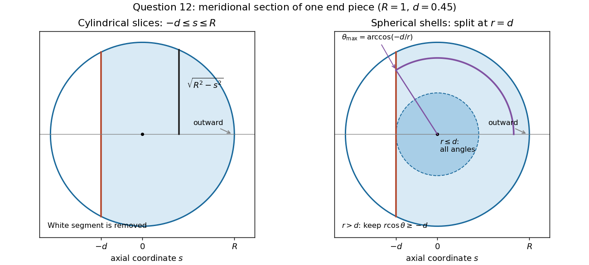

<h1 id="12/c/solution">Solution</h1>

↑ **Parent:** [C](../c.md)

Centre [cylindrical coordinates](../../../../../cylindrical-coordinate-system.md) on the right-hand [sphere](../../../../../sphere.md), with the axial coordinate $s=z-\alpha a$ positive outwards. Using $R=\beta a$ and $d=(\alpha-\gamma)a$, the retained solid satisfies

$$
-d\leq s\leq R,\qquad0\leq r\leq\sqrt{R^2-s^2},\qquad0\leq\phi<2\pi.
$$

In particular, it contains more than a [hemisphere](../../../../../hemisphere.md); it is the small cap on the inward side that has been removed. The [volume integral](../../../../../volume-integral.md) for its [mass](../../../../../mass.md), including the [Jacobian determinant](../../../../../jacobian-determinant.md) $r$, is

$$
\begin{aligned}
M_e&=\rho\int_{-d}^{R}\int_0^{2\pi}\int_0^{\sqrt{R^2-s^2}}r\,dr\,d\phi\,ds\\
&=\pi\rho\int_{-d}^{R}(R^2-s^2)\,ds\\
&=\pi\rho\left(\frac{2R^3}{3}+R^2d-\frac{d^3}{3}\right).
\end{aligned}
$$

Thus each end piece has [mass](../../../../../mass.md)

$$
\boxed{M_e=\pi\rho a^3\left[\frac{2\beta^3}{3}+\beta^2(\alpha-\gamma)-\frac{(\alpha-\gamma)^3}{3}\right].}
$$

Equivalently this is the [volume of a spherical cap](../../../../../volume-of-a-spherical-cap.md) with height $R+d$, multiplied by the uniform [mass density](../../../../../density.md).

**[Figure 1](#12/c/image-the-retained-end-piece-and-the-two-radial-ranges-used-in-spherical-integration). The retained end piece and the two radial ranges used in spherical integration**.

## ↑ Ancestors (13)

1. [C](../c.md)
2. [12](../../12.md)
3. [Paper 1](../../../paper-1-split.md)
4. [2024](../../../split.md)
5. [Past exam of the mathematics course of the year 1 of the natural sciences course of the University of Cambridge](../../../../split.md)
6. [Mathematics course of the year 1 of the natural sciences course of the University of Cambridge](../../../../../mathematics-course-of-the-year-1-of-the-natural-sciences-course-of-the-university-of-cambridge.md)
7. [Year 1 of the natural sciences course of the University of Cambridge](../../../../../year-1-of-the-natural-sciences-course-of-the-university-of-cambridge.md)
8. [Year of the natural sciences course of the University of Cambridge](../../../../../year-of-the-natural-sciences-course-of-the-university-of-cambridge.md)
9. [Natural sciences course of the University of Cambridge](../../../../../natural-sciences-course-of-the-university-of-cambridge.md)
10. [Course of the University of Cambridge](../../../../../course-of-the-university-of-cambridge.md)
11. [University of Cambridge](../../../../../university-of-cambridge-split.md)
12. [List of universities](../../../../../list-of-universities.md)
13. [Codex Wiki](../../../../../split.md)
