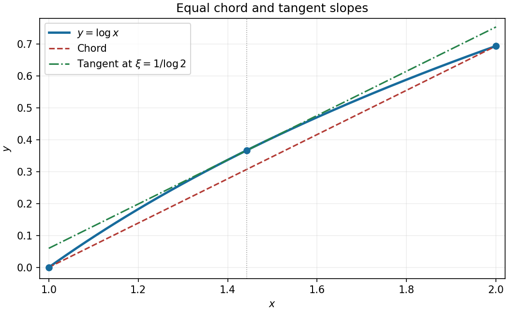
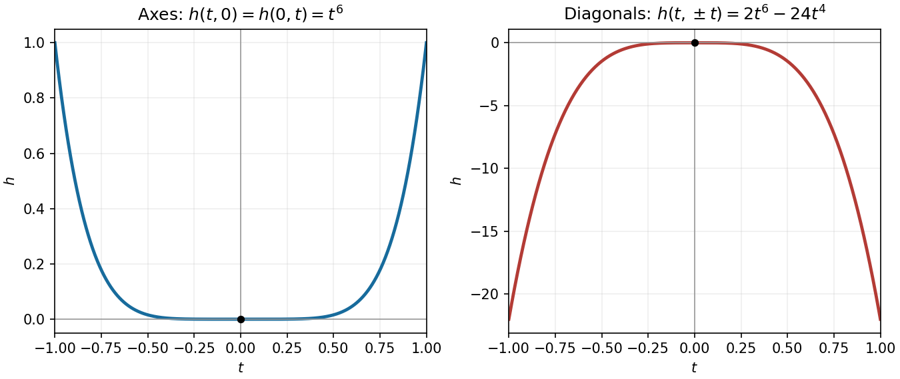

# Paper 2

↑ **Parent:** [2024](../2024.md)

[https://www.maths.cam.ac.uk/undergradnst/files/2024/papernst_ia_2_2024.pdf](https://www.maths.cam.ac.uk/undergradnst/files/2024/papernst_ia_2_2024.pdf)

**Table of contents**

- [1](#1)
  - [a](#1/a)
    - [Solution](#1/a/solution)
  - [b](#1/b)
    - [Solution](#1/b/solution)
- [2](#2)
  - [a](#2/a)
    - [Solution](#2/a/solution)
  - [b](#2/b)
    - [Solution](#2/b/solution)
- [3](#3)
  - [a](#3/a)
    - [Solution](#3/a/solution)
  - [b](#3/b)
    - [Solution](#3/b/solution)
- [4](#4)
  - [a](#4/a)
    - [Solution](#4/a/solution)
  - [b](#4/b)
    - [Solution](#4/b/solution)
- [5](#5)
  - [Solution](#5/solution)
- [6](#6)
  - [a](#6/a)
    - [Solution](#6/a/solution)
  - [b](#6/b)
    - [Solution](#6/b/solution)
- [7](#7)
  - [Solution](#7/solution)
- [8](#8)
  - [a](#8/a)
    - [Solution](#8/a/solution)
  - [b](#8/b)
    - [Solution](#8/b/solution)
- [9](#9)
  - [Solution](#9/solution)
- [10](#10)
  - [Solution](#10/solution)
- [11](#11)
  - [a](#11/a)
    - [Solution](#11/a/solution)
  - [b](#11/b)
    - [Solution](#11/b/solution)
  - [c](#11/c)
    - [Solution](#11/c/solution)
  - [d](#11/d)
    - [i](#11/d/i)
      - [Solution](#11/d/i/solution)
    - [ii](#11/d/ii)
      - [Solution](#11/d/ii/solution)
    - [iii](#11/d/iii)
      - [Solution](#11/d/iii/solution)
    - [iv](#11/d/iv)
      - [Solution](#11/d/iv/solution)
  - [e](#11/e)
    - [Solution](#11/e/solution)
- [12](#12)
  - [a](#12/a)
    - [Solution](#12/a/solution)
  - [b](#12/b)
    - [Solution](#12/b/solution)
  - [c](#12/c)
    - [Solution](#12/c/solution)
  - [d](#12/d)
    - [Solution](#12/d/solution)
  - [e](#12/e)
    - [Solution](#12/e/solution)
  - [f](#12/f)
    - [Solution](#12/f/solution)
- [13](#13)
  - [a](#13/a)
    - [Solution](#13/a/solution)
  - [b](#13/b)
    - [i](#13/b/i)
      - [Solution](#13/b/i/solution)
    - [ii](#13/b/ii)
      - [Solution](#13/b/ii/solution)
- [14](#14)
  - [a](#14/a)
    - [i](#14/a/i)
      - [Solution](#14/a/i/solution)
    - [ii](#14/a/ii)
      - [Solution](#14/a/ii/solution)
    - [iii](#14/a/iii)
      - [Solution](#14/a/iii/solution)
  - [b](#14/b)
    - [i](#14/b/i)
      - [Solution](#14/b/i/solution)
    - [ii](#14/b/ii)
      - [Solution](#14/b/ii/solution)
    - [iii](#14/b/iii)
      - [Solution](#14/b/iii/solution)
    - [iv](#14/b/iv)
      - [Solution](#14/b/iv/solution)
  - [c](#14/c)
    - [Solution](#14/c/solution)
- [15](#15)
  - [a](#15/a)
    - [i](#15/a/i)
      - [Solution](#15/a/i/solution)
    - [ii](#15/a/ii)
      - [Solution](#15/a/ii/solution)
    - [iii](#15/a/iii)
      - [Solution](#15/a/iii/solution)
  - [b](#15/b)
    - [Solution](#15/b/solution)
- [16](#16)
  - [a](#16/a)
    - [Solution](#16/a/solution)
  - [b](#16/b)
    - [i](#16/b/i)
      - [Solution](#16/b/i/solution)
    - [ii](#16/b/ii)
      - [Solution](#16/b/ii/solution)
    - [iii](#16/b/iii)
      - [Solution](#16/b/iii/solution)
- [17](#17)
  - [a](#17/a)
    - [Solution](#17/a/solution)
  - [b](#17/b)
    - [Solution](#17/b/solution)
  - [c](#17/c)
    - [i](#17/c/i)
      - [Solution](#17/c/i/solution)
    - [ii](#17/c/ii)
      - [Solution](#17/c/ii/solution)
    - [iii](#17/c/iii)
      - [Solution](#17/c/iii/solution)
  - [d](#17/d)
    - [Solution](#17/d/solution)
- [18](#18)
  - [a](#18/a)
    - [Solution](#18/a/solution)
  - [b](#18/b)
    - [i](#18/b/i)
      - [Solution](#18/b/i/solution)
    - [ii](#18/b/ii)
      - [Solution](#18/b/ii/solution)
    - [iii](#18/b/iii)
      - [Solution](#18/b/iii/solution)
  - [c](#18/c)
    - [i](#18/c/i)
      - [Solution](#18/c/i/solution)
    - [ii](#18/c/ii)
      - [Solution](#18/c/ii/solution)
- [19](#19)
  - [a](#19/a)
    - [Solution](#19/a/solution)
  - [b](#19/b)
    - [i](#19/b/i)
      - [Solution](#19/b/i/solution)
    - [ii](#19/b/ii)
      - [Solution](#19/b/ii/solution)
- [20](#20)
  - [a](#20/a)
    - [Solution](#20/a/solution)
  - [b](#20/b)
    - [Solution](#20/b/solution)
  - [c](#20/c)
    - [i](#20/c/i)
      - [Solution](#20/c/i/solution)
    - [ii](#20/c/ii)
      - [Solution](#20/c/ii/solution)

## 1

↑ **Parent:** [Paper 2](paper-2.md)

<h3 id="1/a">a</h3>

↑ **Parent:** [1](#1)

<h4 id="1/a/solution">Solution</h4>

↑ **Parent:** [A](#1/a)

The [volume](../../geometry-and-topology.md#volume) of the [parallelepiped](../../euclidean-geometry.md#parallelepiped) is the [absolute value](../../real-analysis.md#absolute-value) of the [scalar triple product](../../multilinear-algebra.md#scalar-triple-product):

$$
V=|\mathbf a\cdot(\mathbf b\times\mathbf c)|
=|(1,0,0)\cdot(1,0,0)|=\boxed{1}.
$$

<h3 id="1/b">b</h3>

↑ **Parent:** [1](#1)

<h4 id="1/b/solution">Solution</h4>

↑ **Parent:** [B](#1/b)

Equating [vector components](../../vector-space.md#coordinate-linear-algebra) gives

$$
(\alpha,\beta+\gamma,\gamma)^T=(0,0,0)^T.
$$

The third component first forces $\gamma=0$, then the second forces $\beta=0$, and the first gives $\alpha=0$. Thus

$$
\boxed{\alpha=\beta=\gamma=0}.
$$

Equivalently, the nonzero [scalar triple product](../../multilinear-algebra.md#scalar-triple-product) proves that these three [vectors](../../vector-space.md#vector) are [linearly independent](../../vector-space.md#linear-independence).

## 2

↑ **Parent:** [Paper 2](paper-2.md)

<h3 id="2/a">a</h3>

↑ **Parent:** [2](#2)

<h4 id="2/a/solution">Solution</h4>

↑ **Parent:** [A](#2/a)

The radial coordinate in the [cylindrical coordinate system](../../multivariable-calculus.md#cylindrical-coordinate-system) is the [Euclidean distance](../../topological-analysis.md#euclidean-distance) from the $z$-axis:

$$
\boxed{r=\sqrt{x^2+y^2}=\sqrt2}.
$$

<h3 id="2/b">b</h3>

↑ **Parent:** [2](#2)

<h4 id="2/b/solution">Solution</h4>

↑ **Parent:** [B](#2/b)

In [spherical coordinates](../../multivariable-calculus.md#spherical-coordinate-system), the radial distance is $\sqrt{x^2+y^2+z^2}=\sqrt3$ and $\cos\theta=z/r$. Since the point lies below the equatorial [plane](../../geometry-and-topology.md#plane), the polar angle exceeds $\pi/2$:

$$
\boxed{\theta=\arccos\left(-\frac1{\sqrt3}\right)}.
$$

The angle is approximately $2.1863$ radians, or $125.26^\circ$.

## 3

↑ **Parent:** [Paper 2](paper-2.md)

<h3 id="3/a">a</h3>

↑ **Parent:** [3](#3)

<h4 id="3/a/solution">Solution</h4>

↑ **Parent:** [A](#3/a)

For the [natural logarithm](../../calculus.md#natural-logarithm), $f'(x)=1/x$. The chord [slope](../../euclidean-geometry.md#slope) is $(\log2-\log1)/(2-1)=\log2$. Hence the [mean value theorem](../../calculus.md#mean-value-theorem) point satisfies $1/\xi=\log2$, giving

$$
\boxed{\xi=\frac1{\log2}}.
$$

It lies strictly between one and two. For example, $\log2=\int_1^2du/u$ lies strictly between $1/2$ and one.

<h3 id="3/b">b</h3>

↑ **Parent:** [3](#3)

<h4 id="3/b/solution">Solution</h4>

↑ **Parent:** [B](#3/b)

The chord through the endpoints is the [straight line](../../euclidean-geometry.md#straight-line) $y=(x-1)\log2$. At $\xi=1/\log2$, the [tangent line](../../calculus.md#tangent-line) is

$$
y=\log\xi+\frac{x-\xi}{\xi}
=\log\xi+(x-\xi)\log2.
$$

These two [straight lines](../../euclidean-geometry.md#straight-line) have the same [slope](../../euclidean-geometry.md#slope), as required by the [mean value theorem](../../calculus.md#mean-value-theorem). Since $f''(x)=-1/x^2<0$, the [natural logarithm](../../calculus.md#natural-logarithm) is a [concave function](../../real-analysis.md#concave-function): its graph lies above the chord and below this [tangent line](../../calculus.md#tangent-line).

**[Figure 1](#3/b/image-the-mean-value-theorem-for-the-logarithm-on-the-interval-from-one-to-two). The mean value theorem for the logarithm on the interval from one to two**. The chord and the [tangent line](../../calculus.md#tangent-line) at $\xi=1/\log2$ are parallel. The marked point lies on the graph of the [natural logarithm](../../calculus.md#natural-logarithm).

## 4

↑ **Parent:** [Paper 2](paper-2.md)

<h3 id="4/a">a</h3>

↑ **Parent:** [4](#4)

<h4 id="4/a/solution">Solution</h4>

↑ **Parent:** [A](#4/a)

The [fundamental theorem of calculus](../../calculus.md#fundamental-theorem-of-calculus) applies because the [integrand](../../integral.md#integrand) is [continuous](../../calculus.md#continuous-function). Thus

$$
\boxed{\frac{dI}{dx}=f(x)}.
$$

The requested [derivative](../../calculus.md#derivative) is $dI/dx$, as shown in the PDF; the local OCR corrupts its notation.

<h3 id="4/b">b</h3>

↑ **Parent:** [4](#4)

<h4 id="4/b/solution">Solution</h4>

↑ **Parent:** [B](#4/b)

Use the [product rule](../../calculus.md#product-rule) and the [fundamental theorem of calculus](../../calculus.md#fundamental-theorem-of-calculus):

$$
\frac d{dx}\left[\sin x\int_0^x\sin y\,dy\right]
=\cos x\int_0^x\sin y\,dy+\sin^2x.
$$

Since the [integral](../../integral.md) is $1-\cos x$, this simplifies to

$$
\boxed{\cos x-\cos(2x)}.
$$

## 5

↑ **Parent:** [Paper 2](paper-2.md)

<h3 id="5/solution">Solution</h3>

↑ **Parent:** [5](#5)

The [Newton root-finding iteration](../../numerical-analysis.md#newton-root-finding-iteration) replaces the graph by its [tangent line](../../calculus.md#tangent-line) at $x_0$ and uses that line's zero:

$$
0=f(x_0)+f'(x_0)(x_1-x_0),\qquad
x_1=x_0-\frac{f(x_0)}{f'(x_0)}.
$$

Comparing with the printed reciprocal-ratio form gives

$$
\boxed{\alpha=-1,\qquad\beta=-1}.
$$

This step requires $f'(x_0)\ne0$. If $f(x_0)=0$, the iteration has already reached a [zero of a function](../../polynomial.md#zero-of-a-function) and the printed reciprocal-ratio expression need not be evaluated.

## 6

↑ **Parent:** [Paper 2](paper-2.md)

<h3 id="6/a">a</h3>

↑ **Parent:** [6](#6)

<h4 id="6/a/solution">Solution</h4>

↑ **Parent:** [A](#6/a)

[Mutually exclusive events](../../probability-space.md#disjoint-events) have empty [intersection](../../set.md#set-intersection). Therefore

$$
\boxed{\mathbb P(A\cap B)=0}.
$$

<h3 id="6/b">b</h3>

↑ **Parent:** [6](#6)

<h4 id="6/b/solution">Solution</h4>

↑ **Parent:** [B](#6/b)

The addition formula for [probability](../../probability-theory.md#probability) subtracts the overlap, which vanishes for [mutually exclusive events](../../probability-space.md#disjoint-events):

$$
\mathbb P(A\cup B)=\mathbb P(A)+\mathbb P(B)-\mathbb P(A\cap B)
=\boxed{\mathbb P(A)+\mathbb P(B)}.
$$

## 7

↑ **Parent:** [Paper 2](paper-2.md)

<h3 id="7/solution">Solution</h3>

↑ **Parent:** [7](#7)

The [chain rule](../../calculus.md#chain-rule) gives $d(e^{xy})=e^{xy}(y\,dx+x\,dy)$, so the given [total differential](../../multivariable-calculus.md#total-differential) is exact. Thus $f=e^{xy}+C$; two such [functions](../../function.md) differ by a constant because their [gradient](../../multivariable-calculus.md#gradient) difference vanishes on the [connected](../../geometry-and-topology.md#connected-space) [plane](../../geometry-and-topology.md#plane). The assigned value at the origin forces $C=-1$, giving

$$
\boxed{f(x,y)=e^{xy}-1}.
$$

## 8

↑ **Parent:** [Paper 2](paper-2.md)

<h3 id="8/a">a</h3>

↑ **Parent:** [8](#8)

<h4 id="8/a/solution">Solution</h4>

↑ **Parent:** [A](#8/a)

The [curl of a gradient](../../multivariable-calculus.md#curl-of-a-gradient) is zero. Consequently the [dot product](../../inner-product.md#dot-product) in the exponent vanishes and

$$
\boxed{\exp[\nabla\phi\cdot(\nabla\times\nabla\phi)]=e^0=1}.
$$

<h3 id="8/b">b</h3>

↑ **Parent:** [8](#8)

<h4 id="8/b/solution">Solution</h4>

↑ **Parent:** [B](#8/b)

The [divergence of a curl is zero](../../multivariable-calculus.md#divergence-of-a-curl-is-zero), so its squared [absolute value](../../real-analysis.md#absolute-value) is

$$
\boxed{|\nabla\cdot(\nabla\times\mathbf F)|^2=0}.
$$

Both identities follow by cancellation of equal [mixed partial derivatives](../../multivariable-calculus.md#mixed-partial-derivative) under the usual smoothness assumptions of [vector calculus](../../multivariable-calculus.md#vector-calculus).

## 9

↑ **Parent:** [Paper 2](paper-2.md)

<h3 id="9/solution">Solution</h3>

↑ **Parent:** [9](#9)

Expanding the [quadratic form](../../quadratic-form.md) gives

$$
(x\ y)\begin{pmatrix}1&4\\a_{21}&a_{22}\end{pmatrix}\binom xy
=x^2+(4+a_{21})xy+a_{22}y^2.
$$

Matching [coefficients](../../vector-space.md#coefficient) of $xy$ and $y^2$ yields

$$
\boxed{a_{21}=4,\qquad a_{22}=4}.
$$

## 10

↑ **Parent:** [Paper 2](paper-2.md)

<h3 id="10/solution">Solution</h3>

↑ **Parent:** [10](#10)

The [trigonometric identity](../../geometry-and-topology.md#trigonometric-identity) gives $\sin x\cos x=\tfrac12\sin2x$, and the complementary-angle [trigonometric identity](../../geometry-and-topology.md#trigonometric-identity) gives $\cos(\pi/2-x)=\sin x$. Thus the [Fourier series](../../fourier-series.md) is already the finite expression

$$
\boxed{\sin x+\frac12\sin2x}.
$$

The only nonzero [Fourier coefficients](../../fourier-series.md#fourier-coefficient) are $b_1=1$ and $b_2=1/2$.

## 11

↑ **Parent:** [Paper 2](paper-2.md)

<h3 id="11/a">a</h3>

↑ **Parent:** [11](#11)

<h4 id="11/a/solution">Solution</h4>

↑ **Parent:** [A](#11/a)

The scalar $\mathbf r\cdot\hat{\mathbf u}$ is the signed [scalar projection](../../inner-product.md#scalar-projection) along the [unit vector](../../vector-space.md#unit-vector) $\hat{\mathbf u}$. Multiplying by that [unit vector](../../vector-space.md#unit-vector) makes $P_{\hat{\mathbf u}}(\mathbf r)$ the [orthogonal projection](../../hilbert-space.md#orthogonal-projection) of $\mathbf r$ onto its span.

For the other expression, the [vector triple product identity](../../multivariable-calculus.md#vector-triple-product) gives

$$
\boxed{R_{\hat{\mathbf u}}(\mathbf r)
=\mathbf r(\hat{\mathbf u}\cdot\hat{\mathbf u})
-\hat{\mathbf u}(\hat{\mathbf u}\cdot\mathbf r)
=\mathbf r-\hat{\mathbf u}(\mathbf r\cdot\hat{\mathbf u})}.
$$

This is the [orthogonal projection onto a plane](../../geometry-and-topology.md#closest-point-on-a-plane) perpendicular to $\hat{\mathbf u}$ through the origin. Its [dot product](../../inner-product.md#dot-product) with $\hat{\mathbf u}$ is zero, while the difference from $\mathbf r$ is parallel to $\hat{\mathbf u}$.

<h3 id="11/b">b</h3>

↑ **Parent:** [11](#11)

<h4 id="11/b/solution">Solution</h4>

↑ **Parent:** [B](#11/b)

The two [orthogonal projections](../../hilbert-space.md#orthogonal-projection) are complementary, giving

$$
\boxed{P_{\hat{\mathbf u}}(\mathbf r)+R_{\hat{\mathbf u}}(\mathbf r)=\mathbf r}.
$$

They split a [vector](../../vector-space.md#vector) into its components parallel and perpendicular to $\hat{\mathbf u}$.

<h3 id="11/c">c</h3>

↑ **Parent:** [11](#11)

<h4 id="11/c/solution">Solution</h4>

↑ **Parent:** [C](#11/c)

The [straight line](../../euclidean-geometry.md#straight-line) consists of $\mathbf y+s(\mathbf z-\mathbf y)$, with $s\in\mathbb R$. Since the endpoints are distinct, the direction [vector](../../vector-space.md#vector) can be normalized. Choose

$$
\boxed{\mathbf p=\mathbf y,\qquad
\hat{\mathbf q}=\frac{\mathbf z-\mathbf y}{|\mathbf z-\mathbf y|}}.
$$

Putting $t=s|\mathbf z-\mathbf y|$ gives the required [parametric equation of a straight line](../../euclidean-geometry.md#parametric-equation-of-a-straight-line) $\mathbf r=\mathbf p+t\hat{\mathbf q}$. Other choices of $\mathbf p$ on the same [straight line](../../euclidean-geometry.md#straight-line), or the opposite direction for $\hat{\mathbf q}$, give equivalent descriptions.

<h3 id="11/d">d</h3>

↑ **Parent:** [11](#11)

<h4 id="11/d/i">i</h4>

↑ **Parent:** [D](#11/d)

<h5 id="11/d/i/solution">Solution</h5>

↑ **Parent:** [I](#11/d/i)

Take the [cross product](../../vector-space.md#cross-product) with $\hat{\mathbf q}$:

$$
\mathbf r\times\hat{\mathbf q}
=\mathbf p\times\hat{\mathbf q}
+t(\hat{\mathbf q}\times\hat{\mathbf q})
=\mathbf p\times\hat{\mathbf q}.
$$

Thus one choice is

$$
\boxed{\hat{\mathbf a}=\hat{\mathbf q},\qquad\mathbf c=\mathbf p\times\hat{\mathbf q}}.
$$

Conversely, this [cross product](../../vector-space.md#cross-product) equation implies $(\mathbf r-\mathbf p)\times\hat{\mathbf q}=0$, so $\mathbf r-\mathbf p$ is parallel to $\hat{\mathbf q}$. It therefore describes precisely the original [straight line](../../euclidean-geometry.md#straight-line).

<h4 id="11/d/ii">ii</h4>

↑ **Parent:** [D](#11/d)

<h5 id="11/d/ii/solution">Solution</h5>

↑ **Parent:** [Ii](#11/d/ii)

The [unit vector](../../vector-space.md#unit-vector) $\hat{\mathbf a}$ specifies the direction of the [straight line](../../euclidean-geometry.md#straight-line). Reversing its sign, together with the sign of $\mathbf c$, leaves the same [straight line](../../euclidean-geometry.md#straight-line).

<h4 id="11/d/iii">iii</h4>

↑ **Parent:** [D](#11/d)

<h5 id="11/d/iii/solution">Solution</h5>

↑ **Parent:** [Iii](#11/d/iii)

Decompose $\mathbf p$ into its [orthogonal projections](../../hilbert-space.md#orthogonal-projection) parallel and perpendicular to $\hat{\mathbf a}$. Since $\mathbf p\times\hat{\mathbf a}$ removes the parallel component,

$$
|\mathbf c|=|\mathbf p\times\hat{\mathbf a}|
=|\mathbf p-(\mathbf p\cdot\hat{\mathbf a})\hat{\mathbf a}|.
$$

The last [vector](../../vector-space.md#vector) is the displacement to the point of the [straight line](../../euclidean-geometry.md#straight-line) nearest the origin. Hence

$$
\boxed{c\text{ is the perpendicular distance from the origin to the line}}.
$$

The original PDF has $c=|\mathbf c|$, not the squared magnitude inserted by the OCR.

<h4 id="11/d/iv">iv</h4>

↑ **Parent:** [D](#11/d)

<h5 id="11/d/iv/solution">Solution</h5>

↑ **Parent:** [Iv](#11/d/iv)

The [vector](../../vector-space.md#vector) $\mathbf c=\mathbf p\times\hat{\mathbf a}$ is a [normal vector](../../differential-geometry.md#normal-vector) to the span of $\mathbf p$ and $\hat{\mathbf a}$. Since $\mathbf c\ne0$, these [vectors](../../vector-space.md#vector) determine a [plane](../../geometry-and-topology.md#plane). Thus the missing words are

**the line and the origin**.

Indeed this [plane](../../geometry-and-topology.md#plane) consists of all [linear combinations](../../vector-space.md#linear-combination) of $\mathbf p$ and the line's direction [vector](../../vector-space.md#vector).

<h3 id="11/e">e</h3>

↑ **Parent:** [11](#11)

<h4 id="11/e/solution">Solution</h4>

↑ **Parent:** [E](#11/e)

A necessary compatibility condition is $\mathbf f\cdot\hat{\mathbf g}=0$, because a [cross product](../../vector-space.md#cross-product) with $\hat{\mathbf g}$ is perpendicular to it. If this condition fails, there is no solution.

If it holds, take $\hat{\mathbf g}\times$ the equation and use the [vector triple product identity](../../multivariable-calculus.md#vector-triple-product):

$$
\hat{\mathbf g}\times\mathbf f
=\hat{\mathbf g}\times(\mathbf r\times\hat{\mathbf g})
=\mathbf r-(\mathbf r\cdot\hat{\mathbf g})\hat{\mathbf g}.
$$

Thus the perpendicular [orthogonal projection](../../hilbert-space.md#orthogonal-projection) is fixed and the parallel component is free:

$$
\boxed{\mathbf r=\hat{\mathbf g}\times\mathbf f+s\hat{\mathbf g},\quad s\in\mathbb R,
\qquad\text{provided }\mathbf f\cdot\hat{\mathbf g}=0}.
$$

Conversely, $(\hat{\mathbf g}\times\mathbf f)\times\hat{\mathbf g}=\mathbf f$ under the compatibility condition, so every displayed [vector](../../vector-space.md#vector) solves the equation. The solution set is a [straight line](../../euclidean-geometry.md#straight-line), including the line through the origin when $\mathbf f=0$.

## 12

↑ **Parent:** [Paper 2](paper-2.md)

<h3 id="12/a">a</h3>

↑ **Parent:** [12](#12)

<h4 id="12/a/solution">Solution</h4>

↑ **Parent:** [A](#12/a)

Differentiate with respect to the two [Cartesian coordinates](../../linear-algebra.md#cartesian-coordinate-system):

$$
\boxed{\nabla h=(6x^5-48xy^2,\ 6y^5-48x^2y)^T
=6\bigl(x(x^4-8y^2),\ y(y^4-8x^2)\bigr)^T}.
$$

<h3 id="12/b">b</h3>

↑ **Parent:** [12](#12)

<h4 id="12/b/solution">Solution</h4>

↑ **Parent:** [B](#12/b)

The [gradient](../../multivariable-calculus.md#gradient) is horizontal when $h_y=0$ and vertical when $h_x=0$. Factoring those [partial derivatives](../../multivariable-calculus.md#partial-derivative) gives the two [loci](../../euclidean-geometry.md#locus-mathematics):

$$
\boxed{h_y=0:\quad y=0\quad\text{or}\quad x=\pm\frac{y^2}{2\sqrt2}},
$$

$$
\boxed{h_x=0:\quad x=0\quad\text{or}\quad y=\pm\frac{x^2}{2\sqrt2}}.
$$

Thus each [locus](../../euclidean-geometry.md#locus-mathematics) consists of an axis and two [parabolas](../../euclidean-geometry.md#parabola). Their common points are the five [stationary points](../../calculus-of-variations.md#stationary-point) found below. At those points the [gradient](../../multivariable-calculus.md#gradient) is zero and has no direction, so they are included in both algebraic zero-component conditions but excluded if “parallel” is required to mean a nonzero directed [vector](../../vector-space.md#vector).

**[Figure 2](#12/b/image-loci-of-horizontal-and-vertical-gradients). Loci of horizontal and vertical gradients**. Blue curves have $h_y=0$, orange curves have $h_x=0$, and black points mark their intersections. At the black points the [gradient](../../multivariable-calculus.md#gradient) itself vanishes.

<h3 id="12/c">c</h3>

↑ **Parent:** [12](#12)

<h4 id="12/c/solution">Solution</h4>

↑ **Parent:** [C](#12/c)

A [stationary point](../../calculus-of-variations.md#stationary-point) must satisfy both factored equations from part (a). If either coordinate is zero, the other equation forces the other coordinate to vanish. This gives $(0,0)$.

Otherwise $x^4=8y^2$ and $y^4=8x^2$. With $u=x^2>0$ and $v=y^2>0$, these become $u^2=8v$ and $v^2=8u$. Dividing gives $(u/v)^3=1$, so $u=v$. Then $u^2=8u$ forces $u=v=8$. Hence all five [stationary points](../../calculus-of-variations.md#stationary-point) are

$$
\boxed{(0,0),\qquad(2\sqrt2\,\varepsilon,\ 2\sqrt2\,\delta),\quad \varepsilon,\delta\in\{-1,1\}}.
$$

<h3 id="12/d">d</h3>

↑ **Parent:** [12](#12)

<h4 id="12/d/solution">Solution</h4>

↑ **Parent:** [D](#12/d)

The [Hessian matrix](../../multivariable-calculus.md#hessian-matrix) is

$$
H=\begin{pmatrix}30x^4-48y^2&-96xy\\-96xy&30y^4-48x^2\end{pmatrix}.
$$

At each nonzero [stationary point](../../calculus-of-variations.md#stationary-point), its diagonal entries are $1536$ and the off-diagonal entries are $\pm768$. Its [eigenvalues](../../linear-operator-theory.md#eigenvalue) are $768$ and $2304$, both positive. Thus the [Hessian matrix](../../multivariable-calculus.md#hessian-matrix) is [positive definite](../../quadratic-form.md#positive-definite-matrix), and the [second-derivative test](../../multivariable-calculus.md#second-derivative-test) proves that

$$
\boxed{\text{all four nonzero stationary points are strict local minima}}.
$$

Their common value is $h=-512$. In fact they are [global minima](../../analysis.md#global-minimum): with $u=|xy|$, the [arithmetic-geometric mean inequality](../../mathematical-optimization.md#arithmetic-geometric-mean-inequality) gives $x^6+y^6\geq2u^3$, so

$$
h\geq2u^3-24u^2\geq-512.
$$

The last one-variable [polynomial](../../polynomial.md) attains its minimum at $u=8$, and equality in the first bound requires $|x|=|y|$, precisely the four points above.

<h3 id="12/e">e</h3>

↑ **Parent:** [12](#12)

<h4 id="12/e/solution">Solution</h4>

↑ **Parent:** [E](#12/e)

Along either coordinate axis, the restriction is $h(t,0)=h(0,t)=t^6$, which is positive for $t\ne0$. Along either diagonal it is

$$
h(t,t)=h(t,-t)=2t^6-24t^4=2t^4(t^2-12),
$$

which is negative for sufficiently small nonzero $t$. Therefore every neighbourhood of the origin contains both positive and negative values, whereas $h(0,0)=0$. Consequently

$$
\boxed{(0,0)\text{ is a saddle point, neither a local minimum nor a local maximum}}.
$$

The [Hessian matrix](../../multivariable-calculus.md#hessian-matrix) vanishes there, so the ordinary [second-derivative test](../../multivariable-calculus.md#second-derivative-test) is inconclusive; the restrictions settle the question.

**[Figure 3](#12/e/image-opposite-signs-along-axes-and-diagonals-establish-the-saddle-at-the-origin). Opposite signs along axes and diagonals establish the saddle at the origin**. The two axes give $t^6>0$, while the two diagonals give $2t^6-24t^4<0$ near zero. The panels use different vertical scales to make both signs visible.

<h3 id="12/f">f</h3>

↑ **Parent:** [12](#12)

<h4 id="12/f/solution">Solution</h4>

↑ **Parent:** [F](#12/f)

Near a nonzero [stationary point](../../calculus-of-variations.md#stationary-point) $\mathbf p$, [Taylor expansion](../../calculus.md#taylor-expansion) of the [gradient](../../multivariable-calculus.md#gradient) gives $\nabla h(\mathbf p+\mathbf v)=H(\mathbf p)\mathbf v+O(|\mathbf v|^2)$. Since the [Hessian matrix](../../multivariable-calculus.md#hessian-matrix) is [positive definite](../../quadratic-form.md#positive-definite-matrix), $\mathbf v\cdot\nabla h(\mathbf p+\mathbf v)>0$ for sufficiently small nonzero $\mathbf v$. Thus the [gradient](../../multivariable-calculus.md#gradient) arrows point away from each of the four [local minima](../../analysis.md#local-minimum), with different strengths in the two [eigenvector](../../linear-operator-theory.md#eigenvector) directions.

At the origin, on the $x$-axis the [gradient](../../multivariable-calculus.md#gradient) is $(6x^5,0)$ and on the $y$-axis it is $(0,6y^5)$, so arrows point outward. On $y=x$ the [gradient](../../multivariable-calculus.md#gradient) is $6x^3(x^2-8)(1,1)$, and on $y=-x$ it is $6x^3(x^2-8)(1,-1)$, so arrows point toward the origin for small $|x|$. Away from the axes the leading terms are $(-48xy^2,-48x^2y)$, pointing inward in both coordinate signs. The narrow outward sectors close to the axes are visible in the exact [vector field](../../multivariable-calculus.md#vector-field).

**[Figure 4](#12/f/image-gradient-directions-near-all-five-stationary-points). Gradient directions near all five stationary points**. Arrows show normalized [gradient](../../multivariable-calculus.md#gradient) directions, not the direction of descent. They point outward near the four minima, while the degenerate origin has outward axis directions and inward diagonal directions.

## 13

↑ **Parent:** [Paper 2](paper-2.md)

<h3 id="13/a">a</h3>

↑ **Parent:** [13](#13)

<h4 id="13/a/solution">Solution</h4>

↑ **Parent:** [A](#13/a)

For $\mathbf G$, the [product rule](../../calculus.md#product-rule) for the [curl](../../multivariable-calculus.md#curl) gives

$$
\nabla\times\mathbf G
=\nabla(\mathbf a\cdot\mathbf r)\times\mathbf r
+(\mathbf a\cdot\mathbf r)(\nabla\times\mathbf r)
=\mathbf a\times\mathbf r.
$$

Since $\mathbf a\ne0$, this is not identically zero on $\mathbb R^3$. A [gradient field](../../multivariable-calculus.md#gradient-field) has zero [curl](../../multivariable-calculus.md#curl), so **no scalar potential exists for $\mathbf G$ on the whole space**.

For the radial [vector field](../../multivariable-calculus.md#vector-field) $\mathbf K$, observe that

$$
\nabla\left[\frac12\log(1+x^2+y^2+z^2)\right]
=\frac{(x,y,z)^T}{1+x^2+y^2+z^2}=\mathbf K.
$$

Thus all [vector-field potentials](../../multivariable-calculus.md#potential-of-a-conservative-vector-field) are

$$
\boxed{\phi(\mathbf r)=\frac12\log(1+|\mathbf r|^2)+C}.
$$

These are [smooth](../../analysis.md#smooth-function) everywhere, including the origin. Any two differ by a constant because their [gradient](../../multivariable-calculus.md#gradient) difference vanishes on the [connected](../../geometry-and-topology.md#connected-space) whole space.

<h3 id="13/b">b</h3>

↑ **Parent:** [13](#13)

<h4 id="13/b/i">i</h4>

↑ **Parent:** [B](#13/b)

<h5 id="13/b/i/solution">Solution</h5>

↑ **Parent:** [I](#13/b/i)

Parameterize the [straight line](../../euclidean-geometry.md#straight-line) by $\mathbf r(t)=(t,t,t)^T$, $0\leq t\leq1$. Then $\mathbf r'=(1,1,1)^T$ and the [line integral](../../multivariable-calculus.md#line-integral) becomes

$$
\int_0^1\left[2t^2+(\mu+1)t^2+(\lambda+1)t^2\right]dt
=\boxed{\frac{\lambda+\mu+4}{3}}.
$$

<h4 id="13/b/ii">ii</h4>

↑ **Parent:** [B](#13/b)

<h5 id="13/b/ii/solution">Solution</h5>

↑ **Parent:** [Ii](#13/b/ii)

On the circular arc, $z=0$ and $dz=0$, so the [line integral](../../multivariable-calculus.md#line-integral) reduces to

$$
\int(x^2\,dx+y^2\,dy)
=\left[\frac{x^3+y^3}{3}\right]_{(0,0)}^{(1,1)}=\frac23.
$$

This [exact differential](../../differential-form.md#exact-differential) evaluation applies to the specified arc; for example its [parametric equation](../../geometry-and-topology.md#parametric-equation) is $(x,y,z)=(1-\cos\theta,\sin\theta,0)$, $0\leq\theta\leq\pi/2$. On the vertical segment $x=y=1$, only $dz$ contributes, giving $\int_0^1(\lambda+1)\,dz=\lambda+1$. The whole path therefore gives

$$
\boxed{\lambda+\frac53}.
$$

To answer the final conservativeness requirement, compute the [curl](../../multivariable-calculus.md#curl):

$$
\nabla\times\mathbf M=((2-\mu)y,\ (1-2\lambda)x,\ 0)^T.
$$

It vanishes identically exactly when

$$
\boxed{\mu=2,\qquad\lambda=\frac12}.
$$

On the [simply connected](../../algebraic-topology.md#simply-connected-space) whole space this condition is sufficient for a [conservative vector field](../../multivariable-calculus.md#conservative-vector-field). Explicitly a [vector-field potential](../../multivariable-calculus.md#potential-of-a-conservative-vector-field) is

$$
\phi=\frac12x^2z+y^2z+\frac{x^3+y^3}{3}+C.
$$

Both path calculations then give $13/6$, equal to $\phi(1,1,1)-\phi(0,0,0)$ by the [fundamental theorem for line integrals](../../multivariable-calculus.md#fundamental-theorem-for-line-integrals). Equality of just these two path values would only force $\mu=2\lambda+1$; it is the [curl](../../multivariable-calculus.md#curl) calculation that establishes full [path independence](../../multivariable-calculus.md#path-independence).

## 14

↑ **Parent:** [Paper 2](paper-2.md)

<h3 id="14/a">a</h3>

↑ **Parent:** [14](#14)

<h4 id="14/a/i">i</h4>

↑ **Parent:** [A](#14/a)

<h5 id="14/a/i/solution">Solution</h5>

↑ **Parent:** [I](#14/a/i)

A displayed minute contains one minute of possible start times, so the specified [uniform distribution](../../continuous-probability-distribution.md#continuous-uniform-distribution) has [probability density function](../../continuous-probability-distribution.md#probability-density-function)

$$
\boxed{p(s)=\begin{cases}1,&0\leq s<1,\\0,&\text{otherwise}.\end{cases}}
$$

Endpoint choices for a [probability density function](../../continuous-probability-distribution.md#probability-density-function) do not affect any [probabilities](../../probability-theory.md#probability).

<h4 id="14/a/ii">ii</h4>

↑ **Parent:** [A](#14/a)

<h5 id="14/a/ii/solution">Solution</h5>

↑ **Parent:** [Ii](#14/a/ii)

The graph is a rectangle of height one over $[0,1)$, with zero height elsewhere. Its unit [area](../../differential-geometry.md#surface-area) is the required normalization of the [probability density function](../../continuous-probability-distribution.md#probability-density-function).

**[Figure 5](#14/a/ii/image-uniform-endpoint-uncertainty-and-triangular-elapsed-time-uncertainty). Uniform endpoint uncertainty and triangular elapsed-time uncertainty**. Left: the [uniform distribution](../../continuous-probability-distribution.md#continuous-uniform-distribution) of one endpoint offset. Right: the [triangular distribution](../../continuous-probability-distribution.md#triangular-distribution) of the difference of two independent endpoint offsets. Shading marks the event $T>1/2$.

<h4 id="14/a/iii">iii</h4>

↑ **Parent:** [A](#14/a)

<h5 id="14/a/iii/solution">Solution</h5>

↑ **Parent:** [Iii](#14/a/iii)

For the [uniform distribution](../../continuous-probability-distribution.md#continuous-uniform-distribution), the [expected value](../../expected-value.md) and second [moment](../../expected-value.md#moment) are

$$
\mathbb E[S]=\int_0^1s\,ds=\frac12,\qquad
\mathbb E[S^2]=\int_0^1s^2\,ds=\frac13.
$$

Hence the [variance](../../variance.md) is

$$
\boxed{\mathbb E[S]=\frac12\text{ minute},\qquad
\operatorname{Var}(S)=\frac13-\frac14=\frac1{12}\text{ minute}^2}.
$$

<h3 id="14/b">b</h3>

↑ **Parent:** [14](#14)

<h4 id="14/b/i">i</h4>

↑ **Parent:** [B](#14/b)

<h5 id="14/b/i/solution">Solution</h5>

↑ **Parent:** [I](#14/b/i)

Let $E$ be the finish-time offset from the start of its displayed minute. The elapsed time is $25+E-S$, so $T=E-S$. To obtain the stated density, use the intended model that $E$ and $S$ are [independent random variables](../../random-variable.md#independent-random-variables), both with the [uniform distribution](../../continuous-probability-distribution.md#continuous-uniform-distribution) on $[0,1)$.

Their joint [probability density function](../../continuous-probability-distribution.md#probability-density-function) is one on the unit square. Equivalently, the [convolution of probability densities](../../probability-distribution.md#convolution-of-independent-random-variables) gives

$$
q(t)=\int_{\mathbb R}p(s)p(s+t)\,ds.
$$

The [integrand](../../integral.md#integrand) is one exactly where $s\in[0,1]$ and $s+t\in[0,1]$. The overlap has length $1+t$ for $-1\leq t<0$, length $1-t$ for $0\leq t<1$, and zero otherwise. Therefore

$$
\boxed{q(t)=\begin{cases}1-|t|,&|t|<1,\\0,&|t|\geq1.\end{cases}}
$$

This is a symmetric [triangular distribution](../../continuous-probability-distribution.md#triangular-distribution). The independence and finish-time uniformity are additional modelling assumptions: the two truncated clock readings alone do not imply them. For example, if $E=S$ then the elapsed time is exactly twenty-five minutes and $T=0$, even though each endpoint offset is individually uniform.

<h4 id="14/b/ii">ii</h4>

↑ **Parent:** [B](#14/b)

<h5 id="14/b/ii/solution">Solution</h5>

↑ **Parent:** [Ii](#14/b/ii)

The [probability density function](../../continuous-probability-distribution.md#probability-density-function) graph joins $(-1,0)$ to $(0,1)$ to $(1,0)$ and is zero elsewhere, as shown in the right panel of the timing figure. Its [area](../../differential-geometry.md#surface-area) is

$$
\int_{-\infty}^\infty q(t)\,dt
=2\int_0^1(1-t)\,dt=\boxed{1}.
$$

Thus the [probability distribution](../../probability-distribution.md) is normalized.

<h4 id="14/b/iii">iii</h4>

↑ **Parent:** [B](#14/b)

<h5 id="14/b/iii/solution">Solution</h5>

↑ **Parent:** [Iii](#14/b/iii)

Since $q$ is an [even function](../../calculus.md#even-function), $tq(t)$ is an [odd function](../../calculus.md#odd-function) and its [integral](../../integral.md) over the symmetric interval vanishes. Thus $\mathbb E[T]=0$. Its [variance](../../variance.md) is

$$
\mathbb E[T^2]=2\int_0^1t^2(1-t)\,dt
=2\left(\frac13-\frac14\right)=\frac16.
$$

Consequently

$$
\boxed{\mathbb E[T]=0,\qquad\operatorname{SD}(T)=\frac1{\sqrt6}\text{ minute}}.
$$

The [standard deviation](../../variance.md#standard-deviation) is approximately $0.40825$ minute, or $24.49$ seconds.

<h4 id="14/b/iv">iv</h4>

↑ **Parent:** [B](#14/b)

<h5 id="14/b/iv/solution">Solution</h5>

↑ **Parent:** [Iv](#14/b/iv)

An excess of thirty seconds is $T>1/2$ in minute units. Therefore

$$
\boxed{\mathbb P(T>1/2)=\int_{1/2}^1(1-t)\,dt=\frac18}.
$$

This is the shaded triangular [area](../../differential-geometry.md#surface-area) under the [probability density function](../../continuous-probability-distribution.md#probability-density-function).

<h3 id="14/c">c</h3>

↑ **Parent:** [14](#14)

<h4 id="14/c/solution">Solution</h4>

↑ **Parent:** [C](#14/c)

The [random variable](../../random-variable.md) $T$ is the sum $E+(-S)$. The [linearity of expectation](../../expected-value.md#linearity-of-expectation) gives

$$
\mathbb E[T]=\mathbb E[E]-\mathbb E[S]=\frac12-\frac12=0.
$$

Multiplication by $-1$ reverses the [mean](../../expected-value.md) but preserves the [variance](../../variance.md). Under the independence assumption used in part (b), the [variance of a sum](../../variance.md#variance-of-a-sum) gives

$$
\operatorname{Var}(T)=\operatorname{Var}(E)+\operatorname{Var}(-S)
=\frac1{12}+\frac1{12}=\frac16.
$$

Thus both predictions agree with the direct [integrals](../../integral.md). For the actual elapsed time, adding twenty-five changes the [mean](../../expected-value.md) to twenty-five minutes and leaves the [variance](../../variance.md) at $1/6$ minute squared.

Without independence, the correct expression is $\operatorname{Var}(T)=1/6-2\operatorname{Cov}(E,S)$ when both marginals are uniform. This explains why independent endpoint errors must be part of the intended model rather than a consequence of the display format.

## 15

↑ **Parent:** [Paper 2](paper-2.md)

<h3 id="15/a">a</h3>

↑ **Parent:** [15](#15)

<h4 id="15/a/i">i</h4>

↑ **Parent:** [A](#15/a)

<h5 id="15/a/i/solution">Solution</h5>

↑ **Parent:** [I](#15/a/i)

The [characteristic equation](../../linear-ordinary-differential-equation.md#characteristic-equation-of-a-constant-coefficient-differential-equation) has the repeated [polynomial root](../../polynomial.md#root-of-a-polynomial) $m=-2$, because both $e^{-2x}$ and $xe^{-2x}$ occur as independent solutions. Hence its [characteristic polynomial](../../linear-operator-theory.md#characteristic-polynomial) is

$$
(m+2)^2=m^2+4m+4.
$$

Comparing constant terms gives

$$
\boxed{\gamma=4}.
$$

<h4 id="15/a/ii">ii</h4>

↑ **Parent:** [A](#15/a)

<h5 id="15/a/ii/solution">Solution</h5>

↑ **Parent:** [Ii](#15/a/ii)

The [characteristic equation](../../linear-ordinary-differential-equation.md#characteristic-equation-of-a-constant-coefficient-differential-equation) factors as

$$
m^2+6m+5=(m+1)(m+5)=0.
$$

The distinct [characteristic roots](../../differential-equation.md#characteristic-root-of-a-constant-coefficient-differential-equation) therefore give the [general solution](../../linear-ordinary-differential-equation.md#general-solution)

$$
\boxed{y(x)=C_1e^{-x}+C_2e^{-5x}}.
$$

<h4 id="15/a/iii">iii</h4>

↑ **Parent:** [A](#15/a)

<h5 id="15/a/iii/solution">Solution</h5>

↑ **Parent:** [Iii](#15/a/iii)

The [characteristic roots](../../differential-equation.md#characteristic-root-of-a-constant-coefficient-differential-equation) are

$$
m=\frac{-3\pm\sqrt{9-16}}2=-\frac32\pm i\frac{\sqrt7}{2}.
$$

Taking real [linear combinations](../../vector-space.md#linear-combination) of the two [complex exponential](../../calculus.md#complex-exponential-function) solutions yields

$$
\boxed{y(x)=e^{-3x/2}\left[C_1\cos\left(\frac{\sqrt7}{2}x\right)
+C_2\sin\left(\frac{\sqrt7}{2}x\right)\right]}.
$$

The coefficient $\beta$ is three here, as confirmed in the PDF; the OCR replaces it by an undefined symbol.

<h3 id="15/b">b</h3>

↑ **Parent:** [15](#15)

<h4 id="15/b/solution">Solution</h4>

↑ **Parent:** [B](#15/b)

The associated [homogeneous linear differential equation](../../differential-equation.md#homogeneous-linear-differential-equation) has [characteristic roots](../../differential-equation.md#characteristic-root-of-a-constant-coefficient-differential-equation) $2\pm i$, so its [complementary function](../../linear-ordinary-differential-equation.md#homogeneous-solution) is $e^{2x}(A\cos x+B\sin x)$. For a [particular integral](../../linear-ordinary-differential-equation.md#particular-solution), the [method of undetermined coefficients](../../linear-ordinary-differential-equation.md#method-of-undetermined-coefficients) suggests $y_p=ax^2+bx+c$. Substitution and comparison of [coefficients](../../vector-space.md#coefficient) gives

$$
5a=125,\qquad -8a+5b=0,\qquad 2a-4b+5c=0,
$$

so $y_p=25x^2+40x+22$. The [general solution](../../linear-ordinary-differential-equation.md#general-solution) is therefore

$$
y=25x^2+40x+22+e^{2x}(A\cos x+B\sin x).
$$

The first [boundary condition](../../differential-equation.md#boundary-condition) gives $A=-21$. At $x=\pi/2$, the polynomial part already equals the assigned boundary value and the cosine vanishes, so $e^\pi B=0$. Thus

$$
\boxed{y(x)=25x^2+40x+22-21e^{2x}\cos x}.
$$

This is the unique solution satisfying the two [boundary conditions](../../differential-equation.md#boundary-condition); here the phrase “particular solution” means that selected member of the full family, rather than only the polynomial [particular integral](../../linear-ordinary-differential-equation.md#particular-solution).

## 16

↑ **Parent:** [Paper 2](paper-2.md)

<h3 id="16/a">a</h3>

↑ **Parent:** [16](#16)

<h4 id="16/a/solution">Solution</h4>

↑ **Parent:** [A](#16/a)

Put $q=x^2yz$. The [chain rule](../../calculus.md#chain-rule) and [product rule](../../calculus.md#product-rule) give

$$
\phi_{xx}=(2yz+4x^2y^2z^2)e^q,\qquad
\phi_{yy}=x^4z^2e^q,\qquad
\phi_{zz}=x^4y^2e^q.
$$

Summing these [partial derivatives](../../multivariable-calculus.md#partial-derivative) gives the [Laplacian](../../multivariable-calculus.md#laplacian)

$$
\boxed{\nabla^2\phi=e^{x^2yz}\left[2yz+4x^2y^2z^2+x^4(y^2+z^2)\right]}.
$$

<h3 id="16/b">b</h3>

↑ **Parent:** [16](#16)

<h4 id="16/b/i">i</h4>

↑ **Parent:** [B](#16/b)

<h5 id="16/b/i/solution">Solution</h5>

↑ **Parent:** [I](#16/b/i)

On the face $OBA$, $z=0$ and the outward [unit normal](../../differential-geometry.md#unit-normal) is $-\mathbf e_z$. The [flux integral](../../multivariable-calculus.md#flux-integral) is therefore

$$
\Phi_{OBA}=-\int_0^1\int_0^{1-x}(1-x-y)\,dy\,dx
=-\frac12\int_0^1(1-x)^2\,dx
=\boxed{-\frac16}.
$$

The negative sign comes from the outward [orientation](../../algebraic-topology.md#orientation-of-a-simplex), which points below the tetrahedron on this face.

<h4 id="16/b/ii">ii</h4>

↑ **Parent:** [B](#16/b)

<h5 id="16/b/ii/solution">Solution</h5>

↑ **Parent:** [Ii](#16/b/ii)

On $OAC$, $y=0$ and the outward [unit normal](../../differential-geometry.md#unit-normal) is $-\mathbf e_y$. Its [flux](../../mathematical-physics.md#flux) is

$$
\begin{aligned}
\Phi_{OAC}&=-\int_0^1\int_0^{1-x}(x+z)^2\,dz\,dx\\
&=-\frac13\int_0^1(1-x^3)\,dx=\boxed{-\frac14}.
\end{aligned}
$$

On $OBC$, $x=0$ and the outward [unit normal](../../differential-geometry.md#unit-normal) is $-\mathbf e_x$. Hence

$$
\Phi_{OBC}=-\int_0^1\int_0^{1-y}(y+z)\,dz\,dy
=-\frac12\int_0^1(1-y^2)\,dy=\boxed{-\frac13}.
$$

On $ABC$, write $z=1-x-y$ over $x\geq0$, $y\geq0$, $x+y\leq1$. The [oriented surface element](../../multivariable-calculus.md#oriented-surface-element) is $(1,1,1)^Tdx\,dy$, pointing away from the origin. Here $x+y+z=1$, so $\mathbf F=(1,1,0)^T$. Thus

$$
\Phi_{ABC}=\int_0^1\int_0^{1-x}2\,dy\,dx=\boxed{1}.
$$

The unnormalized [normal vector](../../differential-geometry.md#normal-vector) in the [oriented surface element](../../multivariable-calculus.md#oriented-surface-element) already incorporates the factor $\sqrt3$ from the surface [area](../../differential-geometry.md#surface-area); no additional factor is needed.

<h4 id="16/b/iii">iii</h4>

↑ **Parent:** [B](#16/b)

<h5 id="16/b/iii/solution">Solution</h5>

↑ **Parent:** [Iii](#16/b/iii)

Add the four outward [fluxes](../../mathematical-physics.md#flux):

$$
\boxed{\Phi_{\mathrm{closed}}=-\frac16-\frac14-\frac13+1=\frac14}.
$$

For a check, $\nabla\cdot\mathbf F=2(x+y+z)$. The [divergence theorem](../../multivariable-calculus.md#divergence-theorem) gives the same result from

$$
\iiint_{x,y,z\geq0,\ x+y+z\leq1}2(x+y+z)\,dx\,dy\,dz=\frac14.
$$

## 17

↑ **Parent:** [Paper 2](paper-2.md)

<h3 id="17/a">a</h3>

↑ **Parent:** [17](#17)

<h4 id="17/a/solution">Solution</h4>

↑ **Parent:** [A](#17/a)

The coefficient [matrix](../../vector-space.md#matrix), unknown [vector](../../vector-space.md#vector) and right-hand side are

$$
\boxed{A=\begin{pmatrix}1&2\alpha&\beta\\1&-1&3\\-3&3&-3\alpha\end{pmatrix},\qquad
\mathbf x=\begin{pmatrix}x\\y\\z\end{pmatrix},\qquad
\mathbf b=\begin{pmatrix}1\\-1\\3\end{pmatrix},\qquad A\mathbf x=\mathbf b}.
$$

<h3 id="17/b">b</h3>

↑ **Parent:** [17](#17)

<h4 id="17/b/solution">Solution</h4>

↑ **Parent:** [B](#17/b)

Apply the determinant-preserving [row operation](../../numerical-linear-algebra.md#elementary-row-operation) $R_3\leftarrow R_3+3R_2$. The new third row is $(0,0,9-3\alpha)$, so expansion of the [determinant](../../multilinear-algebra.md#determinant) along it gives

$$
\det A=(9-3\alpha)\det\begin{pmatrix}1&2\alpha\\1&-1\end{pmatrix}
=\boxed{3(\alpha-3)(2\alpha+1)}.
$$

Therefore

$$
\boxed{\det A=0\iff\alpha=3\text{ or }\alpha=-\frac12,\qquad\beta\text{ arbitrary}}.
$$

The parameter $\beta$ does not affect the [determinant](../../multilinear-algebra.md#determinant).

<h3 id="17/c">c</h3>

↑ **Parent:** [17](#17)

<h4 id="17/c/i">i</h4>

↑ **Parent:** [C](#17/c)

<h5 id="17/c/i/solution">Solution</h5>

↑ **Parent:** [I](#17/c/i)

Adding three times the second [linear equation](../../linear-algebra.md#linear-equation) to the third gives $3(3-\alpha)z=0$. Since $\alpha\ne3$, it follows that $z=0$. The second [linear equation](../../linear-algebra.md#linear-equation) then gives $y=x+1$, and the first becomes $(1+2\alpha)x=1-2\alpha$. Thus the unique solution is

$$
\boxed{x=\frac{1-2\alpha}{1+2\alpha},\qquad y=\frac2{1+2\alpha},\qquad z=0}.
$$

The assumption $\alpha\ne-1/2$ makes the denominator nonzero; $\beta$ is unrestricted.

<h4 id="17/c/ii">ii</h4>

↑ **Parent:** [C](#17/c)

<h5 id="17/c/ii/solution">Solution</h5>

↑ **Parent:** [Ii](#17/c/ii)

When $\alpha=3$, the third [linear equation](../../linear-algebra.md#linear-equation) is $-3$ times the second, so it adds no constraint. Take $z=t$ freely. The remaining [linear equations](../../linear-algebra.md#linear-equation) are $x-y=-1-3t$ and $x+6y=1-\beta t$. Solving gives the [straight line](../../euclidean-geometry.md#straight-line) of solutions

$$
\boxed{(x,y,z)=\left(\frac{-5-(\beta+18)t}{7},\ \frac{2+(3-\beta)t}{7},\ t\right),\qquad t\in\mathbb R}.
$$

This exists for every real $\beta$.

<h4 id="17/c/iii">iii</h4>

↑ **Parent:** [C](#17/c)

<h5 id="17/c/iii/solution">Solution</h5>

↑ **Parent:** [Iii](#17/c/iii)

Here $\alpha\ne3$, so the same elimination forces $z=0$. The first two [linear equations](../../linear-algebra.md#linear-equation) would then require $x-y=1$ and $x-y=-1$ simultaneously. Thus

**There is no solution for any value of $\beta$.**

<h3 id="17/d">d</h3>

↑ **Parent:** [17](#17)

<h4 id="17/d/solution">Solution</h4>

↑ **Parent:** [D](#17/d)

Call the three [planes](../../geometry-and-topology.md#plane) $P_1,P_2,P_3$ in their given order.

For $\alpha\ne3,-1/2$, the nonzero [determinant](../../multilinear-algebra.md#determinant) makes their [normal vectors](../../differential-geometry.md#normal-vector) [linearly independent](../../vector-space.md#linear-independence). The three [planes](../../geometry-and-topology.md#plane) meet at the single point found in part (c)(i), for every $\beta$.

For $\alpha=3$, $P_2$ and $P_3$ coincide. Their common [plane](../../geometry-and-topology.md#plane) and $P_1$ have nonparallel [normal vectors](../../differential-geometry.md#normal-vector), since their first two coefficients are $(1,-1)$ and $(1,6)$. Thus they intersect in the [straight line](../../euclidean-geometry.md#straight-line) from part (c)(ii), for every $\beta$.

For $\alpha=-1/2$, write the three [plane](../../geometry-and-topology.md#plane) equations as

$$
P_1:x-y+\beta z=1,\qquad P_2:x-y+3z=-1,\qquad P_3:x-y-\tfrac12z=-1.
$$

The last two meet on $z=0$, $x-y=-1$, which never lies on $P_1$. If $\beta=3$, $P_1$ and $P_2$ are distinct parallel [planes](../../geometry-and-topology.md#plane), while $P_3$ cuts both. If $\beta=-1/2$, $P_1$ and $P_3$ are distinct parallel [planes](../../geometry-and-topology.md#plane), while $P_2$ cuts both. For every other $\beta$, each pair of [planes](../../geometry-and-topology.md#plane) intersects in a [straight line](../../euclidean-geometry.md#straight-line); these three pairwise intersection lines are distinct and parallel to $(1,1,0)^T$, with no common point. These exhaust the geometric cases.

## 18

↑ **Parent:** [Paper 2](paper-2.md)

<h3 id="18/a">a</h3>

↑ **Parent:** [18](#18)

<h4 id="18/a/solution">Solution</h4>

↑ **Parent:** [A](#18/a)

Use the real [inner product](../../inner-product.md)

$$
\langle f,g\rangle=\int_{-L}^{L}f(x)g(x)\,dx.
$$

[Orthogonality](../../inner-product.md#orthogonal-vectors) means this [integral](../../integral.md) is zero for any two distinct listed [functions](../../function.md). The individual squared [norms](../../normed-vector-space.md#norm) are positive: the constant function has squared [norm](../../normed-vector-space.md#norm) $2L$, while every listed [sine](../../geometry-and-topology.md#sine) or [cosine](../../geometry-and-topology.md#cosine) has squared [norm](../../normed-vector-space.md#norm) $L$. Thus they are orthogonal but not normalized to unit length in this [inner product](../../inner-product.md).

<h3 id="18/b">b</h3>

↑ **Parent:** [18](#18)

<h4 id="18/b/i">i</h4>

↑ **Parent:** [B](#18/b)

<h5 id="18/b/i/solution">Solution</h5>

↑ **Parent:** [I](#18/b/i)

Take the [inner product](../../inner-product.md) of the [Fourier series](../../fourier-series.md) with $\sin(n\pi x/L)$. [Fourier orthogonality](../../fourier-series.md#fourier-orthogonality) eliminates the constant, all cosine terms, and all sine terms except the $n$th. The remaining squared [norm](../../normed-vector-space.md#norm) is

$$
\int_{-L}^{L}\sin^2(n\pi x/L)\,dx=L,
$$

so

$$
\boxed{b_n=\frac1L\int_{-L}^{L}f(x)\sin(n\pi x/L)\,dx,\qquad n\geq1}.
$$

For a [square-integrable function](../../measure-theory.md#square-integrable-function), the calculation is justified by taking [inner products](../../inner-product.md) of finite [Fourier partial sums](../../fourier-series.md#fourier-partial-sum) and passing to their [mean-square limit](../../convergence-of-random-variables.md#convergence-in-l2).

<h4 id="18/b/ii">ii</h4>

↑ **Parent:** [B](#18/b)

<h5 id="18/b/ii/solution">Solution</h5>

↑ **Parent:** [Ii](#18/b/ii)

The analogous [orthogonal projection](../../hilbert-space.md#orthogonal-projection) onto the cosine terms gives

$$
\boxed{a_n=\frac1L\int_{-L}^{L}f(x)\cos(n\pi x/L)\,dx,\qquad n\geq0}.
$$

For $n=0$, this means $a_0=L^{-1}\int_{-L}^{L}f(x)\,dx$; the actual constant in the [Fourier series](../../fourier-series.md) is $a_0/2$ because the constant function has squared [norm](../../normed-vector-space.md#norm) $2L$.

<h4 id="18/b/iii">iii</h4>

↑ **Parent:** [B](#18/b)

<h5 id="18/b/iii/solution">Solution</h5>

↑ **Parent:** [Iii](#18/b/iii)

Let $S_N$ be the [Fourier partial sum](../../fourier-series.md#fourier-partial-sum) through frequency $N$. By [orthogonality](../../inner-product.md#orthogonal-vectors) and the coefficient formulas,

$$
\int_{-L}^{L}S_N^2\,dx
=\frac{La_0^2}{2}+L\sum_{n=1}^{N}(a_n^2+b_n^2),
\qquad
\int_{-L}^{L}fS_N\,dx=\int_{-L}^{L}S_N^2\,dx.
$$

Expanding the nonnegative squared [L2 norm](../../real-analysis.md#l2-norm) of the error gives the exact finite identity

$$
\int_{-L}^{L}(f-S_N)^2\,dx
=\int_{-L}^{L}f^2\,dx-\frac{La_0^2}{2}-L\sum_{n=1}^{N}(a_n^2+b_n^2).
$$

For $f$ in the [L2 space](../../measure-theory.md#l2-space-is-a-hilbert-space), completeness of the [Fourier basis](../../fourier-series.md#fourier-basis) makes the left-hand side tend to zero. Dividing the resulting equality by $2L$ proves [Parseval's identity](../../fourier-analysis.md#parseval-identity):

$$
\boxed{\frac1{2L}\int_{-L}^{L}f(x)^2\,dx
=\frac{a_0^2}{4}+\frac12\sum_{n=1}^\infty(a_n^2+b_n^2)}.
$$

This argument uses [convergence in L2](../../convergence-of-random-variables.md#convergence-in-l2) rather than an unqualified exchange of an infinite sum with the [integral](../../integral.md) of its square. The [function](../../function.md) in part (c) is continuous and piecewise polynomial, so these hypotheses hold.

<h3 id="18/c">c</h3>

↑ **Parent:** [18](#18)

<h4 id="18/c/i">i</h4>

↑ **Parent:** [C](#18/c)

<h5 id="18/c/i/solution">Solution</h5>

↑ **Parent:** [I](#18/c/i)

The [function](../../function.md) is an [odd function](../../calculus.md#odd-function), so $a_0=a_n=0$. Here $L=1$, and the [Fourier coefficients](../../fourier-series.md#fourier-coefficient) are

$$
b_n=2\int_0^1x(1-x)\sin(n\pi x)\,dx.
$$

Write $k=n\pi$. One [integration by parts](../../calculus.md#integration-by-parts) has zero endpoint terms because $x(1-x)$ vanishes at both endpoints:

$$
b_n=\frac2k\int_0^1(1-2x)\cos(kx)\,dx.
$$

A second [integration by parts](../../calculus.md#integration-by-parts) gives

$$
\int_0^1(1-2x)\cos(kx)\,dx
=\frac2k\int_0^1\sin(kx)\,dx
=\frac{2(1-\cos k)}{k^2}.
$$

Therefore $b_n=4(1-(-1)^n)/(n^3\pi^3)$, zero for even $n$ and $8/(n^3\pi^3)$ for odd $n$. The [Fourier series](../../fourier-series.md) is

$$
\boxed{f(x)=\frac8{\pi^3}\sum_{m=0}^\infty\frac{\sin((2m+1)\pi x)}{(2m+1)^3}}.
$$

The coefficients are absolutely summable, and the periodic [function](../../function.md) is continuous even at the joins $x=\pm1$, so the displayed [Fourier series](../../fourier-series.md) represents it everywhere.

<h4 id="18/c/ii">ii</h4>

↑ **Parent:** [C](#18/c)

<h5 id="18/c/ii/solution">Solution</h5>

↑ **Parent:** [Ii](#18/c/ii)

The square is even, and direct [integration](../../integral.md) gives

$$
\int_{-1}^1f(x)^2\,dx
=2\int_0^1x^2(1-x)^2\,dx
=2\left(\frac13-\frac12+\frac15\right)=\frac1{15}.
$$

Using the nonzero [Fourier coefficients](../../fourier-series.md#fourier-coefficient) in [Parseval's identity](../../fourier-analysis.md#parseval-identity),

$$
\frac1{30}=\frac12\sum_{m=0}^\infty\frac{64}{\pi^6(2m+1)^6}.
$$

Hence

$$
\boxed{\sum_{m=0}^\infty\frac1{(2m+1)^6}=\frac{\pi^6}{960},\qquad A=\frac1{960}}.
$$

## 19

↑ **Parent:** [Paper 2](paper-2.md)

<h3 id="19/a">a</h3>

↑ **Parent:** [19](#19)

<h4 id="19/a/solution">Solution</h4>

↑ **Parent:** [A](#19/a)

A central cross-section of the [sphere](../../euclidean-geometry.md#sphere) gives the constraint $r^2+h^2/4=R^2$, and the cylinder's [volume](../../geometry-and-topology.md#volume) is $V=\pi r^2h$. At an interior optimum with $r,h>0$, the [Lagrange multiplier](../../mathematical-optimization.md#lagrange-multiplier) equations for this [constrained optimization](../../numerical-analysis.md#constrained-optimization) problem are

$$
2\pi rh=2\lambda r,\qquad
\pi r^2=\lambda h/2,\qquad
r^2+h^2/4=R^2.
$$

The first gives $\lambda=\pi h$; substitution into the second gives $r^2=h^2/2$. The constraint then gives

$$
\boxed{h=\frac{2R}{\sqrt3},\qquad r=R\sqrt{\frac23}}.
$$

The feasible nonnegative $(r,h)$ form a compact arc, whose endpoints have zero [volume](../../geometry-and-topology.md#volume). Since this is the only positive stationary candidate, it is the [global maximum](../../function.md#global-maximum). Its [volume](../../geometry-and-topology.md#volume) and fraction of the sphere's [volume](../../geometry-and-topology.md#volume) are

$$
\boxed{V_{\max}=\frac{4\pi R^3}{3\sqrt3},\qquad
\frac{V_{\max}}{V_{\mathrm{sphere}}}=\frac1{\sqrt3}}.
$$

<h3 id="19/b">b</h3>

↑ **Parent:** [19](#19)

<h4 id="19/b/i">i</h4>

↑ **Parent:** [B](#19/b)

<h5 id="19/b/i/solution">Solution</h5>

↑ **Parent:** [I](#19/b/i)

Use the [Lagrange multiplier](../../mathematical-optimization.md#lagrange-multiplier) condition $\nabla f=\lambda\nabla g$ for $g=4x^2+y^2/16$:

$$
y=8\lambda x,\qquad x=\lambda y/8,\qquad4x^2+y^2/16=1.
$$

Neither coordinate can vanish at a constrained [stationary point](../../calculus-of-variations.md#stationary-point): either would force both to vanish, contradicting the constraint. Substitution therefore gives $\lambda^2=1$, so $y=8x$ or $y=-8x$. In either case $8x^2=1$, giving

$$
\boxed{(x,y)=\left(\frac{\varepsilon}{2\sqrt2},\ 2\sqrt2\,\delta\right),\qquad
\varepsilon,\delta\in\{-1,1\},\qquad f=\varepsilon\delta}.
$$

Equal signs give the two points attaining the [global maximum](../../function.md#global-maximum) $f=1$; opposite signs give the two [global minima](../../analysis.md#global-minimum) with $f=-1$. These exhaust the extrema because the [ellipse](../../euclidean-geometry.md#ellipse) is compact, its constraint [gradient](../../multivariable-calculus.md#gradient) never vanishes on it, and $f$ is smooth. The bound can also be checked by setting $X=2x$, $Y=y/4$: then $X^2+Y^2=1$ and $f=2XY$, so $|f|\leq1$.

<h4 id="19/b/ii">ii</h4>

↑ **Parent:** [B](#19/b)

<h5 id="19/b/ii/solution">Solution</h5>

↑ **Parent:** [Ii](#19/b/ii)

For a point in the first quadrant, $xy$ is the [area](../../differential-geometry.md#surface-area) of the axis-aligned rectangle with opposite vertices at the origin and $(x,y)$. Thus the maximum says that the largest such quarter-rectangle with its outer corner on the [ellipse](../../euclidean-geometry.md#ellipse) has [area](../../differential-geometry.md#surface-area) one.

Equivalently, reflect this rectangle in both axes. Its four vertices $(\pm|x|,\pm|y|)$ lie on the [ellipse](../../euclidean-geometry.md#ellipse), and its full [area](../../differential-geometry.md#surface-area) is $4|xy|$. Therefore

$$
\boxed{\text{the maximum area of an axis-aligned rectangle inscribed in the ellipse is }4}.
$$

Its width is $1/\sqrt2$ and its height is $4\sqrt2$.

## 20

↑ **Parent:** [Paper 2](paper-2.md)

<h3 id="20/a">a</h3>

↑ **Parent:** [20](#20)

<h4 id="20/a/solution">Solution</h4>

↑ **Parent:** [A](#20/a)

The [wave equation](../../wave-equation.md) is a homogeneous [linear partial differential equation](../../partial-differential-equation.md#linear-partial-differential-equation). Consequently, if $\psi_1$ and $\psi_2$ solve it, every constant [linear combination](../../vector-space.md#linear-combination) $A\psi_1+B\psi_2$ also solves it. This is the [superposition principle](../../vector-space.md#superposition-principle), because [partial differentiation](../../multivariable-calculus.md#partial-derivative) distributes over the [linear combination](../../vector-space.md#linear-combination).

The same statement holds for the homogeneous [Neumann boundary conditions](../../differential-equation.md#neumann-boundary-condition). [Initial conditions](../../differential-equation.md#initial-condition) combine in the same way; an arbitrary combination need not retain a fixed nonzero initial displacement.

<h3 id="20/b">b</h3>

↑ **Parent:** [20](#20)

<h4 id="20/b/solution">Solution</h4>

↑ **Parent:** [B](#20/b)

The equation as printed requires $v\ne0$; its sign does not affect the result. Seek separated solutions $\psi=X(x)T(t)$. Substitution into the [wave equation](../../wave-equation.md) gives

$$
\frac{X''}{X}=\frac{T''}{v^2T}=-\lambda,
\qquad X''+\lambda X=0,\qquad T''+v^2\lambda T=0.
$$

The [Neumann boundary conditions](../../differential-equation.md#neumann-boundary-condition) impose $X'(0)=X'(\pi)=0$. Multiplying the spatial equation by $X$ and [integration by parts](../../calculus.md#integration-by-parts) gives $\int_0^\pi(X')^2dx=\lambda\int_0^\pi X^2dx$, so nontrivial spatial [eigenfunctions](../../linear-operator-theory.md#eigenfunction) require $\lambda\geq0$.

For $\lambda=0$, $X$ is constant and $T=A_0+B_0t$. For $\lambda=k^2>0$, $X=C\cos kx+D\sin kx$. The first [boundary condition](../../differential-equation.md#boundary-condition) gives $D=0$, and the second gives $\sin k\pi=0$. Thus $k=n$ is a positive integer and the spatial [eigenfunctions](../../linear-operator-theory.md#eigenfunction) are $\cos nx$. Their time dependence is $A_n\cos(nvt)+B_n\sin(nvt)$. By [superposition](../../vector-space.md#superposition-principle),

$$
\psi=A_0+B_0t+\sum_{n\geq1}\bigl[A_n\cos(nvt)+B_n\sin(nvt)\bigr]\cos nx.
$$

The zero initial [velocity](../../classical-mechanics.md#velocity) sets $B_0=B_n=0$. The [trigonometric identity](../../geometry-and-topology.md#trigonometric-identity) gives the initial profile $\cos^2(x/2)=(1+\cos x)/2$, so only the constant mode and the first cosine mode occur. Hence

$$
\boxed{\psi(x,t)=\frac12+\frac12\cos x\cos(vt)}.
$$

Its spatial [derivative](../../calculus.md#derivative) is $-\tfrac12\sin x\cos(vt)$, which vanishes at both boundaries, and its time [derivative](../../calculus.md#derivative) vanishes initially. Thus it satisfies all the required data.

<h3 id="20/c">c</h3>

↑ **Parent:** [20](#20)

<h4 id="20/c/i">i</h4>

↑ **Parent:** [C](#20/c)

<h5 id="20/c/i/solution">Solution</h5>

↑ **Parent:** [I](#20/c/i)

For the two travelling profiles, the [initial conditions](../../differential-equation.md#initial-condition) imply

$$
f(x)+g(x)=\cos^2(x/2),\qquad -vf'(x)+vg'(x)=0.
$$

Since $v\ne0$, $g-f$ is constant. One may therefore choose

$$
f(x)=\tfrac12\cos^2(x/2)+C,\qquad
g(x)=\tfrac12\cos^2(x/2)-C,
$$

where the constants cancel in the sum. The [D'Alembert formula](../../wave-equation.md#d-alembert-s-formula) then gives

$$
\begin{aligned}
\psi(x,t)&=\frac12\cos^2\left(\frac{x-vt}{2}\right)
+\frac12\cos^2\left(\frac{x+vt}{2}\right)\\
&=\boxed{\frac12+\frac12\cos x\cos(vt)}.
\end{aligned}
$$

This agrees exactly with the restricted-domain solution from part (b). The whole-line cosine profile already has zero spatial [derivative](../../calculus.md#derivative) at both $x=0$ and $x=\pi$ for every time, so its restriction satisfies the [Neumann boundary conditions](../../differential-equation.md#neumann-boundary-condition) without further modification.

<h4 id="20/c/ii">ii</h4>

↑ **Parent:** [C](#20/c)

<h5 id="20/c/ii/solution">Solution</h5>

↑ **Parent:** [Ii](#20/c/ii)

The [standing wave](../../mathematical-physics.md#standing-wave) oscillates about the constant level $1/2$, with time period $2\pi/|v|$. Suitable snapshots are

$$
\begin{aligned}
t=0:&\quad\psi=\tfrac12(1+\cos x),\\
t=\frac{\pi}{3|v|}:&\quad\psi=\tfrac12+\tfrac14\cos x,\\
t=\frac{\pi}{2|v|}:&\quad\psi=\tfrac12,\\
t=\frac{\pi}{|v|}:&\quad\psi=\tfrac12(1-\cos x),\\
t=\frac{2\pi}{|v|}:&\quad\psi=\tfrac12(1+\cos x).
\end{aligned}
$$

The nonconstant amplitude shrinks to zero at a quarter-period, reverses sign at half a period, and returns after a full period. The [nodes of a standing wave](../../wave-equation.md#node-physics) of the oscillatory part, $x=\pi/2+k\pi$, remain at height $1/2$.

**[Figure 6](#20/c/ii/image-time-evolution-of-the-whole-line-neumann-compatible-standing-wave). Time evolution of the whole-line Neumann-compatible standing wave**. Snapshots at phases $|v|t=0$, $\pi/3$, $\pi/2$ and $\pi$ illustrate contraction, flattening and reversal of the cosine profile. A full-period snapshot repeats the initial curve.

## ↑ Ancestors (10)

1. [2024](../2024.md)
2. [Past exam of the mathematics course of the year 1 of the natural sciences course of the University of Cambridge](../../past-exam-of-the-mathematics-course-of-the-year-1-of-the-natural-sciences-course-of-the-university-of-cambridge.md)
3. [Mathematics course of the year 1 of the natural sciences course of the University of Cambridge](../../university-of-cambridge.md#mathematics-course-of-the-year-1-of-the-natural-sciences-course-of-the-university-of-cambridge)
4. [Year 1 of the natural sciences course of the University of Cambridge](../../university-of-cambridge.md#year-1-of-the-natural-sciences-course-of-the-university-of-cambridge)
5. [Year of the natural sciences course of the University of Cambridge](../../university-of-cambridge.md#year-of-the-natural-sciences-course-of-the-university-of-cambridge)
6. [Natural sciences course of the University of Cambridge](../../university-of-cambridge.md#natural-sciences-course-of-the-university-of-cambridge)
7. [Course of the University of Cambridge](../../university-of-cambridge.md#course-of-the-university-of-cambridge)
8. [University of Cambridge](../../university-of-cambridge.md)
9. [List of universities](../../README.md#list-of-universities)
10. [Codex Wiki](../../README.md)
