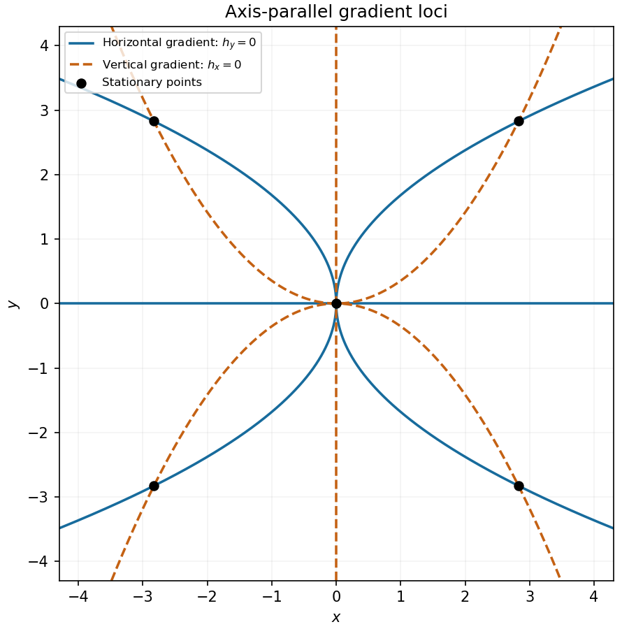

<h1 id="12/b/solution">Solution</h1>

↑ **Parent:** [B](../b.md)

The [gradient](../../../../../gradient.md) is horizontal when $h_y=0$ and vertical when $h_x=0$. Factoring those [partial derivatives](../../../../../partial-derivative.md) gives the two [loci](../../../../../locus-mathematics.md):

$$
\boxed{h_y=0:\quad y=0\quad\text{or}\quad x=\pm\frac{y^2}{2\sqrt2}},
$$

$$
\boxed{h_x=0:\quad x=0\quad\text{or}\quad y=\pm\frac{x^2}{2\sqrt2}}.
$$

Thus each [locus](../../../../../locus-mathematics.md) consists of an axis and two [parabolas](../../../../../parabola.md). Their common points are the five [stationary points](../../../../../stationary-point.md) found below. At those points the [gradient](../../../../../gradient.md) is zero and has no direction, so they are included in both algebraic zero-component conditions but excluded if “parallel” is required to mean a nonzero directed [vector](../../../../../vector.md).

**[Figure 2](#12/b/image-loci-of-horizontal-and-vertical-gradients). Loci of horizontal and vertical gradients**. Blue curves have $h_y=0$, orange curves have $h_x=0$, and black points mark their intersections. At the black points the [gradient](../../../../../gradient.md) itself vanishes.

## ↑ Ancestors (13)

1. [B](../b.md)
2. [12](../../12.md)
3. [Paper 2](../../../paper-2-split.md)
4. [2024](../../../split.md)
5. [Past exam of the mathematics course of the year 1 of the natural sciences course of the University of Cambridge](../../../../split.md)
6. [Mathematics course of the year 1 of the natural sciences course of the University of Cambridge](../../../../../mathematics-course-of-the-year-1-of-the-natural-sciences-course-of-the-university-of-cambridge.md)
7. [Year 1 of the natural sciences course of the University of Cambridge](../../../../../year-1-of-the-natural-sciences-course-of-the-university-of-cambridge.md)
8. [Year of the natural sciences course of the University of Cambridge](../../../../../year-of-the-natural-sciences-course-of-the-university-of-cambridge.md)
9. [Natural sciences course of the University of Cambridge](../../../../../natural-sciences-course-of-the-university-of-cambridge.md)
10. [Course of the University of Cambridge](../../../../../course-of-the-university-of-cambridge.md)
11. [University of Cambridge](../../../../../university-of-cambridge-split.md)
12. [List of universities](../../../../../list-of-universities.md)
13. [Codex Wiki](../../../../../split.md)
