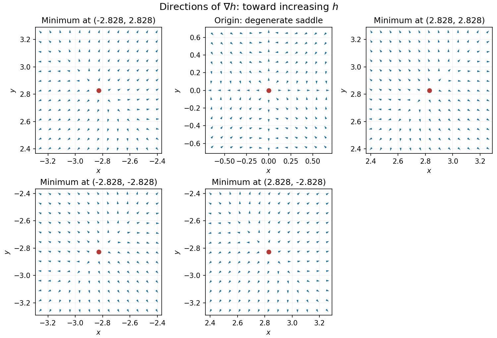

<h1 id="12/f/solution">Solution</h1>

↑ **Parent:** [F](../f.md)

Near a nonzero [stationary point](../../../../../stationary-point.md) $\mathbf p$, [Taylor expansion](../../../../../taylor-expansion.md) of the [gradient](../../../../../gradient.md) gives $\nabla h(\mathbf p+\mathbf v)=H(\mathbf p)\mathbf v+O(|\mathbf v|^2)$. Since the [Hessian matrix](../../../../../hessian-matrix.md) is [positive definite](../../../../../positive-definite-matrix.md), $\mathbf v\cdot\nabla h(\mathbf p+\mathbf v)>0$ for sufficiently small nonzero $\mathbf v$. Thus the [gradient](../../../../../gradient.md) arrows point away from each of the four [local minima](../../../../../local-minimum.md), with different strengths in the two [eigenvector](../../../../../eigenvector.md) directions.

At the origin, on the $x$-axis the [gradient](../../../../../gradient.md) is $(6x^5,0)$ and on the $y$-axis it is $(0,6y^5)$, so arrows point outward. On $y=x$ the [gradient](../../../../../gradient.md) is $6x^3(x^2-8)(1,1)$, and on $y=-x$ it is $6x^3(x^2-8)(1,-1)$, so arrows point toward the origin for small $|x|$. Away from the axes the leading terms are $(-48xy^2,-48x^2y)$, pointing inward in both coordinate signs. The narrow outward sectors close to the axes are visible in the exact [vector field](../../../../../vector-field.md).

**[Figure 4](#12/f/image-gradient-directions-near-all-five-stationary-points). Gradient directions near all five stationary points**. Arrows show normalized [gradient](../../../../../gradient.md) directions, not the direction of descent. They point outward near the four minima, while the degenerate origin has outward axis directions and inward diagonal directions.

## ↑ Ancestors (13)

1. [F](../f.md)
2. [12](../../12.md)
3. [Paper 2](../../../paper-2-split.md)
4. [2024](../../../split.md)
5. [Past exam of the mathematics course of the year 1 of the natural sciences course of the University of Cambridge](../../../../split.md)
6. [Mathematics course of the year 1 of the natural sciences course of the University of Cambridge](../../../../../mathematics-course-of-the-year-1-of-the-natural-sciences-course-of-the-university-of-cambridge.md)
7. [Year 1 of the natural sciences course of the University of Cambridge](../../../../../year-1-of-the-natural-sciences-course-of-the-university-of-cambridge.md)
8. [Year of the natural sciences course of the University of Cambridge](../../../../../year-of-the-natural-sciences-course-of-the-university-of-cambridge.md)
9. [Natural sciences course of the University of Cambridge](../../../../../natural-sciences-course-of-the-university-of-cambridge.md)
10. [Course of the University of Cambridge](../../../../../course-of-the-university-of-cambridge.md)
11. [University of Cambridge](../../../../../university-of-cambridge-split.md)
12. [List of universities](../../../../../list-of-universities.md)
13. [Codex Wiki](../../../../../split.md)
