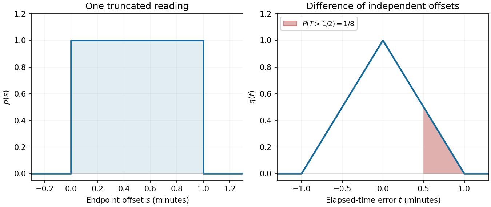

<h1 id="14/a/ii/solution">Solution</h1>

↑ **Parent:** [Ii](../ii.md)

The graph is a rectangle of height one over $[0,1)$, with zero height elsewhere. Its unit [area](../../../../../../surface-area.md) is the required normalization of the [probability density function](../../../../../../probability-density-function.md).

**[Figure 5](#14/a/ii/image-uniform-endpoint-uncertainty-and-triangular-elapsed-time-uncertainty). Uniform endpoint uncertainty and triangular elapsed-time uncertainty**. Left: the [uniform distribution](../../../../../../continuous-uniform-distribution.md) of one endpoint offset. Right: the [triangular distribution](../../../../../../triangular-distribution.md) of the difference of two independent endpoint offsets. Shading marks the event $T>1/2$.

## ↑ Ancestors (14)

1. [Ii](../ii.md)
2. [A](../../a.md)
3. [14](../../../14.md)
4. [Paper 2](../../../../paper-2-split.md)
5. [2024](../../../../split.md)
6. [Past exam of the mathematics course of the year 1 of the natural sciences course of the University of Cambridge](../../../../../split.md)
7. [Mathematics course of the year 1 of the natural sciences course of the University of Cambridge](../../../../../../mathematics-course-of-the-year-1-of-the-natural-sciences-course-of-the-university-of-cambridge.md)
8. [Year 1 of the natural sciences course of the University of Cambridge](../../../../../../year-1-of-the-natural-sciences-course-of-the-university-of-cambridge.md)
9. [Year of the natural sciences course of the University of Cambridge](../../../../../../year-of-the-natural-sciences-course-of-the-university-of-cambridge.md)
10. [Natural sciences course of the University of Cambridge](../../../../../../natural-sciences-course-of-the-university-of-cambridge.md)
11. [Course of the University of Cambridge](../../../../../../course-of-the-university-of-cambridge.md)
12. [University of Cambridge](../../../../../../university-of-cambridge-split.md)
13. [List of universities](../../../../../../list-of-universities.md)
14. [Codex Wiki](../../../../../../split.md)
