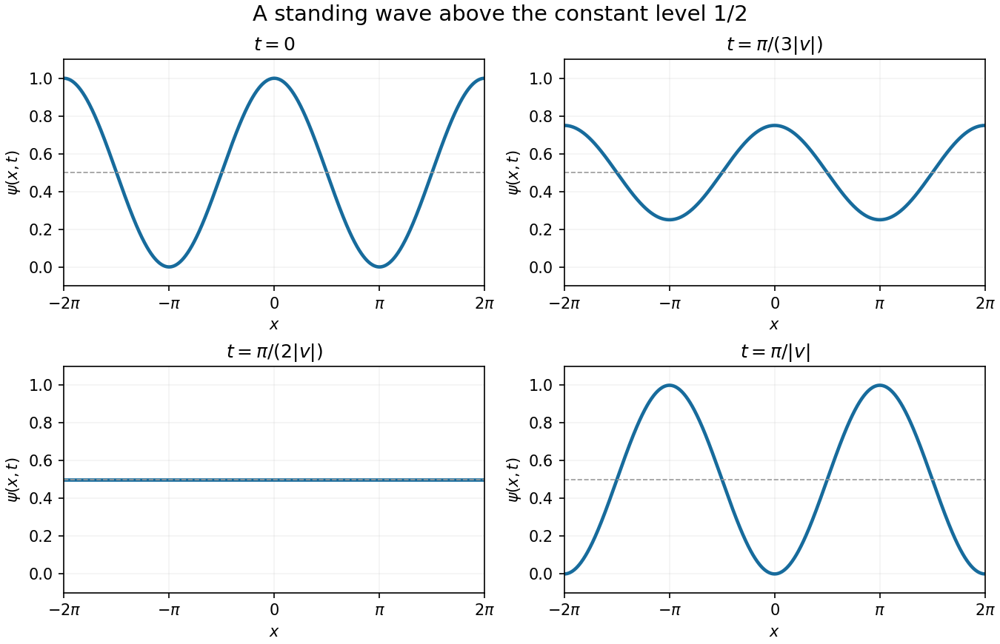

<h1 id="20/c/ii/solution">Solution</h1>

↑ **Parent:** [Ii](../ii.md)

The [standing wave](../../../../../../standing-wave.md) oscillates about the constant level $1/2$, with time period $2\pi/|v|$. Suitable snapshots are

$$
\begin{aligned}
t=0:&\quad\psi=\tfrac12(1+\cos x),\\
t=\frac{\pi}{3|v|}:&\quad\psi=\tfrac12+\tfrac14\cos x,\\
t=\frac{\pi}{2|v|}:&\quad\psi=\tfrac12,\\
t=\frac{\pi}{|v|}:&\quad\psi=\tfrac12(1-\cos x),\\
t=\frac{2\pi}{|v|}:&\quad\psi=\tfrac12(1+\cos x).
\end{aligned}
$$

The nonconstant amplitude shrinks to zero at a quarter-period, reverses sign at half a period, and returns after a full period. The [nodes of a standing wave](../../../../../../node-physics.md) of the oscillatory part, $x=\pi/2+k\pi$, remain at height $1/2$.

**[Figure 6](#20/c/ii/image-time-evolution-of-the-whole-line-neumann-compatible-standing-wave). Time evolution of the whole-line Neumann-compatible standing wave**. Snapshots at phases $|v|t=0$, $\pi/3$, $\pi/2$ and $\pi$ illustrate contraction, flattening and reversal of the cosine profile. A full-period snapshot repeats the initial curve.

## ↑ Ancestors (14)

1. [Ii](../ii.md)
2. [C](../../c.md)
3. [20](../../../20.md)
4. [Paper 2](../../../../paper-2-split.md)
5. [2024](../../../../split.md)
6. [Past exam of the mathematics course of the year 1 of the natural sciences course of the University of Cambridge](../../../../../split.md)
7. [Mathematics course of the year 1 of the natural sciences course of the University of Cambridge](../../../../../../mathematics-course-of-the-year-1-of-the-natural-sciences-course-of-the-university-of-cambridge.md)
8. [Year 1 of the natural sciences course of the University of Cambridge](../../../../../../year-1-of-the-natural-sciences-course-of-the-university-of-cambridge.md)
9. [Year of the natural sciences course of the University of Cambridge](../../../../../../year-of-the-natural-sciences-course-of-the-university-of-cambridge.md)
10. [Natural sciences course of the University of Cambridge](../../../../../../natural-sciences-course-of-the-university-of-cambridge.md)
11. [Course of the University of Cambridge](../../../../../../course-of-the-university-of-cambridge.md)
12. [University of Cambridge](../../../../../../university-of-cambridge-split.md)
13. [List of universities](../../../../../../list-of-universities.md)
14. [Codex Wiki](../../../../../../split.md)
