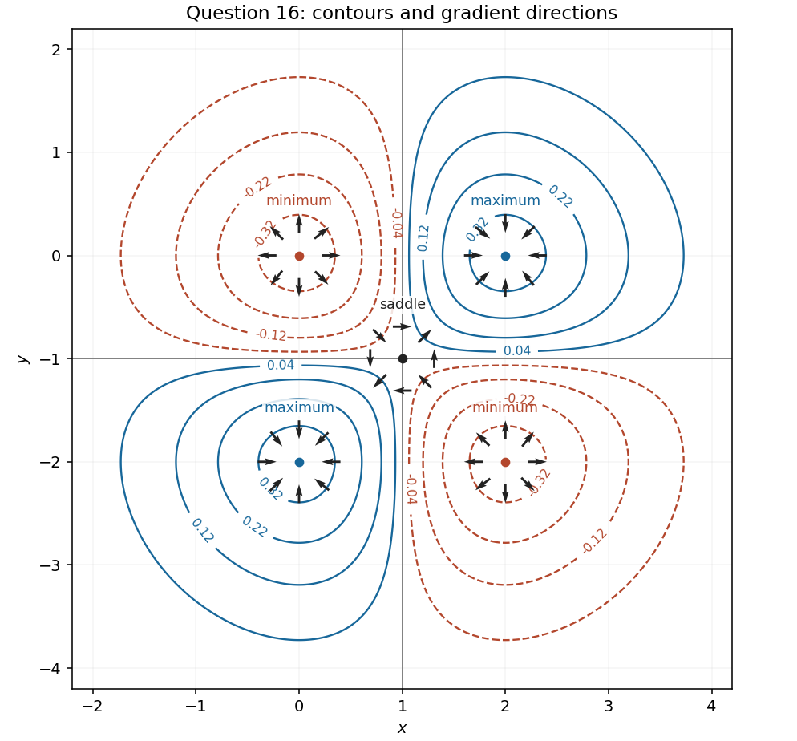

<h1 id="16/c/solution">Solution</h1>

↑ **Parent:** [C](../c.md)

In the translated coordinates $u=x-1$, $v=y+1$, the zero [level set](../../../../../level-set.md) is the pair of [lines](../../../../../straight-line.md) $u=0$ and $v=0$. The [function](../../../../../function-split.md) is positive in the quadrants $uv>0$ and negative in those with $uv<0$, and tends to zero as $u^2+v^2\to\infty$. Thus its nonzero [contours](../../../../../contour-plot.md) form closed curves around the four off-centre [stationary points](../../../../../stationary-point.md).

For an explicit description of the [contour plot](../../../../../contour-plot.md), use [polar coordinates](../../../../../polar-coordinates.md) $u=r\cos\theta$, $v=r\sin\theta$:

$$
f=\frac{r^2}{2}e^{-r^2/2}\sin2\theta.
$$

At fixed direction within a quadrant, the magnitude increases until $r=\sqrt2$ and then decreases towards zero. Also $|u|e^{-u^2/2}\leq e^{-1/2}$, with equality exactly when $|u|=1$, and similarly for $v$. Consequently $|f|\leq e^{-1}$; each positive level below $e^{-1}$ encloses a positive peak in each positive quadrant, with the analogous negative contours in the negative quadrants.

To classify the [stationary points](../../../../../stationary-point.md), the [Hessian matrix](../../../../../hessian-matrix.md) is

$$
\nabla^2f=E\begin{pmatrix}uv(u^2-3)&(1-u^2)(1-v^2)\\(1-u^2)(1-v^2)&uv(v^2-3)\end{pmatrix}.
$$

At $u=v=0$ it is $\begin{pmatrix}0&1\\1&0\end{pmatrix}$, with [eigenvalues](../../../../../eigenvalue.md) $1$ and $-1$, so $(1,-1)$ is a [saddle point](../../../../../saddle-point.md). At $u,v\in\{-1,1\}$ it is $-2fI$. Therefore **$(2,0)$ and $(0,-2)$ are strict [local maxima](../../../../../local-maximum.md), and $(2,-2)$ and $(0,0)$ are strict [local minima](../../../../../local-minimum.md)**. These are also global maxima and minima by the bound just proved.

**[Figure 2](#16/c/image-contours-and-gradient-directions-near-all-five-stationary-points-in-question-16). Contours and gradient directions near all five stationary points in Question 16**.

## ↑ Ancestors (13)

1. [C](../c.md)
2. [16](../../16.md)
3. [Paper 1](../../../paper-1-split.md)
4. [2025](../../../split.md)
5. [Past exam of the mathematics course of the year 1 of the natural sciences course of the University of Cambridge](../../../../split.md)
6. [Mathematics course of the year 1 of the natural sciences course of the University of Cambridge](../../../../../mathematics-course-of-the-year-1-of-the-natural-sciences-course-of-the-university-of-cambridge.md)
7. [Year 1 of the natural sciences course of the University of Cambridge](../../../../../year-1-of-the-natural-sciences-course-of-the-university-of-cambridge.md)
8. [Year of the natural sciences course of the University of Cambridge](../../../../../year-of-the-natural-sciences-course-of-the-university-of-cambridge.md)
9. [Natural sciences course of the University of Cambridge](../../../../../natural-sciences-course-of-the-university-of-cambridge.md)
10. [Course of the University of Cambridge](../../../../../course-of-the-university-of-cambridge.md)
11. [University of Cambridge](../../../../../university-of-cambridge-split.md)
12. [List of universities](../../../../../list-of-universities.md)
13. [Codex Wiki](../../../../../split.md)
