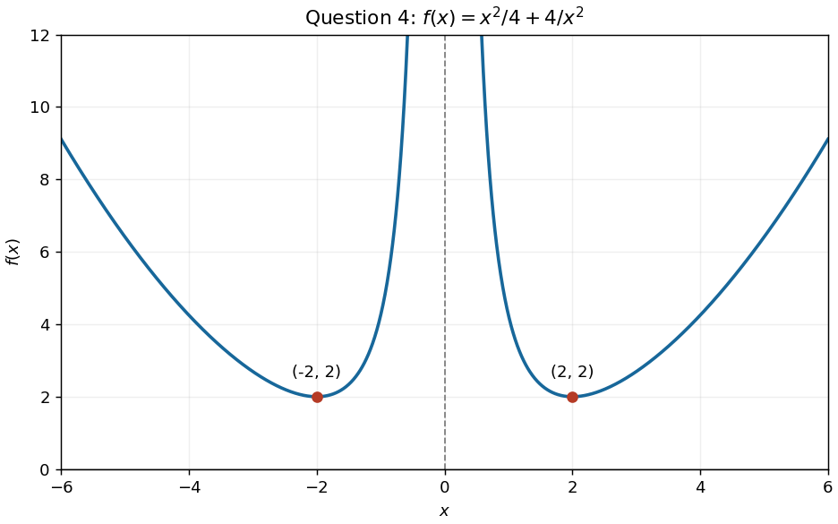

<h1 id="4/b/solution">Solution</h1>

↑ **Parent:** [B](../b.md)

For the requested parameter value $a=2$, the [function graph](../../../../../graph-of-a-function.md) has two branches, symmetric about the vertical axis because $f$ is an [even function](../../../../../even-function.md). Its [derivatives](../../../../../derivative.md) are

$$
f'(x)=\frac x2-\frac8{x^3}=\frac{x^4-16}{2x^3},\qquad f''(x)=\frac12+\frac{24}{x^4}>0.
$$

The [stationary points](../../../../../stationary-point.md) are $\boxed{(-2,2)\text{ and }(2,2)}$, both [local minima](../../../../../local-minimum.md) and also the lowest points of their respective branches. The [function](../../../../../function-split.md) tends to $+\infty$ as $x\to0^\pm$, so $x=0$ is a vertical [asymptote](../../../../../asymptote.md); it also tends to $+\infty$ as $|x|\to\infty$. The negative branch decreases to $(-2,2)$ and then rises towards the vertical [asymptote](../../../../../asymptote.md); the positive branch falls from the vertical [asymptote](../../../../../asymptote.md) to $(2,2)$ and then rises.

**[Figure 1](#4/b/image-two-branches-and-minima-of-the-function-in-question-4-for-a-2). Two branches and minima of the function in Question 4 for $a=2$**.

## ↑ Ancestors (13)

1. [B](../b.md)
2. [4](../../4.md)
3. [Paper 1](../../../paper-1-split.md)
4. [2025](../../../split.md)
5. [Past exam of the mathematics course of the year 1 of the natural sciences course of the University of Cambridge](../../../../split.md)
6. [Mathematics course of the year 1 of the natural sciences course of the University of Cambridge](../../../../../mathematics-course-of-the-year-1-of-the-natural-sciences-course-of-the-university-of-cambridge.md)
7. [Year 1 of the natural sciences course of the University of Cambridge](../../../../../year-1-of-the-natural-sciences-course-of-the-university-of-cambridge.md)
8. [Year of the natural sciences course of the University of Cambridge](../../../../../year-of-the-natural-sciences-course-of-the-university-of-cambridge.md)
9. [Natural sciences course of the University of Cambridge](../../../../../natural-sciences-course-of-the-university-of-cambridge.md)
10. [Course of the University of Cambridge](../../../../../course-of-the-university-of-cambridge.md)
11. [University of Cambridge](../../../../../university-of-cambridge-split.md)
12. [List of universities](../../../../../list-of-universities.md)
13. [Codex Wiki](../../../../../split.md)
