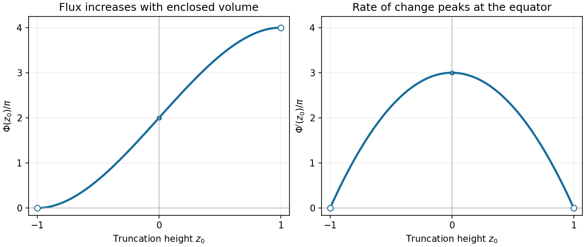

<h1 id="17/a/ii/solution">Solution</h1>

↑ **Parent:** [Ii](../ii.md)

Differentiate the [flux](../../../../../../flux.md):

$$
\boxed{\Phi'(z_0)=3\pi(1-z_0^2)},\qquad
\Phi''(z_0)=-6\pi z_0.
$$

On $-1<z_0<1$, $\Phi$ is strictly increasing. Its limiting endpoint values are $\Phi(-1)=0$ and $\Phi(1)=4\pi$, and $\Phi(0)=2\pi$. It has horizontal limiting [tangents](../../../../../../tangent.md) at the endpoints, curves upward for $z_0<0$, curves downward for $z_0>0$, and has an [inflection point](../../../../../../inflection-point.md) at zero.

The [derivative](../../../../../../derivative.md) graph is a downward-opening [parabola](../../../../../../parabola.md), approaching zero at both endpoints and attaining its maximum $3\pi$ at $z_0=0$.

**[Figure 1](#17/a/ii/image-flux-through-the-truncated-unit-sphere-and-its-derivative). Flux through the truncated unit sphere and its derivative**. Both curves are scaled by $\pi$. Endpoint circles show limiting values because the prescribed truncation parameter lies in $(-1,1)$. The [flux](../../../../../../flux.md) increases from zero to $4\pi$, while its [derivative](../../../../../../derivative.md) is largest at the equator.

## ↑ Ancestors (14)

1. [Ii](../ii.md)
2. [A](../../a.md)
3. [17](../../../17.md)
4. [Paper 2](../../../../paper-2-split.md)
5. [2025](../../../../split.md)
6. [Past exam of the mathematics course of the year 1 of the natural sciences course of the University of Cambridge](../../../../../split.md)
7. [Mathematics course of the year 1 of the natural sciences course of the University of Cambridge](../../../../../../mathematics-course-of-the-year-1-of-the-natural-sciences-course-of-the-university-of-cambridge.md)
8. [Year 1 of the natural sciences course of the University of Cambridge](../../../../../../year-1-of-the-natural-sciences-course-of-the-university-of-cambridge.md)
9. [Year of the natural sciences course of the University of Cambridge](../../../../../../year-of-the-natural-sciences-course-of-the-university-of-cambridge.md)
10. [Natural sciences course of the University of Cambridge](../../../../../../natural-sciences-course-of-the-university-of-cambridge.md)
11. [Course of the University of Cambridge](../../../../../../course-of-the-university-of-cambridge.md)
12. [University of Cambridge](../../../../../../university-of-cambridge-split.md)
13. [List of universities](../../../../../../list-of-universities.md)
14. [Codex Wiki](../../../../../../split.md)
