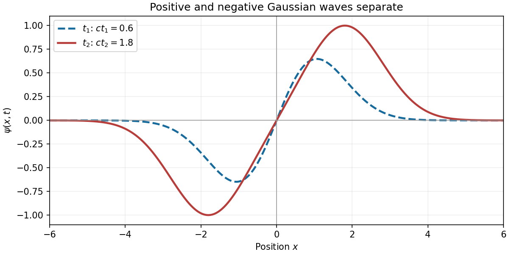

<h1 id="20/c/solution">Solution</h1>

↑ **Parent:** [C](../c.md)

An [antiderivative](../../../../../antiderivative.md) of the initial [velocity](../../../../../velocity.md) is $-2c e^{-s^2/2}$. Thus [D'Alembert's formula](../../../../../d-alembert-s-formula.md) gives

$$
\psi(x,t)=\frac1{2c}\left[-2c e^{-s^2/2}\right]_{x-ct}^{x+ct}
=\boxed{e^{-(x-ct)^2/2}-e^{-(x+ct)^2/2}}.
$$

This is a positive [Gaussian function](../../../../../gaussian-function.md) moving right and a negative [Gaussian function](../../../../../gaussian-function.md) moving left. Their cancellation at $t=0$ gives the zero initial displacement, while direct [differentiation](../../../../../differentiation.md) gives $\psi_t(x,0)=2cx e^{-x^2/2}$.

For every $t>0$, the profile is an [odd function](../../../../../odd-function.md) of $x$, vanishes at $x=0$, is positive for $x>0$ and negative for $x<0$, and tends to zero at both spatial infinities. The signs follow from $(x+ct)^2-(x-ct)^2=4xct$. The positive and negative lobes move farther apart as $t$ increases; for large separation they approach the individual unit-height [Gaussian functions](../../../../../gaussian-function.md) centred at $x=\pm ct$. At finite separation the actual extrema lie slightly beyond these centres: writing $a=ct$, the positive [global maximum](../../../../../global-maximum.md) occurs at the unique $x>a$ satisfying $(x-a)/(x+a)=e^{-2ax}$.

**[Figure 2](#20/c/image-oppositely-signed-gaussian-wave-profiles-at-two-positive-times). Oppositely signed Gaussian wave profiles at two positive times**. Representative times with $ct_1=0.6$ and $ct_2=1.8$ show the [odd function](../../../../../odd-function.md) profile and increasing separation of its lobes. The individual component centres are $x=\pm ct$, while their superposition slightly shifts the actual extrema.

## ↑ Ancestors (13)

1. [C](../c.md)
2. [20](../../20.md)
3. [Paper 2](../../../paper-2-split.md)
4. [2025](../../../split.md)
5. [Past exam of the mathematics course of the year 1 of the natural sciences course of the University of Cambridge](../../../../split.md)
6. [Mathematics course of the year 1 of the natural sciences course of the University of Cambridge](../../../../../mathematics-course-of-the-year-1-of-the-natural-sciences-course-of-the-university-of-cambridge.md)
7. [Year 1 of the natural sciences course of the University of Cambridge](../../../../../year-1-of-the-natural-sciences-course-of-the-university-of-cambridge.md)
8. [Year of the natural sciences course of the University of Cambridge](../../../../../year-of-the-natural-sciences-course-of-the-university-of-cambridge.md)
9. [Natural sciences course of the University of Cambridge](../../../../../natural-sciences-course-of-the-university-of-cambridge.md)
10. [Course of the University of Cambridge](../../../../../course-of-the-university-of-cambridge.md)
11. [University of Cambridge](../../../../../university-of-cambridge-split.md)
12. [List of universities](../../../../../list-of-universities.md)
13. [Codex Wiki](../../../../../split.md)
