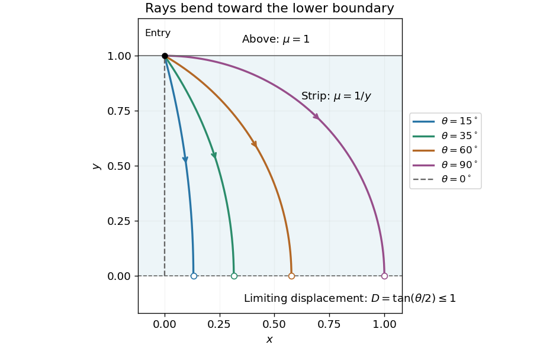
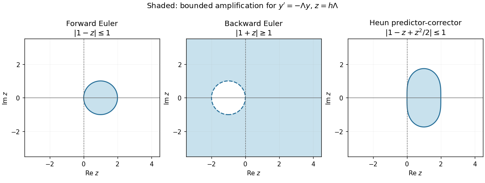

# Paper 1

↑ **Parent:** [2001](../2001.md)

[Original examination paper](https://www.maths.cam.ac.uk/undergradnst/files/2001/PaperNST_IB_1.pdf)

These solutions cover all eleven questions and every printed subpart. The qualification needed at $\kappa=0$ in Question 8 and the limiting interpretation of the ray displacement in Question 10 are explained with their solutions.

**Table of contents**

- [1](#1)
  - [Solution](#1/solution)
- [2](#2)
  - [Solution](#2/solution)
- [3](#3)
  - [Solution](#3/solution)
- [4](#4)
  - [a](#4/a)
    - [Solution](#4/a/solution)
  - [b](#4/b)
    - [Solution](#4/b/solution)
- [5](#5)
  - [Solution](#5/solution)
- [6](#6)
  - [Solution](#6/solution)
- [7](#7)
  - [Solution](#7/solution)
- [8](#8)
  - [Solution](#8/solution)
- [9](#9)
  - [Solution](#9/solution)
- [10](#10)
  - [Solution](#10/solution)
- [11](#11)
  - [Solution](#11/solution)

## 1

↑ **Parent:** [Paper 1](paper-1.md)

<h3 id="1/solution">Solution</h3>

↑ **Parent:** [1](#1)

**Vector identity.** Work in [Cartesian coordinates](../../linear-algebra.md#cartesian-coordinate-system) and use the [Einstein summation convention](../../multilinear-algebra.md#einstein-notation). Contraction of the two [Levi-Civita symbols](../../multivariable-calculus.md#levi-civita-symbol) gives

$$
\begin{aligned}
[\mathbf u\times(\nabla\times\mathbf u)]_i&=\epsilon_{ijk}u_j\epsilon_{klm}\partial_lu_m\\
&=(\delta_{il}\delta_{jm}-\delta_{im}\delta_{jl})u_j\partial_lu_m\\
&=u_j\partial_iu_j-u_j\partial_ju_i\\
&=\tfrac12\partial_i(u_ju_j)-[(\mathbf u\cdot\nabla)\mathbf u]_i.
\end{aligned}
$$

Thus the [convective acceleration identity](../../vorticity.md#convective-acceleration-identity) is

$$
\boxed{(\mathbf u\cdot\nabla)\mathbf u=\frac12\nabla|\mathbf u|^2-\mathbf u\times(\nabla\times\mathbf u).}
$$

Each term is a geometrically defined [vector field](../../multivariable-calculus.md#vector-field): the [directional derivative](../../multivariable-calculus.md#directional-derivative) of a vector along itself, the [gradient](../../multivariable-calculus.md#gradient) of a [scalar field](../../classical-field-theory.md#scalar-field), and a [cross product](../../vector-space.md#cross-product) with the [curl](../../multivariable-calculus.md#curl). Equality in a Cartesian frame is equality of these vectors, so it holds in every coordinate system. When using a varying coordinate [basis](../../vector-space.md#basis), derivatives of the varying basis vectors must be included; differentiating only the component functions would describe a different operation.

**Spherical metric.** Let

$$
R(r,\theta,\phi)=(r\sin\theta\cos\phi,r\sin\theta\sin\phi,r\cos\theta).
$$

Differentiating gives the coordinate [tangent vectors](../../tangent-vector.md)

$$
\begin{aligned}
R_r&=(\sin\theta\cos\phi,\sin\theta\sin\phi,\cos\theta),\\
R_\theta&=r(\cos\theta\cos\phi,\cos\theta\sin\phi,-\sin\theta),\\
R_\phi&=r\sin\theta(-\sin\phi,\cos\phi,0).
\end{aligned}
$$

Their pairwise [dot products](../../inner-product.md#dot-product) vanish, proving that [spherical coordinates](../../multivariable-calculus.md#spherical-coordinate-system) are [orthogonal coordinates](../../multivariable-calculus.md#orthogonal-coordinates). Their lengths are the [scale factors of orthogonal coordinates](../../multivariable-calculus.md#scale-factors-of-orthogonal-coordinates):

$$
\boxed{h_r=1,\qquad h_\theta=r,\qquad h_\phi=r\sin\theta,\qquad ds^2=dr^2+r^2d\theta^2+r^2\sin^2\theta\,d\phi^2.}
$$

These formulas use the usual chart $r>0,0<\theta<\pi$; the origin and polar axis are coordinate singularities.

**Azimuthal field.** Write the speed as $U(r)$ to distinguish it from the [velocity field](../../fluid-mechanics.md#velocity-field) $\mathbf u=U(r)e_\phi$. Using the [curl in spherical coordinates](../../multivariable-calculus.md#curl-in-spherical-coordinates),

$$
\nabla\times\mathbf u=\frac{U\cot\theta}{r}e_r-\frac{U+rU'}r e_\theta.
$$

Also $\frac12\nabla|\mathbf u|^2=UU'e_r$. Since $e_\phi\times e_r=e_\theta$ and $e_\phi\times e_\theta=-e_r$,

$$
\mathbf u\times(\nabla\times\mathbf u)=\frac{U(U+rU')}r e_r+\frac{U^2\cot\theta}r e_\theta.
$$

The $UU'$ terms cancel in the [convective acceleration identity](../../vorticity.md#convective-acceleration-identity), giving

$$
\boxed{[(\mathbf u\cdot\nabla)\mathbf u]_r=-\frac{U^2}r,\quad[(\mathbf u\cdot\nabla)\mathbf u]_\theta=-\frac{U^2\cot\theta}r,\quad[(\mathbf u\cdot\nabla)\mathbf u]_\phi=0.}
$$

This [centripetal acceleration of an azimuthal flow](../../continuum-mechanics.md#centripetal-acceleration-of-an-azimuthal-flow) points toward the polar axis. A streamline is a [circle](../../topology.md#circle) of cylindrical radius $r\sin\theta$, so its acceleration is $-U^2e_\rho/(r\sin\theta)$, with $e_\rho=\sin\theta\,e_r+\cos\theta\,e_\theta$. This independent geometric argument recovers both nonzero components and explains why $U'$ cannot appear: the particle travels at fixed $r$.

## 2

↑ **Parent:** [Paper 1](paper-1.md)

<h3 id="2/solution">Solution</h3>

↑ **Parent:** [2](#2)

**Transform pair.** In the paper's symmetric normalization, the inverse [Fourier transform](../../fourier-transform.md) is

$$
\boxed{g(x)=\frac1{\sqrt{2\pi}}\int_{-\infty}^{\infty}\widetilde g(k)e^{ikx}\,dk.}
$$

Split the transform of $e^{-c|x|}$ at zero, with $c>0$:

$$
\begin{aligned}
\mathcal F[e^{-c|x|}](k)&=\frac1{\sqrt{2\pi}}\left[\int_{-\infty}^0e^{(c-ik)x}\,dx+\int_0^\infty e^{-(c+ik)x}\,dx\right]\\
&=\frac1{\sqrt{2\pi}}\left(\frac1{c-ik}+\frac1{c+ik}\right)=\boxed{\sqrt{\frac2\pi}\frac c{c^2+k^2}}.
\end{aligned}
$$

The inverse formula applied to this result gives

$$
e^{-c|x|}=\frac c\pi\int_{-\infty}^{\infty}\frac{e^{ikx}}{c^2+k^2}\,dk.
$$

Because the kernel is even, replacing the transform variable by $x$ and the argument by $k$ yields

$$
\boxed{\mathcal F\left[\frac1{x^2+c^2}\right](k)=\frac{\sqrt{2\pi}}{2c}e^{-c|k|}.}
$$

The factors of $\sqrt{2\pi}$ depend on the normalization and will also enter the [convolution theorem](../../fourier-analysis.md#convolution-theorem).

**Convolution theorem.** For integrable [functions](../../function.md) define the [convolution](../../fourier-analysis.md#convolution)

$$
(f*g)(x)=\int_{-\infty}^{\infty}f(x-y)g(y)\,dy.
$$

Substitute this into the [Fourier transform](../../fourier-transform.md), interchange the two absolutely integrable factors using [Fubini's theorem](../../measure-theory.md#fubini-s-theorem), and set $z=x-y$:

$$
\begin{aligned}
\widetilde{f*g}(k)&=\frac1{\sqrt{2\pi}}\int_{-\infty}^{\infty}\int_{-\infty}^{\infty}f(x-y)g(y)e^{-ikx}\,dy\,dx\\
&=\frac1{\sqrt{2\pi}}\left(\int f(z)e^{-ikz}\,dz\right)\left(\int g(y)e^{-iky}\,dy\right).
\end{aligned}
$$

Therefore

$$
\boxed{\widetilde{f*g}(k)=\sqrt{2\pi}\,\widetilde f(k)\widetilde g(k).}
$$

**Integral equation.** Put $f_a(x)=1/(x^2+a^2)$. Since this is even, the left side is $f_a*g$. The transformed equation is

$$
\frac\pi a e^{-a|k|}\widetilde g(k)=\frac{\sqrt{2\pi}}{2b}e^{-b|k|},
$$

so

$$
\widetilde g(k)=\frac a{b\sqrt{2\pi}}e^{-(b-a)|k|}.
$$

The assumption $b>a$ makes the new scale $d=b-a$ positive. Inverting with the previously established transform pair gives

$$
\boxed{g(x)=\frac{a(b-a)}{\pi b\,[x^2+(b-a)^2]}.}
$$

The [Cauchy convolution semigroup](../../probability-distribution.md#cauchy-convolution-semigroup) gives a quick verification. With $K_c(x)=c/[\pi(x^2+c^2)]$, the formula is $g=(a/b)K_{b-a}$ and $f_a=(\pi/a)K_a$. Hence $f_a*g=(\pi/b)K_b=1/(x^2+b^2)$, as required. The solution is unique among integrable [functions](../../function.md) because the multiplier $\widetilde f_a(k)$ never vanishes.

## 3

↑ **Parent:** [Paper 1](paper-1.md)

<h3 id="3/solution">Solution</h3>

↑ **Parent:** [3](#3)

**Laplace identities.** The one-sided [Laplace transform](../../integral-transform.md#laplace-transform) is

$$
\boxed{F(p)=\int_0^\infty e^{-pt}f(t)\,dt,}
$$

for $\operatorname{Re}p$ sufficiently large that the integral converges. For a piecewise smooth [function](../../function.md) of exponential order, [integration by parts](../../calculus.md#integration-by-parts) gives

$$
\mathcal L[f'](p)=[e^{-pt}f(t)]_0^\infty+p\int_0^\infty e^{-pt}f(t)\,dt=\boxed{pF(p)-f(0)}.
$$

Differentiating under the [integral](../../integral.md) gives

$$
F'(p)=-\int_0^\infty t e^{-pt}f(t)\,dt,\qquad\boxed{\mathcal L[tf](p)=-F'(p)}.
$$

Iteration also yields $\mathcal L[f'']=p^2F-pf(0)-f'(0)$. For real $k$ and $p>0$, taking the imaginary part of $(p-ik)^{-1}$ gives

$$
\boxed{\mathcal L[\sin kt](p)=\frac k{p^2+k^2}.}
$$

**Transformed differential equation.** Let $G=\mathcal L[g]$, using the initial values $g(0)=1,g'(0)=0$. Then

$$
\begin{aligned}
\mathcal L[tg'']&=-\frac d{dp}(p^2G-p)=-2pG-p^2G'+1,\\
2\mathcal L[g']&=2pG-2,\\
\alpha^2\mathcal L[tg]&=-\alpha^2G'.
\end{aligned}
$$

Summing the three contributions gives

$$
\boxed{G'(p)=-\frac1{p^2+\alpha^2}.}
$$

For $\alpha\ne0$, the condition $G(p)\to0$ as $p\to\infty$ fixes the integration constant:

$$
G(p)=\int_p^\infty\frac{dq}{q^2+\alpha^2}=\frac1\alpha\arctan\frac\alpha p\qquad(p>0).
$$

It is simpler to invert the derivative: $\mathcal L[tg]=-G'=1/(p^2+\alpha^2)=\mathcal L[\sin(\alpha t)/\alpha]$. Thus

$$
\boxed{g(t)=\frac{\sin(\alpha t)}{\alpha t}\quad(t>0),\qquad g(0)=1.}
$$

This is the [sinc function](../../fourier-transform.md#sinc-function). Its [Taylor series](../../calculus.md#taylor-series) begins $1-\alpha^2t^2/6+O(t^4)$, verifying both initial values. For a direct differential check set $h=tg=\sin(\alpha t)/\alpha$. Then $h''+\alpha^2h=tg''+2g'+\alpha^2tg=0$. For $\alpha=0$, take the continuous limit $\boxed{g(t)=1}$, which also follows from $G=1/p$.

## 4

↑ **Parent:** [Paper 1](paper-1.md)

<h3 id="4/a">a</h3>

↑ **Parent:** [4](#4)

<h4 id="4/a/solution">Solution</h4>

↑ **Parent:** [A](#4/a)

If $Av=\lambda v$ for a nonzero [eigenvector](../../linear-operator-theory.md#eigenvector), then $A^2v=\lambda^2v$. Since $A^2=A$, $\lambda(\lambda-1)=0$: every [eigenvalue](../../linear-operator-theory.md#eigenvalue) is zero or one. Let $m$ be the number of ones, counted with [algebraic multiplicity](../../linear-operator-theory.md#algebraic-multiplicity). The [trace](../../linear-algebra.md#matrix-trace) is $m$ and the [determinant](../../multilinear-algebra.md#determinant) is the product of these [eigenvalues](../../linear-operator-theory.md#eigenvalue). Therefore

$$
\boxed{m=n:\quad\det A=1,\ \operatorname{tr}A=n;\qquad0\leq m<n:\quad\det A=0,\ \operatorname{tr}A=m.}
$$

Every output $y=Ax$ is fixed by a second application:

$$
\boxed{Ay=A^2x=Ax=y.}
$$

The [image of a linear map](../../vector-space.md#image-of-a-linear-map) is thus the [eigenspace](../../linear-operator-theory.md#eigenspace) for the [eigenvalue](../../linear-operator-theory.md#eigenvalue) one. To establish its dimension without assuming [diagonalizability](../../linear-operator-theory.md#diagonalizable-matrix), decompose every input as

$$
x=Ax+(I-A)x.
$$

The first term lies in the [image of a linear map](../../vector-space.md#image-of-a-linear-map) $A$ and the second in its [kernel](../../kernel-of-a-linear-map.md). Their intersection is zero, because a vector in the image is fixed by $A$ whereas a vector in the kernel is killed by $A$. Thus the space is their [direct sum](../../vector-space.md#direct-sum), and an adapted [basis](../../vector-space.md#basis) puts $A$ into the form $\operatorname{diag}(I_r,0)$, where $r=\operatorname{rank}A$. Comparing [traces](../../linear-algebra.md#matrix-trace) gives $r=m$:

$$
\boxed{\dim\operatorname{im}A=n\text{ in case (i)},\qquad\dim\operatorname{im}A=m\text{ in case (ii)}.}
$$

This is an [idempotent linear map](../../vector-space.md#projection-linear-algebra), and [trace of an idempotent equals its rank](../../vector-space.md#trace-of-an-idempotent-equals-its-rank). If $m=0$, no nonzero output exists. The dimension in the question refers to the image subspace, including its zero vector.

<h3 id="4/b">b</h3>

↑ **Parent:** [4](#4)

<h4 id="4/b/solution">Solution</h4>

↑ **Parent:** [B](#4/b)

The first three output components equal $x_1,x_2,x_3$, while the fourth is $x_4-\sum_{k=1}^4x_k=-x_1-x_2-x_3$. Hence

$$
\boxed{P=\begin{pmatrix}1&0&0&0\\0&1&0&0\\0&0&1&0\\-1&-1&-1&0\end{pmatrix}.}
$$

Its outputs have component sum zero, and applying $P$ to any such output leaves it fixed. Thus

$$
\boxed{P^2=P,\qquad\det P=0,\qquad\operatorname{tr}P=3.}
$$

The first three columns give a [basis](../../vector-space.md#basis) of the [image of a linear map](../../vector-space.md#image-of-a-linear-map):

$$
v_1=(1,0,0,-1)^T,\quad v_2=(0,1,0,-1)^T,\quad v_3=(0,0,1,-1)^T.
$$

They are [linearly independent](../../vector-space.md#linear-independence) because their first three coordinates are the standard [basis](../../vector-space.md#basis). Their [span](../../vector-space.md#linear-span) is precisely the three-dimensional hyperplane $y_1+y_2+y_3+y_4=0$.

Apply the [Gram-Schmidt process](../../inner-product.md#gram-schmidt-process). First $q_1=v_1/\sqrt2$. Subtracting the $q_1$ projection from $v_2$ gives $(-1,2,0,-1)^T/2$, of length $\sqrt{3/2}$. Subtracting both preceding projections from $v_3$ gives $(-1,-1,3,-1)^T/3$, of length $2/\sqrt3$. Therefore an [orthonormal basis](../../inner-product.md#orthonormal-basis) is

$$
\boxed{q_1=\frac{(1,0,0,-1)^T}{\sqrt2},\qquad q_2=\frac{(-1,2,0,-1)^T}{\sqrt6},\qquad q_3=\frac{(-1,-1,3,-1)^T}{\sqrt{12}}.}
$$

Their pairwise [dot products](../../inner-product.md#dot-product) vanish and each has length one. Although this image admits an [orthonormal basis](../../inner-product.md#orthonormal-basis), $P$ itself is an [oblique projection](../../vector-space.md#oblique-projection): its [kernel](../../kernel-of-a-linear-map.md) is the fourth coordinate axis, which is not perpendicular to the image, and $P\ne P^T$.

## 5

↑ **Parent:** [Paper 1](paper-1.md)

<h3 id="5/solution">Solution</h3>

↑ **Parent:** [5](#5)

**Commuting inverse.** Assume $I-M$ is invertible, as required by the displayed inverse. Multiplication gives

$$
(I+M)(I-M)=I-M^2=(I-M)(I+M).
$$

Multiply on both sides by $(I-M)^{-1}$ to obtain

$$
\boxed{(I+M)(I-M)^{-1}=(I-M)^{-1}(I+M).}
$$

More generally, a [matrix](../../vector-space.md#matrix) commuting with an invertible [matrix](../../vector-space.md#matrix) also commutes with its inverse.

**Orthogonality.** For a real [skew-symmetric matrix](../../linear-algebra.md#skew-symmetric-matrix) $A$, $x^TAx=0$. If $(I-A)x=0$ for a real [vector](../../vector-space.md#vector) $x$, multiply by $x^T$ to obtain $\|x\|^2=0$. Thus $I-A$ is invertible; the same argument applies to $I+A$. For the [Cayley transform of a real skew-symmetric matrix](../../lie-theory.md#cayley-transform-of-a-real-skew-symmetric-matrix),

$$
N=(I+A)(I-A)^{-1},\qquad N^T=(I+A)^{-1}(I-A).
$$

The factors commute by the first result, so

$$
N^TN=(I+A)^{-1}(I-A)(I+A)(I-A)^{-1}=I.
$$

Therefore $\boxed{N\text{ is an orthogonal matrix}.}$

**Eigenvector mapping.** If $Av=av$, then $(I-A)^{-1}v=(1-a)^{-1}v$. Consequently

$$
\boxed{Nv=\frac{1+a}{1-a}v.}
$$

The denominator cannot vanish. In fact the [eigenvalues](../../linear-operator-theory.md#eigenvalue) of a real [skew-symmetric matrix](../../linear-algebra.md#skew-symmetric-matrix) are purely imaginary: $v^\dagger Av$ is the negative of its complex conjugate, so $a=-\overline a$. For $a=i\beta$ the corresponding [eigenvalue](../../linear-operator-theory.md#eigenvalue) of $N$ is $(1+i\beta)/(1-i\beta)=e^{2i\arctan\beta}$, consistent with [orthogonality](../../inner-product.md#orthogonal-vectors).

**Spectrum in three dimensions.** Let $Q$ be any real three-by-three [orthogonal matrix](../../linear-algebra.md#orthogonal-matrix). For a complex [eigenvector](../../linear-operator-theory.md#eigenvector) $v$, $\|Qv\|=\|v\|$ implies $|\lambda|=1$. A real cubic [characteristic polynomial](../../linear-operator-theory.md#characteristic-polynomial) has a real root, necessarily $+1$ or $-1$. Any nonreal roots form a complex-conjugate pair of unit modulus. If all three roots are real, two of the three signs agree and can be grouped as a pair with angle zero or $\pi$. Thus in every case the [eigenvalues](../../linear-operator-theory.md#eigenvalue) can be written

$$
\boxed{e^{i\alpha},\quad e^{-i\alpha},\quad\varepsilon,\qquad\alpha\in\mathbb R,\quad\varepsilon\in\{1,-1\}.}
$$

Their product is $\varepsilon=\det Q$.

**Determinant and fixed axis for the Cayley transform.** Since $A^T=-A$,

$$
\det(I+A)=\det((I+A)^T)=\det(I-A),
$$

so $\boxed{\det N=1}$. This determinant argument works in every dimension. In dimension three the preceding spectrum result then guarantees an [eigenvector](../../linear-operator-theory.md#eigenvector) with $Nx=x$. Set $z=(I-A)^{-1}x$. The fixed-vector equation says $(I+A)z=(I-A)z$, so $Az=0$ and $x=(I-A)z=z$. Hence

$$
\boxed{Ax=0\text{ for a nonzero real direction }x.}
$$

This is the axis fixed by the three-dimensional [rotation](../../riemannian-geometry.md#rotation-mathematics). Equivalently, a real odd-dimensional [skew-symmetric matrix](../../linear-algebra.md#skew-symmetric-matrix) has zero [determinant](../../multilinear-algebra.md#determinant), because $\det A=\det A^T=\det(-A)=-\det A$.

## 6

↑ **Parent:** [Paper 1](paper-1.md)

<h3 id="6/solution">Solution</h3>

↑ **Parent:** [6](#6)

**Classification and existence.** For $y''+p(x)y'+q(x)y=0$, an [ordinary point](../../complex-analysis.md#ordinary-point-criterion-for-a-second-order-equation) $x_0$ is one where $p,q$ are analytic. There are two independent analytic [power series](../../sequence-and-series.md#power-series) solutions, with arbitrary initial values $y(x_0),y'(x_0)$. A [regular singular point](../../complex-analysis.md#regular-singular-point) is a singular point where $(x-x_0)p(x)$ and $(x-x_0)^2q(x)$ are analytic. The [Frobenius method](../../complex-analysis.md#frobenius-method) then constructs solutions beginning with $(x-x_0)^\sigma$, where $\sigma$ solves the [indicial equation](../../linear-ordinary-differential-equation.md#indicial-equation). At least one [Frobenius solution](../../complex-analysis.md#frobenius-solution) exists; two such solutions exist without logarithms when the two exponents differ by a noninteger. Repeated exponents or an integer difference can require a logarithmic second solution.

For this equation,

$$
xp(x)=\frac{1-x}2,\qquad x^2q(x)=-\frac x4.
$$

Both are analytic at zero, while $p,q$ themselves have poles there. Thus zero is a [regular singular point](../../complex-analysis.md#regular-singular-point).

**Indicial equation and recurrence.** Multiply by $4x$ and insert $y=x^\sigma\sum_{n\geq0}a_nx^n$, $a_0\ne0$:

$$
4xy''+2(1-x)y'-y=0.
$$

The lowest power $x^{\sigma-1}$ has coefficient $[4\sigma(\sigma-1)+2\sigma]a_0$, giving

$$
\boxed{2\sigma(2\sigma-1)=0,\qquad\sigma=0,\ \frac12.}
$$

The coefficient of $x^{n+\sigma}$ is

$$
2(n+\sigma+1)(2n+2\sigma+1)a_{n+1}-(2n+2\sigma+1)a_n.
$$

For either exponent the common factor is nonzero for $n\geq0$, so the [recurrence relation](../../sequence-and-series.md#recurrence-relation) reduces to

$$
\boxed{a_{n+1}=\frac{a_n}{2(n+\sigma+1)},\qquad n\geq0.}
$$

Normalizing each leading coefficient to one, the two [Frobenius solutions](../../complex-analysis.md#frobenius-solution) are

$$
\boxed{y_1(x)=\sum_{n=0}^\infty\frac{x^n}{2^nn!}=e^{x/2},\qquad y_2(x)=\sqrt{x}\left(1+\frac x3+\frac{x^2}{15}+\frac{x^3}{105}+\cdots\right).}
$$

More explicitly, $y_2=\sqrt{x}\sum_{n\geq0}2^nn!x^n/(2n+1)!$. The distinct leading powers establish [linear independence](../../vector-space.md#linear-independence), so $y=C_1y_1+C_2y_2$ on the positive real side of the singular point. The displayed [exponential function](../../calculus.md#exponential-function) is the requested closed-form solution; substitution gives $y_1'=y_1/2,y_1''=y_1/4$, which makes the differential expression zero.

**Convergence.** For either exponent the ratio of successive terms in the coefficient [power series](../../sequence-and-series.md#power-series) is

$$
\left|\frac{a_{n+1}x^{n+1}}{a_nx^n}\right|=\frac{|x|}{2|n+\sigma+1|}\longrightarrow0.
$$

Thus both coefficient series have $\boxed{R=\infty}$ by the [ratio test](../../sequence-and-series.md#ratio-test). This does not remove the $\sqrt{x}$ branch point of $y_2$: its analytic coefficient factor is entire, while the full [Frobenius solution](../../complex-analysis.md#frobenius-solution) requires a square-root branch away from zero in the complex plane. The differential equation has no other finite singular points to limit continuation of these coefficient series.

## 7

↑ **Parent:** [Paper 1](paper-1.md)

<h3 id="7/solution">Solution</h3>

↑ **Parent:** [7](#7)

**Boundary form.** For real [functions](../../function.md) and $\mathcal Ly=-(py')'+qy$, [integration by parts](../../calculus.md#integration-by-parts) gives

$$
\begin{aligned}
\int_a^b(y_1\mathcal Ly_2-y_2\mathcal Ly_1)\,dx&=\int_a^b[-y_1(py_2')'+y_2(py_1')']\,dx\\
&=[p(y_2y_1'-y_1y_2')]_a^b.
\end{aligned}
$$

The integral terms containing $py_1'y_2'$ cancel, as do the $q$ terms. This is the [Lagrange identity for a Sturm-Liouville operator](../../sturm-liouville-theory.md#lagrange-identity-for-a-sturm-liouville-operator). The [boundary conditions](../../differential-equation.md#boundary-condition) must make this boundary form zero for every admissible pair. Several suitable choices are homogeneous [Dirichlet boundary conditions](../../differential-equation.md#dirichlet-boundary-condition) at both endpoints; homogeneous [Neumann boundary conditions](../../differential-equation.md#neumann-boundary-condition) at both endpoints; one of each; or separated homogeneous [Robin boundary conditions](../../differential-equation.md#robin-boundary-condition)

$$
\alpha_a y(a)+\beta_a p(a)y'(a)=0,\qquad\alpha_b y(b)+\beta_b p(b)y'(b)=0,
$$

where each fixed real pair $(\alpha,\beta)$ is nonzero. At each endpoint the two boundary data vectors are then proportional, making their antisymmetric product zero. Another choice is periodic data $y(a)=y(b)$ and $p(a)y'(a)=p(b)y'(b)$, which cancel the two endpoint contributions. These domains give the required [self-adjoint differential operator](../../sturm-liouville-theory.md#self-adjoint-differential-operator) in the regular setting.

**Eigenfunctions.** Set $x=\cos\theta$, $0\leq\theta\leq\pi$, and $Y(\theta)=y(\cos\theta)$. The [chain rule](../../calculus.md#chain-rule) gives

$$
y'=-\frac{Y_\theta}{\sin\theta},\qquad(1-x^2)y''-xy'=Y_{\theta\theta}.
$$

The [Chebyshev differential equation](../../numerical-analysis.md#chebyshev-differential-equation) therefore becomes $Y''+n^2Y=0$, with $Y(0)=Y(\pi)=0$. For a positive integer $n$, the first condition excludes the cosine term and the second is satisfied by $\sin(n\theta)$. Thus

$$
\boxed{y_n(x)=N_n\sin(n\arccos x),\qquad\lambda_n=n^2,\qquad n=1,2,\ldots.}
$$

There is no nonzero $n=0$ [eigenfunction](../../linear-operator-theory.md#eigenfunction): the transformed solution is linear in $\theta$ and vanishes at both endpoints only if identically zero. Negative $n$ merely repeats a positive mode with the opposite sign, so it is excluded from the indexing of an independent [eigenbasis](../../linear-operator-theory.md#eigenbasis).

**Weight and normalization.** Multiplying the differential equation by $-1/\sqrt{1-x^2}$ puts it into [Sturm-Liouville form](../../sturm-liouville-theory.md#sturm-liouville-form):

$$
-\frac d{dx}\left(\sqrt{1-x^2}\,y'\right)=\lambda\frac{y}{\sqrt{1-x^2}}.
$$

Hence $p=\sqrt{1-x^2}$, $q=0$ and $w=(1-x^2)^{-1/2}$. Under $x=\cos\theta$, the measure $w(x)\,dx$ becomes $-d\theta$, so

$$
\int_{-1}^1w(x)y_n(x)y_m(x)\,dx=N_nN_m\int_0^\pi\sin(n\theta)\sin(m\theta)\,d\theta=N_nN_m\frac\pi2\delta_{nm}.
$$

Therefore

$$
\boxed{w(x)=\frac1{\sqrt{1-x^2}},\qquad N_n=\sqrt{\frac2\pi}\quad(n\geq1).}
$$

These endpoints are singular because $p$ vanishes and $w$ diverges there, but the weight is integrable. Moreover $py_n'=-N_n n\cos(n\theta)$ remains finite, so the vanishing values of $y_n$ make the boundary form zero. These are the [Dirichlet eigenfunctions of the Chebyshev differential operator](../../numerical-analysis.md#dirichlet-eigenfunctions-of-the-chebyshev-differential-operator), not the first-kind [Chebyshev polynomials](../../numerical-analysis.md#chebyshev-polynomial) $\cos(n\arccos x)$, which have nonzero endpoint values.

## 8

↑ **Parent:** [Paper 1](paper-1.md)

<h3 id="8/solution">Solution</h3>

↑ **Parent:** [8](#8)

**Adapted homogeneous solutions.** First assume real $\kappa\ne0$. The functions $u(x)=\cosh(\kappa x)$ and $v(x)=\cosh(\kappa(1-x))$ solve $z''-\kappa^2z=0$ and obey $u'(0)=v'(1)=0$. Their [Wronskian](../../linear-ordinary-differential-equation.md#wronskian) is

$$
W=uv'-u'v=-\kappa[\cosh(\kappa x)\sinh(\kappa(1-x))+\sinh(\kappa x)\cosh(\kappa(1-x))]=-\kappa\sinh\kappa.
$$

It is independent of $x$ and nonzero.

**Green function.** For $0<\xi<1$, continuity at $x=\xi$ and the jump condition $G_x(\xi^+,\xi)-G_x(\xi^-,\xi)=1$ follow by matching the [Dirac delta function](../../distribution-theory.md#dirac-delta-function) source. In particular a jump in $G$ itself would produce a derivative of the [Dirac delta function](../../distribution-theory.md#dirac-delta-function), which is absent. Write $G=A(\xi)u(x)$ for $x<\xi$ and $G=B(\xi)v(x)$ for $x>\xi$. Solving the continuity and derivative-jump equations gives $A=v(\xi)/W$, $B=u(\xi)/W$. Hence the [Neumann Green function for the modified Helmholtz equation on an interval](../../green-s-function.md#neumann-green-function-for-the-modified-helmholtz-equation-on-an-interval) is

$$
\boxed{G(x,\xi)=-\frac1{\kappa\sinh\kappa}\begin{cases}\cosh(\kappa x)\cosh(\kappa(1-\xi)),&x\leq\xi,\\\cosh(\kappa\xi)\cosh(\kappa(1-x)),&x\geq\xi.\end{cases}}
$$

The two pieces coincide at the source. Their derivative difference is $W/W=1$ and their endpoint derivatives vanish. The same expression has continuous one-sided limits as the source approaches an endpoint; the interior-source construction is what is needed in the integral solution.

**Solution for a general source.** By [superposition](../../vector-space.md#superposition-principle), $y(x)=\int_0^1G(x,\xi)f(\xi)\,d\xi$. Splitting the [integral](../../integral.md) at $\xi=x$ gives

$$
\boxed{y(x)=-\frac{\cosh(\kappa x)\displaystyle\int_x^1f(\xi)\cosh(\kappa(1-\xi))\,d\xi+\cosh(\kappa(1-x))\displaystyle\int_0^xf(\xi)\cosh(\kappa\xi)\,d\xi}{\kappa\sinh\kappa}.}
$$

No nonzero homogeneous solution satisfies both endpoint conditions when $\kappa\ne0$: the condition at zero eliminates $\sinh(\kappa x)$, and the condition at one then eliminates $\cosh(\kappa x)$. Thus the [Green function](../../green-s-function.md) gives the unique solution.

**The printed zero-parameter case.** The statement permits real $\kappa$, but $\kappa=0$ is exceptional. Integrating a putative equation $G''=\delta(x-\xi)$ would give $G'(1)-G'(0)=1$, contrary to the two zero derivatives. Thus this [Green function](../../green-s-function.md) does not exist at zero. For $y''=f$ with homogeneous [Neumann boundary conditions](../../differential-equation.md#neumann-boundary-condition), solvability instead requires $\int_0^1f=0$, and a compatible solution has an arbitrary additive constant. This is the [Fredholm solvability condition](../../sturm-liouville-theory.md#fredholm-solvability-condition) associated with the constant zero mode.

**Explicit forcing.** For $f(x)=x$ and $\kappa=1$, the particular solution is $-x$. Write $y=C\cosh x+D\sinh x-x$. Then $y'(0)=0$ gives $D=1$ and $y'(1)=0$ gives $C=(1-\cosh1)/\sinh1=-\tanh(1/2)$. Therefore

$$
\boxed{y(x)=\sinh x-\tanh(1/2)\cosh x-x=\frac{\sinh(x-1/2)}{\cosh(1/2)}-x.}
$$

Direct differentiation gives $y'=\cosh(x-1/2)/\cosh(1/2)-1$, which vanishes at both endpoints, and $y''-y=x$, verifying the solution independently of the [Green function](../../green-s-function.md) integration.

## 9

↑ **Parent:** [Paper 1](paper-1.md)

<h3 id="9/solution">Solution</h3>

↑ **Parent:** [9](#9)

**Variational formulation.** Take real $p,q,w$ with $p,w>0$ in the interval, and impose homogeneous [Dirichlet boundary conditions](../../differential-equation.md#dirichlet-boundary-condition), or other suitable conditions that cancel the boundary terms. The [functional](../../calculus-of-variations.md#functional)

$$
J[y]=\int_a^b\left[p(x)(y')^2+q(x)y^2-\lambda w(x)y^2\right]dx
$$

has [Euler-Lagrange equation](../../analysis.md#euler-lagrange-equation)

$$
\frac d{dx}(2py')-2(q-\lambda w)y=0,
$$

which is equivalent to $-(py')'+qy-\lambda wy=0$. The same construction is constrained stationarity of the energy $\int[p(y')^2+qy^2]$ subject to $\int wy^2=1$, with $\lambda$ a [Lagrange multiplier](../../mathematical-optimization.md#lagrange-multiplier). For fixed zero endpoint values, the variation vanishes at both ends; homogeneous zero-flux conditions also cancel the boundary term $[2py'\delta y]_a^b$.

Multiplying the differential equation by $y$ and using [integration by parts](../../calculus.md#integration-by-parts) gives the [Rayleigh quotient](../../linear-operator-theory.md#rayleigh-quotient)

$$
\boxed{R[y]=\frac{\displaystyle\int_a^b[p(y')^2+qy^2]dx}{\displaystyle\int_a^bwy^2dx}.}
$$

For a nonzero admissible trial [function](../../function.md), $R[y]\geq\lambda_0$ by the [Rayleigh-Ritz variational principle](../../linear-operator-theory.md#rayleigh-ritz-variational-principle). The [Rayleigh-Ritz method](../../finite-element-method.md#rayleigh-ritz-method) chooses trial functions satisfying the endpoint conditions, often with adjustable coefficients, and minimizes this quotient over that trial family. Expanding $y=\sum c_ny_n$ in a normalized [eigenbasis](../../linear-operator-theory.md#eigenbasis) shows why the lower bound holds: $R[y]=\sum\lambda_n c_n^2/\sum c_n^2$, a weighted average of [eigenvalues](../../linear-operator-theory.md#eigenvalue) no smaller than the least one.

**Radial quadratic trial.** The radial problem becomes

$$
-(r^2\psi')'=\lambda r^2\psi,\qquad\psi(1)=0,\qquad\psi'(0)=0,
$$

where the printed endpoint notation $y$ refers to $\psi$. Thus $p=w=r^2$ and $q=0$. At the origin the vanishing $r^2$ and regularity of $\psi$ make the boundary term vanish; the weight must be retained in both numerator and denominator.

For a quadratic $\psi=A+Br+Cr^2$, the derivative condition sets $B=0$ and the outer condition gives $C=-A$. Overall amplitude cancels in the [Rayleigh quotient](../../linear-operator-theory.md#rayleigh-quotient), so take $\widetilde\psi=1-r^2$. Then

$$
\int_0^1r^2(\widetilde\psi')^2dr=4\int_0^1r^4dr=\frac45,
$$

while

$$
\int_0^1r^2\widetilde\psi^2dr=\int_0^1(r^2-2r^4+r^6)dr=\frac13-\frac25+\frac17=\frac8{105}.
$$

Consequently

$$
\boxed{\widetilde\psi(r)=1-r^2,\qquad\widetilde\lambda_0=\frac{4/5}{8/105}=\frac{21}2=10.5.}
$$

**Why the estimate is higher.** For a regular radial [function](../../function.md) put $u=r\psi$. Then $u(0)=u(1)=0$, and direct differentiation transforms the equation to $u''+\lambda u=0$. Its first mode is $u=\sin(\pi r)$, corresponding to $\psi=\sin(\pi r)/r$ with its continuous value at the origin. Thus $\lambda_0=\pi^2$. The quadratic trial is not proportional to that [Spherical Bessel function](../../bessel-function.md#spherical-bessel-function), so it has nonzero components in higher modes. Its [Rayleigh quotient](../../linear-operator-theory.md#rayleigh-quotient) is therefore strictly larger than $\pi^2$, in agreement with $21/2>\pi^2$.

## 10

↑ **Parent:** [Paper 1](paper-1.md)

<h3 id="10/solution">Solution</h3>

↑ **Parent:** [10](#10)

**First integral.** If $F$ has no explicit $x$ dependence, the [chain rule](../../calculus.md#chain-rule) gives

$$
\frac d{dx}\left(F-y'F_{y'}\right)=F_yy'+F_{y'}y''-y''F_{y'}-y'\frac d{dx}F_{y'}=y'\left(F_y-\frac d{dx}F_{y'}\right).
$$

The [Euler-Lagrange equation](../../analysis.md#euler-lagrange-equation) makes this zero without requiring division by $y'$. Hence the [Beltrami identity](../../analysis.md#beltrami-identity) is

$$
\boxed{F-y'\frac{\partial F}{\partial y'}=k\quad\text{constant}.}
$$

**Optical paths.** By [Fermat principle](../../mathematical-physics.md#fermat-principle), a ray makes the [optical path length](../../physical-optics.md#optical-path-length) stationary. Within the strip $0<y\leq1$, its [functional](../../calculus-of-variations.md#functional) for a graph $y(x)$ is

$$
I=\int\mu(y)\,ds=\int\frac{\sqrt{1+(y')^2}}y\,dx.
$$

The [Beltrami identity](../../analysis.md#beltrami-identity) gives

$$
F-y'F_{y'}=\frac1{y\sqrt{1+(y')^2}}=k.
$$

For a nonvertical segment $k>0$, write $R=1/k$. Then $(y')^2=(R^2-y^2)/y^2$, so

$$
\frac{dx}{dy}=\pm\frac y{\sqrt{R^2-y^2}},\qquad x-c=\mp\sqrt{R^2-y^2}.
$$

Thus the [optical rays in a reciprocal-height refractive index](../../geometrical-optics.md#optical-rays-in-a-reciprocal-height-refractive-index) satisfy

$$
\boxed{(x-c)^2+y^2=R^2,\qquad y>0,}
$$

restricted to the part in the strip. They are arcs of [circles](../../topology.md#circle) centered on $y=0$. Vertical lines are the additional solutions, obtained as a limiting case or directly from the constant horizontal optical momentum. The same curves are [geodesics](../../riemannian-geometry.md#geodesic) of the [Poincaré half-plane model](../../hyperbolic-geometry.md#poincare-half-plane-model), whose length element is $ds/y$.

**Horizontal displacement.** Let the ray enter at $(x_0,1)$, travelling to the right and downward at angle $0<\theta<\pi/2$ to the vertical. The [refractive index](../../electromagnetic-wave.md#refractive-index) is continuous at $y=1$, so there is no instantaneous angular jump at entry. The tangent has $(dx/ds,dy/ds)=(\sin\theta,-\cos\theta)$; hence $y'(x_0)=-\cot\theta$. The first integral gives $k=\sin\theta$, or $R=\csc\theta$. The circle derivative $y'=-(x-c)/y$ then fixes $c=x_0-\cot\theta$.

As $y\downarrow0$, the rightward ray approaches $x=c+R$. The total limiting horizontal distance is therefore

$$
\boxed{D=R-\cot\theta=\csc\theta-\cot\theta=\tan\frac\theta2.}
$$

For vertical incidence, $D=0$ by continuity. For a leftward ray the displacement has the opposite sign, with the same magnitude. Since $\tan(\theta/2)$ increases on $[0,\pi/2]$,

$$
\boxed{D\leq1,\qquad D_{\max}=1\text{ in the grazing-incidence limit }\theta\to\pi/2.}
$$

If entry is required to have a strictly downward component, this is a supremum rather than an attained maximum. A horizontal tangent at entry gives the limiting unit-radius arc, which immediately bends downward in the medium.

**[Figure 1](#10/image-light-rays-entering-a-medium-with-refractive-index-equal-to-reciprocal-height). Light rays entering a medium with refractive index equal to reciprocal height**. Original circular-ray construction for entry at x equal to zero and y equal to one. Rays bend toward the singular lower boundary; their limiting horizontal displacements are tan of half the entry angle, bounded by one.

The lower boundary is a limit, rather than a point reached in finite optical travel time. On a nonvertical circular ray, $ds/dy=R/\sqrt{R^2-y^2}\to1$ as $y\downarrow0$. Thus the [optical path length](../../physical-optics.md#optical-path-length) contains a divergent integral proportional to $\int dy/y$. The horizontal distance stays finite even though propagation toward $y=0$ takes infinite time.

## 11

↑ **Parent:** [Paper 1](paper-1.md)

<h3 id="11/solution">Solution</h3>

↑ **Parent:** [11](#11)

**Local errors of the Euler schemes.** Let $h=\Delta t>0$, and evaluate $f$ and its partial [derivatives](../../calculus.md#derivative) at an exact starting point $(y(t),t)$. Define

$$
A=f_t+f_yf=y''(t).
$$

The exact [Taylor expansion](../../calculus.md#taylor-expansion) is $y(t+h)=y+hf+\tfrac12h^2A+O(h^3)$. The [forward Euler method](../../numerical-analysis.md#euler-method) retains only $y+hf$, so its one-step defect, exact minus computed value, is

$$
\boxed{\delta_E=\frac{h^2}2A+O(h^3)=O(h^2).}
$$

For the [Backward Euler method](../../numerical-analysis.md#backward-euler-method), substitution of the exact solution into the scheme gives the residual

$$
y(t+h)-y(t)-h f(y(t+h),t+h)=-\frac{h^2}2A+O(h^3),
$$

because $f(y(t+h),t+h)=f+hA+O(h^2)$. Under local smoothness, solving the implicit step changes this residual by a factor $1+O(h)$, so the one-step defect has the same leading term:

$$
\boxed{\delta_{BE}=-\frac{h^2}2A+O(h^3)=O(h^2).}
$$

These are unnormalized [local truncation errors](../../numerical-analysis.md#local-truncation-error), as in the question. A convention dividing by $h$ instead gives $O(h)$. Both schemes have first-order [global error](../../numerical-analysis.md#global-discretization-error) under the usual smoothness and stability hypotheses.

**Euler stability.** For the [Dahlquist test equation](../../numerical-analysis.md#dahlquist-test-equation) $y'=-\Lambda y$, put $z=h\Lambda$, with $\operatorname{Re}z>0$. The numerical [amplification factors](../../finite-difference.md#amplification-factor) are

$$
\boxed{R_E(z)=1-z,\qquad R_{BE}(z)=\frac1{1+z}.}
$$

Strict decay requires $|R|<1$; the boundary $|R|=1$ gives bounded but generally nondecaying values. For [Forward Euler method](../../numerical-analysis.md#euler-method),

$$
|1-h\Lambda|<1\quad\Longleftrightarrow\quad0<h<\frac{2\operatorname{Re}\Lambda}{|\Lambda|^2}.
$$

For positive real $\Lambda$, this reduces to $0<h\Lambda<2$. The [absolute stability](../../numerical-analysis.md#linear-stability-domain) region in the $z$ plane is the disk $|z-1|\leq1$. For [Backward Euler method](../../numerical-analysis.md#backward-euler-method), $|1+z|>1$ whenever $\operatorname{Re}z>0$, so it decays for every step size. It is [A-stable](../../numerical-analysis.md#a-stability) and also [L-stable](../../numerical-analysis.md#l-stability), since $R_{BE}(z)\to0$ for large $z$ in this half-plane. Here $z$ has the opposite sign from the alternative convention $z=h\lambda$ for $y'=\lambda y$.

**Predictor-corrector accuracy.** The printed two-stage construction is [Heun's method](../../runge-kutta-method.md#heun-s-method), equivalently

$$
y_{n+1}=y_n+\frac h2\left[f(y_n,t_n)+f(y_n+hf(y_n,t_n),t_n+h)\right].
$$

Although the second stage resembles a [Backward Euler method](../../numerical-analysis.md#backward-euler-method) evaluation, it uses the predicted value, so the combined method is explicit. Expand that stage around the exact starting point, putting

$$
B=f_{tt}+2f f_{ty}+f^2f_{yy}.
$$

Then

$$
f(y+hf,t+h)=f+hA+\frac{h^2}2B+O(h^3),
$$

and the numerical step is $y+hf+\tfrac12h^2A+\tfrac14h^3B+O(h^4)$. Along the exact solution, $y'''=B+f_yA$, so comparison with the exact [Taylor expansion](../../calculus.md#taylor-expansion) gives

$$
\boxed{\delta_H=h^3\left(\frac{f_yA}6-\frac B{12}\right)+O(h^4)=O(h^3).}
$$

Thus the local defect improves by one power of $h$, giving second-order [global error](../../numerical-analysis.md#global-discretization-error) under the usual hypotheses. For the linear test equation the defect reduces to $-h^3\Lambda^3y/6+O(h^4)$.

**Predictor-corrector stability.** Applied to the test equation, the predictor is $y^{(1)}=(1-z)y_n$ and the second value is $y^{(2)}=(1-z+z^2)y_n$. Their average gives

$$
\boxed{R_H(z)=1-z+\frac{z^2}2,\qquad\text{stability region: }\left|1-z+\frac{z^2}2\right|\leq1.}
$$

For real positive $z$, $R_H(z)=\tfrac12[(z-1)^2+1]$, so strict decay holds exactly for $0<z<2$, the same real-axis step bound as [Forward Euler method](../../numerical-analysis.md#euler-method). For complex $z=x+iy$ the precise condition is

$$
\left[1-x+\frac{x^2-y^2}2\right]^2+y^2(x-1)^2\leq1.
$$

The region is bounded and does not contain the full right half-plane: for example $z=3$ gives $R_H=5/2$. It is therefore not [A-stable](../../numerical-analysis.md#a-stability). Its imaginary-axis values satisfy $|R_H(iy)|^2=1+y^4/4>1$ for $y\ne0$. Better accuracy has not inherited the unconditional stability of an actual implicit [Backward Euler method](../../numerical-analysis.md#backward-euler-method) step.

**[Figure 2](#11/image-absolute-stability-regions-of-the-three-time-stepping-methods-in-the-exam). Absolute stability regions of the three time-stepping methods in the exam**. Shading shows amplification factor of modulus at most one, using z equal to step size times Lambda for y prime equal to minus Lambda y. Positive real z therefore represents physical decay; Heun improves accuracy but retains a bounded stability region.

## ↑ Ancestors (10)

1. [2001](../2001.md)
2. [Past exam of the mathematics course of the year 2 of the natural sciences course of the University of Cambridge](../../past-exam-of-the-mathematics-course-of-the-year-2-of-the-natural-sciences-course-of-the-university-of-cambridge.md)
3. [Mathematics course of the year 2 of the natural sciences course of the University of Cambridge](../../university-of-cambridge.md#mathematics-course-of-the-year-2-of-the-natural-sciences-course-of-the-university-of-cambridge)
4. [Year 2 of the natural sciences course of the University of Cambridge](../../university-of-cambridge.md#year-2-of-the-natural-sciences-course-of-the-university-of-cambridge)
5. [Year of the natural sciences course of the University of Cambridge](../../university-of-cambridge.md#year-of-the-natural-sciences-course-of-the-university-of-cambridge)
6. [Natural sciences course of the University of Cambridge](../../university-of-cambridge.md#natural-sciences-course-of-the-university-of-cambridge)
7. [Course of the University of Cambridge](../../university-of-cambridge.md#course-of-the-university-of-cambridge)
8. [University of Cambridge](../../university-of-cambridge.md)
9. [List of universities](../../README.md#list-of-universities)
10. [Codex Wiki](../../README.md)
