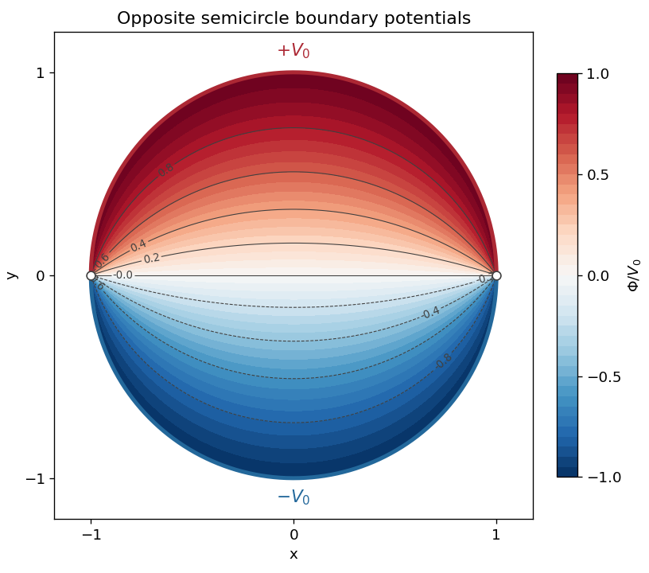

<h1 id="3/solution">Solution</h1>

↑ **Parent:** [3](../3.md)

**Harmonic parts.** Write the [holomorphic function](../../../../holomorphic-function-split.md) as $f=u+iv$. The [Cauchy-Riemann equations](../../../../cauchy-riemann-equations.md) say $u_x=v_y$ and $u_y=-v_x$. Equality of [mixed partial derivatives](../../../../mixed-partial-derivative.md) therefore gives

$$
u_{xx}+u_{yy}=v_{yx}-v_{xy}=0,\qquad v_{xx}+v_{yy}=-u_{yx}+u_{xy}=0.
$$

Thus both the real and imaginary parts are [harmonic functions](../../../../harmonic-function.md) and satisfy two-dimensional [Laplace's equation](../../../../laplace-equation.md).

**Single-valued logarithm.** A convenient choice is

$$
f(z)=\operatorname{Log}(1+z)-\operatorname{Log}(1-z),\qquad f(0)=0,
$$

using the [principal logarithm](../../../../principal-complex-logarithm.md) for each term. Its [branch cuts](../../../../branch-cut.md) in the $z$ plane are $(-\infty,-1]$ and $[1,\infty)$. The [branch points](../../../../branch-point.md) are $-1$ and $1$: going once around the first adds $2\pi i$, while going once around the second subtracts $2\pi i$. Removing the two exterior rays makes this a consistent [branch of a multivalued function](../../../../branch-of-a-multivalued-function.md) and in particular leaves the whole open unit disk available.

**Potential inside the cylinder.** Put $z=re^{i\theta}$ with $r<1$. Multiplication by $1-\overline z$ gives

$$
\frac{1+z}{1-z}=\frac{1-r^2+2ir\sin\theta}{1-2r\cos\theta+r^2}.
$$

The denominator is positive and the real part of the numerator is positive. Thus its [argument](../../../../argument-complex-analysis.md) lies strictly between $-\pi/2$ and $\pi/2$, and

$$
\operatorname{Im}f(re^{i\theta})=\arctan\frac{2r\sin\theta}{1-r^2}.
$$

As $r\uparrow1$, this tends to $\pi/2$ on the upper open semicircle and $-\pi/2$ on the lower open semicircle. Scale the imaginary part to obtain

$$
\boxed{\Phi(r,\theta)=\frac{2V_0}{\pi}\arctan\frac{2r\sin\theta}{1-r^2},\qquad0\leq r<1.}
$$

It is a [harmonic function](../../../../harmonic-function.md), has the required boundary values, and gives $\Phi(0)=0$. The two joining points of the boundary arcs have discontinuous boundary data, so no common continuous boundary value is demanded there. Along the real diameter, including radial approaches to either joining point, the displayed solution is zero. This is the [disk potential with two semicircular boundary values](../../../../disk-potential-with-two-semicircular-boundary-values.md).

**[Figure 1](#3/image-harmonic-potential-inside-a-disk-with-opposite-semicircle-boundary-values). Harmonic potential inside a disk with opposite semicircle boundary values**. The upper boundary has potential +V0 and the lower boundary -V0. Contours and colour show Phi/V0; the two joining points are excluded from the prescribed boundary values.

For a second check, the [Taylor series](../../../../taylor-series.md) of the logarithms gives $f(z)=2\sum_{j\geq0}z^{2j+1}/(2j+1)$. Taking the imaginary part yields the [Fourier series](../../../../fourier-series-split.md)

$$
\Phi(r,\theta)=\frac{4V_0}{\pi}\sum_{j=0}^{\infty}\frac{r^{2j+1}\sin((2j+1)\theta)}{2j+1},
$$

whose boundary limit is exactly the required alternating pair of constant semicircle values.

## ↑ Ancestors (12)

1. [3](../3.md)
2. [Paper 2](../../paper-2-split.md)
3. [2001](../../split.md)
4. [Past exam of the mathematics course of the year 2 of the natural sciences course of the University of Cambridge](../../../split.md)
5. [Mathematics course of the year 2 of the natural sciences course of the University of Cambridge](../../../../mathematics-course-of-the-year-2-of-the-natural-sciences-course-of-the-university-of-cambridge.md)
6. [Year 2 of the natural sciences course of the University of Cambridge](../../../../year-2-of-the-natural-sciences-course-of-the-university-of-cambridge.md)
7. [Year of the natural sciences course of the University of Cambridge](../../../../year-of-the-natural-sciences-course-of-the-university-of-cambridge.md)
8. [Natural sciences course of the University of Cambridge](../../../../natural-sciences-course-of-the-university-of-cambridge.md)
9. [Course of the University of Cambridge](../../../../course-of-the-university-of-cambridge.md)
10. [University of Cambridge](../../../../university-of-cambridge-split.md)
11. [List of universities](../../../../list-of-universities.md)
12. [Codex Wiki](../../../../split.md)
