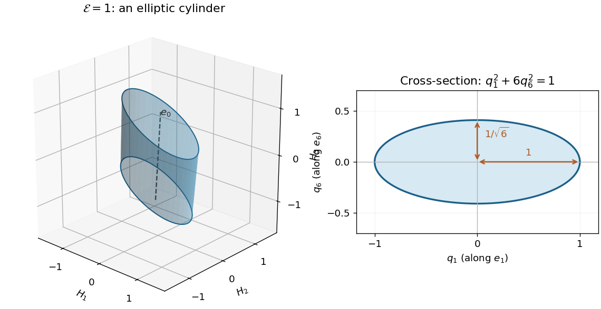

<h1 id="6/solution">Solution</h1>

↑ **Parent:** [6](../6.md)

**Tensor transformation.** Under an [orthogonal transformation](../../../../orthogonal-transformation.md) $R$, the magnetic moment and [magnetic field intensity](../../../../magnetic-field-intensity.md) have transformed components $M'=RM$, $H'=RH$ for a proper rotation. The physical relation $M=\chi H$ must retain its form, giving $RM=\chi'RH$, hence

$$
\boxed{\chi'=R\chi R^T,\qquad\chi'_{ij}=R_{ia}R_{jb}\chi_{ab}.}
$$

This is precisely the law for a [Cartesian second-rank tensor](../../../../cartesian-second-rank-tensor.md). Both magnetic quantities are [axial vectors](../../../../pseudovector.md); under reflections they each acquire the same determinant sign, which cancels from the transformation of the [magnetic susceptibility tensor](../../../../magnetic-susceptibility-tensor.md).

**Parallel directions.** The condition $M=\lambda H$ is the [eigenvalue](../../../../eigenvalue.md) equation $\chi H=\lambda H$. For the matrix in the paper, expansion of $\det(\chi-\lambda I)$ gives

$$
\det(\chi-\lambda I)=-\lambda(\lambda-1)(\lambda-6).
$$

Solving the three resulting homogeneous systems gives

$$
\boxed{\begin{array}{c|c|c}
\lambda&\text{direction of }H&\text{normalized eigenvector}\\\hline
0&(1,-1,2)&e_0=(1,-1,2)/\sqrt6\\
1&(-2,0,1)&e_1=(-2,0,1)/\sqrt5\\
6&(1,5,2)&e_6=(1,5,2)/\sqrt{30}
\end{array}.}
$$

The three directions are mutually [orthogonal](../../../../orthogonal-vectors.md). For the zero [eigenvalue](../../../../eigenvalue.md), the induced magnetic moment is zero: the proportionality equation still holds with factor zero, though there is then no nonzero moment direction to assign.

**Energy extrema.** The stipulated energy is $\mathcal E=H^T\chi H$. At fixed $H^TH=H_0^2>0$, a [Lagrange multiplier](../../../../lagrange-multiplier.md) calculation gives

$$
\nabla_H[H^T\chi H-\lambda(H^TH-H_0^2)]=2\chi H-2\lambda H=0,
$$

because $\chi$ is a real [symmetric matrix](../../../../symmetric-matrix.md). Thus all stationary directions are the [eigenvectors](../../../../eigenvector.md), for which $M=\lambda H$. Equivalently write $H=q_0e_0+q_1e_1+q_6e_6$; then

$$
\mathcal E=q_1^2+6q_6^2,\qquad H_0^2=q_0^2+q_1^2+q_6^2.
$$

The [Rayleigh quotient](../../../../rayleigh-quotient.md) immediately gives

$$
\boxed{\mathcal E_{\min}=0\text{ on }H=\pm H_0e_0,\qquad\mathcal E_{\max}=6H_0^2\text{ on }H=\pm H_0e_6.}
$$

The intermediate direction $e_1$ is stationary with $\mathcal E=H_0^2$ but is not an extremum on the sphere. At the minimum $M=0$, so the precise extremum condition is proportionality, including a vanishing proportionality factor.

**Constant-energy surface.** In the original field components,

$$
\boxed{\mathcal E=(H_1+H_2)^2+(H_3+2H_2)^2=q_1^2+6q_6^2.}
$$

For a fixed positive value $E$, $q_0$ is unrestricted and the cross-section satisfies $q_1^2/E+q_6^2/(E/6)=1$. The surface is therefore an [elliptic cylinder](../../../../elliptic-cylinder.md), with axis along $(1,-1,2)$ and transverse semiaxes $\sqrt E$ along $e_1$ and $\sqrt{E/6}$ along $e_6$. This is an example of [level sets of a positive semidefinite quadratic form](../../../../level-sets-of-a-positive-semidefinite-quadratic-form.md). At $E=0$ the surface degenerates to the axis line; no negative-energy level exists.

**[Figure 2](#6/image-the-susceptibility-energy-has-elliptic-cylindrical-level-sets). The susceptibility energy has elliptic cylindrical level sets**. The surface shown has E=1. Its unbounded axis is the zero-eigenvalue direction (1,-1,2); transverse semiaxes are 1 along e1 and 1/sqrt(6) along e6. Only a finite axial segment is drawn.

## ↑ Ancestors (12)

1. [6](../6.md)
2. [Paper 2](../../paper-2-split.md)
3. [2001](../../split.md)
4. [Past exam of the mathematics course of the year 2 of the natural sciences course of the University of Cambridge](../../../split.md)
5. [Mathematics course of the year 2 of the natural sciences course of the University of Cambridge](../../../../mathematics-course-of-the-year-2-of-the-natural-sciences-course-of-the-university-of-cambridge.md)
6. [Year 2 of the natural sciences course of the University of Cambridge](../../../../year-2-of-the-natural-sciences-course-of-the-university-of-cambridge.md)
7. [Year of the natural sciences course of the University of Cambridge](../../../../year-of-the-natural-sciences-course-of-the-university-of-cambridge.md)
8. [Natural sciences course of the University of Cambridge](../../../../natural-sciences-course-of-the-university-of-cambridge.md)
9. [Course of the University of Cambridge](../../../../course-of-the-university-of-cambridge.md)
10. [University of Cambridge](../../../../university-of-cambridge-split.md)
11. [List of universities](../../../../list-of-universities.md)
12. [Codex Wiki](../../../../split.md)
