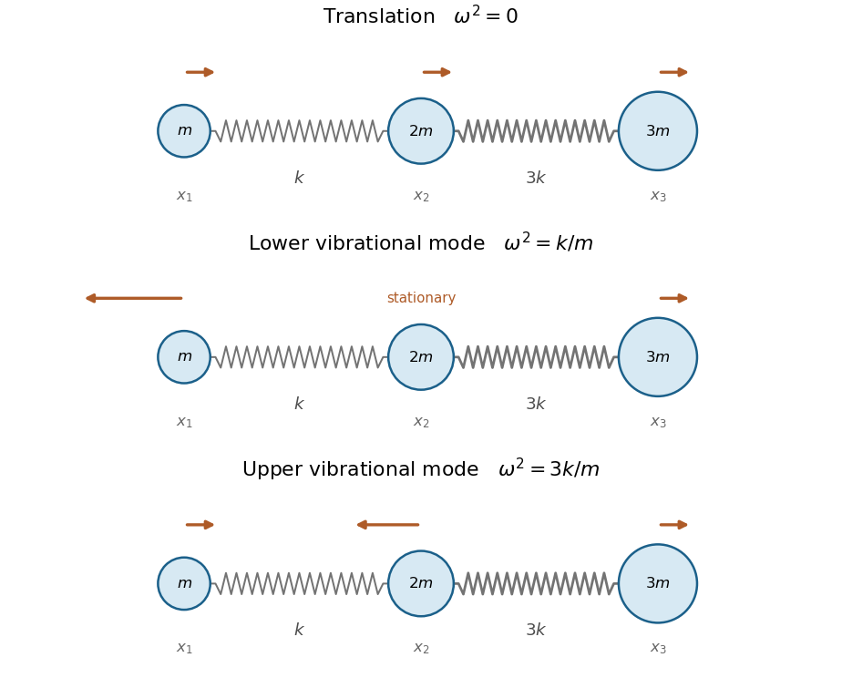

<h1 id="7/solution">Solution</h1>

↑ **Parent:** [7](../7.md)

**General definitions.** The [Euler-Lagrange equation](../../../../euler-lagrange-equation.md) gives $m_i\ddot q_i+\sum_jV_{ij}q_j=0$. Write $M=\operatorname{diag}(m_i)$ and $K=(V_{ij})$. A [normal mode](../../../../normal-mode.md) has fixed displacement pattern $v$ and common time factor, $q(t)=vQ(t)$; its [normal frequency](../../../../eigenfrequency.md) satisfies

$$
\boxed{Kv=\omega^2Mv,\qquad\ddot Q+\omega^2Q=0.}
$$

Here $\omega$ is angular frequency. A [normal coordinate](../../../../normal-coordinate.md) is the coefficient of one pattern in a complete modal expansion, so these coordinates decouple the equations. Since $M$ is positive definite, the change $z=M^{1/2}q$ turns the mode equation into the ordinary symmetric [eigenvalue problem](../../../../eigenvalue-problem.md) for $M^{-1/2}KM^{-1/2}$.

**Three-mass equations.** Let $x_1,x_2,x_3$ be horizontal displacements from the unstretched equilibrium, ordered left to right. The [kinetic energy](../../../../kinetic-energy.md) and [potential energy](../../../../potential-energy.md) are

$$
T=\frac m2(\dot x_1^2+2\dot x_2^2+3\dot x_3^2),\qquad V=\frac k2(x_2-x_1)^2+\frac{3k}{2}(x_3-x_2)^2.
$$

Differentiating the [potential energy](../../../../potential-energy.md) gives

$$
\boxed{\begin{aligned}
m\ddot x_1&=k(x_2-x_1),\\2m\ddot x_2&=k(x_1-x_2)+3k(x_3-x_2),\\3m\ddot x_3&=3k(x_2-x_3).
\end{aligned}}
$$

Thus $M=m\operatorname{diag}(1,2,3)$ and

$$
K=k\begin{pmatrix}1&-1&0\\-1&4&-3\\0&-3&3\end{pmatrix}.
$$

**Frequencies and patterns.** Put $\lambda=m\omega^2/k$. Expansion of the [generalized eigenvalue problem for small oscillations](../../../../generalized-eigenvalue-problem-for-small-oscillations.md) gives

$$
\det\left[\begin{pmatrix}1&-1&0\\-1&4&-3\\0&-3&3\end{pmatrix}-\lambda\operatorname{diag}(1,2,3)\right]=-6\lambda(\lambda-1)(\lambda-3).
$$

Solving at each root gives

$$
\boxed{\begin{array}{c|c|c}
&v&\omega\\\hline
0&(1,1,1)^T&0\\
1&(-3,0,1)^T&\sqrt{k/m}\\
3&(1,-2,1)^T&\sqrt{3k/m}
\end{array}.}
$$

The zero [normal mode](../../../../normal-mode.md) is uniform [translation](../../../../translation-geometry.md). In the lower nonzero mode, the central mass stays fixed, the two end masses move oppositely, and their unequal displacements balance both the end-mass momenta and the forces on the central mass. In the upper mode the end masses move together and the centre oppositely. Both vibrating modes leave the [centre of mass](../../../../center-of-mass.md) fixed.

**Orthogonality.** Because $K$ is symmetric, two mode equations imply

$$
v_r^TKv_s=\omega_s^2v_r^TMv_s=\omega_r^2v_r^TMv_s.
$$

Distinct [eigenvalues](../../../../eigenvalue.md) therefore give the [mass-matrix orthogonality of normal modes](../../../../mass-matrix-orthogonality-of-normal-modes.md):

$$
\boxed{v_r^TMv_s=\sum_i m_i(v_r)_i(v_s)_i=0\quad(r\ne s).}
$$

The Euclidean dot product need not vanish for unequal masses; for example $v_0^Tv_1=-2$, while $v_0^TMv_1=m(-3+3)=0$. The modal squared norms are $6m,12m,12m$.

**[Figure 3](#7/image-the-three-normal-modes-of-the-unequal-free-mass-chain). The three normal modes of the unequal free mass chain**. Masses from left to right are m, 2m and 3m, joined by springs k and 3k. Arrow lengths show the modal amplitude ratios (1,1,1), (-3,0,1), and (1,-2,1).

**Normal coordinates.** Expand $x=Q_0v_0+Q_1v_1+Q_3v_3$. Project using the mass-weighted [inner product](../../../../inner-product-split.md) and divide by each modal norm to obtain

$$
\boxed{Q_0=\frac{x_1+2x_2+3x_3}{6},\qquad Q_1=\frac{x_3-x_1}{4},\qquad Q_3=\frac{x_1-4x_2+3x_3}{12}.}
$$

For example, the inverse equations are $x_1=Q_0-3Q_1+Q_3$, $x_2=Q_0-2Q_3$, $x_3=Q_0+Q_1+Q_3$. They reduce the energies to

$$
T=\frac m2(6\dot Q_0^2+12\dot Q_1^2+12\dot Q_3^2),\qquad V=\frac k2(12Q_1^2+36Q_3^2),
$$

and hence

$$
\boxed{\ddot Q_0=0,\qquad\ddot Q_1+(k/m)Q_1=0,\qquad\ddot Q_3+(3k/m)Q_3=0.}
$$

The first coordinate is the [centre of mass](../../../../center-of-mass.md) and has free linear motion. Multiplying $Q_0,Q_1,Q_3$ by $\sqrt{6m},\sqrt{12m},\sqrt{12m}$ respectively gives mass-normalized [normal coordinates](../../../../normal-coordinates.md) if desired.

## ↑ Ancestors (12)

1. [7](../7.md)
2. [Paper 2](../../paper-2-split.md)
3. [2001](../../split.md)
4. [Past exam of the mathematics course of the year 2 of the natural sciences course of the University of Cambridge](../../../split.md)
5. [Mathematics course of the year 2 of the natural sciences course of the University of Cambridge](../../../../mathematics-course-of-the-year-2-of-the-natural-sciences-course-of-the-university-of-cambridge.md)
6. [Year 2 of the natural sciences course of the University of Cambridge](../../../../year-2-of-the-natural-sciences-course-of-the-university-of-cambridge.md)
7. [Year of the natural sciences course of the University of Cambridge](../../../../year-of-the-natural-sciences-course-of-the-university-of-cambridge.md)
8. [Natural sciences course of the University of Cambridge](../../../../natural-sciences-course-of-the-university-of-cambridge.md)
9. [Course of the University of Cambridge](../../../../course-of-the-university-of-cambridge.md)
10. [University of Cambridge](../../../../university-of-cambridge-split.md)
11. [List of universities](../../../../list-of-universities.md)
12. [Codex Wiki](../../../../split.md)
