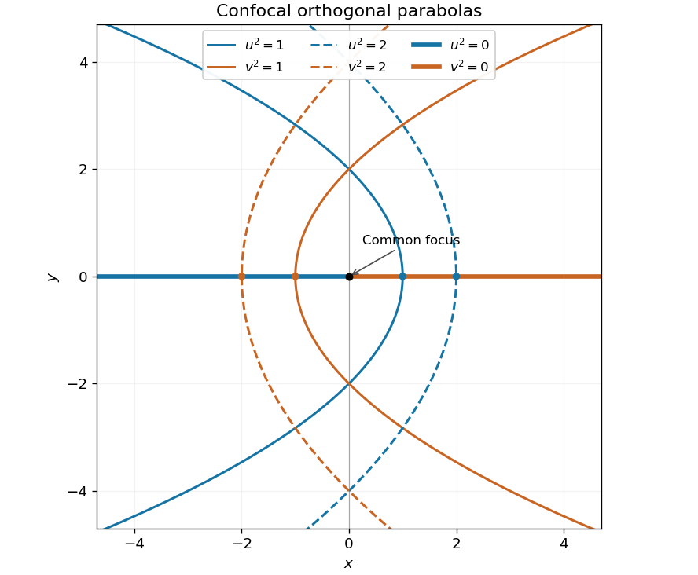
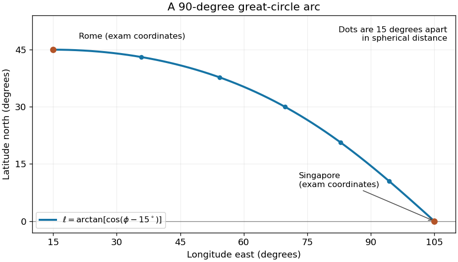

# Paper 1

↑ **Parent:** [2002](../2002.md)

[Original examination paper](https://www.maths.cam.ac.uk/undergradnst/files/2002/PaperNST_IB_1.pdf)

These solutions cover all ten questions, including every printed subpart. The original PDF supplies the adjoints in Question 5, the fourth powers in Question 7 and the complete Question 10. Two qualifications to the printed wording are explained where they arise: unitary diagonalisation in Question 5 and the integration limits in Question 10.

**Table of contents**

- [1](#1)
  - [Solution](#1/solution)
- [2](#2)
  - [Solution](#2/solution)
- [3](#3)
  - [Solution](#3/solution)
- [4](#4)
  - [Solution](#4/solution)
- [5](#5)
  - [i](#5/i)
    - [Solution](#5/i/solution)
  - [ii](#5/ii)
    - [Solution](#5/ii/solution)
  - [iii](#5/iii)
    - [Solution](#5/iii/solution)
  - [b](#5/b)
    - [Solution](#5/b/solution)
- [6](#6)
  - [a](#6/a)
    - [Solution](#6/a/solution)
  - [b](#6/b)
    - [Solution](#6/b/solution)
  - [c](#6/c)
    - [Solution](#6/c/solution)
- [7](#7)
  - [a](#7/a)
    - [Solution](#7/a/solution)
  - [b](#7/b)
    - [Solution](#7/b/solution)
- [8](#8)
  - [a](#8/a)
    - [Solution](#8/a/solution)
  - [b](#8/b)
    - [Solution](#8/b/solution)
  - [c](#8/c)
    - [Solution](#8/c/solution)
- [9](#9)
  - [a](#9/a)
    - [Solution](#9/a/solution)
  - [b](#9/b)
    - [Solution](#9/b/solution)
- [10](#10)
  - [a](#10/a)
    - [Solution](#10/a/solution)
  - [b](#10/b)
    - [Solution](#10/b/solution)

## 1

↑ **Parent:** [Paper 1](paper-1.md)

<h3 id="1/solution">Solution</h3>

↑ **Parent:** [1](#1)

**Coordinate surfaces and sketch.** Adding and subtracting the defining relations gives $s=u^2+v^2$ and $x=u^2-v^2$. Since $y^2=s^2-x^2$, we have $y^2=4u^2v^2$. For $u^2=c>0$, eliminate $v^2$ to obtain

$$
x=c-\frac{y^2}{4c}.
$$

This is a [parabolic cylinder](../../euclidean-geometry.md#parabolic-cylinder) parallel to the $z$ axis, opening towards negative $x$, with cross-sectional vertex $(c,0)$ and focus at the origin. Similarly, $v^2=d>0$ gives

$$
x=\frac{y^2}{4d}-d,
$$

a [parabolic cylinder](../../euclidean-geometry.md#parabolic-cylinder) opening towards positive $x$, with vertex $(-d,0)$ and the same focus. The degenerate $u^2=0$ surface is the half-plane $y=0,x\leq0$; $v^2=0$ gives $y=0,x\geq0$. Constant $w$ gives the horizontal [planes](../../geometry-and-topology.md#plane) $z=w$.

Thus the requested cross-sections consist of $x=1-y^2/4$, $x=2-y^2/8$, $x=y^2/4-1$, $x=y^2/8-2$ and the two horizontal half-axes. The [parabolas](../../euclidean-geometry.md#parabola) of the two families meet orthogonally.

**[Figure 1](#1/image-the-requested-parabolic-coordinate-curves-in-the-xy-plane). The requested parabolic coordinate curves in the xy plane**. Blue curves have u squared equal to one or two; orange curves have v squared equal to one or two. The thick horizontal rays are the degenerate zero levels. All parabolas share the origin as focus.

**Signed coordinates.** Take $u\geq0$ and choose the sign of $v$ to agree with $y$ away from $y=0$. Then the [Cartesian coordinates](../../linear-algebra.md#cartesian-coordinate-system) are

$$
\boxed{x=u^2-v^2,\qquad y=2uv,\qquad z=w.}
$$

Every coordinate triple gives exactly one point. For $u>0$, $v$ and $y$ have the same sign. A fixed signed $v\ne0$ selects the upper or lower half of its [parabolic cylinder](../../euclidean-geometry.md#parabolic-cylinder); the entire cylinder corresponds to fixed $v^2$. On the cut $u=0$, the two values $v=\pm\sqrt{-x}$ represent the same point of the negative $x$ half-axis. This boundary identification is unavoidable: there $y=0$ even when $v\ne0$, so the sign prescription is understood by approaching from either side of the cut. The interior $u>0$ gives a unique coordinate chart off that half-axis.

**Orthogonality and metric.** Differentiate the [position vector](../../classical-mechanics.md#position-vector):

$$
r_u=(2u,2v,0),\qquad r_v=(-2v,2u,0),\qquad r_w=(0,0,1).
$$

The pairwise [dot products](../../inner-product.md#dot-product) vanish. Their lengths give the [scale factors of orthogonal coordinates](../../multivariable-calculus.md#scale-factors-of-orthogonal-coordinates) and hence the [Riemannian metric](../../riemannian-metric.md):

$$
\boxed{h_u=h_v=2\sqrt{u^2+v^2},\quad h_w=1,\qquad dl^2=4(u^2+v^2)(du^2+dv^2)+dw^2.}
$$

These are [parabolic cylindrical coordinates](../../multivariable-calculus.md#parabolic-cylindrical-coordinates). The differential calculation is regular for $u^2+v^2>0$; the $z$ axis is the coordinate singularity where the two planar [tangent vectors](../../tangent-vector.md) vanish.

**Laplacian.** Put $h=2\sqrt{u^2+v^2}$. The physical components of the [gradient](../../multivariable-calculus.md#gradient) of a $w$-independent [scalar field](../../classical-field-theory.md#scalar-field) are $\phi_u/h,\phi_v/h,0$. Applying the [divergence](../../multivariable-calculus.md#divergence) formula cancels the two equal [scale factors of orthogonal coordinates](../../multivariable-calculus.md#scale-factors-of-orthogonal-coordinates) inside the derivatives:

$$
\nabla^2\phi=\frac1{h^2}\left[\partial_u\left(h\frac{\phi_u}h\right)+\partial_v\left(h\frac{\phi_v}h\right)\right].
$$

Therefore, away from the coordinate singularity,

$$
\boxed{\nabla^2\phi=\frac{\phi_{uu}+\phi_{vv}}{4(u^2+v^2)}.}
$$

## 2

↑ **Parent:** [Paper 1](paper-1.md)

<h3 id="2/solution">Solution</h3>

↑ **Parent:** [2](#2)

**Steady state.** In the [heat equation](../../diffusion-equation.md#heat-equation), time independence makes the second spatial [derivative](../../calculus.md#derivative) zero. The two endpoint [temperatures](../../temperature.md) therefore determine the linear profile

$$
\boxed{T_\infty(x)=T_0x/l.}
$$

Insulation is along the sides; the endpoint reservoirs can still exchange [heat](../../heat.md) with the rod.

**Transient solution.** Subtract the steady profile before applying [separation of variables](../../partial-differential-equation.md#separation-of-variables): let $U=T-T_0x/l$. Then $U_t=\nu U_{xx}$, $U(0,t)=U(l,t)=0$ and $U(x,0)=-T_0x/l$ for $0<x<l$. Writing $U=X(x)\Theta(t)$ gives

$$
\frac{\Theta'}{\nu\Theta}=\frac{X''}{X}=-\mu,\qquad X''+\mu X=0,\qquad\Theta'+\nu\mu\Theta=0.
$$

The homogeneous [Dirichlet boundary conditions](../../differential-equation.md#dirichlet-boundary-condition) exclude $\mu\leq0$ and select the [eigenfunctions](../../linear-operator-theory.md#eigenfunction) $\sin(n\pi x/l)$ with [eigenvalues](../../linear-operator-theory.md#eigenvalue) $\mu_n=(n\pi/l)^2$, $n\geq1$. Their [orthogonality](../../inner-product.md#orthogonal-vectors) gives the [Fourier sine series](../../fourier-series.md#fourier-sine-series) coefficients

$$
b_n=\frac2l\int_0^l\left(-\frac{T_0x}l\right)\sin\frac{n\pi x}l\,dx=\frac{2T_0(-1)^n}{n\pi}.
$$

Here [integration by parts](../../calculus.md#integration-by-parts) uses $\int_0^l x\sin(n\pi x/l)\,dx=-l^2(-1)^n/(n\pi)$. Thus

$$
\boxed{T(x,t)=\frac{T_0x}l+\frac{2T_0}\pi\sum_{n=1}^\infty\frac{(-1)^n}{n}\sin\frac{n\pi x}l\,e^{-\nu n^2\pi^2t/l^2},\qquad t>0.}
$$

Every summand satisfies the [heat equation](../../diffusion-equation.md#heat-equation) and the homogeneous endpoint conditions, while the steady profile supplies the prescribed endpoint values. The initial [Fourier sine series](../../fourier-series.md#fourier-sine-series) equals $-T_0x/l$ in the open interval. At $(l,0)$ the initially cold rod and the suddenly imposed hot endpoint are incompatible; the formula describes the prescribed data for $t>0$ and the initial limit at interior points.

**Heat absorption.** Integrating in $x$ kills the even modes. With $a=\nu\pi^2/l^2$, the total [heat](../../heat.md) relative to the initial state is

$$
H(t)=\frac{\gamma T_0l}2-\frac{4\gamma T_0l}{\pi^2}\sum_{j=0}^\infty\frac{e^{-a(2j+1)^2t}}{(2j+1)^2}.
$$

Consequently the net rate of [heat](../../heat.md) absorption is

$$
\boxed{\frac{dH}{dt}=\frac{4\gamma\nu T_0}l\sum_{j=0}^\infty e^{-\nu\pi^2(2j+1)^2t/l^2}.}
$$

For each $t\geq\varepsilon>0$, any fixed number of differentiated modes is bounded by a polynomial in $n$ times $e^{-a\varepsilon n^2}$. These bounds have finite sums, proving [absolute convergence](../../sequence-and-series.md#absolute-convergence), [uniform convergence](../../sequence-and-series.md#uniform-convergence) on such time intervals and the validity of the integration and differentiation. In particular the displayed rate is finite for every $t>0$, positive when $T_0>0$, and tends to zero as equilibrium is approached. The same answer follows from the [heat equation](../../diffusion-equation.md#heat-equation) balance $H'=\gamma\nu[T_x(l,t)-T_x(0,t)]$; this subtracts loss at the cold endpoint from input at the hot endpoint.

## 3

↑ **Parent:** [Paper 1](paper-1.md)

<h3 id="3/solution">Solution</h3>

↑ **Parent:** [3](#3)

**Transform convention and derivatives.** Use the [Fourier transform](../../fourier-transform.md) pair

$$
\boxed{\widetilde f(k)=\int_{-\infty}^{\infty}f(x)e^{-ikx}\,dx,\qquad f(x)=\frac1{2\pi}\int_{-\infty}^{\infty}\widetilde f(k)e^{ikx}\,dk.}
$$

For sufficiently decaying $f,f'$ with integrable second [derivative](../../calculus.md#derivative), two applications of [integration by parts](../../calculus.md#integration-by-parts) give

$$
\begin{aligned}
\widetilde{f''}(k)&=[f'e^{-ikx}]_{-\infty}^{\infty}+ik\int_{-\infty}^{\infty}f'e^{-ikx}\,dx\\
&=ik[f e^{-ikx}]_{-\infty}^{\infty}+(ik)^2\widetilde f(k)=\boxed{-k^2\widetilde f(k)}.
\end{aligned}
$$

The identity also holds for [tempered distributions](../../fourier-analysis.md#tempered-distribution), which is the setting needed for the [Dirac delta function](../../distribution-theory.md#dirac-delta-function) boundary data.

**Upper half-plane solution.** Take the [Fourier transform](../../fourier-transform.md) in $x$ only, writing $\Phi(k,y)=\widetilde\phi(k,y)$. [Laplace's equation](../../partial-differential-equation.md#laplace-equation) becomes $\Phi_{yy}-k^2\Phi=0$. For $k\ne0$, discard the exponentially growing solution and use $\Phi(k,0)=1$, the [Fourier transform](../../fourier-transform.md) of the [Dirac delta function](../../distribution-theory.md#dirac-delta-function). This gives $\Phi(k,y)=e^{-|k|y}$. The value at $k=0$ can be set to its continuous limit one. Pointwise decay of $\phi$ as $y\to\infty$ does not require this individual transformed value to decay: the total integral in $x$ remains one while the profile spreads.

The inverse [Fourier transform](../../fourier-transform.md) now yields, for $y>0$,

$$
\phi(x,y)=\frac1{2\pi}\int_{-\infty}^{\infty}e^{-|k|y}e^{ikx}\,dk=\frac1\pi\int_0^\infty e^{-ky}\cos(kx)\,dk.
$$

Evaluate the last [integral](../../integral.md) as the real part of $\int_0^\infty e^{-(y-ix)k}\,dk=(y-ix)^{-1}$:

$$
\boxed{\phi(x,y)=\frac{y}{\pi(x^2+y^2)},\qquad y>0.}
$$

This is the [Poisson kernel for the upper half-plane](../../partial-differential-equation.md#poisson-kernel-for-the-upper-half-plane). Its boundary condition is a [distributional convergence](../../distribution-theory.md#weak-convergence-of-distributions), rather than an ordinary value at $(0,0)$: for a smooth compactly supported test [function](../../function.md) $g$,

$$
\int_{-\infty}^{\infty}\phi(x,y)g(x)\,dx=\frac1\pi\int_{-\infty}^{\infty}\frac{g(yt)}{1+t^2}\,dt\longrightarrow g(0).
$$

The [dominated convergence theorem](../../measure-theory.md#dominated-convergence-theorem) applies because $g$ is bounded and $(1+t^2)^{-1}$ is integrable. Also $0\leq\phi(x,y)\leq1/(\pi y)$, proving the required decay as $y\to\infty$.

**Direct verification.** Differentiating the rational expression gives

$$
\phi_{xx}=\frac{2y(3x^2-y^2)}{\pi(x^2+y^2)^3},\qquad\phi_{yy}=\frac{2y(y^2-3x^2)}{\pi(x^2+y^2)^3}.
$$

Their sum is zero throughout $y>0$, so the solution is a [harmonic function](../../partial-differential-equation.md#harmonic-function) there.

## 4

↑ **Parent:** [Paper 1](paper-1.md)

<h3 id="4/solution">Solution</h3>

↑ **Parent:** [4](#4)

**Nilpotence and eigenvalues.** If $Av=\lambda v$ with $v\ne0$, then $A^nv=\lambda^nv$. Thus $A^n=0$ forces $\lambda=0$ for every [eigenvalue](../../linear-operator-theory.md#eigenvalue). Conversely, if all $n$ complex [eigenvalues](../../linear-operator-theory.md#eigenvalue), counted with [algebraic multiplicity](../../linear-operator-theory.md#algebraic-multiplicity), vanish, the monic [characteristic polynomial](../../linear-operator-theory.md#characteristic-polynomial) is $\chi_A(t)=t^n$. The [Cayley-Hamilton theorem](../../cayley-hamilton-theorem.md) then gives $A^n=0$. Hence

$$
\boxed{A^n=0\quad\Longleftrightarrow\quad\operatorname{spec}(A)=\{0\}.}
$$

This is the criterion for a [nilpotent matrix](../../linear-operator-theory.md#nilpotent-matrix).

**Symmetric case.** Here a [symmetric matrix](../../linear-algebra.md#symmetric-matrix) is understood to be real. The [spectral theorem](../../hilbert-space.md#spectral-theorem) gives $A=QDQ^T$ with $Q$ orthogonal and $D$ real diagonal. The previous result makes every diagonal entry zero, so $A=0$. Alternatively, choose $2^r\geq n$, so $A^{2^r}=0$. For every real [vector](../../vector-space.md#vector) $x$,

$$
x^TA^{2^r}x=\left\|A^{2^{r-1}}x\right\|^2=0.
$$

It follows that $A^{2^{r-1}}=0$. Repeat until $A=0$. This uses positivity of the [quadratic form](../../quadratic-form.md) $x^TM^TMx$. The restriction to real symmetric, or complex [Hermitian matrices](../../hilbert-space.md#hermitian-operator), matters: a complex matrix satisfying only $A^T=A$ need not have this positivity.

**The parameters and powers.** The first two columns of $T$ coincide, so $\det T=0$ for all $\alpha,\beta$. The sum of its principal two-by-two determinants, each a [minor of a matrix](../../vector-space.md#minor-linear-algebra), is

$$
0+(\beta-1)+(\beta-\alpha)=2\beta-\alpha-1.
$$

Together with $\operatorname{tr}T=2+\beta$, this gives

$$
\chi_T(t)=t^3-(2+\beta)t^2+(2\beta-\alpha-1)t.
$$

For every [eigenvalue](../../linear-operator-theory.md#eigenvalue) to vanish both remaining coefficients must be zero. Therefore

$$
\boxed{\beta=-2,\qquad\alpha=-5.}
$$

Direct multiplication at these values gives

$$
T=\begin{pmatrix}1&1&1\\1&1&-5\\1&1&-2\end{pmatrix},\qquad
T^2=\begin{pmatrix}3&3&-6\\-3&-3&6\\0&0&0\end{pmatrix},\qquad\boxed{T^3=0.}
$$

Indeed the first row of $T^2$ multiplied by $T$ is $3\operatorname{row}_1(T)+3\operatorname{row}_2(T)-6\operatorname{row}_3(T)=0$, and the second row is its negative.

**Geometry of repeated application.** For any parameters the [image of a linear map](../../vector-space.md#image-of-a-linear-map) lies in the [span](../../vector-space.md#linear-span) of $a=(1,1,1)^T$ and $b=(1,\alpha,\beta)^T$, since $Tx=(x_1+x_2)a+x_3b$. Thus it lies in a fixed [plane](../../geometry-and-topology.md#plane) through the origin, independently of the input. When $a,b$ are independent its normal is $a\times b=(\beta-\alpha,1-\beta,\alpha-1)$; if they coincide, the image is a line and is still contained in a plane.

For $\alpha=-5,\beta=-2$, put $s=x_1+x_2$ and $t=x_3$. Then

$$
Tx=(s+t,s-5t,s-2t)^T,\qquad x'_1+x'_2-2x'_3=0.
$$

The columns span this entire [plane](../../geometry-and-topology.md#plane), so $T$ has [rank](../../quadratic-form.md#rank-one-quadratic-form) two. The next two steps are

$$
\boxed{T^2x=3(x_1+x_2-2x_3)(1,-1,0)^T,\qquad T^3x=0.}
$$

Thus the [image of a linear map](../../vector-space.md#image-of-a-linear-map) contracts from a plane to a line and then to the origin under successive applications. The line from $T^2$ is precisely the [kernel](../../kernel-of-a-linear-map.md) of $T$.

## 5

↑ **Parent:** [Paper 1](paper-1.md)

<h3 id="5/i">i</h3>

↑ **Parent:** [5](#5)

<h4 id="5/i/solution">Solution</h4>

↑ **Parent:** [I](#5/i)

The [conjugate transpose](../../linear-operator-theory.md#conjugate-transpose) reverses products and conjugates scalars. Since $A,B$ are [Hermitian matrices](../../hilbert-space.md#hermitian-operator),

$$
H^\dagger=-i(AB-BA)^\dagger=-i(BA-AB)=i(AB-BA)=H.
$$

Therefore $\boxed{H\text{ is Hermitian}.}$ In particular the [commutator](../../lie-algebra.md#commutator) of two [Hermitian matrices](../../hilbert-space.md#hermitian-operator) is anti-Hermitian, and multiplication by $i$ converts it to a [Hermitian matrix](../../hilbert-space.md#hermitian-operator).

<h3 id="5/ii">ii</h3>

↑ **Parent:** [5](#5)

<h4 id="5/ii/solution">Solution</h4>

↑ **Parent:** [Ii](#5/ii)

Suppose $AB=BA$ and $Av_j=a_jv_j$. Then

$$
A(Bv_j)=B(Av_j)=a_jBv_j.
$$

Because the [eigenvalues](../../linear-operator-theory.md#eigenvalue) of $A$ are distinct, the [eigenspace](../../linear-operator-theory.md#eigenspace) for $a_j$ is one-dimensional. It follows that $Bv_j=b_jv_j$, including the possibility $b_j=0$. Thus an orthonormal [eigenbasis](../../linear-operator-theory.md#eigenbasis) of $A$ is also an [eigenbasis](../../linear-operator-theory.md#eigenbasis) of $B$. The simplicity of both spectra means their [eigenvectors](../../linear-operator-theory.md#eigenvector) coincide as directions, up to ordering, phases and nonzero scalar multiples.

Conversely, if they share a complete [eigenbasis](../../linear-operator-theory.md#eigenbasis), choose the [unitary matrix](../../linear-operator-theory.md#unitary-matrix) $U$ whose columns are these common normalized [eigenvectors](../../linear-operator-theory.md#eigenvector). Then $U^\dagger AU=D_A$ and $U^\dagger BU=D_B$ are diagonal, so $D_AD_B=D_BD_A$ and $AB=BA$. Hence

$$
\boxed{AB=BA\quad\Longleftrightarrow\quad A,B\text{ have a common orthonormal eigenbasis}.}
$$

This is [simultaneous diagonalization](../../mathematics.md#simultaneous-diagonalization) of the two [Hermitian matrices](../../hilbert-space.md#hermitian-operator).

<h3 id="5/iii">iii</h3>

↑ **Parent:** [5](#5)

<h4 id="5/iii/solution">Solution</h4>

↑ **Parent:** [Iii](#5/iii)

The original PDF uses the [conjugate transpose](../../linear-operator-theory.md#conjugate-transpose) $N^\dagger$, rather than the transpose found in the transcription. The printed diagonalisation criterion is correct when diagonalisation means [unitary diagonalization of a normal matrix](../../linear-operator-theory.md#unitary-diagonalization-of-a-normal-matrix). Since $N^\dagger=A-iB$,

$$
NN^\dagger=A^2+B^2-i(AB-BA),\qquad N^\dagger N=A^2+B^2+i(AB-BA).
$$

Consequently $NN^\dagger=N^\dagger N$ if and only if $AB=BA$. By part (ii), this gives a common [unitary matrix](../../linear-operator-theory.md#unitary-matrix) $U$ and

$$
U^\dagger NU=D_A+iD_B,
$$

which is diagonal. Conversely, if $N=UDU^\dagger$ for a diagonal $D$ and a [unitary matrix](../../linear-operator-theory.md#unitary-matrix) $U$, then

$$
NN^\dagger=UDD^\dagger U^\dagger=UD^\dagger DU^\dagger=N^\dagger N.
$$

Thus the precise conclusion is

$$
\boxed{N\text{ is unitarily diagonalizable}\quad\Longleftrightarrow\quad N\text{ is normal}\quad\Longleftrightarrow\quad AB=BA.}
$$

If arbitrary invertible changes of basis are allowed, the printed assertion is false. For example,

$$
N=\begin{pmatrix}1&1\\0&2\end{pmatrix},\quad A=\begin{pmatrix}1&1/2\\1/2&2\end{pmatrix},\quad B=\begin{pmatrix}0&-i/2\\i/2&0\end{pmatrix}
$$

satisfy $N=A+iB$. Both [Hermitian matrices](../../hilbert-space.md#hermitian-operator) have distinct [eigenvalues](../../linear-operator-theory.md#eigenvalue): $(3\pm\sqrt2)/2$ for $A$ and $\pm1/2$ for $B$. The distinct [eigenvalues](../../linear-operator-theory.md#eigenvalue) $1,2$ make $N$ diagonalizable by similarity, but $NN^\dagger=\begin{pmatrix}2&2\\2&4\end{pmatrix}$ and $N^\dagger N=\begin{pmatrix}1&1\\1&5\end{pmatrix}$ differ. This distinguishes ordinary [diagonalization](../../linear-operator-theory.md#diagonalization-of-a-matrix) from the required unitary version.

<h3 id="5/b">b</h3>

↑ **Parent:** [5](#5)

<h4 id="5/b/solution">Solution</h4>

↑ **Parent:** [B](#5/b)

As $C$ is a [unitary matrix](../../linear-operator-theory.md#unitary-matrix), $C^{-1}=C^\dagger$. Let $M=C^\dagger AC$. Its [conjugate transpose](../../linear-operator-theory.md#conjugate-transpose) is $M^\dagger=C^\dagger A^\dagger C=M$, so $M$ and every positive integer power $M^n$ are [Hermitian matrices](../../hilbert-space.md#hermitian-operator) and have real [eigenvalues](../../linear-operator-theory.md#eigenvalue).

More explicitly, if $Av_j=a_jv_j$ with $a_j$ real, then $C^{-1}v_j$ form an [eigenbasis](../../linear-operator-theory.md#eigenbasis) and

$$
M^n(C^{-1}v_j)=C^{-1}A^nv_j=a_j^n(C^{-1}v_j).
$$

Therefore

$$
\boxed{\operatorname{spec}\bigl((C^{-1}AC)^n\bigr)=\{a_j^n:j=1,\ldots,n_A\}\subset\mathbb R,}
$$

where $n_A$ denotes the matrix size, to distinguish it from the power $n$.

## 6

↑ **Parent:** [Paper 1](paper-1.md)

<h3 id="6/a">a</h3>

↑ **Parent:** [6](#6)

<h4 id="6/a/solution">Solution</h4>

↑ **Parent:** [A](#6/a)

Divide the [Chebyshev differential equation](../../numerical-analysis.md#chebyshev-differential-equation) by $1-x^2$. Its coefficients $-x/(1-x^2)$ and $m^2/(1-x^2)$ are analytic at zero, so $\boxed{x=0\text{ is an ordinary point}.}$ The finite [singular points of a differential equation](../../differential-equation.md#singular-point-of-a-differential-equation) are $x=\pm1$.

Insert $y=\sum_{n\geq0}a_nx^{n+\sigma}$, $a_0\ne0$. The coefficient of the lowest power $x^{\sigma-2}$ is $\sigma(\sigma-1)a_0$, hence $\sigma=0$ or $1$. The next power gives $\sigma(\sigma+1)a_1=0$, and the remaining powers yield

$$
\boxed{a_{n+2}=\frac{(n+\sigma)^2-m^2}{(n+\sigma+2)(n+\sigma+1)}a_n,\qquad n\geq0.}
$$

For $\sigma=0$, $a_1$ is free and

$$
a_{n+2}=\frac{n^2-m^2}{(n+2)(n+1)}a_n.
$$

Choosing $a_1=0$ selects the even [power series](../../sequence-and-series.md#power-series), with $y(0)=a_0,y'(0)=0$. For $\sigma=1$, the next-power equation forces $a_1=0$ and

$$
a_{n+2}=\frac{(n+1)^2-m^2}{(n+3)(n+2)}a_n.
$$

This selects the odd [power series](../../sequence-and-series.md#power-series), with $y(0)=0,y'(0)=a_0$. Their different initial values prove [linear independence](../../vector-space.md#linear-independence). Although the [Frobenius method](../../complex-analysis.md#frobenius-method) produces two possible leading exponents, zero is an [ordinary point](../../complex-analysis.md#ordinary-point-criterion-for-a-second-order-equation), and a general $\sigma=0$ series already includes both initial constants.

<h3 id="6/b">b</h3>

↑ **Parent:** [6](#6)

<h4 id="6/b/solution">Solution</h4>

↑ **Parent:** [B](#6/b)

Let $M=|m|$ for integer $m$. In the even or odd [power series](../../sequence-and-series.md#power-series) whose parity matches $M$, the numerator in the [recurrence relation](../../sequence-and-series.md#recurrence-relation) vanishes at the coefficient of $x^M$. All coefficients of lower powers in that parity are nonzero, and all higher ones vanish. Therefore a [polynomial](../../polynomial.md) solution exists, of [polynomial degree](../../polynomial.md#degree-of-a-polynomial) $M$, containing

$$
\boxed{\left\lfloor\frac M2\right\rfloor+1\text{ nonzero terms}.}
$$

For nonnegative $m$ these are the [Chebyshev polynomials](../../numerical-analysis.md#chebyshev-polynomial) $T_m$. The normalized low-degree cases follow directly from the [recurrence relation](../../sequence-and-series.md#recurrence-relation):

$$
\begin{aligned}
m=0:&\quad y=a_0,\\
m=1:&\quad y=a_1x,\\
m=2:&\quad y=a_0(1-2x^2),\\
m=3:&\quad y=a_1(x-\tfrac43x^3).
\end{aligned}
$$

Enforcing $T_m(1)=1$ gives

$$
\boxed{T_0=1,\qquad T_1=x,\qquad T_2=2x^2-1,\qquad T_3=4x^3-3x.}
$$

To see that normalization at one is always possible, set $x=\cos\theta$ in the [Chebyshev differential equation](../../numerical-analysis.md#chebyshev-differential-equation). For $Y(\theta)=y(\cos\theta)$, the differential expression $(1-x^2)y''-xy'$ becomes $Y''$. Thus $Y=\cos(M\theta)$ gives $T_M(x)=\cos(M\arccos x)$ on $[-1,1]$ and has value one at $x=1$. It is a [polynomial](../../polynomial.md) because the [cosine addition formula](../../geometry-and-topology.md#cosine-addition-formula) gives $T_{M+1}=2xT_M-T_{M-1}$. Negative integer $m$ produces the same solution as $M=|m|$.

<h3 id="6/c">c</h3>

↑ **Parent:** [6](#6)

<h4 id="6/c/solution">Solution</h4>

↑ **Parent:** [C](#6/c)

Write a nonterminating parity series as $y=x^r\sum_{j\geq0}b_jx^{2j}$, where $r=0$ or $1$. Its [recurrence relation](../../sequence-and-series.md#recurrence-relation) is

$$
\frac{b_{j+1}}{b_j}=\frac{(2j+r)^2-m^2}{(2j+r+2)(2j+r+1)}.
$$

The [ratio test](../../sequence-and-series.md#ratio-test) applied to its nonzero successive terms has limiting absolute ratio $|x|^2$. Hence the series converges absolutely for $|x|<1$ and diverges for $|x|>1$, with

$$
\boxed{R=1\quad\text{for every nonterminating parity series}.}
$$

At $x=\pm1$, the limiting ratio is one, so the basic [ratio test](../../sequence-and-series.md#ratio-test) alone is inconclusive. Retain the next term of the ratio instead:

$$
\left|\frac{b_{j+1}}{b_j}\right|=1-\frac{3}{2j}+O(j^{-2}).
$$

For large $j$ the ratio is positive. Taking logarithms and summing gives $\log|b_j|=-\tfrac32\log j+O(1)$; the $O(j^{-2})$ remainders have a finite sum. Thus $|b_j|\leq Cj^{-3/2}$ eventually. Comparison with the convergent [p-series](../../sequence-and-series.md#p-series) proves [absolute convergence](../../sequence-and-series.md#absolute-convergence) at both endpoints as well:

$$
\boxed{\text{The nonpolynomial solutions' power series converge throughout }[-1,1].}
$$

The [radius of convergence](../../sequence-and-series.md#radius-of-convergence) one is the distance from the expansion point to the nearest [singular points of a differential equation](../../differential-equation.md#singular-point-of-a-differential-equation), $x=\pm1$. Convergence of function values at those points does not make the solutions analytic there; endpoint [derivatives](../../calculus.md#derivative) can diverge. The terminating [Chebyshev polynomial](../../numerical-analysis.md#chebyshev-polynomial) is an exception with infinite [radius of convergence](../../sequence-and-series.md#radius-of-convergence). For example, at $m=0$ the other solution is $\arcsin x$, whose endpoint values are finite while its first [derivative](../../calculus.md#derivative) diverges.

## 7

↑ **Parent:** [Paper 1](paper-1.md)

<h3 id="7/a">a</h3>

↑ **Parent:** [7](#7)

<h4 id="7/a/solution">Solution</h4>

↑ **Parent:** [A](#7/a)

Multiply the differential equation by $-p(x)$ and compare the coefficients of $y''$ and $y'$ with $-(py')'=-py''-p'y'$. The required [integrating factor](../../linear-ordinary-differential-equation.md#integrating-factor) satisfies $p'=-bp$. Thus one may take

$$
\boxed{p(x)=\exp\left(-\int_{x_*}^x b(s)\,ds\right),\qquad q(x)=-p(x)c(x),\qquad w(x)=p(x)d(x).}
$$

Then $-(py')'+qy=\lambda wy$, the desired [Sturm-Liouville form](../../sturm-liouville-theory.md#sturm-liouville-form), with the same homogeneous [Dirichlet boundary conditions](../../differential-equation.md#dirichlet-boundary-condition). A common positive constant multiplying $p,q,w$ is immaterial. For the usual regular [Sturm-Liouville problem](../../sturm-liouville-theory.md#sturm-liouville-problem) one also assumes real sufficiently regular coefficients and $d>0$, ensuring $p,w>0$.

<h3 id="7/b">b</h3>

↑ **Parent:** [7](#7)

<h4 id="7/b/solution">Solution</h4>

↑ **Parent:** [B](#7/b)

**Mixed endpoint spectrum.** For $y''+\lambda y=0$, integration against $y$ and [integration by parts](../../calculus.md#integration-by-parts), using $y(0)=0,y'(\pi/2)=0$, gives $\lambda\int y^2=\int(y')^2>0$ for every nonzero real [eigenfunction](../../linear-operator-theory.md#eigenfunction). Thus $\lambda=k^2>0$ and the first condition makes $y=A\sin(kx)$. The second requires $\cos(k\pi/2)=0$, so $k=2n+1$, $n\geq0$. Since

$$
\int_0^{\pi/2}\sin^2((2n+1)x)\,dx=\frac\pi4,
$$

the normalized [eigenfunctions](../../linear-operator-theory.md#eigenfunction) and [eigenvalues](../../linear-operator-theory.md#eigenvalue) are

$$
\boxed{u_n(x)=\frac2{\sqrt\pi}\sin((2n+1)x),\qquad\lambda_n=(2n+1)^2,\qquad n=0,1,\ldots.}
$$

The [orthogonality](../../inner-product.md#orthogonal-vectors) also follows by applying [integration by parts](../../calculus.md#integration-by-parts) to two different [eigenfunctions](../../linear-operator-theory.md#eigenfunction) of the same [self-adjoint differential operator](../../sturm-liouville-theory.md#self-adjoint-differential-operator).

**Forced expansion.** Let $k_n=2n+1$ and write $x=\sum f_nu_n$, $y=\sum c_nu_n$. The [Fourier coefficients](../../fourier-series.md#fourier-coefficient) of the forcing are

$$
f_n=\frac2{\sqrt\pi}\int_0^{\pi/2}x\sin(k_nx)\,dx=\frac{2(-1)^n}{\sqrt\pi\,k_n^2},
$$

because the boundary cosine vanishes and $\sin(k_n\pi/2)=(-1)^n$. Applying $d^2/dx^2+\kappa$ to the [eigenfunction expansion](../../algebra.md#eigenfunction-expansion) gives $(\kappa-k_n^2)c_n=f_n$. Since $\kappa$ is not an [eigenvalue](../../linear-operator-theory.md#eigenvalue),

$$
\boxed{y(x)=\frac4\pi\sum_{n=0}^\infty\frac{(-1)^n\sin(k_nx)}{k_n^2(\kappa-k_n^2)}.}
$$

The coefficients are $O(k_n^{-4})$, so the series and its first two differentiated series converge absolutely and uniformly on the interval. Each term satisfies the two endpoint conditions, and $y''+\kappa y$ equals the mixed-endpoint [Fourier series](../../fourier-series.md) of $x$. The forcing coefficients are $O(k_n^{-2})$, giving uniform convergence of that series as well. Uniqueness follows because the homogeneous problem has a nonzero solution only at one of the excluded [eigenvalues](../../linear-operator-theory.md#eigenvalue).

**Odd fourth-power sum.** Set $\kappa=0$. Direct integration of $y''=x$, with the same endpoint conditions, gives

$$
y(x)=\frac{x^3}6-\frac{\pi^2x}8,\qquad y(\pi/2)=-\frac{\pi^3}{24}.
$$

At $x=\pi/2$, the [eigenfunction expansion](../../algebra.md#eigenfunction-expansion) instead gives $y(\pi/2)=-(4/\pi)\sum_{n\geq0}k_n^{-4}$. Equating the two values yields

$$
\boxed{\sum_{n=0}^\infty\frac1{(2n+1)^4}=1+\frac1{3^4}+\frac1{5^4}+\cdots=\frac{\pi^4}{96}.}
$$

Absolute and uniform convergence justify evaluation at the endpoint.

## 8

↑ **Parent:** [Paper 1](paper-1.md)

<h3 id="8/a">a</h3>

↑ **Parent:** [8](#8)

<h4 id="8/a/solution">Solution</h4>

↑ **Parent:** [A](#8/a)

Use [reduction of order](../../linear-ordinary-differential-equation.md#reduction-of-order) by setting $y=xv$. Then $y'=v+xv'$ and $y''=2v'+xv''$, so the differential expression simplifies to

$$
y''-\frac{y'}x+\frac y{x^2}=xv''+v'=(xv')'.
$$

In the homogeneous case $xv'$ is constant. Hence $v=c_1+c_2\ln x$, and a [basis](../../vector-space.md#basis) of the solution space is

$$
\boxed{y_1=x,\qquad y_2=x\ln x.}
$$

Their [Wronskian](../../linear-ordinary-differential-equation.md#wronskian) is $x\ne0$ on $[1,e]$, proving [linear independence](../../vector-space.md#linear-independence). No nonzero homogeneous solution satisfies both endpoint conditions: $y(1)=0$ sets $c_1=0$, and $y(e)=0$ then sets $c_2=0$.

<h3 id="8/b">b</h3>

↑ **Parent:** [8](#8)

<h4 id="8/b/solution">Solution</h4>

↑ **Parent:** [B](#8/b)

Choose the homogeneous solutions $u(x)=x\ln x$, which vanishes at $1$, and $v(x)=x(\ln x-1)$, which vanishes at $e$. Their [Wronskian](../../linear-ordinary-differential-equation.md#wronskian) in the order $uv'-u'v$ is $x$. For a source point $1<\xi<e$, seek the [Green's function](../../green-s-function.md) as

$$
G(x,\xi)=\begin{cases}A(\xi)u(x),&x<\xi,\\B(\xi)v(x),&x>\xi.\end{cases}
$$

It is continuous at $x=\xi$; otherwise its second [distributional derivative](../../distribution-theory.md#distributional-derivative) would contain a derivative of the [Dirac delta function](../../distribution-theory.md#dirac-delta-function), which the source does not contain. Integrating the differential equation across the source, using continuity and the leading coefficient one, gives the jump condition

$$
G_x(\xi^+,\xi)-G_x(\xi^-,\xi)=1.
$$

Continuity and this derivative jump require

$$
A u(\xi)=Bv(\xi),\qquad Bv'(\xi)-Au'(\xi)=1.
$$

Solving with the [Wronskian](../../linear-ordinary-differential-equation.md#wronskian) $\xi$ gives $A=v(\xi)/\xi=\ln\xi-1$ and $B=u(\xi)/\xi=\ln\xi$. Therefore

$$
\boxed{G(x,\xi)=\begin{cases}x\ln x(\ln\xi-1),&1\leq x\leq\xi,\\x(\ln x-1)\ln\xi,&\xi\leq x\leq e.\end{cases}}
$$

The two values at $x=\xi$ are identical. The derivative jump is explicitly

$$
(\ln\xi)\ln\xi-(\ln\xi+1)(\ln\xi-1)=1.
$$

Both endpoint values vanish and the differential expression is zero off the diagonal, completing the verification of the [Green's function](../../green-s-function.md).

<h3 id="8/c">c</h3>

↑ **Parent:** [8](#8)

<h4 id="8/c/solution">Solution</h4>

↑ **Parent:** [C](#8/c)

By [superposition](../../vector-space.md#superposition-principle), $y(x)=\int_1^eG(x,\xi)f(\xi)\,d\xi$. Split the [integral](../../integral.md) at $\xi=x$: the portion $\xi>x$ uses the first branch of the [Green's function](../../green-s-function.md), and the portion $\xi<x$ uses the second. This yields

$$
\boxed{y(x)=x\ln x\int_x^e(\ln\xi-1)f(\xi)\,d\xi+x(\ln x-1)\int_1^x\ln\xi f(\xi)\,d\xi.}
$$

For $f(\xi)=1/\xi$, put $t=\ln x$. The two [integrals](../../integral.md) are

$$
\int_x^e\frac{\ln\xi-1}{\xi}\,d\xi=-\frac12-\frac{t^2}2+t,\qquad\int_1^x\frac{\ln\xi}{\xi}\,d\xi=\frac{t^2}2.
$$

Substitution and cancellation give

$$
\boxed{y(x)=\frac x2\bigl[(\ln x)^2-\ln x\bigr].}
$$

Indeed $y(1)=y(e)=0$. For a direct differential check,

$$
y'=\frac12(t^2+t-1),\qquad y''=\frac{2t+1}{2x},
$$

and therefore

$$
y''-\frac{y'}x+\frac y{x^2}=\frac{(2t+1)-(t^2+t-1)+(t^2-t)}{2x}=\frac1x.
$$

The homogeneous uniqueness shown in part (a) makes this the unique solution.

## 9

↑ **Parent:** [Paper 1](paper-1.md)

<h3 id="9/a">a</h3>

↑ **Parent:** [9](#9)

<h4 id="9/a/solution">Solution</h4>

↑ **Parent:** [A](#9/a)

For the real [Sturm-Liouville operator](../../sturm-liouville-theory.md#sturm-liouville-operator) $\mathcal Ly=-(py')'+qy$, two integrations by parts give the [Lagrange identity for a Sturm-Liouville operator](../../sturm-liouville-theory.md#lagrange-identity-for-a-sturm-liouville-operator):

$$
\int_0^1(u\mathcal Lv-v\mathcal Lu)\,dx=[p(vu'-uv')]_0^1.
$$

Set $u=y_n,v=\widetilde y$. Both vanish at the endpoints, so the boundary term is zero. Since $\mathcal Ly_n=\lambda_nwy_n$,

$$
\int_0^1y_n\mathcal L\widetilde y\,dx=\int_0^1\widetilde y\mathcal Ly_n\,dx=\lambda_n\int_0^1wy_n\widetilde y\,dx.
$$

Consequently

$$
\boxed{\int_0^1y_nF_n\,dx=\int_0^1y_n(\mathcal L\widetilde y-\lambda_nw\widetilde y)\,dx=0.}
$$

This is [self-adjointness](../../linear-operator-theory.md#self-adjoint-operator) with the homogeneous [Dirichlet boundary conditions](../../differential-equation.md#dirichlet-boundary-condition), and expresses the [Fredholm solvability condition](../../sturm-liouville-theory.md#fredholm-solvability-condition) at the [eigenvalue](../../linear-operator-theory.md#eigenvalue) $\lambda_n$. In this unweighted integral $F_n$ already contains its factor of $w$; adding another weight would be incorrect.

<h3 id="9/b">b</h3>

↑ **Parent:** [9](#9)

<h4 id="9/b/solution">Solution</h4>

↑ **Parent:** [B](#9/b)

Assume the regular real [Sturm-Liouville problem](../../sturm-liouville-theory.md#sturm-liouville-problem), with $p,w>0$, ordered [eigenvalues](../../linear-operator-theory.md#eigenvalue) $\lambda_0<\lambda_1<\cdots$, and real orthonormal [eigenfunctions](../../linear-operator-theory.md#eigenfunction) in the [weighted inner product](../../inner-product.md#weighted-inner-product)

$$
\langle u,v\rangle_w=\int_0^1uv\,w\,dx.
$$

The [Rayleigh quotient](../../linear-operator-theory.md#rayleigh-quotient) for an admissible trial [function](../../function.md) is

$$
R[\widetilde y]=\frac{\int_0^1\widetilde y\mathcal L\widetilde y\,dx}{\int_0^1w\widetilde y^2\,dx}=\frac{\int_0^1[p(\widetilde y')^2+q\widetilde y^2]\,dx}{\int_0^1w\widetilde y^2\,dx}.
$$

The second expression follows by [integration by parts](../../calculus.md#integration-by-parts). It is the quantity used in the [Rayleigh-Ritz method](../../finite-element-method.md#rayleigh-ritz-method).

For $\widetilde y=y_0+\sum_{n\geq1}a_ny_n$, orthonormality eliminates every cross-term in the denominator:

$$
\int_0^1w\widetilde y^2\,dx=1+\sum_{n\geq1}a_n^2.
$$

Applying $\mathcal L$ to the [eigenfunction expansion](../../algebra.md#eigenfunction-expansion) and using the same [orthogonality](../../inner-product.md#orthogonal-vectors) in the numerator gives

$$
\int_0^1\widetilde y\mathcal L\widetilde y\,dx=\lambda_0+\sum_{n\geq1}a_n^2\lambda_n.
$$

Hence, whenever the trial [function](../../function.md) has finite energy,

$$
\boxed{\widetilde\lambda_0=R[\widetilde y]=\frac{\lambda_0+\sum_{n\geq1}a_n^2\lambda_n}{1+\sum_{n\geq1}a_n^2}.}
$$

Put $S=\sum a_n^2$ and $\Delta=\sum a_n^2(\lambda_n-\lambda_0)$. The exact error and its expansion are

$$
\boxed{\widetilde\lambda_0-\lambda_0=\frac\Delta{1+S}=\Delta+O(S\Delta).}
$$

In particular, under a common small scaling $a_n=\varepsilon b_n$ with fixed finite sums $\sum b_n^2$ and $\sum b_n^2(\lambda_n-\lambda_0)$,

$$
\boxed{\widetilde\lambda_0=\lambda_0+\sum_{n\geq1}a_n^2(\lambda_n-\lambda_0)+O(\varepsilon^4).}
$$

The fourth-order remainder includes mixed products $a_n^2a_j^2$, not just individual fourth powers.

**Error comparison and sign.** Since $\|y_0\|_w=1$, the relative [weighted norm](../../inner-product.md#weighted-norm) error of the supplied trial [function](../../function.md) is

$$
\frac{\|\widetilde y-y_0\|_w}{\|y_0\|_w}=\sqrt{S}=O(\varepsilon).
$$

For $\lambda_0\ne0$, the relative [eigenvalue](../../linear-operator-theory.md#eigenvalue) error is $\Delta/(|\lambda_0|(1+S))=O(\varepsilon^2)$. Thus the [Rayleigh quotient](../../linear-operator-theory.md#rayleigh-quotient) has a second-order error for a first-order error in the trial [eigenfunction](../../linear-operator-theory.md#eigenfunction), provided the energy-weighted coefficient sum is controlled. Small weighted norm error alone does not control arbitrarily high-frequency contamination, because $\lambda_n$ can grow without bound. If $\lambda_0=0$, an absolute error must replace the undefined relative one.

Finally every summand of $\Delta$ is nonnegative. Thus

$$
\boxed{\widetilde\lambda_0\geq\lambda_0,}
$$

with strict inequality whenever some $a_n\ne0$. This is the upper-bound property of the [Rayleigh-Ritz variational principle](../../linear-operator-theory.md#rayleigh-ritz-variational-principle) for the lowest [eigenvalue](../../linear-operator-theory.md#eigenvalue).

## 10

↑ **Parent:** [Paper 1](paper-1.md)

<h3 id="10/a">a</h3>

↑ **Parent:** [10](#10)

<h4 id="10/a/solution">Solution</h4>

↑ **Parent:** [A](#10/a)

Let $y$ be a stationary [function](../../function.md) and perturb it to $y_\varepsilon=y+\varepsilon\eta$, where $\eta$ is smooth and $\eta(a)=\eta(b)=0$. These perturbations preserve the prescribed endpoint values. Differentiate the [functional](../../calculus-of-variations.md#functional) at $\varepsilon=0$:

$$
\delta I=\left.\frac{dI[y_\varepsilon]}{d\varepsilon}\right|_{\varepsilon=0}=\int_a^b(F_y\eta+F_{y'}\eta')\,dx.
$$

By [integration by parts](../../calculus.md#integration-by-parts),

$$
\delta I=[F_{y'}\eta]_a^b+\int_a^b\left(F_y-\frac d{dx}F_{y'}\right)\eta\,dx.
$$

The boundary term vanishes. The remaining [integral](../../integral.md) must vanish for every such $\eta$, so the [fundamental lemma of the calculus of variations](../../calculus-of-variations.md#fundamental-lemma-of-the-calculus-of-variations) gives the [Euler-Lagrange equation](../../analysis.md#euler-lagrange-equation)

$$
\boxed{\frac{\partial F}{\partial y}-\frac d{dx}\left(\frac{\partial F}{\partial y'}\right)=0.}
$$

It is a necessary stationarity condition; deciding whether the stationary path is a minimum requires additional information.

<h3 id="10/b">b</h3>

↑ **Parent:** [10](#10)

<h4 id="10/b/solution">Solution</h4>

↑ **Parent:** [B](#10/b)

**Length functional.** On the unit [sphere](../../euclidean-geometry.md#sphere), write the [position vector](../../classical-mechanics.md#position-vector) in [spherical coordinates](../../multivariable-calculus.md#spherical-coordinate-system) as

$$
r(\theta,\phi)=(\sin\theta\cos\phi,\sin\theta\sin\phi,\cos\theta).
$$

Its two coordinate [tangent vectors](../../tangent-vector.md) satisfy $r_\theta\cdot r_\phi=0$, $|r_\theta|=1$ and $|r_\phi|=\sin\theta$. Consequently the induced [Riemannian metric](../../riemannian-metric.md) is $ds^2=d\theta^2+\sin^2\theta\,d\phi^2$. On a segment for which $\theta$ increases and $\phi=\phi(\theta)$,

$$
\boxed{S=\int_{\theta_1}^{\theta_2}\sqrt{1+\sin^2\theta\,(\phi')^2}\,d\theta.}
$$

Segments where $\theta$ is not monotone require another parameter or a subdivision. Endpoint turning points can be handled by a limit.

**First integral.** With $F=\sqrt{1+\sin^2\theta\,(\phi')^2}$, there is no explicit $\phi$ dependence. The [Euler-Lagrange equation](../../analysis.md#euler-lagrange-equation) therefore says that

$$
\frac{\partial F}{\partial\phi'}=\frac{\sin^2\theta\,\phi'}{\sqrt{1+\sin^2\theta\,(\phi')^2}}=c
$$

is constant. For $c\ne0$, put $k=1/|c|$ and solve:

$$
\boxed{\phi'=\frac{\operatorname{sgn}c}{\sin\theta\sqrt{k^2\sin^2\theta-1}},\qquad\phi(\theta)-\phi(\theta_1)=\operatorname{sgn}c\int_{\theta_1}^{\theta}\frac{d\vartheta}{\sin\vartheta\sqrt{k^2\sin^2\vartheta-1}}.}
$$

The radicand must be nonnegative along the chosen segment. The printed expression with both limits fixed at $\theta_1,\theta_2$ describes a longitude difference between endpoints; a formula for $\phi(\theta)$ needs the variable upper limit and the additive constant shown here. The case $c=0$ gives a [meridian](../../euclidean-geometry.md#meridian-of-a-sphere) with constant longitude. The [equator](../../euclidean-geometry.md#equator) is also a stationary route, although it cannot be parameterized using changing $\theta$.

**Integration and geometric meaning.** Put $t=\cot\theta$, so $d\theta=-dt/(1+t^2)$ and

$$
\sin\theta\sqrt{k^2\sin^2\theta-1}=\frac{\sqrt{k^2-1-t^2}}{1+t^2}.
$$

For a nonconstant segment $k>1$, and writing $K=\sqrt{k^2-1}$, the [integral](../../integral.md) becomes

$$
\phi-\phi_0=\mp\arcsin\frac{\cot\theta}K.
$$

Rearranging, and absorbing phase and sign into two constants, gives

$$
\boxed{\cot\theta=A\cos\phi+B\sin\phi.}
$$

Multiplying by $\sin\theta$ shows that the corresponding [Cartesian coordinates](../../linear-algebra.md#cartesian-coordinate-system) satisfy $z=Ax+By$. Thus every such stationary route lies in a [plane](../../geometry-and-topology.md#plane) through the sphere's center: it is a [great circle](../../euclidean-geometry.md#great-circle), the [geodesic](../../riemannian-geometry.md#geodesic) of the [sphere](../../euclidean-geometry.md#sphere). The meridians and equator are the limiting or separately parameterized cases of the same description.

**Rome to Singapore.** Use exactly the approximate coordinates supplied in the question: $(\theta,\phi)=(\pi/4,\pi/12)$ at departure and $(\pi/2,7\pi/12)$ at arrival. Inserting them into the preceding relation determines

$$
\boxed{\cot\theta=\cos(\phi-\pi/12),\qquad\frac\pi{12}\leq\phi\leq\frac{7\pi}{12}.}
$$

Indeed the right side is one at Rome and zero at Singapore. This corresponds to $K=1$, $k=\sqrt2$. In latitude $\ell=\pi/2-\theta$, the route is $\ell=\arctan[\cos(\phi-\pi/12)]$: it starts at $45^\circ$ north with an initially eastward heading and then curves southward to the equator. The first-integral expression in $\theta$ has an integrable endpoint singularity at departure, where $\theta$ has a turning point; the longitude parameter is regular there.

**[Figure 2](#10/b/image-shortest-spherical-route-for-the-approximate-rome-and-singapore-coordinates-in-the-question). Shortest spherical route for the approximate Rome and Singapore coordinates in the question**. Latitude versus longitude for the derived great circle, with endpoints at 45 degrees north and 15 degrees east, and zero degrees north and 105 degrees east. The quarter-circle parameter increases uniformly in spherical distance.

For an explicit regular [arc-length parametrization](../../differential-geometry.md#arc-length-parametrization), let $a=r(\pi/4,\pi/12)$ and $b=r(\pi/2,7\pi/12)$. Their [dot product](../../inner-product.md#dot-product) is $\sin(\pi/4)\cos(\pi/2)=0$. Hence

$$
\boxed{r(s)=a\cos s+b\sin s,\quad0\leq s\leq\frac\pi2,\qquad S_{\min}=\frac\pi2.}
$$

Both $|r(s)|$ and $|r'(s)|$ equal one. The shorter [great circle](../../euclidean-geometry.md#great-circle) arc is the global shortest path: for any unit-speed curve from $a$, its central angle $\alpha=\arccos(a\cdot r)$ satisfies $|d\alpha/ds|\leq1$ by the [Cauchy-Schwarz inequality](../../probability-and-statistics.md#cauchy-schwarz-inequality), since the tangential projection of $a$ has length $\sin\alpha$. Integrating gives length at least the endpoint angle $\pi/2$, which this route attains. For a sphere of radius $R$, the corresponding shortest distance is $\pi R/2$.

## ↑ Ancestors (10)

1. [2002](../2002.md)
2. [Past exam of the mathematics course of the year 2 of the natural sciences course of the University of Cambridge](../../past-exam-of-the-mathematics-course-of-the-year-2-of-the-natural-sciences-course-of-the-university-of-cambridge.md)
3. [Mathematics course of the year 2 of the natural sciences course of the University of Cambridge](../../university-of-cambridge.md#mathematics-course-of-the-year-2-of-the-natural-sciences-course-of-the-university-of-cambridge)
4. [Year 2 of the natural sciences course of the University of Cambridge](../../university-of-cambridge.md#year-2-of-the-natural-sciences-course-of-the-university-of-cambridge)
5. [Year of the natural sciences course of the University of Cambridge](../../university-of-cambridge.md#year-of-the-natural-sciences-course-of-the-university-of-cambridge)
6. [Natural sciences course of the University of Cambridge](../../university-of-cambridge.md#natural-sciences-course-of-the-university-of-cambridge)
7. [Course of the University of Cambridge](../../university-of-cambridge.md#course-of-the-university-of-cambridge)
8. [University of Cambridge](../../university-of-cambridge.md)
9. [List of universities](../../README.md#list-of-universities)
10. [Codex Wiki](../../README.md)
