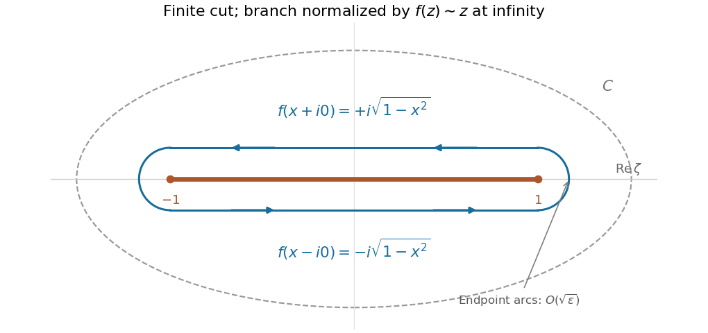

<h1 id="3/solution">Solution</h1>

↑ **Parent:** [3](../3.md)

**Branches and cuts.** For the [square root of z squared minus one](../../../../square-root-of-z-squared-minus-one.md), a [branch point](../../../../branch-point.md) is a point around which [analytic continuation](../../../../analytic-continuation.md) along an arbitrarily small closed loop can change the value of a chosen [branch of a multivalued function](../../../../branch-of-a-multivalued-function.md). Near $z=1$, the square root behaves as $\sqrt2(z-1)^{1/2}$; near $z=-1$ it is a nonzero analytic factor times $(z+1)^{1/2}$. One circuit around either point reverses its sign. Thus the finite [branch points](../../../../branch-point.md) are $\boxed{z=\pm1}$. Infinity is not a [branch point](../../../../branch-point.md): in $w=1/z$ the expression is $w^{-1}\sqrt{1-w^2}$, which has two single-valued meromorphic choices near zero.

A single [branch cut](../../../../branch-cut.md) can join $-1$ to $1$; its shortest choice is the real segment $[-1,1]$. Any surviving loop then surrounds either both [branch points](../../../../branch-point.md) or neither, so it produces no sign change. Alternatively, use two [branch cuts](../../../../branch-cut.md), $(-\infty,-1]$ and $[1,\infty)$, each joining a [branch point](../../../../branch-point.md) to infinity. On the resulting slit region one can choose a consistent [branch of a multivalued function](../../../../branch-of-a-multivalued-function.md).

For the finite cut, fix $f(z)\sim z$ at infinity, equivalently $f(x)>0$ for $x>1$. To give its actual values on both sides, put

$$
a=x^2-y^2-1,\qquad \rho=\sqrt{a^2+4x^2y^2},\qquad U=\sqrt{\frac{\rho+a}{2}},\quad V=\sqrt{\frac{\rho-a}{2}}.
$$

For $y\ne0$, the selected [square root](../../../../square-root.md) is

$$
\boxed{f(x+iy)=\operatorname{sgn}(x)U+i\operatorname{sgn}(y)V.}
$$

Here $\operatorname{sgn}(0)=0$; when $x=0$, $U=0$. Squaring verifies the formula because $UV=|xy|$. Its real part has the sign of $x$, its imaginary part has the sign of $y$, and it matches the chosen value at infinity. In particular, the two boundary values on the [branch cut](../../../../branch-cut.md) are

$$
\boxed{f(x+i0)=+i\sqrt{1-x^2},\qquad f(x-i0)=-i\sqrt{1-x^2},\quad -1<x<1.}
$$

Outside the cut, $f(x)=\operatorname{sgn}(x)\sqrt{x^2-1}$. Reversing the global [branch of a multivalued function](../../../../branch-of-a-multivalued-function.md) reverses every displayed value.

**Differential equation.** Write $f(\zeta)=\sqrt{\zeta^2-1}$ with this finite cut, and orient $C$ counterclockwise with one circuit around it. Since $C$ is fixed and avoids the [branch points](../../../../branch-point.md), [differentiation under the integral sign](../../../../differentiation-under-the-integral-sign.md) gives

$$
u'(z)=\oint_C\frac{\zeta e^{z\zeta}}{f(\zeta)}\,d\zeta,\qquad u''(z)=\oint_C\frac{\zeta^2e^{z\zeta}}{f(\zeta)}\,d\zeta.
$$

On the contour $f'=\zeta/f$. Therefore

$$
zu''+u'-zu=\oint_Ce^{z\zeta}\left(zf(\zeta)+\frac{\zeta}{f(\zeta)}\right)d\zeta=\oint_C\frac d{d\zeta}\left[e^{z\zeta}f(\zeta)\right]d\zeta=0.
$$

The last [contour integral](../../../../contour-integral.md) vanishes because the expression in brackets returns to its original value after circling both [branch points](../../../../branch-point.md). This proves $\boxed{zu''+u'-zu=0}$, including at $z=0$; division by $z$ is unnecessary.

**[Figure 1](#3/image-shrinking-a-counterclockwise-contour-around-the-finite-square-root-cut). Shrinking a counterclockwise contour around the finite square-root cut**. The upper lip runs from 1 to -1, and the lower lip returns from -1 to 1. The endpoint arcs have vanishing integrals. The values shown use the branch that behaves as z at infinity.

**Value at zero.** Near either endpoint $\zeta_0=\pm1$, the integrand at zero is $O(|\zeta-\zeta_0|^{-1/2})$. A small arc of radius $\varepsilon$ has length $O(\varepsilon)$ and hence contributes $O(\sqrt\varepsilon)\to0$. The upper lip runs from $1$ to $-1$, and the lower lip from $-1$ to $1$. Thus

$$
u(0)=\int_1^{-1}\frac{dx}{i\sqrt{1-x^2}}+\int_{-1}^1\frac{dx}{-i\sqrt{1-x^2}}=2i\int_{-1}^1\frac{dx}{\sqrt{1-x^2}}.
$$

Using $x=\sin t$ evaluates the final [integral](../../../../integral-split.md) as $\pi$, and so

$$
\boxed{u(0)=2\pi i.}
$$

The same deformation gives $u(z)=2i\int_{-1}^1e^{zx}(1-x^2)^{-1/2}dx$. The sign of $u(0)$ reverses if either the global square-root choice or the contour orientation is reversed; the differential equation is unaffected.

## ↑ Ancestors (12)

1. [3](../3.md)
2. [Paper 2](../../paper-2-split.md)
3. [2002](../../split.md)
4. [Past exam of the mathematics course of the year 2 of the natural sciences course of the University of Cambridge](../../../split.md)
5. [Mathematics course of the year 2 of the natural sciences course of the University of Cambridge](../../../../mathematics-course-of-the-year-2-of-the-natural-sciences-course-of-the-university-of-cambridge.md)
6. [Year 2 of the natural sciences course of the University of Cambridge](../../../../year-2-of-the-natural-sciences-course-of-the-university-of-cambridge.md)
7. [Year of the natural sciences course of the University of Cambridge](../../../../year-of-the-natural-sciences-course-of-the-university-of-cambridge.md)
8. [Natural sciences course of the University of Cambridge](../../../../natural-sciences-course-of-the-university-of-cambridge.md)
9. [Course of the University of Cambridge](../../../../course-of-the-university-of-cambridge.md)
10. [University of Cambridge](../../../../university-of-cambridge-split.md)
11. [List of universities](../../../../list-of-universities.md)
12. [Codex Wiki](../../../../split.md)
