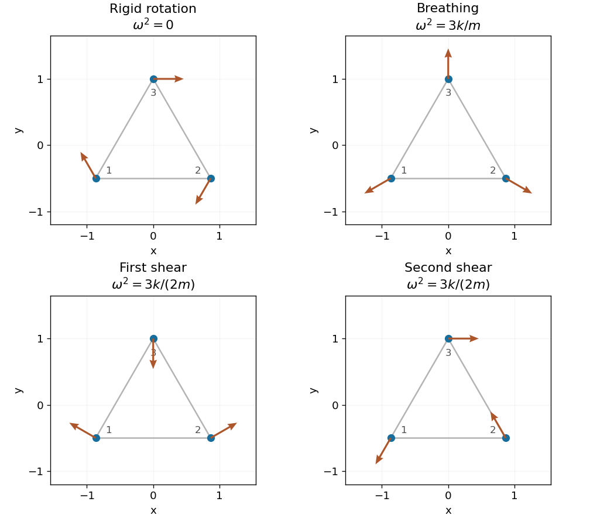

<h1 id="7/iii/solution">Solution</h1>

↑ **Parent:** [Iii](../iii.md)

For the [normal modes of an equilateral spring triangle](../../../../../normal-modes-of-an-equilateral-spring-triangle.md), the complement of the three rigid motions has dimension three. One convenient mutually [orthogonal](../../../../../orthogonal-vectors.md) basis is

$$
b=(-\sqrt3,\sqrt3,0;-1,-1,2),\qquad d=(-\sqrt3,\sqrt3,0;1,1,-2),\qquad s=(-1,-1,2;-\sqrt3,\sqrt3,0).
$$

These vectors are also orthogonal to $t_x,t_y,r$, and each has squared length $12$. Their geometry comes from applying symmetric linear deformations to the equilibrium triangle: $b$ is uniform expansion, $d$ stretches one axis while compressing the other, and $s$ is the second independent shear pattern. Their extensions are

$$
\begin{array}{c|ccc}&e_{12}&e_{13}&e_{23}\\\hline
b&2\sqrt3&2\sqrt3&2\sqrt3\\
d&2\sqrt3&-\sqrt3&-\sqrt3\\
s&0&3&-3
\end{array}.
$$

Insert each row into the force equations. For example, $b$ gives $m\ddot x_1=3\sqrt3 k=-3k b_{x_1}$ and $m\ddot y_3=-6k=-3k b_{y_3}$, with the same proportionality in every component. The other two rows similarly give force $-3k/2$ times their displacement vector. Thus

$$
Kb=3kb,\qquad Kd=\tfrac32kd,\qquad Ks=\tfrac32ks,
$$

and the remaining [normal modes](../../../../../normal-mode.md) and [normal frequencies](../../../../../eigenfrequency.md) are

$$
\boxed{\begin{array}{c|c|c}\text{pattern}&\omega^2&\omega\\\hline
b&3k/m&\sqrt{3k/m}\\
d&3k/(2m)&\sqrt{3k/(2m)}\\
s&3k/(2m)&\sqrt{3k/(2m)}
\end{array}.}
$$

Any orthogonal pair spanning the same two-dimensional shear subspace is equally valid, because its [eigenvalue](../../../../../eigenvalue.md) is repeated. The six displayed vectors are nonzero and mutually orthogonal, so they supply all six independent [normal modes](../../../../../normal-mode.md) without solving a characteristic polynomial.

**[Figure 2](#7/iii/image-rotation-breathing-and-two-shear-patterns-of-the-three-mass-triangle). Rotation, breathing and two shear patterns of the three-mass triangle**. Arrows show infinitesimal displacements using the equilibrium coordinates in the paper. Translations supply two further zero modes. The breathing frequency squared is 3k/m; both shear frequencies squared are 3k/(2m).

For explicit [normal coordinates](../../../../../normal-coordinates.md), normalize $t_x,t_y$ by $\sqrt3$ and $r,b,d,s$ by $\sqrt{12}$, and write $q=\sum_jQ_j\widehat v_j$. Since all masses are equal,

$$
T=\frac m2\sum_j\dot Q_j^2,\qquad V=\frac m2\sum_j\omega_j^2Q_j^2,\qquad\ddot Q_j+\omega_j^2Q_j=0.
$$

Positive-frequency coordinates have $Q_j=A_j\cos(\omega_jt)+B_j\sin(\omega_jt)$; the three rigid coordinates have the linear form found above.

## ↑ Ancestors (13)

1. [Iii](../iii.md)
2. [7](../../7.md)
3. [Paper 2](../../../paper-2-split.md)
4. [2002](../../../split.md)
5. [Past exam of the mathematics course of the year 2 of the natural sciences course of the University of Cambridge](../../../../split.md)
6. [Mathematics course of the year 2 of the natural sciences course of the University of Cambridge](../../../../../mathematics-course-of-the-year-2-of-the-natural-sciences-course-of-the-university-of-cambridge.md)
7. [Year 2 of the natural sciences course of the University of Cambridge](../../../../../year-2-of-the-natural-sciences-course-of-the-university-of-cambridge.md)
8. [Year of the natural sciences course of the University of Cambridge](../../../../../year-of-the-natural-sciences-course-of-the-university-of-cambridge.md)
9. [Natural sciences course of the University of Cambridge](../../../../../natural-sciences-course-of-the-university-of-cambridge.md)
10. [Course of the University of Cambridge](../../../../../course-of-the-university-of-cambridge.md)
11. [University of Cambridge](../../../../../university-of-cambridge-split.md)
12. [List of universities](../../../../../list-of-universities.md)
13. [Codex Wiki](../../../../../split.md)
