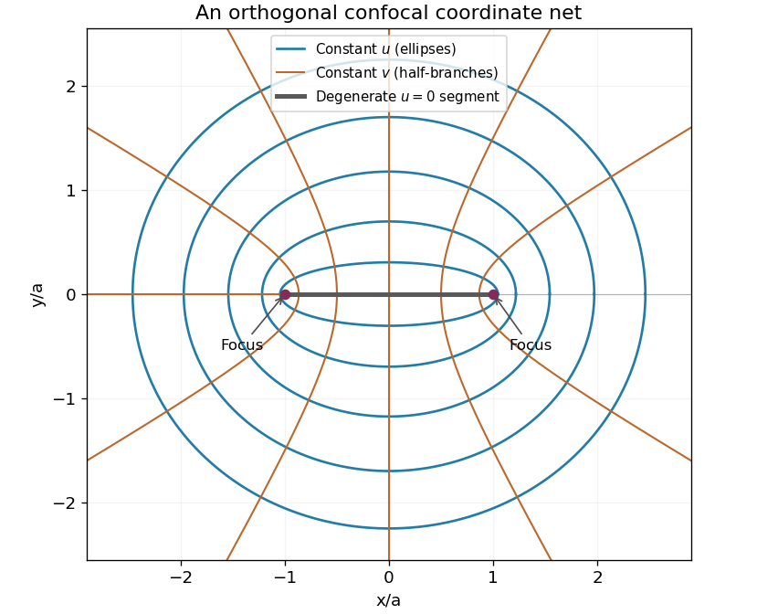

# Paper 1

↑ **Parent:** [2003](../2003.md)

[https://www.maths.cam.ac.uk/undergradnst/files/2003/PaperNST_IB_1.pdf](https://www.maths.cam.ac.uk/undergradnst/files/2003/PaperNST_IB_1.pdf)

**Table of contents**

- [1](#1)
  - [Solution](#1/solution)
- [2](#2)
  - [i](#2/i)
    - [Solution](#2/i/solution)
  - [ii](#2/ii)
    - [Solution](#2/ii/solution)
  - [iii](#2/iii)
    - [Solution](#2/iii/solution)
- [3](#3)
  - [Solution](#3/solution)
- [4](#4)
  - [Solution](#4/solution)
- [5](#5)
  - [Solution](#5/solution)
  - [a](#5/a)
    - [Solution](#5/a/solution)
  - [b](#5/b)
    - [Solution](#5/b/solution)
- [6](#6)
  - [Solution](#6/solution)
- [7](#7)
  - [Solution](#7/solution)
- [8](#8)
  - [Solution](#8/solution)
- [9](#9)
  - [Solution](#9/solution)
- [10](#10)
  - [Solution](#10/solution)

## 1

↑ **Parent:** [Paper 1](paper-1.md)

<h3 id="1/solution">Solution</h3>

↑ **Parent:** [1](#1)

For $a>0$, the positive constant-$u$ surfaces in [elliptic cylindrical coordinates](../../multivariable-calculus.md#elliptic-cylindrical-coordinates) satisfy

$$
\frac{x^2}{a^2\cosh^2u}+\frac{y^2}{a^2\sinh^2u}=1.
$$

They are confocal [elliptic cylinders](../../euclidean-geometry.md#elliptic-cylinder) with focal lines $x=\pm a,y=0$. For a generic fixed $v$, eliminating $u$ gives

$$
\frac{x^2}{a^2\cos^2v}-\frac{y^2}{a^2\sin^2v}=1.
$$

Because $u\geq0$, a fixed $v$ selects the half-branch with the signs of $x$ and $y$ fixed by $\cos v$ and $\sin v$. These are [hyperbolic cylinders](../../euclidean-geometry.md#hyperbolic-cylinder). The degenerate $u=0$ surface is $y=0$, $|x|\leq a$, extended in $z$. At $v=0,\pi$ the cross-sections are the two exterior horizontal rays; at $v=\pi/2,3\pi/2$ they are vertical half-axes.

**[Figure 1](#1/image-confocal-elliptic-and-hyperbolic-coordinate-curves). Confocal elliptic and hyperbolic coordinate curves**. Original cross-section with focal points marked. Ellipses are constant-u curves and the hyperbola half-branches are constant-v curves; extruding in z gives their coordinate surfaces.

Differentiate the position [vector](../../vector-space.md#vector) to get the coordinate [tangent vectors](../../tangent-vector.md)

$$
r_u=(a\sinh u\cos v,a\cosh u\sin v,0),\quad r_v=(-a\cosh u\sin v,a\sinh u\cos v,0),\quad r_z=(0,0,1).
$$

Their pairwise [dot products](../../inner-product.md#dot-product) vanish. Their squared lengths are $a^2(\sinh^2u+\sin^2v)$, $a^2(\sinh^2u+\sin^2v)$ and one. This proves [orthogonality](../../inner-product.md#orthogonal-vectors) and gives the [scale factors of orthogonal coordinates](../../multivariable-calculus.md#scale-factors-of-orthogonal-coordinates):

$$
\boxed{h_u=h_v=h=a\sqrt{\sinh^2u+\sin^2v},\qquad h_z=1.}
$$

The [Riemannian metric](../../riemannian-metric.md) is $ds^2=h^2(du^2+dv^2)+dz^2$. Away from the focal lines, divide the coordinate [tangent vectors](../../tangent-vector.md) by their lengths to obtain the local orthonormal [unit vectors](../../vector-space.md#unit-vector) $e_u,e_v,e_z$. For physical [vector field](../../multivariable-calculus.md#vector-field) components $A_u,A_v,A_z$, the formulas for [vector calculus in elliptic cylindrical coordinates](../../multivariable-calculus.md#vector-calculus-in-elliptic-cylindrical-coordinates) are

$$
\boxed{\nabla\cdot A=\frac{\partial_u(hA_u)+\partial_v(hA_v)+\partial_z(h^2A_z)}{h^2},}
$$

$$
\boxed{\nabla\times A=\frac{\partial_vA_z-\partial_z(hA_v)}h e_u+\frac{\partial_z(hA_u)-\partial_uA_z}h e_v+\frac{\partial_u(hA_v)-\partial_v(hA_u)}{h^2}e_z.}
$$

The [gradient](../../multivariable-calculus.md#gradient) of a [scalar](../../vector-space.md#scalar) [function](../../function.md) has components $(\phi_u/h,\phi_v/h,\phi_z)$. Apply the [divergence](../../multivariable-calculus.md#divergence) formula to this [gradient](../../multivariable-calculus.md#gradient); [Laplace's equation](../../partial-differential-equation.md#laplace-equation) becomes

$$
\boxed{\frac{\phi_{uu}+\phi_{vv}}{a^2(\sinh^2u+\sin^2v)}+\phi_{zz}=0.}
$$

The formulas apply where $h>0$; the focal lines require a limit or another coordinate chart.

## 2

↑ **Parent:** [Paper 1](paper-1.md)

<h3 id="2/i">i</h3>

↑ **Parent:** [2](#2)

<h4 id="2/i/solution">Solution</h4>

↑ **Parent:** [I](#2/i)

With [temperature](../../temperature.md) measured relative to the fixed-temperature end, the [heat equation](../../diffusion-equation.md#heat-equation) and its data are

$$
\boxed{u_t=\nu u_{xx}\quad(0<x<L,t>0),\qquad u(0,t)=0,\qquad k u_x(L,t)=H,\qquad u(x,0)=0.}
$$

Here $\nu>0$ is thermal [diffusivity](../../brownian-motion.md#diffusion-coefficient) and $k>0$ is [thermal conductivity](../../heat.md#thermal-conductivity). The sign of the [derivative](../../calculus.md#derivative) condition describes incoming [heat flux](../../heat.md#heat-flux-density) at $L$: the outward conductive [heat flux](../../heat.md#heat-flux-density) is $-k u_x=-H$.

<h3 id="2/ii">ii</h3>

↑ **Parent:** [2](#2)

<h4 id="2/ii/solution">Solution</h4>

↑ **Parent:** [Ii](#2/ii)

Choose the [stationary solution](../../differential-equation.md#stationary-solution) $w''=0$ satisfying $w(0)=0$ and $kw'(L)=H$. Hence $\boxed{w(x)=Hx/k}$. Subtracting it gives the homogeneous problem

$$
\boxed{v_t=\nu v_{xx},\qquad v(0,t)=0,\qquad v_x(L,t)=0,\qquad v(x,0)=-\frac{Hx}k.}
$$

This [boundary lifting](../../boundary-value-problem.md#boundary-lifting) leaves a [Dirichlet boundary condition](../../differential-equation.md#dirichlet-boundary-condition) at one end and a [Neumann boundary condition](../../differential-equation.md#neumann-boundary-condition) at the other, as in the [fixed-temperature and fixed-flux heat equation on an interval](../../diffusion-equation.md#fixed-temperature-and-fixed-flux-heat-equation-on-an-interval).

<h3 id="2/iii">iii</h3>

↑ **Parent:** [2](#2)

<h4 id="2/iii/solution">Solution</h4>

↑ **Parent:** [Iii](#2/iii)

For a nonzero separated solution $v=X(x)T(t)$, [separation of variables](../../partial-differential-equation.md#separation-of-variables) gives $X''+\kappa^2X=0$ and $T'=-\nu\kappa^2T$. The endpoint conditions require $X=\sin\kappa x$ and $\cos\kappa L=0$. Thus the [mixed Dirichlet-Neumann modes on an interval](../../diffusion-equation.md#mixed-dirichlet-neumann-modes-on-an-interval) have $\kappa_n=(n+1/2)\pi/L$, $n\geq0$. Their squared [L2 norms](../../real-analysis.md#l2-norm) are $L/2$, so the initial [Fourier coefficients](../../fourier-series.md#fourier-coefficient) are

$$
b_n=-\frac{2H}{kL}\int_0^Lx\sin(\kappa_nx)dx=-\frac{2H(-1)^n}{kL\kappa_n^2}.
$$

The integration uses $\cos\kappa_nL=0$ and $\sin\kappa_nL=(-1)^n$. Therefore

$$
\boxed{v(x,t)=-\frac{8HL}{k\pi^2}\sum_{n=0}^\infty\frac{(-1)^n}{(2n+1)^2}\sin\frac{(2n+1)\pi x}{2L}\exp\left[-\frac{\nu(2n+1)^2\pi^2t}{4L^2}\right],\qquad u=\frac{Hx}k+v.}
$$

At positive time the series can be differentiated termwise and satisfies both homogeneous endpoint conditions for $v$. At time zero it recovers $-Hx/k$, so $u$ recovers the initial zero [temperature](../../temperature.md). If $H\ne0$, the prescribed [derivative](../../calculus.md#derivative) at $(L,0)$ is incompatible with differentiating the initial zero profile; the [temperature](../../temperature.md) is still continuous there, while its spatial [derivative](../../calculus.md#derivative) has a corner layer. At long times the decaying modes leave $u\to Hx/k$.

**[Figure 2](#2/iii/image-heating-a-bar-through-one-end-while-the-other-end-stays-at-zero-temperature). Heating a bar through one end while the other end stays at zero temperature**. Original dimensionless temperature profiles at several diffusion times. The eventual linear profile has the imposed unit derivative at the heated end.

## 3

↑ **Parent:** [Paper 1](paper-1.md)

<h3 id="3/solution">Solution</h3>

↑ **Parent:** [3](#3)

Use the [Fourier transform](../../fourier-transform.md) convention $\widehat f(k)=\int_{\mathbb R}f(t)e^{-ikt}dt$, with inverse factor $1/(2\pi)$. For [functions](../../function.md) in [L1 space](../../measure-theory.md#l1-space), their [convolution](../../fourier-analysis.md#convolution) is $h(t)=\int_{\mathbb R}f(s)g(t-s)ds$. [Fubini's theorem](../../measure-theory.md#fubini-s-theorem) applies because the absolute double [integral](../../integral.md) is $\|f\|_1\|g\|_1$. Substituting $r=t-s$ therefore proves the [convolution theorem](../../fourier-analysis.md#convolution-theorem):

$$
\widehat h(k)=\int_{\mathbb R}\int_{\mathbb R}f(s)g(r)e^{-ik(r+s)}drds=\widehat f(k)\widehat g(k).
$$

For the specified [rectangular pulse](../../electrical-engineering.md#rectangular-function), the support condition is $|t|<1$. Its [Fourier transform](../../fourier-transform.md) is

$$
\boxed{\widehat f(k)=\int_{-1}^1e^{-ikt}dt=\frac{2\sin k}k,\qquad\widehat f(0)=2.}
$$

The [convolution](../../fourier-analysis.md#convolution) $f*f$ is the length of the overlap of $(-1,1)$ and $(t-1,t+1)$. Thus it is the [triangular pulse](../../fourier-analysis.md#triangular-function)

$$
\boxed{(f*f)(t)=\begin{cases}2-|t|,&|t|<2,\\0,&|t|\geq2,\end{cases}\qquad\widehat{f*f}(k)=\frac{4\sin^2k}{k^2}.}
$$

The transform's value at zero is four, given by its continuous extension. In this convention, the [Parseval identity](../../fourier-analysis.md#parseval-identity) for [square-integrable functions](../../measure-theory.md#square-integrable-function) is

$$
\int_{\mathbb R}|f(t)|^2dt=\frac1{2\pi}\int_{\mathbb R}|\widehat f(k)|^2dk.
$$

For the [rectangular pulse](../../electrical-engineering.md#rectangular-function) the left side is two, giving the [sinc-squared integral](../../fourier-transform.md#sinc-squared-integral)

$$
\boxed{\int_{-\infty}^{\infty}\frac{\sin^2k}{k^2}dk=\pi.}
$$

For the [triangular pulse](../../fourier-analysis.md#triangular-function), $\int|f*f|^2dt=2\int_0^2(2-t)^2dt=16/3$. Apply the same [Parseval identity](../../fourier-analysis.md#parseval-identity) with transform $4\sin^2k/k^2$ to obtain the [sinc fourth-power integral](../../fourier-transform.md#sinc-fourth-power-integral)

$$
\boxed{\int_{-\infty}^{\infty}\frac{\sin^4k}{k^4}dk=\frac{2\pi}3.}
$$

Both integrands have removable singularities at zero and integrable tails.

## 4

↑ **Parent:** [Paper 1](paper-1.md)

<h3 id="4/solution">Solution</h3>

↑ **Parent:** [4](#4)

The [spectral theorem](../../hilbert-space.md#spectral-theorem) gives a real orthonormal [eigenbasis](../../linear-operator-theory.md#eigenbasis) $v_1,\ldots,v_n$ for a real [symmetric matrix](../../linear-algebra.md#symmetric-matrix) $A$. Distinct [eigenspaces](../../linear-operator-theory.md#eigenspace) are [orthogonal](../../inner-product.md#orthogonal-vectors); within a repeated [eigenspace](../../linear-operator-theory.md#eigenspace), choose an [orthonormal basis](../../inner-product.md#orthonormal-basis), for example by [Gram-Schmidt orthogonalization](../../inner-product.md#gram-schmidt-process). Put these [eigenvectors](../../linear-operator-theory.md#eigenvector) in the columns of $T$. Then $T^{-1}=T^T$ and

$$
T^{-1}AT=\operatorname{diag}(\lambda_1,\ldots,\lambda_n).
$$

For a change of variables $y=Sx$, choose $\boxed{S=T^T}$. Since $x=Ty$, the [quadratic form](../../quadratic-form.md) becomes $x^TAx=\sum_i\lambda_i y_i^2$; the $\lambda_i$ are precisely the [eigenvalues](../../linear-operator-theory.md#eigenvalue) of $A$.

In the numerical case, the off-diagonal entries are half the cross-term coefficients, so

$$
A=\begin{pmatrix}1&1&3\\1&1&-3\\3&-3&-3\end{pmatrix}.
$$

A direct [eigenvector](../../linear-operator-theory.md#eigenvector) calculation gives the unit [eigenvectors](../../linear-operator-theory.md#eigenvector) $(1,1,0)/\sqrt2$, $(1,-1,1)/\sqrt3$, $(1,-1,-2)/\sqrt6$, with [eigenvalues](../../linear-operator-theory.md#eigenvalue) two, three and minus six. They are pairwise [orthogonal](../../inner-product.md#orthogonal-vectors). Therefore the required [orthogonal diagonalization](../../linear-algebra.md#orthogonal-diagonalization-of-a-real-symmetric-matrix) is

$$
\boxed{y_1=\frac{x_1+x_2}{\sqrt2},\qquad y_2=\frac{x_1-x_2+x_3}{\sqrt3},\qquad y_3=\frac{x_1-x_2-2x_3}{\sqrt6},}
$$

and the transformed [quadratic form](../../quadratic-form.md) is $\boxed{2y_1^2+3y_2^2-6y_3^2}$.

## 5

↑ **Parent:** [Paper 1](paper-1.md)

<h3 id="5/solution">Solution</h3>

↑ **Parent:** [5](#5)

If $Hv=\lambda v$ for a [Hermitian matrix](../../hilbert-space.md#hermitian-operator) and a nonzero [eigenvector](../../linear-operator-theory.md#eigenvector), then $v^\dagger Hv=\lambda v^\dagger v$. The [scalar](../../vector-space.md#scalar) on the left equals its complex conjugate because $H^\dagger=H$, while $v^\dagger v>0$. Thus $\lambda$ is real. If also $Hw=\mu w$, then

$$
\mu v^\dagger w=v^\dagger Hw=(Hv)^\dagger w=\lambda v^\dagger w.
$$

Consequently distinct [eigenvalues](../../linear-operator-theory.md#eigenvalue) force $v^\dagger w=0$, proving [orthogonality](../../inner-product.md#orthogonal-vectors) of their [eigenvectors](../../linear-operator-theory.md#eigenvector).

For a [unitary matrix](../../linear-operator-theory.md#unitary-matrix), $U^\dagger U=I$ preserves the [norm](../../normed-vector-space.md#norm) induced by the standard [Hermitian inner product](../../linear-algebra.md#hermitian-inner-product). If $Uv=\zeta v$ with $v\ne0$, then $\|v\|^2=\|Uv\|^2=|\zeta|^2\|v\|^2$, so $\boxed{|\zeta|=1}$.

<h3 id="5/a">a</h3>

↑ **Parent:** [5](#5)

<h4 id="5/a/solution">Solution</h4>

↑ **Parent:** [A](#5/a)

Since $A$ and $B$ are real [symmetric matrices](../../linear-algebra.md#symmetric-matrix), $U^\dagger=A-iB$. Expanding the [unitarity](../../vector-space.md#unitary-operator) condition gives

$$
I=U^\dagger U=(A-iB)(A+iB)=A^2+B^2+i(AB-BA).
$$

Equality of the entrywise real and imaginary parts yields

$$
\boxed{A^2+B^2=I,\qquad AB=BA.}
$$

These are the identities for the [real and imaginary parts of a symmetric unitary matrix](../../linear-operator-theory.md#real-and-imaginary-parts-of-a-symmetric-unitary-matrix).

<h3 id="5/b">b</h3>

↑ **Parent:** [5](#5)

<h4 id="5/b/solution">Solution</h4>

↑ **Parent:** [B](#5/b)

Let $Av=\alpha v$. The commutation relation gives $A(Bv)=B(Av)=\alpha Bv$, so $B$ preserves the [eigenspace](../../linear-operator-theory.md#eigenspace) of $A$ with [eigenvalue](../../linear-operator-theory.md#eigenvalue) $\alpha$. Because it is a [nondegenerate eigenvalue](../../linear-operator-theory.md#simple-eigenvalue), the [eigenspace](../../linear-operator-theory.md#eigenspace) is one-dimensional, and $Bv=\beta v$ for some real $\beta$. This includes $Bv=0$. Thus the [eigenvectors](../../linear-operator-theory.md#eigenvector) of $A$ form a common [eigenbasis](../../linear-operator-theory.md#eigenbasis), and

$$
Uv=(\alpha+i\beta)v.
$$

Writing the corresponding unit-modulus [eigenvalue](../../linear-operator-theory.md#eigenvalue) of $U$ as $\zeta=e^{i\theta}$ gives

$$
\boxed{\alpha=\operatorname{Re}\zeta=\cos\theta,\qquad\beta=\operatorname{Im}\zeta=\sin\theta.}
$$

The pairing refers to the same common [eigenvector](../../linear-operator-theory.md#eigenvector); independent reorderings of the two real spectra would lose this information. The [simultaneous diagonalization](../../mathematics.md#simultaneous-diagonalization) can also be constructed without requiring [simple eigenvalues](../../linear-operator-theory.md#simple-eigenvalue) by diagonalizing $B$ within each [eigenspace](../../linear-operator-theory.md#eigenspace) of $A$.

## 6

↑ **Parent:** [Paper 1](paper-1.md)

<h3 id="6/solution">Solution</h3>

↑ **Parent:** [6](#6)

For the normalized second-order [linear differential equation](../../differential-equation.md#linear-differential-equation) $y''+P(z)y'+Q(z)y=0$, an [ordinary point](../../complex-analysis.md#ordinary-point-criterion-for-a-second-order-equation) $z_0$ has analytic $P,Q$ near $z_0$. At a [regular singular point](../../complex-analysis.md#regular-singular-point), which is not ordinary, $(z-z_0)P(z)$ and $(z-z_0)^2Q(z)$ are analytic. Ordinary points admit two independent convergent [power series](../../sequence-and-series.md#power-series) solutions. Regular singular points instead call for the [Frobenius method](../../complex-analysis.md#frobenius-method), which permits leading powers and, in some cases, [logarithms](../../calculus.md#logarithm).

Here zero is an [ordinary point](../../complex-analysis.md#ordinary-point-criterion-for-a-second-order-equation). Substitute $y=\sum_{n\geq0}a_nz^n$ into the [Hermite differential equation](../../analysis.md#hermite-differential-equation) and equate coefficients:

$$
(n+2)(n+1)a_{n+2}+(\lambda-2n)a_n=0,\qquad\boxed{a_{n+2}=\frac{2n-\lambda}{(n+2)(n+1)}a_n.}
$$

The even and odd initial coefficients are independent, giving

$$
y=a_0\left[1-\frac\lambda2z^2+\frac{\lambda(\lambda-4)}{24}z^4+\cdots\right]+a_1\left[z+\frac{2-\lambda}{6}z^3+\frac{(2-\lambda)(6-\lambda)}{120}z^5+\cdots\right].
$$

These are the [power series solutions of the Hermite differential equation](../../analysis.md#power-series-solutions-of-the-hermite-differential-equation), with the present parameter equal to twice the parameter in that article. The ratio of successive terms within each nonterminating parity is asymptotically $2|z|^2/n$, so both series have infinite [radius of convergence](../../sequence-and-series.md#radius-of-convergence).

For a nonzero [polynomial](../../polynomial.md) of degree $m$, its highest coefficient in $-2zy'+\lambda y$ forces $\lambda=2m$. Conversely at that value the matching parity terminates. Hence

$$
\boxed{\lambda=2m,\qquad m=0,1,2,\ldots.}
$$

The [polynomial](../../polynomial.md) solutions are [scalar multiples](../../vector-space.md#scalar-multiple) of the [Hermite polynomials](../../orthogonal-polynomial.md#hermite-polynomial). Two examples are $\boxed{\lambda=0:\ y=1;\qquad\lambda=2:\ y=z}$; direct substitution verifies both. The other independent solution generally remains nonpolynomial.

## 7

↑ **Parent:** [Paper 1](paper-1.md)

<h3 id="7/solution">Solution</h3>

↑ **Parent:** [7](#7)

Multiplication by $x^2$ puts the [eigenvalue problem](../../linear-operator-theory.md#eigenvalue-problem) into [Sturm-Liouville form](../../sturm-liouville-theory.md#sturm-liouville-form), $-(x^2y')'=\lambda x^2y$, with weight $x^2$. If $u,v$ correspond to distinct [eigenvalues](../../linear-operator-theory.md#eigenvalue) $\lambda,\mu$, subtract their multiplied equations and integrate to get

$$
(\lambda-\mu)\int_0^\pi x^2uv\,dx=\left[x^2(uv'-vu')\right]_0^\pi=0.
$$

The upper boundary term vanishes by the [Dirichlet boundary condition](../../differential-equation.md#dirichlet-boundary-condition). For a bounded solution near zero, $x^2y'$ has a limit because $(x^2y')'=-\lambda x^2y$ is integrable. A nonzero limit would force a $1/x$ divergence in $y$, so that limit is zero; integration then gives $y'=O(x)$. The lower boundary term therefore also vanishes, proving the weighted [orthogonality](../../inner-product.md#orthogonal-vectors).

Set $z=xy$. For $x>0$, $y''+2y'/x=z''/x$, and finiteness of $y(0)$ gives $z(0)=0$. Thus $z''+\lambda z=0$ with zero values at zero and $\pi$. The [radial Dirichlet spectrum in three dimensions](../../sturm-liouville-theory.md#radial-dirichlet-spectrum-in-three-dimensions) gives

$$
\boxed{\lambda_n=n^2,\qquad y_n(x)=\frac{\sin nx}{x},\qquad n=1,2,\ldots,\quad y_n(0)=n.}
$$

The zero and negative [eigenvalues](../../linear-operator-theory.md#eigenvalue) yield only the zero solution under these [boundary conditions](../../differential-equation.md#boundary-condition). Also $\int_0^\pi x^2y_n^2dx=\pi/2$.

For the forced equation, the same substitution gives $z''-\beta z=x$. The [Fourier sine series](../../fourier-series.md#fourier-sine-series) of $x$ on $(0,\pi)$ has coefficients

$$
b_n=\frac2\pi\int_0^\pi x\sin nx\,dx=\frac{2(-1)^{n+1}}n.
$$

Expanding $z=\sum c_n\sin nx$ gives $-(n^2+\beta)c_n=b_n$, hence

$$
\boxed{y(x)=2\sum_{n=1}^\infty\frac{(-1)^n}{n(n^2+\beta)}\frac{\sin nx}{x}.}
$$

The value at zero is defined by a [limit](../../calculus.md#limit-of-a-function). In fact $|\sin nx/x|\leq n$, so [uniform convergence](../../sequence-and-series.md#uniform-convergence) holds even there, by comparison with $2\sum(n^2+\beta)^{-1}$. An independent check comes from solving the constant-coefficient equation directly:

$$
y(x)=-\frac1\beta+\frac{\pi\sinh(\sqrt\beta x)}{\beta x\sinh(\pi\sqrt\beta)}.
$$

It satisfies both endpoint conditions and the forcing for $x>0$, and its finite origin limit agrees with the series. For $\beta>0$ the homogeneous boundary value problem has no nonzero solution, so the solution is unique.

## 8

↑ **Parent:** [Paper 1](paper-1.md)

<h3 id="8/solution">Solution</h3>

↑ **Parent:** [8](#8)

Substitution of $y=x^p$ into the homogeneous [Euler-Cauchy equation](../../linear-ordinary-differential-equation.md#euler-cauchy-equation) gives $(p(p-1)+p-1)x^{p-2}=(p^2-1)x^{p-2}$, so $\boxed{p=1,-1}$. Use the solution $u(x)=x$ that vanishes at zero and $v(x)=1/x$ that decays at infinity. Their [Wronskian](../../linear-ordinary-differential-equation.md#wronskian) is $uv'-u'v=-2/x$. The [half-line Green function for the first cylindrical harmonic](../../green-s-function.md#half-line-green-function-for-the-first-cylindrical-harmonic) is therefore

$$
\boxed{G(x,s)=\begin{cases}-x/2,&0<x\leq s,\\-s^2/(2x),&0<s\leq x.\end{cases}}
$$

It is continuous at $x=s$, its first [derivative](../../calculus.md#derivative) has jump $1/2-(-1/2)=1$, and it solves the homogeneous equation elsewhere. Thus $L_xG=\delta(x-s)$ for integration with ordinary measure $ds$. The [boundary conditions](../../differential-equation.md#boundary-condition) hold for each fixed $s>0$.

Integrating against the forcing gives

$$
y(x)=-\frac1{2x}\int_0^xs^2e^{-s}ds-\frac x2\int_x^\infty e^{-s}ds.
$$

Since the two [integrals](../../integral.md) are $2-(x^2+2x+2)e^{-x}$ and $e^{-x}$, respectively,

$$
\boxed{y(x)=\frac{(x+1)e^{-x}-1}{x}\quad(x>0),\qquad y(0)=0.}
$$

A [Taylor expansion](../../calculus.md#taylor-expansion) gives $y=-x/2+O(x^2)$ near zero, while $y\sim-1/x$ at infinity. This verifies the two endpoint limits; direct differentiation verifies $Ly=e^{-x}$ on $x>0$. The differential expression itself is singular at zero, so the endpoint condition is imposed by continuity. No nonzero combination of $x$ and $1/x$ satisfies both homogeneous endpoint conditions, proving [uniqueness](../../mathematical-logic.md#uniqueness).

## 9

↑ **Parent:** [Paper 1](paper-1.md)

<h3 id="9/solution">Solution</h3>

↑ **Parent:** [9](#9)

Vary $r$ by $r+\varepsilon\eta$ with $\eta(a)=\eta(b)=0$. The first [variation](../../calculus-of-variations.md#variation) of the [functional](../../calculus-of-variations.md#functional) is

$$
\delta I_1=\int_a^b(F_{1,r}\eta+F_{1,r'}\eta')dz=\int_a^b\left(F_{1,r}-\frac d{dz}F_{1,r'}\right)\eta\,dz.
$$

The boundary term from [integration by parts](../../calculus.md#integration-by-parts) is zero. The [fundamental lemma of the calculus of variations](../../calculus-of-variations.md#fundamental-lemma-of-the-calculus-of-variations) therefore gives $\boxed{F_{1,r}-dF_{1,r'}/dz=0}$. For $I_2$, independently vary $r$ and $\theta$ with zero endpoint variations; the two [Euler-Lagrange equations](../../analysis.md#euler-lagrange-equation) are

$$
\boxed{F_{2,r}-\frac d{dz}F_{2,r'}=0,\qquad F_{2,\theta}-\frac d{dz}F_{2,\theta'}=0.}
$$

For the optical path, [Fermat principle](../../mathematical-physics.md#fermat-principle) makes $\int\mu\,ds$ stationary. In [cylindrical coordinates](../../multivariable-calculus.md#cylindrical-coordinate-system) its [integrand](../../integral.md#integrand) is $L=\mu(r,\theta)s$, with $s=\sqrt{1+r'^2+r^2\theta'^2}$. There is no explicit $z$ dependence. The [Beltrami identity for several dependent variables](../../analysis.md#beltrami-identity-for-several-dependent-variables) gives

$$
L-r'L_{r'}-\theta'L_{\theta'}=\mu s-\frac{\mu(r'^2+r^2\theta'^2)}s=\frac\mu s=\text{constant}.
$$

The conserved quantity is the axial component of the [optical momentum of a ray](../../geometrical-optics.md#optical-momentum-of-a-ray). As $\mu>0$, squaring and inverting yields

$$
\boxed{\frac{1+r'^2+r^2\theta'^2}{\mu^2}=\text{constant}.}
$$

Now suppose $\mu=\mu(r)$ and seek a path of radius $R>0$. The angle is a [cyclic coordinate](../../lagrangian-mechanics.md#cyclic-coordinate), so $L_{\theta'}=\mu R^2\theta'/\sqrt{1+R^2\theta'^2}$ is conserved. At fixed radius this is strictly increasing in $\theta'$, forcing $\theta'=\omega$ constant. The radial [Euler-Lagrange equation](../../analysis.md#euler-lagrange-equation) reduces to

$$
\mu'(R)(1+R^2\omega^2)+\mu(R)R\omega^2=0.
$$

Consequently the [helical rays in a radially graded refractive index](../../geometrical-optics.md#helical-rays-in-a-radially-graded-refractive-index) have

$$
\boxed{r(z)=R,\qquad\theta(z)=\theta_0+\omega z,\qquad\omega^2=-\frac{\mu'(R)}{R[\mu(R)+R\mu'(R)]}.}
$$

A real nonzero [helix](../../topology.md#helix) exists at such a radius when $0<-R\mu'(R)/\mu(R)<1$, and its [helical pitch](../../topology.md#pitch-of-a-helix) is $2\pi/|\omega|$. If $\mu'(R)=0$, the solution is instead a straight axial [light ray](../../geometrical-optics.md#light-ray). Thus radial dependence permits constant-radius rays for suitable profiles; an arbitrary radial profile need not support a nonzero real [helix](../../topology.md#helix). This qualification is necessary, for example when the [refractive index](../../electromagnetic-wave.md#refractive-index) increases with radius.

## 10

↑ **Parent:** [Paper 1](paper-1.md)

<h3 id="10/solution">Solution</h3>

↑ **Parent:** [10](#10)

Choose homogeneous [Dirichlet boundary conditions](../../differential-equation.md#dirichlet-boundary-condition), $y(a)=y(b)=0$, and nonzero admissible [functions](../../function.md) with finite $F$ and positive $G$. Variations obey the same zero endpoint values. At a stationary [Rayleigh quotient](../../linear-operator-theory.md#rayleigh-quotient), set $\lambda=F[y]/G[y]$. Then

$$
0=G\,\delta\Lambda=\delta F-\lambda\delta G=2[py'\eta]_a^b+2\int_a^b\left[-(py')'+qy-\lambda wy\right]\eta\,dx.
$$

The boundary term vanishes, and the [fundamental lemma of the calculus of variations](../../calculus-of-variations.md#fundamental-lemma-of-the-calculus-of-variations) gives the [Sturm-Liouville equation](../../sturm-liouville-theory.md#sturm-liouville-equation) $-(py')'+qy=\lambda wy$. Thus stationary [functions](../../function.md) are [eigenfunctions](../../linear-operator-theory.md#eigenfunction). Conversely, multiply that equation by $y$ and integrate by parts to obtain $F=\lambda G$; its first [variation](../../calculus-of-variations.md#variation) then vanishes by the same calculation. This proves that stationary values are the corresponding [eigenvalues](../../linear-operator-theory.md#eigenvalue). Homogeneous [Neumann boundary conditions](../../differential-equation.md#neumann-boundary-condition) also make the displayed boundary terms vanish; general [Robin boundary conditions](../../differential-equation.md#robin-boundary-condition) can require a boundary contribution to the quadratic form.

For $p=1$, $q=0$, $w=x$ on $(0,\pi)$, the [polynomial](../../polynomial.md) [trial function](../../finite-element-method.md#trial-function) $y=x(\pi-x)$ satisfies the endpoint conditions. Its [Rayleigh quotient](../../linear-operator-theory.md#rayleigh-quotient) uses

$$
F=\int_0^\pi(\pi-2x)^2dx=\frac{\pi^3}3,\qquad G=\int_0^\pi x^3(\pi-x)^2dx=\frac{\pi^6}{60},
$$

so the [polynomial](../../polynomial.md) estimate is $\boxed{\lambda_{\rm poly}=20/\pi^3\simeq0.64503}$. The trigonometric [trial function](../../finite-element-method.md#trial-function) $y=\sin x$ gives

$$
F=\frac\pi2,\qquad G=\int_0^\pi x\sin^2x\,dx=\frac{\pi^2}4,
$$

and hence $\boxed{\lambda_{\rm trig}=2/\pi\simeq0.63662}$. Both are **upper bounds** on the lowest [eigenvalue](../../linear-operator-theory.md#eigenvalue), by the [Rayleigh-Ritz method](../../finite-element-method.md#rayleigh-ritz-method); neither trial is an exact [eigenfunction](../../linear-operator-theory.md#eigenfunction), so the inequalities are strict.

Their closeness has a useful explanation beyond their similar single-arch shapes. Both [trial functions](../../finite-element-method.md#trial-function) are symmetric under $x\mapsto\pi-x$, forcing $\int_0^\pi xy^2dx=(\pi/2)\int_0^\pi y^2dx$. The [reflection-symmetric trials for a linearly weighted Rayleigh quotient](../../linear-operator-theory.md#reflection-symmetric-trials-for-a-linearly-weighted-rayleigh-quotient) therefore reduce this problem to a constant multiple of the ordinary Dirichlet energy quotient. The [sine](../../geometry-and-topology.md#sine) is the best trial within this symmetric class, and the [polynomial](../../polynomial.md)'s value is only a factor $10/\pi^2\simeq1.0132$ larger. The unrestricted lowest [eigenfunction](../../linear-operator-theory.md#eigenfunction) can be asymmetric because the weight $x$ is asymmetric.

## ↑ Ancestors (10)

1. [2003](../2003.md)
2. [Past exam of the mathematics course of the year 2 of the natural sciences course of the University of Cambridge](../../past-exam-of-the-mathematics-course-of-the-year-2-of-the-natural-sciences-course-of-the-university-of-cambridge.md)
3. [Mathematics course of the year 2 of the natural sciences course of the University of Cambridge](../../university-of-cambridge.md#mathematics-course-of-the-year-2-of-the-natural-sciences-course-of-the-university-of-cambridge)
4. [Year 2 of the natural sciences course of the University of Cambridge](../../university-of-cambridge.md#year-2-of-the-natural-sciences-course-of-the-university-of-cambridge)
5. [Year of the natural sciences course of the University of Cambridge](../../university-of-cambridge.md#year-of-the-natural-sciences-course-of-the-university-of-cambridge)
6. [Natural sciences course of the University of Cambridge](../../university-of-cambridge.md#natural-sciences-course-of-the-university-of-cambridge)
7. [Course of the University of Cambridge](../../university-of-cambridge.md#course-of-the-university-of-cambridge)
8. [University of Cambridge](../../university-of-cambridge.md)
9. [List of universities](../../README.md#list-of-universities)
10. [Codex Wiki](../../README.md)
