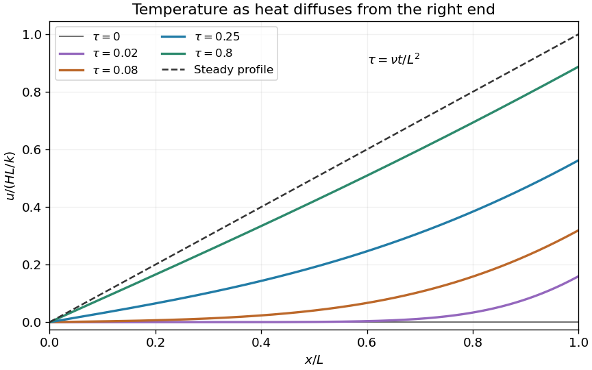

<h1 id="2/iii/solution">Solution</h1>

↑ **Parent:** [Iii](../iii.md)

For a nonzero separated solution $v=X(x)T(t)$, [separation of variables](../../../../../separation-of-variables.md) gives $X''+\kappa^2X=0$ and $T'=-\nu\kappa^2T$. The endpoint conditions require $X=\sin\kappa x$ and $\cos\kappa L=0$. Thus the [mixed Dirichlet-Neumann modes on an interval](../../../../../mixed-dirichlet-neumann-modes-on-an-interval.md) have $\kappa_n=(n+1/2)\pi/L$, $n\geq0$. Their squared [L2 norms](../../../../../l2-norm.md) are $L/2$, so the initial [Fourier coefficients](../../../../../fourier-coefficient.md) are

$$
b_n=-\frac{2H}{kL}\int_0^Lx\sin(\kappa_nx)dx=-\frac{2H(-1)^n}{kL\kappa_n^2}.
$$

The integration uses $\cos\kappa_nL=0$ and $\sin\kappa_nL=(-1)^n$. Therefore

$$
\boxed{v(x,t)=-\frac{8HL}{k\pi^2}\sum_{n=0}^\infty\frac{(-1)^n}{(2n+1)^2}\sin\frac{(2n+1)\pi x}{2L}\exp\left[-\frac{\nu(2n+1)^2\pi^2t}{4L^2}\right],\qquad u=\frac{Hx}k+v.}
$$

At positive time the series can be differentiated termwise and satisfies both homogeneous endpoint conditions for $v$. At time zero it recovers $-Hx/k$, so $u$ recovers the initial zero [temperature](../../../../../temperature-split.md). If $H\ne0$, the prescribed [derivative](../../../../../derivative.md) at $(L,0)$ is incompatible with differentiating the initial zero profile; the [temperature](../../../../../temperature-split.md) is still continuous there, while its spatial [derivative](../../../../../derivative.md) has a corner layer. At long times the decaying modes leave $u\to Hx/k$.

**[Figure 2](#2/iii/image-heating-a-bar-through-one-end-while-the-other-end-stays-at-zero-temperature). Heating a bar through one end while the other end stays at zero temperature**. Original dimensionless temperature profiles at several diffusion times. The eventual linear profile has the imposed unit derivative at the heated end.

## ↑ Ancestors (13)

1. [Iii](../iii.md)
2. [2](../../2.md)
3. [Paper 1](../../../paper-1-split.md)
4. [2003](../../../split.md)
5. [Past exam of the mathematics course of the year 2 of the natural sciences course of the University of Cambridge](../../../../split.md)
6. [Mathematics course of the year 2 of the natural sciences course of the University of Cambridge](../../../../../mathematics-course-of-the-year-2-of-the-natural-sciences-course-of-the-university-of-cambridge.md)
7. [Year 2 of the natural sciences course of the University of Cambridge](../../../../../year-2-of-the-natural-sciences-course-of-the-university-of-cambridge.md)
8. [Year of the natural sciences course of the University of Cambridge](../../../../../year-of-the-natural-sciences-course-of-the-university-of-cambridge.md)
9. [Natural sciences course of the University of Cambridge](../../../../../natural-sciences-course-of-the-university-of-cambridge.md)
10. [Course of the University of Cambridge](../../../../../course-of-the-university-of-cambridge.md)
11. [University of Cambridge](../../../../../university-of-cambridge-split.md)
12. [List of universities](../../../../../list-of-universities.md)
13. [Codex Wiki](../../../../../split.md)
