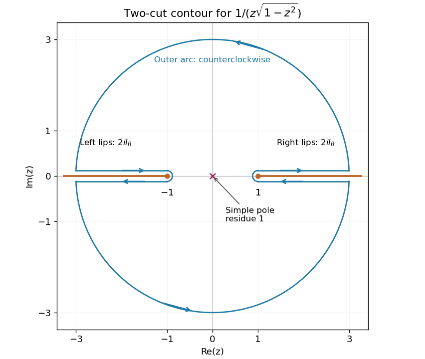

<h1 id="3/solution">Solution</h1>

↑ **Parent:** [3](../3.md)

Choose the [square root of one minus z squared](../../../../square-root-of-one-minus-z-squared.md) with $f(0)=1$: explicitly $f(z)=\sqrt{1-z}\sqrt{1+z}$ with principal [square roots](../../../../square-root.md). It is single valued and [holomorphic](../../../../holomorphic-function-split.md) away from the two specified exterior real [branch cuts](../../../../branch-cut.md). If $q(x)=\sqrt{x^2-1}>0$ for $|x|>1$, its boundary values are

$$
\boxed{\begin{array}{c|cc}&f(x+i0)&f(x-i0)\\\hline x>1&-iq(x)&+iq(x)\\x<-1&+iq(x)&-iq(x)\end{array}.}
$$

For example, above the right cut $1-z$ approaches the negative real axis from below, selecting $-i\sqrt{x-1}$; above the left cut $1+z$ approaches it from above, selecting $+i\sqrt{-x-1}$. Continuing once around either [branch point](../../../../branch-point.md) changes the sign, which explains the need for cuts.

Apply the [residue theorem](../../../../residue-theorem.md) to $F(z)=1/[zf(z)]$ on a large disk slit along both cuts, with small arcs excluding $\pm1$. The only enclosed [pole](../../../../pole.md) is at zero, and its [residue](../../../../residue.md) is $1/f(0)=1$. On the positively oriented boundary of the slit domain, the upper right lip runs from one to $R$, and the lower right lip returns from $R$ to one. The jump in $F$ gives their combined [integral](../../../../integral-split.md) as $2iI_R$, where $I_R=\int_1^Rdx/[x\sqrt{x^2-1}]$. The left lips similarly give $2iI_R$ after the substitution $x=-t$.

**[Figure 1](#3/image-a-contour-around-the-two-exterior-square-root-cuts). A contour around the two exterior square-root cuts**. Original schematic. The two slit boundaries are traversed with the retained domain on the left; each contributes twice the same real integral multiplied by i. The sole enclosed pole is at zero.

The small arcs contribute $O(\sqrt\varepsilon)$ because the branch singularities have order $-1/2$. The large arc contributes $O(R^{-1})$ because $F(z)=O(|z|^{-2})$. Taking [limits](../../../../limit-of-a-function.md) therefore yields $4iI=2\pi i$, and hence

$$
\boxed{I=\frac\pi2.}
$$

The real substitution $x=\sec\theta$ independently reduces the [integral](../../../../integral-split.md) to $\int_0^{\pi/2}d\theta$, confirming its value and sign.

## ↑ Ancestors (12)

1. [3](../3.md)
2. [Paper 2](../../paper-2-split.md)
3. [2003](../../split.md)
4. [Past exam of the mathematics course of the year 2 of the natural sciences course of the University of Cambridge](../../../split.md)
5. [Mathematics course of the year 2 of the natural sciences course of the University of Cambridge](../../../../mathematics-course-of-the-year-2-of-the-natural-sciences-course-of-the-university-of-cambridge.md)
6. [Year 2 of the natural sciences course of the University of Cambridge](../../../../year-2-of-the-natural-sciences-course-of-the-university-of-cambridge.md)
7. [Year of the natural sciences course of the University of Cambridge](../../../../year-of-the-natural-sciences-course-of-the-university-of-cambridge.md)
8. [Natural sciences course of the University of Cambridge](../../../../natural-sciences-course-of-the-university-of-cambridge.md)
9. [Course of the University of Cambridge](../../../../course-of-the-university-of-cambridge.md)
10. [University of Cambridge](../../../../university-of-cambridge-split.md)
11. [List of universities](../../../../list-of-universities.md)
12. [Codex Wiki](../../../../split.md)
