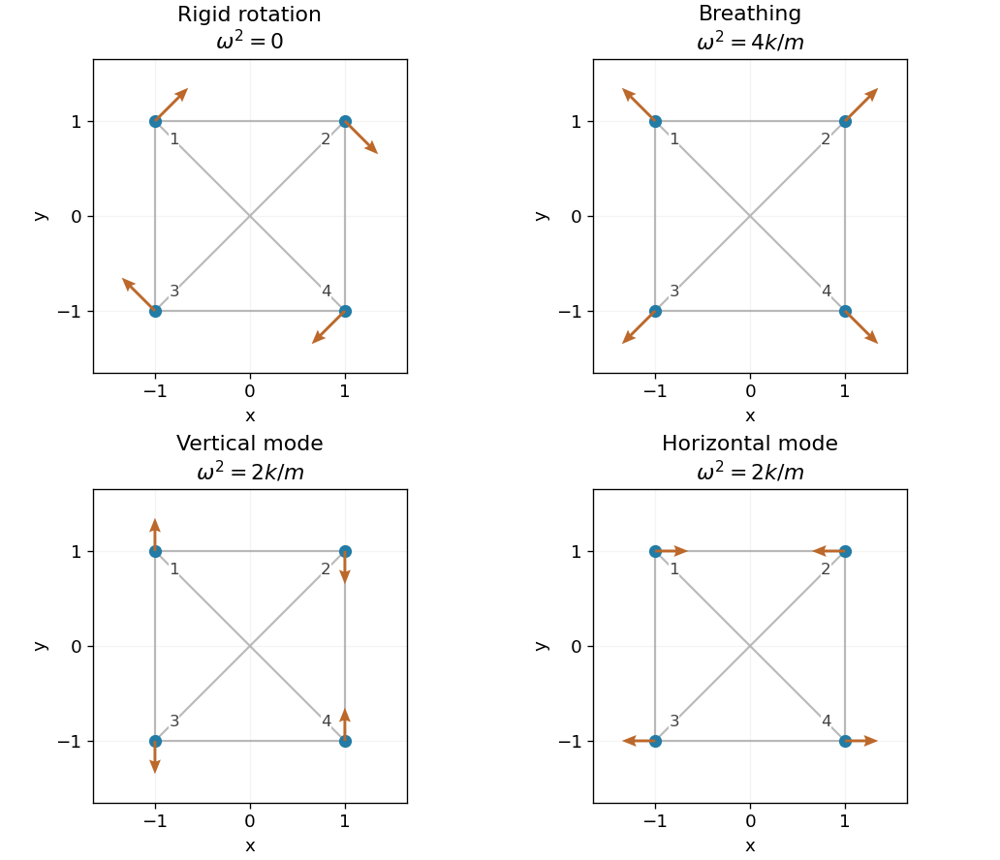

<h1 id="7/solution">Solution</h1>

↑ **Parent:** [7](../7.md)

Use the ordered displacement [vector](../../../../vector.md) $q=(x_1,y_1,x_2,y_2,x_3,y_3,x_4,y_4)^T$, and define $K$ by $V=\tfrac12q^TKq$. For an unstretched [spring](../../../../spring.md), the extension to first order is the [dot product](../../../../dot-product.md) of the relative [displacement](../../../../displacement.md) with its equilibrium [unit vector](../../../../unit-vector.md). Summing its squared extensions gives the [central spring stiffness matrix](../../../../central-spring-stiffness-matrix.md). The four side [springs](../../../../spring.md) and two diagonal [springs](../../../../spring.md) give

$$
V=\frac k2\left[(x_1-x_2)^2+(y_1-y_3)^2+(y_2-y_4)^2+(x_3-x_4)^2+\frac{(x_4-x_1-y_4+y_1)^2}2+\frac{(x_3-x_2+y_3-y_2)^2}2\right].
$$

Therefore

$$
K=\frac k2\begin{pmatrix}
3&-1&-2&0&0&0&-1&1\\
-1&3&0&0&0&-2&1&-1\\
-2&0&3&1&-1&-1&0&0\\
0&0&1&3&-1&-1&0&-2\\
0&0&-1&-1&3&1&-2&0\\
0&-2&-1&-1&1&3&0&0\\
-1&1&0&0&-2&0&3&-1\\
1&-1&0&-2&0&0&-1&3
\end{pmatrix}.
$$

The [kinetic energy](../../../../kinetic-energy.md) is $\tfrac m2\dot q^T\dot q$, so a [normal mode](../../../../normal-mode.md) satisfies $Kq=m\omega^2q$. Keeping the factor $1/2$ in the definition of $V$ fixes the normalization of $K$ and the resulting frequencies.

**[Figure 2](#7/image-rigid-rotation-breathing-and-modes-with-reflection-symmetry). Rigid rotation, breathing and modes with reflection symmetry**. Original displacement diagrams. Grey lines show all six equilibrium springs; arrows show representative mode vectors. The rotation has zero frequency, the breathing mode has squared frequency 4k/m, and the two other modes have squared frequency 2k/m.

## ↑ Ancestors (12)

1. [7](../7.md)
2. [Paper 2](../../paper-2-split.md)
3. [2003](../../split.md)
4. [Past exam of the mathematics course of the year 2 of the natural sciences course of the University of Cambridge](../../../split.md)
5. [Mathematics course of the year 2 of the natural sciences course of the University of Cambridge](../../../../mathematics-course-of-the-year-2-of-the-natural-sciences-course-of-the-university-of-cambridge.md)
6. [Year 2 of the natural sciences course of the University of Cambridge](../../../../year-2-of-the-natural-sciences-course-of-the-university-of-cambridge.md)
7. [Year of the natural sciences course of the University of Cambridge](../../../../year-of-the-natural-sciences-course-of-the-university-of-cambridge.md)
8. [Natural sciences course of the University of Cambridge](../../../../natural-sciences-course-of-the-university-of-cambridge.md)
9. [Course of the University of Cambridge](../../../../course-of-the-university-of-cambridge.md)
10. [University of Cambridge](../../../../university-of-cambridge-split.md)
11. [List of universities](../../../../list-of-universities.md)
12. [Codex Wiki](../../../../split.md)
