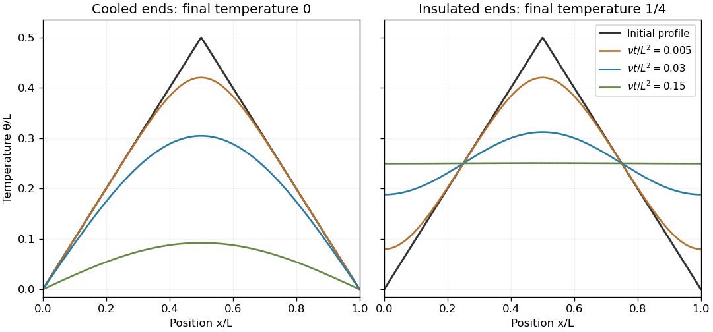
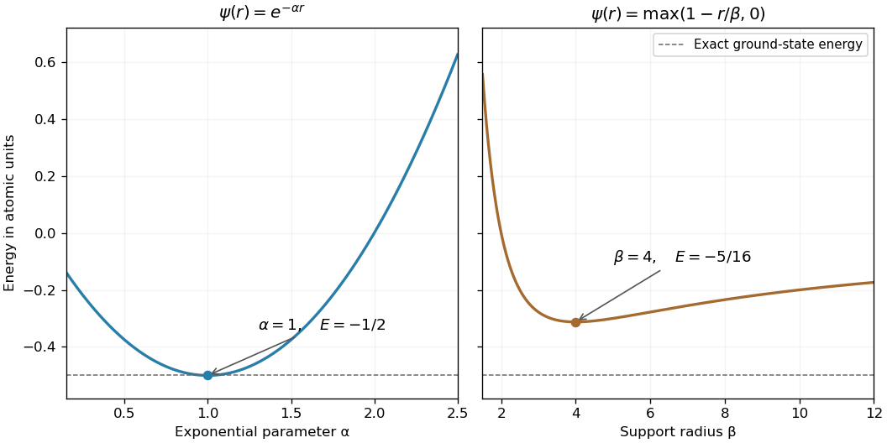

# Paper 1

↑ **Parent:** [2004](../2004.md)

[https://www.maths.cam.ac.uk/undergradnst/files/2004/PaperNST_IB_1.pdf](https://www.maths.cam.ac.uk/undergradnst/files/2004/PaperNST_IB_1.pdf)

**Table of contents**

- [1](#1)
  - [Solution](#1/solution)
- [2](#2)
  - [Solution](#2/solution)
  - [a](#2/a)
    - [Solution](#2/a/solution)
  - [b](#2/b)
    - [Solution](#2/b/solution)
- [3](#3)
  - [a](#3/a)
    - [Solution](#3/a/solution)
  - [b](#3/b)
    - [Solution](#3/b/solution)
  - [c](#3/c)
    - [Solution](#3/c/solution)
- [4](#4)
  - [a](#4/a)
    - [Solution](#4/a/solution)
  - [b](#4/b)
    - [Solution](#4/b/solution)
- [5](#5)
  - [Solution](#5/solution)
- [6](#6)
  - [i](#6/i)
    - [Solution](#6/i/solution)
  - [ii](#6/ii)
    - [Solution](#6/ii/solution)
  - [Solution](#6/solution)
- [7](#7)
  - [a](#7/a)
    - [Solution](#7/a/solution)
  - [b](#7/b)
    - [Solution](#7/b/solution)
  - [c](#7/c)
    - [Solution](#7/c/solution)
- [8](#8)
  - [Solution](#8/solution)
  - [a](#8/a)
    - [Solution](#8/a/solution)
  - [b](#8/b)
    - [Solution](#8/b/solution)
- [9](#9)
  - [a](#9/a)
    - [Solution](#9/a/solution)
  - [b](#9/b)
    - [Solution](#9/b/solution)
  - [Solution](#9/solution)
- [10](#10)
  - [Solution](#10/solution)

## 1

↑ **Parent:** [Paper 1](paper-1.md)

<h3 id="1/solution">Solution</h3>

↑ **Parent:** [1](#1)

Compare the [total differential](../../multivariable-calculus.md#total-differential) $d\phi=\sum_i\partial_{u_i}\phi\,du_i$ with $d\phi=\nabla\phi\cdot d\mathbf r$ and $d\mathbf r=\sum_i h_i\mathbf e_i\,du_i$. The orthonormality of the coordinate basis gives the [gradient in orthogonal coordinates](../../multivariable-calculus.md#gradient-in-orthogonal-coordinates):

$$
\boxed{\nabla\phi=\sum_{i=1}^3\frac{\mathbf e_i}{h_i}\partial_{u_i}\phi,\qquad \nabla u_i=\frac{\mathbf e_i}{h_i}.}
$$

To obtain the [curl](../../multivariable-calculus.md#curl) without neglecting the variation of the basis vectors, write $\phi\mathbf e_1=(\phi h_1)\nabla u_1$. The curl of a gradient vanishes, and the product rule gives

$$
\nabla\times(\phi\mathbf e_1)=\nabla(\phi h_1)\times\nabla u_1=\frac{\mathbf e_2}{h_1h_3}\partial_{u_3}(\phi h_1)-\frac{\mathbf e_3}{h_1h_2}\partial_{u_2}(\phi h_1).
$$

Likewise $\nabla u_2\times\nabla u_3=\mathbf e_1/(h_2h_3)$ because the system is right-handed. This cross product has zero [divergence](../../multivariable-calculus.md#divergence): $\nabla\cdot(\nabla u_2\times\nabla u_3)=\nabla u_3\cdot(\nabla\times\nabla u_2)-\nabla u_2\cdot(\nabla\times\nabla u_3)=0$. The divergence product rule applied to $(\phi h_2h_3)(\nabla u_2\times\nabla u_3)$ now gives

$$
\nabla\cdot(\phi\mathbf e_1)=\frac1{h_1h_2h_3}\partial_{u_1}(\phi h_2h_3).
$$

Cyclic permutation and linearity give the general component formulas described by [divergence and curl from orthogonal coordinate gradients](../../multivariable-calculus.md#divergence-and-curl-from-orthogonal-coordinate-gradients):

$$
\boxed{\nabla\cdot\mathbf v=\frac{\partial_{u_1}(h_2h_3v_1)+\partial_{u_2}(h_3h_1v_2)+\partial_{u_3}(h_1h_2v_3)}{h_1h_2h_3},}
$$

and

$$
\boxed{\nabla\times\mathbf v=\frac{\mathbf e_1}{h_2h_3}[\partial_{u_2}(h_3v_3)-\partial_{u_3}(h_2v_2)]+\frac{\mathbf e_2}{h_3h_1}[\partial_{u_3}(h_1v_1)-\partial_{u_1}(h_3v_3)]+\frac{\mathbf e_3}{h_1h_2}[\partial_{u_1}(h_2v_2)-\partial_{u_2}(h_1v_1)].}
$$

In [cylindrical coordinates](../../multivariable-calculus.md#cylindrical-coordinate-system), $(h_r,h_\theta,h_z)=(1,r,1)$. The specified field has no $z$ dependence or $z$ component, so

$$
\boxed{\nabla\times\mathbf v=\left[\frac1r\partial_r(r^4)-\frac1r\partial_\theta(\alpha\theta r^p)\right]\mathbf e_z=(4r^2-\alpha r^{p-1})\mathbf e_z.}
$$

It is an [irrotational vector field](../../multivariable-calculus.md#irrotational-vector-field) for every $r>0$ exactly when $\boxed{p=3,\ \alpha=4}$. This statement is local to an angular coordinate chart: the component proportional to $\theta$ is not single-valued under $\theta\mapsto\theta+2\pi$.

## 2

↑ **Parent:** [Paper 1](paper-1.md)

<h3 id="2/solution">Solution</h3>

↑ **Parent:** [2](#2)

With constant positive [thermal diffusivity](../../heat.md#thermal-diffusivity) $\nu$, no internal heat source and one spatial coordinate, the [heat equation](../../diffusion-equation.md#heat-equation) is

$$
\boxed{\partial_t\theta=\nu\partial_x^2\theta,\qquad0<x<L.}
$$

[Separation of variables](../../partial-differential-equation.md#separation-of-variables) makes each spatial mode decay by $e^{-\nu k^2t}$. The endpoint conditions determine whether the initial triangular profile is expanded in a [Fourier sine series](../../fourier-series.md#fourier-sine-series) or a [Fourier cosine series](../../fourier-series.md#fourier-cosine-series).

**[Figure 1](#2/image-the-same-triangular-initial-temperature-with-cooled-and-insulated-ends). The same triangular initial temperature with cooled and insulated ends**. Original heat-equation solutions for several dimensionless times. Fixed zero-temperature ends cool the bar to zero; insulated ends preserve its initial mean and approach a uniform temperature.

<h3 id="2/a">a</h3>

↑ **Parent:** [2](#2)

<h4 id="2/a/solution">Solution</h4>

↑ **Parent:** [A](#2/a)

The cooled endpoints impose [Dirichlet boundary conditions](../../differential-equation.md#dirichlet-boundary-condition) $\theta(0,t)=\theta(L,t)=0$. The spatial modes are $\sin(n\pi x/L)$. Integrating the initial profile on its two straight segments gives

$$
b_n=\frac2L\left[\int_0^{L/2}x\sin\frac{n\pi x}{L}dx+\int_{L/2}^L(L-x)\sin\frac{n\pi x}{L}dx\right]=\frac{4L}{n^2\pi^2}\sin\frac{n\pi}{2}.
$$

The [heat flow from a triangular initial temperature](../../diffusion-equation.md#heat-flow-from-a-triangular-initial-temperature) with height $L/2$ is therefore

$$
\boxed{\theta_D(x,t)=\frac{4L}{\pi^2}\sum_{n=1}^\infty\frac{\sin(n\pi/2)}{n^2}\sin\frac{n\pi x}{L}\,e^{-\nu(n\pi/L)^2t}.}
$$

Every nonzero mode decays, so $\theta_D\to0$ as $t\to\infty$. There is no nonzero constant mode compatible with these endpoint temperatures.

<h3 id="2/b">b</h3>

↑ **Parent:** [2](#2)

<h4 id="2/b/solution">Solution</h4>

↑ **Parent:** [B](#2/b)

By [Fourier's law](../../heat.md#fourier-s-law), insulation means zero outward heat flux. The [Neumann boundary conditions](../../differential-equation.md#neumann-boundary-condition) are $\theta_x(0,t)=\theta_x(L,t)=0$. The constant mode equals the initial [integral average](../../measure-theory.md#integral-average) $L/4$. For $n\geq1$, the cosine coefficients are

$$
a_n=\frac{2L}{n^2\pi^2}\left[2\cos\frac{n\pi}{2}-1-(-1)^n\right].
$$

Odd modes and modes divisible by four vanish; write the remaining indices as $n=2(2j+1)$. The [heat flow from a triangular initial temperature with insulated endpoints](../../diffusion-equation.md#heat-flow-from-a-triangular-initial-temperature-with-insulated-endpoints) gives

$$
\boxed{\theta_N(x,t)=\frac L4-\frac{2L}{\pi^2}\sum_{j=0}^\infty\frac{\cos(2(2j+1)\pi x/L)}{(2j+1)^2}\,e^{-\nu[2(2j+1)\pi/L]^2t}.}
$$

The nonconstant modes decay, so $\boxed{\theta_N\to L/4}$ uniformly as $t\to\infty$. Integrating the [heat equation](../../diffusion-equation.md#heat-equation) gives $d(\int_0^L\theta\,dx)/dt=\nu[\theta_x]_0^L=0$, explaining the conserved mean. The cooled case tends instead to zero because heat leaves through its ends.

The initial triangle has nonzero endpoint slopes, so it is not compatible with the insulated condition at the corner $t=0$. The series nevertheless recovers the continuous initial temperature and satisfies the insulated condition for every $t>0$; one should not assert continuity of its spatial derivative at that initial corner.

## 3

↑ **Parent:** [Paper 1](paper-1.md)

<h3 id="3/a">a</h3>

↑ **Parent:** [3](#3)

<h4 id="3/a/solution">Solution</h4>

↑ **Parent:** [A](#3/a)

Use the [Fourier transform](../../fourier-transform.md) convention

$$
\boxed{\widehat f(k)=\int_{-\infty}^\infty f(x)e^{-ikx}dx,\qquad f(x)=\frac1{2\pi}\int_{-\infty}^\infty\widehat f(k)e^{ikx}dk.}
$$

These hold directly under suitable integrability and inversion hypotheses, and extend to square-integrable functions through the [Plancherel theorem](../../fourier-analysis.md#plancherel-theorem). At a jump, ordinary Fourier inversion uses the mean of the one-sided limits under the usual piecewise smooth hypotheses.

<h3 id="3/b">b</h3>

↑ **Parent:** [3](#3)

<h4 id="3/b/solution">Solution</h4>

↑ **Parent:** [B](#3/b)

For the two-sided exponential, split the integral at zero:

$$
\boxed{\widehat f(k)=\int_0^\infty e^{-(1+ik)x}dx+\int_{-\infty}^0e^{(1-ik)x}dx=\frac1{1+ik}+\frac1{1-ik}=\frac2{1+k^2}.}
$$

For the interval indicator, the [Fourier transform of an interval indicator](../../fourier-transform.md#fourier-transform-of-an-interval-indicator) gives

$$
\boxed{\widehat g(k)=\int_{-2\pi}^{2\pi}e^{-ikx}dx=\frac{2\sin(2\pi k)}k.}
$$

At $k=0$, the continuous limiting value is $4\pi$, the length of the interval. Changing the values at its two endpoints has no effect on the transform.

<h3 id="3/c">c</h3>

↑ **Parent:** [3](#3)

<h4 id="3/c/solution">Solution</h4>

↑ **Parent:** [C](#3/c)

The [convolution](../../fourier-analysis.md#convolution) is $(u*v)(x)=\int_{-\infty}^\infty u(t)v(x-t)dt$. In this transform convention, the [convolution theorem](../../fourier-analysis.md#convolution-theorem) says $\widehat{u*v}=\widehat u\,\widehat v$, and [Parseval's identity](../../fourier-analysis.md#parseval-identity) says

$$
\int_{-\infty}^\infty|u(x)|^2dx=\frac1{2\pi}\int_{-\infty}^\infty|\widehat u(k)|^2dk.
$$

To match the integral's scale exactly, set $u=f/2$ and $h(x)=\tfrac12\mathbf1_{[-1,1]}(x)=g(2\pi x)/2$. Then $\widehat u=1/(1+k^2)$ and $\widehat h=\sin k/k$, using the value one at zero. Their convolution is the [box smoothing of a two-sided exponential](../../fourier-analysis.md#box-smoothing-of-a-two-sided-exponential) with both scales equal to one:

$$
w(x)=(u*h)(x)=\begin{cases}\tfrac12(1-e^{-1}\cosh x),&|x|\leq1,\\\tfrac12\sinh1\,e^{-|x|},&|x|\geq1.\end{cases}
$$

Its transform is precisely $\sin k/[k(1+k^2)]$. Since $w$ is even, [Parseval's identity](../../fourier-analysis.md#parseval-identity) reduces the requested integral to

$$
J=\pi\left[\int_0^1(1-e^{-1}\cosh x)^2dx+\sinh^2(1)\int_1^\infty e^{-2x}dx\right].
$$

Use $\int_0^1\cosh x\,dx=\sinh1$, $\int_0^1\cosh^2x\,dx=1/2+\sinh2/4$ and $\int_1^\infty e^{-2x}dx=e^{-2}/2$. Simplifying gives

$$
\boxed{J=\frac\pi4(1+5e^{-2}).}
$$

The apparent singularity at $k=0$ is removable, and the integrand decays as $O(|k|^{-6})$, so the integral converges.

## 4

↑ **Parent:** [Paper 1](paper-1.md)

<h3 id="4/a">a</h3>

↑ **Parent:** [4](#4)

<h4 id="4/a/solution">Solution</h4>

↑ **Parent:** [A](#4/a)

A [Hermitian matrix](../../hilbert-space.md#hermitian-operator) obeys $H^\dagger=H$, where the dagger is conjugate transpose. If $Hv=\lambda v$ with $v\ne0$, then $v^\dagger Hv=\lambda v^\dagger v$. This scalar is real because its complex conjugate equals $v^\dagger H^\dagger v=v^\dagger Hv$. Since $v^\dagger v>0$, the [eigenvalue](../../linear-operator-theory.md#eigenvalue) $\lambda$ is real.

For the [Gram matrix](../../inner-product.md#gram-matrix), conjugate symmetry of the [inner product](../../inner-product.md) gives

$$
(G^\dagger)_{ij}=\overline{G_{ji}}=\overline{\langle u_j,u_i\rangle}=\langle u_i,u_j\rangle=G_{ij}.
$$

Thus $G$ is [Hermitian](../../hilbert-space.md#hermitian-operator). The assumption that the vectors form a basis additionally makes $G$ positive definite, though only Hermiticity is needed here.

<h3 id="4/b">b</h3>

↑ **Parent:** [4](#4)

<h4 id="4/b/solution">Solution</h4>

↑ **Parent:** [B](#4/b)

Let $Av_1=\lambda_1v_1$ and $Av_2=\lambda_2v_2$, with both vectors nonzero and $\lambda_1\ne\lambda_2$. If $c_1v_1+c_2v_2=0$, apply $A-\lambda_2I$ to get $c_1(\lambda_1-\lambda_2)v_1=0$. Hence $c_1=0$, and then $c_2=0$.

For the general [independence of eigenvectors for distinct eigenvalues](../../linear-operator-theory.md#independence-of-eigenvectors-for-distinct-eigenvalues), use induction. In a relation $\sum_{j=1}^n c_jv_j=0$, applying $A-\lambda_nI$ gives $\sum_{j=1}^{n-1}c_j(\lambda_j-\lambda_n)v_j=0$. Independence of the first $n-1$ vectors makes each coefficient vanish. Distinctness of the eigenvalues then gives $c_1=\cdots=c_{n-1}=0$, and the original relation gives $c_n=0$. No Hermitian assumption is required.

## 5

↑ **Parent:** [Paper 1](paper-1.md)

<h3 id="5/solution">Solution</h3>

↑ **Parent:** [5](#5)

A real [orthogonal matrix](../../linear-algebra.md#orthogonal-matrix) satisfies $Q^TQ=I$; a complex [unitary matrix](../../linear-operator-theory.md#unitary-matrix) satisfies $U^\dagger U=I$. Their columns are orthonormal in the corresponding real or complex [inner product](../../inner-product.md).

Adopt the convention that a [complex inner product](../../linear-algebra.md#hermitian-inner-product) is linear in its second argument, conjugate symmetric, and positive definite: $\langle u,u\rangle\geq0$, with equality exactly when $u=0$. Conjugate symmetry and second-argument linearity then imply antilinearity in the first:

$$
\langle\alpha u_1+\beta u_2,v\rangle=\overline{\langle v,\alpha u_1+\beta u_2\rangle}=\overline{\alpha\langle v,u_1\rangle+\beta\langle v,u_2\rangle}=\bar\alpha\langle u_1,v\rangle+\bar\beta\langle u_2,v\rangle.
$$

For the specified real symmetric matrix use $b=a^2$. Its upper block is the [outer product](../../vector-space.md#outer-product) $(1,a)^T(1,a)$, so it has one zero eigenvalue and one eigenvalue $1+a^2$. A complete [orthonormal eigenbasis](../../linear-operator-theory.md#orthonormal-eigenbasis) is

$$
\boxed{\lambda_0=0,\quad v_0=\frac{(-a,1,0)^T}{\sqrt{1+a^2}};\qquad \lambda_+=1+a^2=1+b,\quad v_+=\frac{(1,a,0)^T}{\sqrt{1+a^2}};\qquad \lambda_c=c,\quad v_c=(0,0,1)^T.}
$$

If $c=1+b$, the last two eigenvalues coincide and their [eigenspace](../../linear-operator-theory.md#eigenspace) is the span of $v_+,v_c$; every nonzero vector in that span is an eigenvector. Since $c>0$, the zero eigenspace remains one-dimensional.

## 6

↑ **Parent:** [Paper 1](paper-1.md)

<h3 id="6/i">i</h3>

↑ **Parent:** [6](#6)

<h4 id="6/i/solution">Solution</h4>

↑ **Parent:** [I](#6/i)

An [ordinary point](../../complex-analysis.md#ordinary-point-criterion-for-a-second-order-equation) of the normalized second-order equation is a point where both coefficient functions $p(x)$ and $q(x)$ are analytic in a neighborhood. Ordinary continuity is enough for a local existence theorem, but analyticity is the condition used for a convergent local [power series](../../sequence-and-series.md#power-series) solution.

<h3 id="6/ii">ii</h3>

↑ **Parent:** [6](#6)

<h4 id="6/ii/solution">Solution</h4>

↑ **Parent:** [Ii](#6/ii)

A [regular singular point](../../complex-analysis.md#regular-singular-point) is a nonordinary point $x_0$ for which $(x-x_0)p(x)$ and $(x-x_0)^2q(x)$ extend analytically across $x_0$. These pole restrictions permit the [Frobenius method](../../complex-analysis.md#frobenius-method).

<h3 id="6/solution">Solution</h3>

↑ **Parent:** [6](#6)

The [Wronskian](../../linear-ordinary-differential-equation.md#wronskian) is $W=y_1y_2'-y_1'y_2$. If constants $A,B$ obey $Ay_1+By_2=0$, differentiating gives $Ay_1'+By_2'=0$. At any point where $W\ne0$, these form an invertible two-by-two system, forcing $A=B=0$. Thus the two solutions are linearly independent.

For the given equation, the normalized coefficients are $p=(1-x)/(2x)$ and $q=-1/(4x)$, so zero is a [regular singular point](../../complex-analysis.md#regular-singular-point). Substitute a [Frobenius series](../../complex-analysis.md#frobenius-solution) $y=x^r\sum_{n=0}^\infty a_nx^n$, $a_0\ne0$. The lowest power gives the [indicial equation](../../linear-ordinary-differential-equation.md#indicial-equation)

$$
\boxed{2r(2r-1)=0,\qquad r=0,\ \tfrac12.}
$$

The coefficient of $x^{n+r}$ gives

$$
2(n+r+1)(2n+2r+1)a_{n+1}=(2n+2r+1)a_n.
$$

For either root the common factor is nonzero for $n\geq0$, so

$$
\boxed{a_{n+1}=\frac{a_n}{2(n+r+1)}.}
$$

With leading coefficient one, the two independent solutions are

$$
\boxed{y_1=\sum_{n=0}^\infty\frac{x^n}{2^nn!}=e^{x/2},\qquad y_2=x^{1/2}\sum_{n=0}^\infty\frac{x^n}{(2n+1)!!}=\sqrt{x}\left(1+\frac x3+\frac{x^2}{15}+\frac{x^3}{105}+\cdots\right).}
$$

Their analytic series factors both have **infinite radius of convergence**, because the ratio of consecutive terms tends to zero for every fixed $x$. The factor $x^{1/2}$ still gives the second solution a branch point at zero; it is not an entire function or an ordinary Taylor series there. On $x>0$, the general real solution is $C_1y_1+C_2y_2$. This is the $b=1/2$, $z=x/2$ case of the [exponential reduction of a confluent hypergeometric equation with equal parameters](../../linear-ordinary-differential-equation.md#exponential-reduction-of-a-confluent-hypergeometric-equation-with-equal-parameters).

## 7

↑ **Parent:** [Paper 1](paper-1.md)

<h3 id="7/a">a</h3>

↑ **Parent:** [7](#7)

<h4 id="7/a/solution">Solution</h4>

↑ **Parent:** [A](#7/a)

For the given [weighted inner product](../../inner-product.md#weighted-inner-product), a [self-adjoint operator](../../linear-operator-theory.md#self-adjoint-operator) $L$ obeys $L=L^\dagger$, including equality of its domain with the adjoint domain. In the differential-equation calculation this requires

$$
\langle f,Lg\rangle=\langle Lf,g\rangle
$$

for all functions in a specified common domain, with endpoint conditions that remove the boundary form. Equality of these inner products by itself describes symmetry; the domain conditions complete the self-adjoint realization.

<h3 id="7/b">b</h3>

↑ **Parent:** [7](#7)

<h4 id="7/b/solution">Solution</h4>

↑ **Parent:** [B](#7/b)

Divide the equation by $\sqrt{1-x^2}$ to obtain its [Sturm-Liouville form](../../sturm-liouville-theory.md#sturm-liouville-form):

$$
\boxed{\frac d{dx}\left(\sqrt{1-x^2}\,y'\right)+\frac{n^2}{\sqrt{1-x^2}}y=0.}
$$

Thus $p=\sqrt{1-x^2}$, $q=0$ and $w=(1-x^2)^{-1/2}$. For $L=-w^{-1}(p\,d/dx)'$, the [Lagrange identity for a Sturm-Liouville operator](../../sturm-liouville-theory.md#lagrange-identity-for-a-sturm-liouville-operator) gives the endpoint form $[p(\bar f'g-\bar f g')]_{-1}^1$. A natural self-adjoint choice is

$$
\boxed{\lim_{x\to-1^+}\sqrt{1-x^2}\,y'(x)=\lim_{x\to1^-}\sqrt{1-x^2}\,y'(x)=0.}
$$

Under $x=\cos\theta$, these become the ordinary zero-derivative conditions at $\theta=0,\pi$ for $-d^2/d\theta^2$. They therefore define the realization whose [Neumann eigenfunctions of the Chebyshev differential operator](../../numerical-analysis.md#neumann-eigenfunctions-of-the-chebyshev-differential-operator) are $T_n(x)=\cos(n\arccos x)$, with $n=0,1,\ldots$.

Boundedness alone does not choose these endpoint conditions: $\sin(n\arccos x)$ is also bounded but generally has a nonzero endpoint value of $py'$. Requiring bounded $y'$ is a sufficient stronger regularity condition for the displayed zero-flux limits. Other self-adjoint endpoint choices are possible; the boundary form and the operator domain must specify which is intended.

<h3 id="7/c">c</h3>

↑ **Parent:** [7](#7)

<h4 id="7/c/solution">Solution</h4>

↑ **Parent:** [C](#7/c)

Use the [drift-removing substitution for a Dirichlet Sturm-Liouville problem](../../sturm-liouville-theory.md#drift-removing-substitution-for-a-dirichlet-sturm-liouville-problem), $z(x)=e^{-2x}u(x)$. It gives $u''+\lambda u=0$ with $u(0)=u(1)=0$. Positive $\lambda=k^2$ requires $\sin k=0$; zero or negative $\lambda$ yields only the trivial solution under both endpoint conditions. Hence

$$
\boxed{\lambda_n=n^2\pi^2,\qquad z_n(x)=e^{-2x}\sin(n\pi x),\qquad n=1,2,\ldots.}
$$

Multiplication of the original equation by $e^{4x}$ gives $-(e^{4x}z')'-4e^{4x}z=\lambda e^{4x}z$. Thus the appropriate [weighted inner product](../../inner-product.md#weighted-inner-product) has weight $e^{4x}$, and

$$
\boxed{\int_0^1e^{4x}z_m(x)z_n(x)dx=\int_0^1\sin(m\pi x)\sin(n\pi x)dx=\frac12\delta_{mn}.}
$$

Multiplying each eigenfunction by $\sqrt2$ gives weighted norm one.

## 8

↑ **Parent:** [Paper 1](paper-1.md)

<h3 id="8/solution">Solution</h3>

↑ **Parent:** [8](#8)

The homogeneous [Cauchy-Euler equation](../../linear-ordinary-differential-equation.md#cauchy-euler-equation) has powers $x^r$ with $r(r-1)+2r-2=(r-1)(r+2)=0$. Boundedness at zero selects $x$, and boundedness at infinity selects $x^{-2}$. Put $G=Ax$ for $x<\zeta$ and $G=Bx^{-2}$ for $x>\zeta$. Continuity gives $B=A\zeta^3$. Since the operator is $L=(x^2\,d/dx)'-2$, the required delta-function normalization is $\zeta^2[G_x]_{\zeta^-}^{\zeta^+}=1$. Thus $-3A\zeta^2=1$, giving the [bounded Green kernel for a radial Euler operator](../../green-s-function.md#bounded-green-kernel-for-a-radial-euler-operator):

$$
\boxed{G(x,\zeta)=\begin{cases}-x/(3\zeta^2),&0<x<\zeta,\\-\zeta/(3x^2),&\zeta<x<\infty.\end{cases}}
$$

In the requested notation, $\boxed{a=1,\ b=-2,\ c=1,\ d=-2,\ k_-=k_+=-1/3}$. The two expressions agree at $x=\zeta$.

With ordinary measure $d\zeta$, the solution is

$$
\boxed{y(x)=\int_0^\infty G(x,\zeta)f(\zeta)d\zeta=-\frac1{3x^2}\int_0^x\zeta f(\zeta)d\zeta-\frac x3\int_x^\infty\frac{f(\zeta)}{\zeta^2}d\zeta.}
$$

For bounded forcing these integrals converge and give a bounded solution. It is unique because no nonzero combination of $x,x^{-2}$ is bounded at both ends. For a more general forcing, convergence and boundedness of the displayed integral must be checked.

<h3 id="8/a">a</h3>

↑ **Parent:** [8](#8)

<h4 id="8/a/solution">Solution</h4>

↑ **Parent:** [A](#8/a)

The [Green's function](../../green-s-function.md) is nonpositive, so $f\geq0$ gives $y\leq0$. If also $f\leq m$, then

$$
\int_0^x\zeta f(\zeta)d\zeta\leq\frac{mx^2}{2},\qquad\int_x^\infty\frac{f(\zeta)}{\zeta^2}d\zeta\leq\frac mx.
$$

The integral solution therefore gives

$$
\boxed{-\frac m2=-\frac13\left(\frac m2+m\right)\leq y(x)\leq0.}
$$

Both bounds are attained, by the constant forcings $f=m$ and $f=0$, respectively. In particular, boundedness of the solution does not require it to approach zero.

<h3 id="8/b">b</h3>

↑ **Parent:** [8](#8)

<h4 id="8/b/solution">Solution</h4>

↑ **Parent:** [B](#8/b)

Differentiate the integral formula using the [Leibniz integral rule](../../analysis.md#leibniz-integral-rule). Its two moving-endpoint terms cancel, leaving

$$
y'(x)=\frac2{3x^3}\int_0^x\zeta f(\zeta)d\zeta-\frac13\int_x^\infty\frac{f(\zeta)}{\zeta^2}d\zeta.
$$

Each term before subtraction lies between zero and $m/(3x)$. Therefore

$$
\boxed{-\frac m{3x}\leq y'(x)\leq\frac m{3x}.}
$$

The bounds are sharp at any fixed positive $x$: put $f=m$ below that point and zero above it for the upper bound, or reverse those choices for the lower bound. If continuity of the forcing is required, smooth approximations approach the same bounds.

## 9

↑ **Parent:** [Paper 1](paper-1.md)

<h3 id="9/a">a</h3>

↑ **Parent:** [9](#9)

<h4 id="9/a/solution">Solution</h4>

↑ **Parent:** [A](#9/a)

If the integrand has no explicit $x$ dependence, differentiate $f-y'f_{y'}$ along a stationary path:

$$
\frac d{dx}(f-y'f_{y'})=f_x+y'\left(f_y-\frac d{dx}f_{y'}\right)=0.
$$

The last equality uses $f_x=0$ and the [Euler-Lagrange equation](../../analysis.md#euler-lagrange-equation). This proves the [Beltrami identity](../../analysis.md#beltrami-identity), the [first integral](../../differential-equation.md#first-integral) $\boxed{f-y'f_{y'}=C}$.

<h3 id="9/b">b</h3>

↑ **Parent:** [9](#9)

<h4 id="9/b/solution">Solution</h4>

↑ **Parent:** [B](#9/b)

If $f$ has no explicit $y$ dependence, the [Euler-Lagrange equation](../../analysis.md#euler-lagrange-equation) becomes $d(f_{y'})/dx=0$. Thus

$$
\boxed{f_{y'}=C.}
$$

The variable $y$ is then a [cyclic coordinate](../../lagrangian-mechanics.md#cyclic-coordinate). This is the case used for the azimuth in the ramp calculation.

<h3 id="9/solution">Solution</h3>

↑ **Parent:** [9](#9)

For variations $y+\epsilon\eta$ with $\eta(a)=\eta(b)=0$, [integration by parts](../../calculus.md#integration-by-parts) gives $\delta I=\int_a^b[f_y-d(f_{y'})/dx]\eta\,dx$. The [fundamental lemma of the calculus of variations](../../calculus-of-variations.md#fundamental-lemma-of-the-calculus-of-variations) therefore gives the [Euler-Lagrange equation](../../analysis.md#euler-lagrange-equation)

$$
\boxed{\frac d{dx}f_{y'}-f_y=0.}
$$

For the ramp, use [conservation of energy](../../mathematical-physics.md#conservation-of-energy) from rest at the rim. The vertical drop is $R\cos\theta$, so $v=\sqrt{2gR\cos\theta}$. The spherical surface [arc length](../../riemannian-geometry.md#arc-length) is $ds=R\sqrt{d\theta^2+\sin^2\theta\,d\phi^2}$. On a monotone segment described by $\phi(\theta)$, the [travel time](../../dispersion-relation.md#travel-time) is consequently

$$
\boxed{T=\sqrt{\frac R{2g}}\int\sqrt{\frac{1+\sin^2\theta\,\phi'^2}{\cos\theta}}\,|d\theta|.}
$$

For increasing $\theta$ this has the printed limits $\theta_0$ to $\theta_1$; for a descent, reverse the decreasing angular limits to keep time positive. The azimuth is a [cyclic coordinate](../../lagrangian-mechanics.md#cyclic-coordinate) of this integrand. Its conserved derivative gives the [first integral](../../differential-equation.md#first-integral) for the [brachistochrone on a hemispherical ramp](../../calculus-of-variations.md#brachistochrone-on-a-hemispherical-ramp):

$$
\boxed{\frac{\sin^2\theta\,\phi'}{\sqrt{\cos\theta}\sqrt{1+\sin^2\theta\,\phi'^2}}=C.}
$$

Solving for its square yields

$$
\phi'^2=\frac{C^2\cos\theta}{\sin^2\theta(\sin^2\theta-C^2\cos\theta)}.
$$

For a regular stationary path with finite $C$, this tends to zero as the rim $\theta\to\pi/2$ is approached. The ratio of azimuthal to meridional displacements is $\sin\theta\,\phi'$, which also tends to zero. Hence **the initial direction is along a meridian toward the bottom**. This conclusion concerns the initial heading; the later route can turn before reaching the bottom when its rim endpoints require a nonzero azimuthal displacement.

## 10

↑ **Parent:** [Paper 1](paper-1.md)

<h3 id="10/solution">Solution</h3>

↑ **Parent:** [10](#10)

For example, impose homogeneous [Dirichlet boundary conditions](../../differential-equation.md#dirichlet-boundary-condition) $y(a)=y(b)=0$, and use variations vanishing there. Homogeneous [Neumann boundary conditions](../../differential-equation.md#neumann-boundary-condition) $py'=0$ are another choice removing the boundary terms. Put $N[y]=\int_a^b(py'^2+qy^2)dx$, $D[y]=\int_a^bwy^2dx>0$, and $I=N/D$. At a stationary function let $\lambda=I[y]$. The quotient rule gives $\delta I=(\delta N-\lambda\delta D)/D$. After [integration by parts](../../calculus.md#integration-by-parts), stationarity under every allowed variation gives

$$
0=\int_a^b[-(py')'+qy-\lambda wy]\eta\,dx,
$$

so the [fundamental lemma of the calculus of variations](../../calculus-of-variations.md#fundamental-lemma-of-the-calculus-of-variations) yields the stated [Sturm-Liouville problem](../../sturm-liouville-theory.md#sturm-liouville-problem). Conversely an eigenfunction with those boundary conditions has $N=\lambda D$ and makes the quotient stationary. The lowest eigenvalue minimizes the [Rayleigh quotient](../../linear-operator-theory.md#rayleigh-quotient) under the usual self-adjoint, lower-bounded hypotheses; higher eigenvalues are stationary values with orthogonality constraints when minimizing successively.

The hydrogen equation becomes $-(r^2\psi')'-2r\psi=2Er^2\psi$. Its radial energy quotient is therefore

$$
E[\psi]=\frac{\int_0^\infty[r^2\psi'^2-2r\psi^2]dr}{2\int_0^\infty r^2\psi^2dr}.
$$

Regularity at zero and decay at infinity remove the boundary term $r^2\psi\psi'$. The condition $\psi(0)=1$ fixes an arbitrary amplitude for these trial functions; it is not their three-dimensional probability normalization, which cancels from the quotient.

For $\psi=e^{-\alpha r}$, elementary exponential integrals give $\int r^2\psi^2dr=1/(4\alpha^3)$, $\int r^2\psi'^2dr=1/(4\alpha)$, and $\int r\psi^2dr=1/(4\alpha^2)$. Hence

$$
E(\alpha)=\frac{\alpha^2}{2}-\alpha=\frac12(\alpha-1)^2-\frac12,\qquad\boxed{\alpha=1,\quad E_{\exp}=-\frac12.}
$$

For the [compactly supported linear trial for hydrogen](../../mathematical-physics.md#compactly-supported-linear-trial-for-hydrogen), the norm, gradient and Coulomb integrals are $\beta^3/30$, $\beta/3$, and $\beta^2/12$, respectively. Thus

$$
E(\beta)=\frac5{\beta^2}-\frac5{2\beta},\qquad E'(\beta)=\frac{5(\beta-4)}{2\beta^3},\qquad\boxed{\beta=4,\quad E_{\mathrm{linear}}=-\frac5{16}.}
$$

The derivative changes from negative to positive at four, so this is the minimum over positive $\beta$. The [quantum variational principle](../../quantum-mechanics.md#quantum-variational-principle) gives upper bounds on the [ground-state energy](../../quantum-mechanics.md#ground-state-energy); **the exponential trial is better**, and in fact $e^{-r}$ satisfies the exact differential equation at $E=-1/2$. It is the nodeless hydrogen ground state in the given units. The linear trial is admissible for the energy quadratic form despite its derivative jump at $r=\beta$; it need not possess a classical second derivative at that point.

**[Figure 2](#10/image-variational-energy-curves-for-exponential-and-compact-linear-hydrogen-trials). Variational energy curves for exponential and compact linear hydrogen trials**. Original energy curves in the equation's atomic units. The exponential family reaches the exact ground-state energy, while the best compact linear trial remains above it.

## ↑ Ancestors (10)

1. [2004](../2004.md)
2. [Past exam of the mathematics course of the year 2 of the natural sciences course of the University of Cambridge](../../past-exam-of-the-mathematics-course-of-the-year-2-of-the-natural-sciences-course-of-the-university-of-cambridge.md)
3. [Mathematics course of the year 2 of the natural sciences course of the University of Cambridge](../../university-of-cambridge.md#mathematics-course-of-the-year-2-of-the-natural-sciences-course-of-the-university-of-cambridge)
4. [Year 2 of the natural sciences course of the University of Cambridge](../../university-of-cambridge.md#year-2-of-the-natural-sciences-course-of-the-university-of-cambridge)
5. [Year of the natural sciences course of the University of Cambridge](../../university-of-cambridge.md#year-of-the-natural-sciences-course-of-the-university-of-cambridge)
6. [Natural sciences course of the University of Cambridge](../../university-of-cambridge.md#natural-sciences-course-of-the-university-of-cambridge)
7. [Course of the University of Cambridge](../../university-of-cambridge.md#course-of-the-university-of-cambridge)
8. [University of Cambridge](../../university-of-cambridge.md)
9. [List of universities](../../README.md#list-of-universities)
10. [Codex Wiki](../../README.md)
