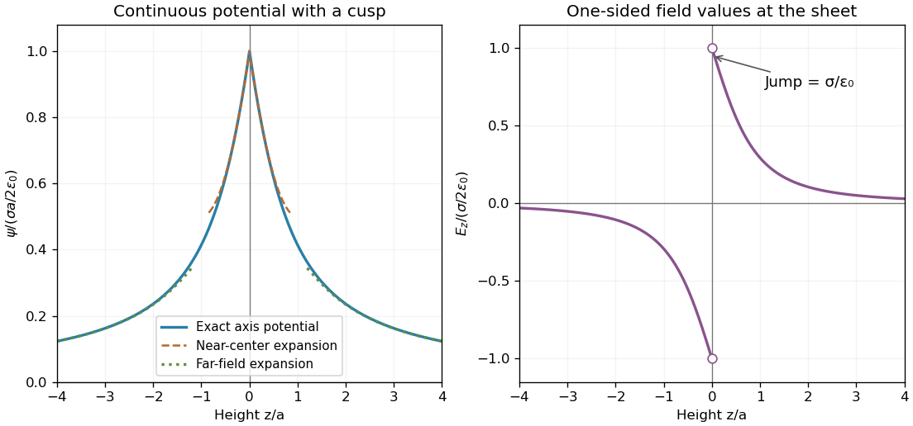

<h1 id="2/solution">Solution</h1>

↑ **Parent:** [2](../2.md)

Use [Green's second identity](../../../../green-second-identity.md) in the source coordinate:

$$
\int_\Omega(u\Delta v-v\Delta u)dV'=\int_{\partial\Omega}(u\partial_n v-v\partial_n u)dS'.
$$

Take $u(\mathbf x')=\psi(\mathbf x')$ and $v(\mathbf x')=-1/[4\pi|\mathbf x-\mathbf x'|]$, the [fundamental solution of the Laplace equation](../../../../fundamental-solution-of-the-laplace-equation.md) satisfying $\Delta'v=\delta(\mathbf x'-\mathbf x)$. With localized charge and the decaying potential, the boundary integral tends to zero on expanding spheres. The volume identity then gives $\psi(\mathbf x)+(1/\epsilon_0)\int vq\,dV'=0$, hence the [Coulomb potential](../../../../coulomb-potential-energy.md)

$$
\boxed{\psi(\mathbf x)=\frac1{4\pi\epsilon_0}\int_{\mathbb R^3}\frac{q(\mathbf x')}{|\mathbf x-\mathbf x'|}dV'.}
$$

Convergence of this integral and a condition fixing the potential at infinity are needed: mere pointwise decay of $q$ is not enough, and a harmonic function could otherwise be added. A bounded, compactly supported charge distribution is a sufficient setting for this derivation.

For the disk put $\sigma=Q/(\pi a^2)$. On its axis, every ring of radius $\rho$ is at distance $\sqrt{\rho^2+z^2}$, so

$$
\boxed{\psi(0,z)=\frac{\sigma}{2\epsilon_0}\int_0^a\frac{\rho\,d\rho}{\sqrt{\rho^2+z^2}}=\frac{Q}{2\pi\epsilon_0a^2}(\sqrt{a^2+z^2}-|z|).}
$$

For $z>0$ subtract $z$; for $z<0$ add $z$. This is the [electrostatic potential of a uniformly charged disk](../../../../electrostatic-potential-of-a-uniformly-charged-disk.md) with zero potential at infinity. The absolute value is essential for reflection symmetry and the correct behavior on the lower axis.

**[Figure 1](#2/image-the-potential-is-continuous-across-a-charged-disk-while-its-normal-field-jumps). The potential is continuous across a charged disk while its normal field jumps**. Original axis potential and normal electric field for a uniform positive surface charge. Open circles at the center show the two limiting fields, not a single field value assigned on the ideal sheet.

## ↑ Ancestors (12)

1. [2](../2.md)
2. [Paper 2](../../paper-2-split.md)
3. [2004](../../split.md)
4. [Past exam of the mathematics course of the year 2 of the natural sciences course of the University of Cambridge](../../../split.md)
5. [Mathematics course of the year 2 of the natural sciences course of the University of Cambridge](../../../../mathematics-course-of-the-year-2-of-the-natural-sciences-course-of-the-university-of-cambridge.md)
6. [Year 2 of the natural sciences course of the University of Cambridge](../../../../year-2-of-the-natural-sciences-course-of-the-university-of-cambridge.md)
7. [Year of the natural sciences course of the University of Cambridge](../../../../year-of-the-natural-sciences-course-of-the-university-of-cambridge.md)
8. [Natural sciences course of the University of Cambridge](../../../../natural-sciences-course-of-the-university-of-cambridge.md)
9. [Course of the University of Cambridge](../../../../course-of-the-university-of-cambridge.md)
10. [University of Cambridge](../../../../university-of-cambridge-split.md)
11. [List of universities](../../../../list-of-universities.md)
12. [Codex Wiki](../../../../split.md)
