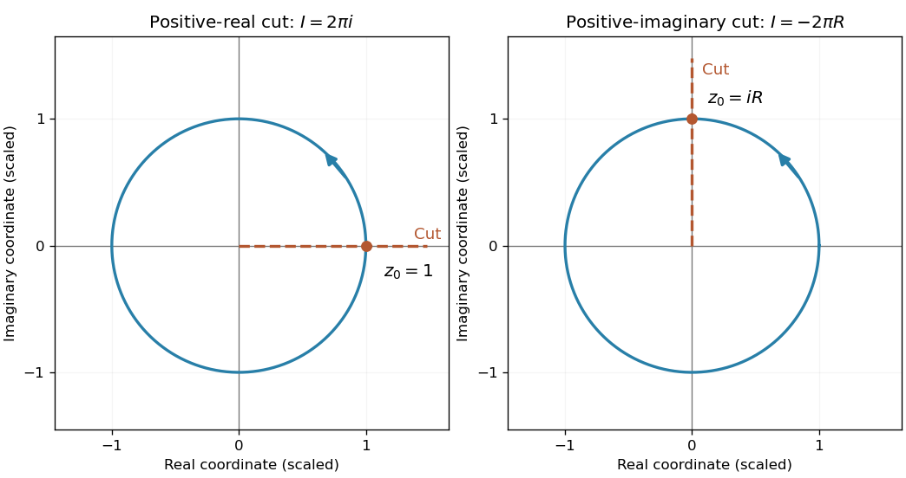

<h1 id="3/c/i/solution">Solution</h1>

↑ **Parent:** [I](../i.md)

On the unit circle use $z=e^{i\theta}$ with $0<\theta<2\pi$. The specified branch has $\operatorname{Log}z=i\theta$ there and $dz=ie^{i\theta}d\theta$. Therefore

$$
\boxed{I=-\int_0^{2\pi}\theta e^{i\theta}d\theta=-[(1-i\theta)e^{i\theta}]_0^{2\pi}=2\pi i.}
$$

This is the [circle integral of a logarithm with a radial branch cut](../../../../../../circle-integral-of-a-logarithm-with-a-radial-branch-cut.md), using the one-sided values at the cut crossing. The logarithm is discontinuous at that crossing, so the [Cauchy integral theorem](../../../../../../cauchy-s-integral-theorem.md) for a function holomorphic around a closed contour does not apply.

**[Figure 2](#3/c/i/image-the-cut-crossing-point-determines-the-circle-integral-of-a-logarithm). The cut-crossing point determines the circle integral of a logarithm**. Original unit-circle illustrations of the two radial branch cuts. The formula is $2\pi i$ times the cut-crossing point; the second circle represents the general radius-$R$ case by rescaling.

## ↑ Ancestors (14)

1. [I](../i.md)
2. [C](../../c.md)
3. [3](../../../3.md)
4. [Paper 2](../../../../paper-2-split.md)
5. [2004](../../../../split.md)
6. [Past exam of the mathematics course of the year 2 of the natural sciences course of the University of Cambridge](../../../../../split.md)
7. [Mathematics course of the year 2 of the natural sciences course of the University of Cambridge](../../../../../../mathematics-course-of-the-year-2-of-the-natural-sciences-course-of-the-university-of-cambridge.md)
8. [Year 2 of the natural sciences course of the University of Cambridge](../../../../../../year-2-of-the-natural-sciences-course-of-the-university-of-cambridge.md)
9. [Year of the natural sciences course of the University of Cambridge](../../../../../../year-of-the-natural-sciences-course-of-the-university-of-cambridge.md)
10. [Natural sciences course of the University of Cambridge](../../../../../../natural-sciences-course-of-the-university-of-cambridge.md)
11. [Course of the University of Cambridge](../../../../../../course-of-the-university-of-cambridge.md)
12. [University of Cambridge](../../../../../../university-of-cambridge-split.md)
13. [List of universities](../../../../../../list-of-universities.md)
14. [Codex Wiki](../../../../../../split.md)
