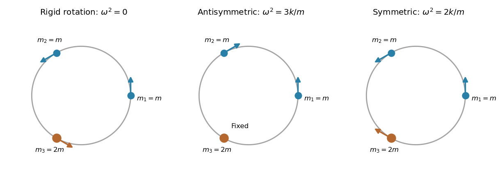

<h1 id="7/solution">Solution</h1>

↑ **Parent:** [7](../7.md)

A [normal mode](../../../../normal-mode.md) has all coordinates following one fixed displacement pattern with a common time factor. Its [normal frequency](../../../../eigenfrequency.md) is that factor's oscillation frequency; [normal mode coordinates](../../../../normal-coordinate.md) are amplitudes in a basis of such patterns, making the linear equations independent. A zero-frequency mode can instead have constant velocity along a symmetry direction.

For the unit circle, each angular displacement equals its corresponding arc displacement. The [kinetic energy](../../../../kinetic-energy.md) and change in [potential energy](../../../../potential-energy.md) are

$$
T=\frac m2(\dot\theta_1^2+\dot\theta_2^2+\mu\dot\theta_3^2),\qquad V-V_0=\frac k2[(\theta_2-\theta_1)^2+(\theta_3-\theta_2)^2+(\theta_1-\theta_3)^2].
$$

Any common spring prestress changes only the constant $V_0$, because the sum of the three arc lengths is fixed. The [Euler-Lagrange equations](../../../../euler-lagrange-equation.md) give

$$
m\ddot\theta_1+k(2\theta_1-\theta_2-\theta_3)=0,\qquad m\ddot\theta_2+k(2\theta_2-\theta_1-\theta_3)=0,\qquad\mu m\ddot\theta_3+k(2\theta_3-\theta_1-\theta_2)=0.
$$

These are the [normal modes of three beads connected by springs on a circular hoop](../../../../normal-modes-of-three-beads-connected-by-springs-on-a-circular-hoop.md), with third mass $M=\mu m$. For $\mu>0$, their three mode vectors and squared [angular frequencies](../../../../angular-frequency.md) are

$$
\boxed{v_0=(1,1,1),\ \omega_0^2=0;\qquad v_A=(1,-1,0),\ \omega_A^2=\frac{3k}{m};\qquad v_S=(1,1,-2/\mu),\ \omega_S^2=\frac{k}{m}\left(1+\frac2\mu\right).}
$$

The zero mode rotates the entire configuration without stretching a spring. The antisymmetric mode moves the equal masses oppositely while leaving the third fixed. In the symmetric mode the equal masses move together against the third, with zero total [angular momentum](../../../../angular-momentum.md). These vectors are orthogonal in the mass inner product with matrix $m\operatorname{diag}(1,1,\mu)$.

Writing $\boldsymbol\theta=Q_0v_0+Q_Av_A+Q_Sv_S$ gives independent equations $\ddot Q_0=0$, $\ddot Q_A+\omega_A^2Q_A=0$, $\ddot Q_S+\omega_S^2Q_S=0$. In particular $Q_0=A+Bt$, retaining possible slow common rotation. For $\mu=1$, the two positive frequencies coincide at $\sqrt{3k/m}$; their two-dimensional space is all patterns with $\theta_1+\theta_2+\theta_3=0$.

**[Figure 3](#7/image-rigid-rotation-and-the-two-oscillatory-patterns-of-three-spring-coupled-beads). Rigid rotation and the two oscillatory patterns of three spring-coupled beads**. Original illustrations for the example $\mu=2$. Arrows are tangent displacements at the equilibrium positions; spring extensions depend on differences of neighboring angular displacements.

## ↑ Ancestors (12)

1. [7](../7.md)
2. [Paper 2](../../paper-2-split.md)
3. [2004](../../split.md)
4. [Past exam of the mathematics course of the year 2 of the natural sciences course of the University of Cambridge](../../../split.md)
5. [Mathematics course of the year 2 of the natural sciences course of the University of Cambridge](../../../../mathematics-course-of-the-year-2-of-the-natural-sciences-course-of-the-university-of-cambridge.md)
6. [Year 2 of the natural sciences course of the University of Cambridge](../../../../year-2-of-the-natural-sciences-course-of-the-university-of-cambridge.md)
7. [Year of the natural sciences course of the University of Cambridge](../../../../year-of-the-natural-sciences-course-of-the-university-of-cambridge.md)
8. [Natural sciences course of the University of Cambridge](../../../../natural-sciences-course-of-the-university-of-cambridge.md)
9. [Course of the University of Cambridge](../../../../course-of-the-university-of-cambridge.md)
10. [University of Cambridge](../../../../university-of-cambridge-split.md)
11. [List of universities](../../../../list-of-universities.md)
12. [Codex Wiki](../../../../split.md)
