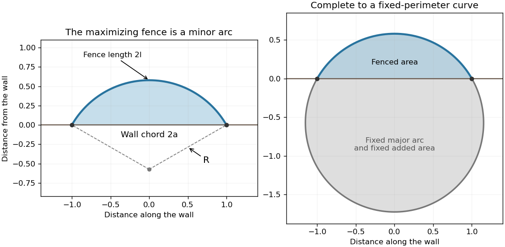

<h1 id="10/solution">Solution</h1>

↑ **Parent:** [10](../10.md)

Along an extremal, differentiate $f-y'f_{y'}$. The [chain rule](../../../../chain-rule.md) gives

$$
\frac d{dx}(f-y'f_{y'})=f_x+y'\left(f_y-\frac d{dx}f_{y'}\right).
$$

When $f_x=0$, the [Euler-Lagrange equation](../../../../euler-lagrange-equation.md) makes the right side zero. This proves the [Beltrami identity](../../../../beltrami-identity.md), $f-y'f_{y'}=k$.

Place the wall on $y=0$ with attachments at $x=\pm a$, and write the fence above it as $y(x)\geq0$. Maximize area $A=\int_{-a}^aydx$ subject to length $\int_{-a}^a\sqrt{1+y'^2}dx=2l$. The [isoperimetric constraint](../../../../isoperimetric-constraint.md) gives the augmented integrand $f=y-R\sqrt{1+y'^2}$, where $R$ is a constant multiplier. Its [Euler-Lagrange equation](../../../../euler-lagrange-equation.md) is $y''/(1+y'^2)^{3/2}=-1/R$, so the fence has constant negative curvature. Equivalently the [Beltrami identity](../../../../beltrami-identity.md) is $y-R/\sqrt{1+y'^2}=k$.

The resulting [maximum-area circular segment with fixed arc length and chord](../../../../maximum-area-circular-segment-with-fixed-arc-length-and-chord.md) has

$$
\boxed{y(x)=\sqrt{R^2-x^2}-\sqrt{R^2-a^2},\qquad R=\frac a{\sin\theta},\qquad\frac la=\frac\theta{\sin\theta}.}
$$

Here $0<\theta<\pi/2$ is the half-angle subtended by the arc. Its half-length is $R\theta=l$ and half-chord is $R\sin\theta=a$. The function $\theta/\sin\theta$ increases from one to $\pi/2$, so the given range $a<l<\pi a/2$ determines a unique minor arc. Its enclosed area is $A_{\max}=R^2(\theta-\sin\theta\cos\theta)$.

There is also a global maximality proof for simple fences in the chosen half-plane, without assuming competitors are graphs. Complete the candidate minor arc with the complementary major arc of the same circle, which lies below the wall. Attach this same fixed major arc to any competing fence of length $2l$. The completed closed curve always has perimeter $2\pi R$, and its area is the competitor's fenced area plus the same fixed area below the wall. The [planar isoperimetric inequality](../../../../planar-isoperimetric-inequality.md) bounds that total by $\pi R^2$, attained by the candidate circle. Hence no competitor encloses more area, and equality requires the circular arc.

**[Figure 2](#10/image-optimal-circular-fence-and-its-completion-to-a-circle-for-the-global-area-bound). Optimal circular fence and its completion to a circle for the global area bound**. Original normalized example with half-chord $a=1$ and half-angle $\theta=1.05$ radians. Left: the arc, wall and radius geometry. Right: completing with the fixed major arc below the wall turns every competing fence into a fixed-perimeter isoperimetric problem.

## ↑ Ancestors (12)

1. [10](../10.md)
2. [Paper 1](../../paper-1-split.md)
3. [2005](../../split.md)
4. [Past exam of the mathematics course of the year 2 of the natural sciences course of the University of Cambridge](../../../split.md)
5. [Mathematics course of the year 2 of the natural sciences course of the University of Cambridge](../../../../mathematics-course-of-the-year-2-of-the-natural-sciences-course-of-the-university-of-cambridge.md)
6. [Year 2 of the natural sciences course of the University of Cambridge](../../../../year-2-of-the-natural-sciences-course-of-the-university-of-cambridge.md)
7. [Year of the natural sciences course of the University of Cambridge](../../../../year-of-the-natural-sciences-course-of-the-university-of-cambridge.md)
8. [Natural sciences course of the University of Cambridge](../../../../natural-sciences-course-of-the-university-of-cambridge.md)
9. [Course of the University of Cambridge](../../../../course-of-the-university-of-cambridge.md)
10. [University of Cambridge](../../../../university-of-cambridge-split.md)
11. [List of universities](../../../../list-of-universities.md)
12. [Codex Wiki](../../../../split.md)
