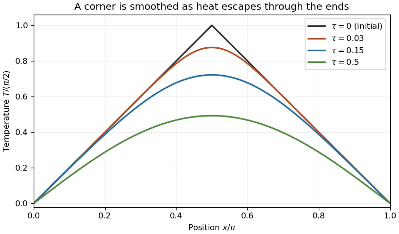

<h1 id="2/solution">Solution</h1>

↑ **Parent:** [2](../2.md)

Set $T(x,t)=X(x)G(t)$ in the [heat equation](../../../../heat-equation.md). [Separation of variables](../../../../separation-of-variables.md) gives $G'/(c^2G)=X''/X=-\lambda$. Zero endpoint temperatures impose [Dirichlet boundary conditions](../../../../dirichlet-boundary-condition.md) $X(0)=X(\pi)=0$, selecting $\lambda=n^2$ for $n\geq1$. The separated factors can therefore be chosen as

$$
\boxed{F_n(x)=\sin nx,\qquad G_n(t)=e^{-c^2n^2t}.}
$$

Zero and negative separation eigenvalues give only the zero spatial solution under these boundary conditions.

The initial profile is continuous and triangular, with midpoint height $\pi/2$. Its [Fourier sine series](../../../../fourier-sine-series.md) coefficients are

$$
a_n=\frac2\pi\left[\int_0^{\pi/2}x\sin nx\,dx+\int_{\pi/2}^\pi(\pi-x)\sin nx\,dx\right]=\boxed{\frac4{\pi n^2}\sin\frac{n\pi}2}.
$$

Consequently the [heat flow from a triangular initial temperature](../../../../heat-flow-from-a-triangular-initial-temperature.md) is

$$
\boxed{T(x,t)=\frac4\pi\sum_{m=0}^\infty\frac{(-1)^m}{(2m+1)^2}e^{-c^2(2m+1)^2t}\sin((2m+1)x).}
$$

For $t\geq0$, each summand has magnitude at most $4/[\pi(2m+1)^2]$. The [Weierstrass M-test](../../../../weierstrass-m-test.md) proves absolute and [uniform convergence](../../../../uniform-convergence.md). The initial [Fourier sine series](../../../../fourier-sine-series.md) equals the continuous piecewise smooth profile, and for $t>0$ the exponential factors justify termwise spatial and time differentiation on every time interval bounded away from zero.

**[Figure 1](#2/image-cooling-of-a-bar-with-a-triangular-initial-temperature-profile). Cooling of a bar with a triangular initial temperature profile**. Original normalized solution snapshots, with horizontal coordinate $x/\pi$, temperature divided by its initial maximum $\pi/2$, and time $\tau=c^2t$. Both endpoints remain at zero while the midpoint corner is smoothed.

## ↑ Ancestors (12)

1. [2](../2.md)
2. [Paper 1](../../paper-1-split.md)
3. [2005](../../split.md)
4. [Past exam of the mathematics course of the year 2 of the natural sciences course of the University of Cambridge](../../../split.md)
5. [Mathematics course of the year 2 of the natural sciences course of the University of Cambridge](../../../../mathematics-course-of-the-year-2-of-the-natural-sciences-course-of-the-university-of-cambridge.md)
6. [Year 2 of the natural sciences course of the University of Cambridge](../../../../year-2-of-the-natural-sciences-course-of-the-university-of-cambridge.md)
7. [Year of the natural sciences course of the University of Cambridge](../../../../year-of-the-natural-sciences-course-of-the-university-of-cambridge.md)
8. [Natural sciences course of the University of Cambridge](../../../../natural-sciences-course-of-the-university-of-cambridge.md)
9. [Course of the University of Cambridge](../../../../course-of-the-university-of-cambridge.md)
10. [University of Cambridge](../../../../university-of-cambridge-split.md)
11. [List of universities](../../../../list-of-universities.md)
12. [Codex Wiki](../../../../split.md)
