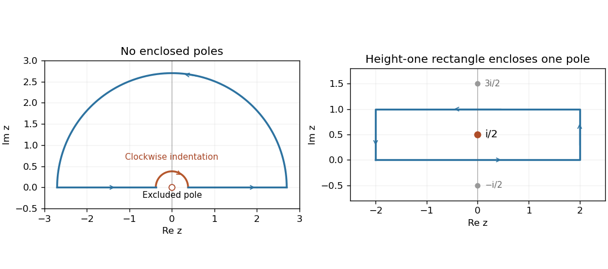

<h1 id="4/solution">Solution</h1>

↑ **Parent:** [4](../4.md)

A [pole](../../../../pole.md) of order $N$ at $z_0$ has $(z-z_0)^Nf(z)$ extending holomorphically to a nonzero value there. Its [residue](../../../../residue.md) is the coefficient of $(z-z_0)^{-1}$ in the [Laurent series](../../../../laurent-series.md). The [Cauchy integral theorem](../../../../cauchy-s-integral-theorem.md) gives $\oint_Cf\,dz=0$ for a closed contour in a simply connected domain of holomorphicity. The [residue theorem](../../../../residue-theorem.md) replaces zero by $2\pi i$ times the enclosed residues for a positively oriented simple contour avoiding finitely many poles.

For the first integral, use the upper-half-plane semicircle, with a small clockwise upper semicircle excluding the origin. Near zero,

$$
\frac{e^{iaz}-e^{ibz}}{z^2}=\frac{i(a-b)}z+O(1).
$$

There are no poles inside the indented contour. The large arc vanishes because $a,b>0$ and the integrand there is $O(R^{-2})$; the small arc tends to $-i\pi\,i(a-b)=\pi(a-b)$. Therefore the real-axis complex principal value is $\pi(b-a)$. Taking real parts gives the ordinary convergent [cosine-difference inverse-square integral](../../../../cosine-difference-inverse-square-integral.md)

$$
\boxed{\int_{-\infty}^{\infty}\frac{\cos ax-\cos bx}{x^2}dx=\pi(b-a).}
$$

The real numerator cancels to second order at zero, so this final real integral itself needs no principal-value convention.

For $g(z)=e^{az}/\cosh\pi z$, the simple poles are $z_n=i(n+1/2)$, $n\in\mathbb Z$. Differentiating the denominator gives

$$
\boxed{\operatorname{Res}_{z_n}g=\frac{(-1)^n e^{ia(n+1/2)}}{\pi i}.}
$$

Integrate around the rectangle with vertices $-R,R,R+i,-R+i$. It contains only $i/2$. On the top side $g(x+i)=-e^{ia}g(x)$, and reversed traversal therefore contributes $+e^{ia}$ times the bottom integral. The vertical sides vanish for $|a|<\pi$. The [residue theorem](../../../../residue-theorem.md) gives $(1+e^{ia})J=2e^{ia/2}$, so the [exponential moment of the hyperbolic secant](../../../../exponential-moment-of-the-hyperbolic-secant.md) is

$$
\boxed{J=\int_{\mathbb R}\frac{e^{ax}}{\cosh\pi x}dx=\frac1{\cos(a/2)},\qquad-\pi

**[Figure 1](#4/image-indented-semicircle-and-height-one-rectangle-for-the-two-real-integrals). Indented semicircle and height-one rectangle for the two real integrals**. Original contour diagrams. The left contour excludes the origin with a clockwise indentation; the right encloses only the pole $i/2$. Other hyperbolic-secant poles are shown outside the rectangle.

## ↑ Ancestors (12)

1. [4](../4.md)
2. [Paper 2](../../paper-2-split.md)
3. [2005](../../split.md)
4. [Past exam of the mathematics course of the year 2 of the natural sciences course of the University of Cambridge](../../../split.md)
5. [Mathematics course of the year 2 of the natural sciences course of the University of Cambridge](../../../../mathematics-course-of-the-year-2-of-the-natural-sciences-course-of-the-university-of-cambridge.md)
6. [Year 2 of the natural sciences course of the University of Cambridge](../../../../year-2-of-the-natural-sciences-course-of-the-university-of-cambridge.md)
7. [Year of the natural sciences course of the University of Cambridge](../../../../year-of-the-natural-sciences-course-of-the-university-of-cambridge.md)
8. [Natural sciences course of the University of Cambridge](../../../../natural-sciences-course-of-the-university-of-cambridge.md)
9. [Course of the University of Cambridge](../../../../course-of-the-university-of-cambridge.md)
10. [University of Cambridge](../../../../university-of-cambridge-split.md)
11. [List of universities](../../../../list-of-universities.md)
12. [Codex Wiki](../../../../split.md)
