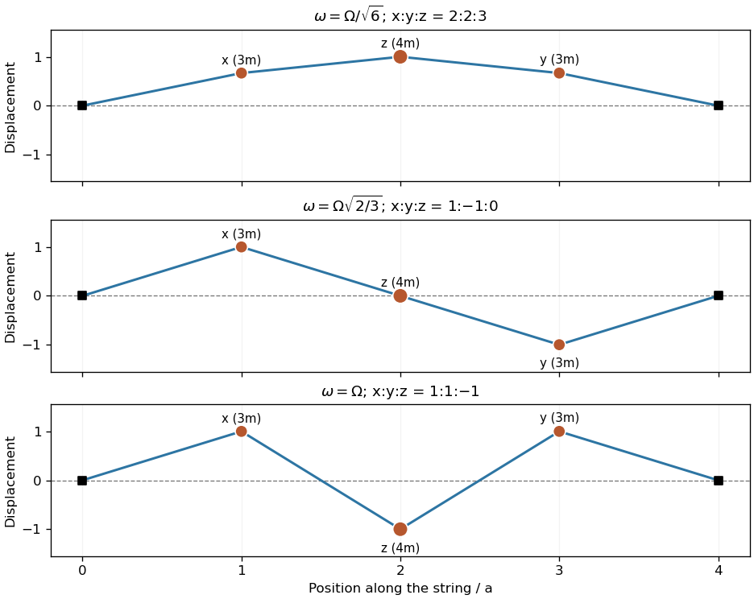

<h1 id="7/solution">Solution</h1>

↑ **Parent:** [7](../7.md)

The [kinetic energy](../../../../kinetic-energy.md) is $K=\tfrac12m(3\dot x^2+3\dot y^2+4\dot z^2)$. Differentiating the given potential and applying [Newton's second law](../../../../newton-s-second-law.md) gives

$$
\boxed{3\ddot x+\Omega^2(2x-z)=0,\quad3\ddot y+\Omega^2(2y-z)=0,\quad4\ddot z+\Omega^2(2z-x-y)=0.}
$$

These are the [normal modes of a symmetric three-mass string](../../../../normal-modes-of-a-symmetric-three-mass-string.md), with mass matrix $M=m\operatorname{diag}(3,3,4)$ and stiffness matrix $m\Omega^2\begin{pmatrix}2&0&-1\\0&2&-1\\-1&-1&2\end{pmatrix}$. The coordinate order here is $(x,y,z)$, although the spatial order along the string is $x,z,y$.

Reflection symmetry splits the [generalized eigenvalue problem](../../../../generalized-eigenvalue-problem.md) into an antisymmetric mode $x=-y$, $z=0$, with $\omega^2=2\Omega^2/3$, and symmetric modes $x=y=q$. Writing $\mu=\omega^2/\Omega^2$, these obey $z=(2-3\mu)q$ and $(2-4\mu)z=2q$. Thus $(2-4\mu)(2-3\mu)-2=2(6\mu-1)(\mu-1)=0$. The three results are

$$
\boxed{\begin{array}{c|c}\omega&x:y:z\\\hline\Omega/\sqrt6&2:2:3\\\Omega\sqrt{2/3}&1:-1:0\\\Omega&1:1:-1\end{array}.}
$$

The displacement vectors are mutually orthogonal under the mass-weighted inner product $u^TMv$, as required for these conservative [normal modes](../../../../normal-mode.md).

**[Figure 2](#7/image-the-three-transverse-normal-modes-in-their-physical-order-along-the-string). The three transverse normal modes in their physical order along the string**. Original mode shapes with segment length $a=1$. The moving particles have masses $3m,4m,3m$ from left to right and positions $x,z,y$. Vertical displacements are normalized independently in each panel; straight string segments join the particles and fixed endpoints.

## ↑ Ancestors (12)

1. [7](../7.md)
2. [Paper 2](../../paper-2-split.md)
3. [2005](../../split.md)
4. [Past exam of the mathematics course of the year 2 of the natural sciences course of the University of Cambridge](../../../split.md)
5. [Mathematics course of the year 2 of the natural sciences course of the University of Cambridge](../../../../mathematics-course-of-the-year-2-of-the-natural-sciences-course-of-the-university-of-cambridge.md)
6. [Year 2 of the natural sciences course of the University of Cambridge](../../../../year-2-of-the-natural-sciences-course-of-the-university-of-cambridge.md)
7. [Year of the natural sciences course of the University of Cambridge](../../../../year-of-the-natural-sciences-course-of-the-university-of-cambridge.md)
8. [Natural sciences course of the University of Cambridge](../../../../natural-sciences-course-of-the-university-of-cambridge.md)
9. [Course of the University of Cambridge](../../../../course-of-the-university-of-cambridge.md)
10. [University of Cambridge](../../../../university-of-cambridge-split.md)
11. [List of universities](../../../../list-of-universities.md)
12. [Codex Wiki](../../../../split.md)
