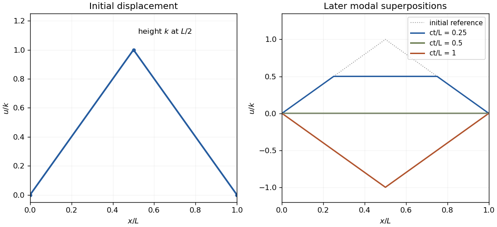

# Paper 1

↑ **Parent:** [2006](../2006.md)

[https://www.maths.cam.ac.uk/undergradnst/files/2006/PaperNST_IB_1.pdf](https://www.maths.cam.ac.uk/undergradnst/files/2006/PaperNST_IB_1.pdf)

**Table of contents**

- [1](#1)
  - [Solution](#1/solution)
- [2](#2)
  - [Solution](#2/solution)
- [3](#3)
  - [Solution](#3/solution)
- [4](#4)
  - [i](#4/i)
    - [Solution](#4/i/solution)
  - [ii](#4/ii)
    - [Solution](#4/ii/solution)
- [5](#5)
  - [Solution](#5/solution)
- [6](#6)
  - [Solution](#6/solution)
  - [i](#6/i)
    - [Solution](#6/i/solution)
  - [ii](#6/ii)
    - [Solution](#6/ii/solution)
  - [iii](#6/iii)
    - [Solution](#6/iii/solution)
- [7](#7)
  - [Solution](#7/solution)
- [8](#8)
  - [Solution](#8/solution)
- [9](#9)
  - [Solution](#9/solution)
- [10](#10)
  - [Solution](#10/solution)

## 1

↑ **Parent:** [Paper 1](paper-1.md)

<h3 id="1/solution">Solution</h3>

↑ **Parent:** [1](#1)

In [Cartesian coordinates](../../linear-algebra.md#cartesian-coordinate-system), $\nabla\Phi=(\Phi_x,\Phi_y,\Phi_z)$. For [orthogonal coordinates](../../multivariable-calculus.md#orthogonal-coordinates), let $\mathbf r(q_1,q_2,q_3)$ be the position, $h_i=|\partial\mathbf r/\partial q_i|$ the [scale factors of orthogonal coordinates](../../multivariable-calculus.md#scale-factors-of-orthogonal-coordinates), and $\mathbf e_i=h_i^{-1}\partial\mathbf r/\partial q_i$ the corresponding [unit vectors](../../vector-space.md#unit-vector). Since $d\mathbf r=\sum_i h_i\mathbf e_i\,dq_i$ and $d\Phi=\nabla\Phi\cdot d\mathbf r=\sum_i\Phi_{q_i}dq_i$, comparison of independent increments gives the [gradient in orthogonal coordinates](../../multivariable-calculus.md#gradient-in-orthogonal-coordinates):

$$
\boxed{\nabla\Phi=\sum_{i=1}^3\frac{\mathbf e_i}{h_i}\frac{\partial\Phi}{\partial q_i}.}
$$

For the [hyperbolic parametrization of oblate spheroidal coordinates](../../general-relativity.md#hyperbolic-parametrization-of-oblate-spheroidal-coordinates), the three coordinate tangent vectors are

$$
\mathbf r_R=(\sinh R\cos\theta\cos\phi,\sinh R\cos\theta\sin\phi,\cosh R\sin\theta),
$$

$$
\mathbf r_\theta=(-\cosh R\sin\theta\cos\phi,-\cosh R\sin\theta\sin\phi,\sinh R\cos\theta),\qquad\mathbf r_\phi=(-\cosh R\cos\theta\sin\phi,\cosh R\cos\theta\cos\phi,0).
$$

Their pairwise [dot products](../../inner-product.md#dot-product) are zero. Their squared [Euclidean norms](../../normed-vector-space.md#euclidean-norm) are $\sinh^2R+\sin^2\theta$, $\sinh^2R+\sin^2\theta$, and $\cosh^2R\cos^2\theta$, respectively. Thus the coordinate surfaces meet orthogonally wherever this is a regular coordinate chart, and

$$
\boxed{h_R=h_\theta=\sqrt{\sinh^2R+\sin^2\theta},\qquad h_\phi=\cosh R\cos\theta.}
$$

The last expression uses the usual latitude range $|\theta|<\pi/2$; without that range a scale factor is its absolute value. Axial or ring degeneracies are excluded from a regular chart.

## 2

↑ **Parent:** [Paper 1](paper-1.md)

<h3 id="2/solution">Solution</h3>

↑ **Parent:** [2](#2)

[Separation of variables](../../partial-differential-equation.md#separation-of-variables) in the [wave equation](../../wave-equation.md) with fixed endpoints selects $H_n(x)=\sin(n\pi x/L)$ and angular frequencies $\omega_n=cn\pi/L$, $n\geq1$. The time factors may be chosen as $F_n(t)=\cos\omega_nt$, $G_n(t)=\sin\omega_nt$. By [Fourier sine series](../../fourier-series.md#fourier-sine-series) orthogonality, the initial data give

$$
a_n=\frac2L\int_0^Lf(x)\sin\frac{n\pi x}{L}\,dx,\qquad b_n=\frac2{L\omega_n}\int_0^Lg(x)\sin\frac{n\pi x}{L}\,dx.
$$

Hence $u=\sum_{n\geq1}[a_n\cos\omega_nt+b_n\sin\omega_nt]\sin(n\pi x/L)$. The factor $1/\omega_n$ in $b_n$ is required because differentiating the time sine supplies $\omega_n$.

The given displacement is a symmetric triangular tent: it is zero at both endpoints and has height $k$ at $L/2$. Integrating each linear half gives $a_n=8k\sin(n\pi/2)/(n^2\pi^2)$. Release from rest gives $b_n=0$, so the [midpoint-plucked fixed-end string](../../wave-equation.md#midpoint-plucked-fixed-end-string) is

$$
\boxed{u(x,t)=\frac{8k}{\pi^2}\sum_{m=0}^\infty\frac{(-1)^m}{(2m+1)^2}\cos\frac{(2m+1)\pi ct}{L}\sin\frac{(2m+1)\pi x}{L}.}
$$

Only odd modes occur, by symmetry about the midpoint. The initial slope corner makes this a finite-energy [weak solution](../../partial-differential-equation.md#weak-solution); it is a classical solution away from the propagating corner lines.

**[Figure 1](#2/image-initial-triangular-pluck-and-later-shapes-of-a-fixed-end-string). Initial triangular pluck and later shapes of a fixed-end string**. Original normalized displacement and modal predictions. The initial tent reaches one at the midpoint; snapshots use time $ct/L$. The string passes through a straight configuration at $ct/L=1/2$ and reverses its initial displacement at $ct/L=1$.

## 3

↑ **Parent:** [Paper 1](paper-1.md)

<h3 id="3/solution">Solution</h3>

↑ **Parent:** [3](#3)

With the stated angular-frequency convention, the [inverse Fourier transform](../../fourier-transform.md#inverse-fourier-transform) is $f(x)=(2\pi)^{-1}\int_{-\infty}^{\infty}\widetilde f(k)e^{ikx}dk$. Direct integration gives $\widetilde f_0(k)=\int_0^\infty e^{-(\alpha+ik)x}dx=1/(\alpha+ik)$. For $n\geq1$, [integration by parts](../../calculus.md#integration-by-parts) has zero boundary terms and gives $\widetilde f_n=n\widetilde f_{n-1}/(\alpha+ik)$. Therefore

$$
\boxed{\widetilde f_n(k)=\frac{n!}{(\alpha+ik)^{n+1}}.}
$$

This also follows from the [Fourier transform of a polynomial multiple](../../fourier-transform.md#fourier-transform-of-a-polynomial-multiple), since multiplication by $x$ corresponds to $i\partial_k$.

To prove [Parseval's identity](../../fourier-analysis.md#parseval-identity), substitute the inverse transform of $g$ into $\int f^*g$. Under the assumed integrability, [Fubini's theorem](../../measure-theory.md#fubini-s-theorem) permits interchange, and the inner integral is $\int f(x)^*e^{ikx}dx=\widetilde f(k)^*$. Hence

$$
\int_{\mathbb R}f(x)^*g(x)dx=\frac1{2\pi}\int_{\mathbb R}\widetilde f(k)^*\widetilde g(k)dk.
$$

Apply this with $f=g=f_n$. The spatial [Gamma integral](../../complex-analysis.md#gamma-integral) is $\int_0^\infty x^{2n}e^{-2\alpha x}dx=(2n)!/(2\alpha)^{2n+1}$. The transformed squared modulus is $(n!)^2/(\alpha^2+k^2)^{n+1}$, giving the scaled [even rational Parseval integral](../../fourier-analysis.md#even-rational-parseval-integral)

$$
\boxed{\int_{-\infty}^{\infty}\frac{dk}{(\alpha^2+k^2)^{n+1}}=\frac{2\pi(2n)!}{(n!)^2(2\alpha)^{2n+1}}.}
$$

## 4

↑ **Parent:** [Paper 1](paper-1.md)

<h3 id="4/i">i</h3>

↑ **Parent:** [4](#4)

<h4 id="4/i/solution">Solution</h4>

↑ **Parent:** [I](#4/i)

Decompose $\mathbb R^n=\operatorname{span}\{a\}\oplus a^\perp$. The [rank-one matrix update](../../linear-algebra.md#rank-one-matrix-update) $aa^T$ acts as multiplication by $\|a\|^2$ along $a$ and as zero on its [orthogonal complement](../../hilbert-space.md#orthogonal-complement). Thus

$$
\boxed{\lambda_\parallel(A^\pm)=1\pm\|a\|^2,\quad v_\parallel\in\operatorname{span}\{a\}\setminus\{0\};\qquad\lambda_\perp=1,\quad v_\perp\in a^\perp\setminus\{0\}.}
$$

The perpendicular eigenvalue has multiplicity $n-1$ and is absent when $n=1$. Consequently $A^+$ is always an [invertible matrix](../../linear-algebra.md#invertible-matrix), while

$$
\boxed{A^-\text{ is invertible if and only if }\|a\|\ne1.}
$$

<h3 id="4/ii">ii</h3>

↑ **Parent:** [4](#4)

<h4 id="4/ii/solution">Solution</h4>

↑ **Parent:** [Ii](#4/ii)

Put $\beta=\|b\|>0$ and choose an oriented [orthonormal basis](../../inner-product.md#orthonormal-basis) with third vector $b/\beta$. The [Levi-Civita symbol](../../multivariable-calculus.md#levi-civita-symbol) term has action $\epsilon_{ijk}b_kx_j=x\times b$, the negative of $b\times x$. Thus this [axisymmetric linear map](../../vector-space.md#axisymmetric-linear-map) has block form

$$
B^\pm\sim\begin{pmatrix}1&\beta&0\\-\beta&1&0\\0&0&1\pm\beta^2\end{pmatrix}.
$$

The transverse eigenvalues $1\pm i\beta$ are not real. The only real [eigenvalue](../../linear-operator-theory.md#eigenvalue) and its [eigenvectors](../../linear-operator-theory.md#eigenvector) are therefore

$$
\boxed{\lambda(B^\pm)=1\pm\beta^2,\qquad v\in\operatorname{span}\{b\}\setminus\{0\}.}
$$

The determinants are $\det B^+=(1+\beta^2)^2>0$ and $\det B^-=(1-\beta^2)(1+\beta^2)$, proving that **$B^+$ is always invertible, and $B^-$ is invertible exactly when $\|b\|\ne1$**. The complex transverse pair is important for this determinant even though the question asks for real eigenvalues.

## 5

↑ **Parent:** [Paper 1](paper-1.md)

<h3 id="5/solution">Solution</h3>

↑ **Parent:** [5](#5)

A matrix is [diagonalizable](../../linear-operator-theory.md#diagonalizable-matrix) if some invertible $S$ makes $S^{-1}AS$ diagonal, equivalently if it has a basis of [eigenvectors](../../linear-operator-theory.md#eigenvector). If $A^p=0$ and $Av=\lambda v$ for $v\ne0$, then $0=A^pv=\lambda^pv$, so every [eigenvalue](../../linear-operator-theory.md#eigenvalue) is zero. There is at least one zero eigenvalue: otherwise $A$ and hence $A^p$ would be invertible. A [diagonalizable nilpotent matrix](../../linear-operator-theory.md#diagonalizable-nilpotent-matrix) has an all-zero diagonal form and therefore is zero itself.

For the specified matrices, direct determinant expansion gives

$$
\boxed{\det(\lambda I-B)=\lambda^3,\qquad\det(\lambda I-C)=\lambda(\lambda-6)(\lambda+6).}
$$

The [Cayley-Hamilton theorem](../../cayley-hamilton-theorem.md) gives $B^3=0$. Its entry $B_{12}=-2$ is nonzero for every real $\alpha$, so **$B$ is not diagonalizable for any $\alpha$**. The matrix $C$ has three distinct real eigenvalues and is therefore **diagonalizable over $\mathbb R$**. For an explicit check, take columns $(-1,0,1)^T$, $(2,-3,1)^T$, $(2,3,1)^T$ in $S$; then $S^{-1}CS=\operatorname{diag}(-6,0,6)$.

## 6

↑ **Parent:** [Paper 1](paper-1.md)

<h3 id="6/solution">Solution</h3>

↑ **Parent:** [6](#6)

For the normalized second-order equation $y''+P(x)y'+Q(x)y=0$, an [ordinary point](../../complex-analysis.md#ordinary-point-criterion-for-a-second-order-equation) has analytic $P,Q$. A [regular singular point](../../complex-analysis.md#regular-singular-point) is a [singular point](../../algebraic-geometry.md#singular-point-of-an-algebraic-variety) where $(x-x_0)P$ and $(x-x_0)^2Q$ extend analytically through $x_0$. The two finite singular points here are $0$ and $1/2$. At zero, the respective limiting coefficients are $1/2,0$; at $1/2$, they are $-1,0$. Thus **both are regular singular points**, with indicial roots $0,1/2$ and $0,2$, respectively.

<h3 id="6/i">i</h3>

↑ **Parent:** [6](#6)

<h4 id="6/i/solution">Solution</h4>

↑ **Parent:** [I](#6/i)

Use the [Frobenius method](../../complex-analysis.md#frobenius-method) and write $y=x^r\sum_{n\geq0}a_nx^n$, $a_0\ne0$, with coefficients at negative indices defined as zero. The lowest power gives the [indicial equation](../../linear-ordinary-differential-equation.md#indicial-equation) $r(2r-1)=0$, so $r=0$ or $r=1/2$. Equating the coefficient of $x^{n+r-1}$ gives, for $n\geq1$,

$$
\boxed{a_n=\frac{[4(n+r-1)^2+2]a_{n-1}-12(n+r-2)a_{n-2}+8a_{n-3}}{(n+r)[2(n+r)-1]}.}
$$

For $r=0$ and $a_0=1$, the first coefficients are $1,2,2,4/3,\ldots$. For $r=1/2$ they are $1,1,1/2,1/6,\ldots$, multiplying $x^{1/2}$. The distinct nonintegrally separated indicial roots give two independent [Frobenius series](../../complex-analysis.md#frobenius-solution). The half-power solution is a generalized power series, rather than an ordinary Taylor series at zero.

<h3 id="6/ii">ii</h3>

↑ **Parent:** [6](#6)

<h4 id="6/ii/solution">Solution</h4>

↑ **Parent:** [Ii](#6/ii)

The coefficients in the [Taylor series](../../calculus.md#taylor-series) are

$$
\boxed{e^x=\sum_{n=0}^\infty\frac{x^n}{n!},\qquad e^{2x}=\sum_{n=0}^\infty\frac{2^nx^n}{n!}.}
$$

For either series, the [ratio test](../../sequence-and-series.md#ratio-test) gives absolute term ratio $|x|/(n+1)$ or $2|x|/(n+1)$, tending to zero for each fixed real or complex $x$. Both have infinite [radius of convergence](../../sequence-and-series.md#radius-of-convergence).

<h3 id="6/iii">iii</h3>

↑ **Parent:** [6](#6)

<h4 id="6/iii/solution">Solution</h4>

↑ **Parent:** [Iii](#6/iii)

Substituting $a_n=2^n/n!$ into the $r=0$ recurrence, and $a_n=1/n!$ into the $r=1/2$ recurrence, satisfies every coefficient equation. They give $e^{2x}$ and $\sqrt x\,e^x$. Thus on a positive interval not crossing a singular point,

$$
\boxed{y=A\sqrt x\,e^x+Be^{2x}.}
$$

Their [Wronskian](../../linear-ordinary-differential-equation.md#wronskian) is $e^{3x}(2x-1)/(2\sqrt x)$, nonzero for $x>0$, $x\ne1/2$, proving independence on each ordinary interval. Both functions are analytic near $1/2$, so this is an [apparent regular singular point](../../complex-analysis.md#apparent-regular-singular-point): a pole in normalized coefficients need not force a singular solution. The Wronskian can vanish at that singular point without making the two functions linearly dependent on an ordinary interval.

## 7

↑ **Parent:** [Paper 1](paper-1.md)

<h3 id="7/solution">Solution</h3>

↑ **Parent:** [7](#7)

Multiply the original equation by $p(x)=\exp(\int^xu(s)ds)>0$. Since $p'=up$, it becomes $(py')'+qy+\lambda ry=0$ with $q=pv$, $r=pw>0$. This is [Sturm-Liouville form](../../sturm-liouville-theory.md#sturm-liouville-form). For two real [eigenfunctions](../../linear-operator-theory.md#eigenfunction), multiply the equation for $y_n$ by $y_m$, subtract the equation for $y_m$ multiplied by $y_n$, and integrate. The [Lagrange identity for a Sturm-Liouville operator](../../sturm-liouville-theory.md#lagrange-identity-for-a-sturm-liouville-operator) gives

$$
(\lambda_m-\lambda_n)\int_a^br\,y_my_n\,dx=[p(y_my_n'-y_ny_m')]_a^b.
$$

Each separated homogeneous boundary condition makes the corresponding determinant zero, provided its pair of coefficients is not both zero. For distinct [eigenvalues](../../linear-operator-theory.md#eigenvalue), this proves the [orthogonality of Sturm-Liouville eigenfunctions](../../sturm-liouville-theory.md#orthogonality-of-sturm-liouville-eigenfunctions).

For the constant drift, the [drift-removing substitution for a Dirichlet Sturm-Liouville problem](../../sturm-liouville-theory.md#drift-removing-substitution-for-a-dirichlet-sturm-liouville-problem) is $y=e^{-\alpha x}v$. It reduces the equation to $v''+\lambda v=0$ with $v(0)=v(\pi)=0$. Nonzero solutions occur exactly at

$$
\boxed{\lambda_n=n^2,\qquad y_n=e^{-\alpha x}\sin nx,\quad n=1,2,\ldots.}
$$

The zero and negative values give only the zero solution under both endpoint conditions. The self-adjoint expression is $(e^{2\alpha x}y')'+\alpha^2e^{2\alpha x}y+\lambda e^{2\alpha x}y=0$. Hence the weight is $r=e^{2\alpha x}$, and for the displayed normalization,

$$
\boxed{\int_0^\pi e^{2\alpha x}y_my_n\,dx=\frac\pi2\delta_{mn}.}
$$

## 8

↑ **Parent:** [Paper 1](paper-1.md)

<h3 id="8/solution">Solution</h3>

↑ **Parent:** [8](#8)

For the zero initial data, the [Green function of an undamped oscillator](../../green-s-function.md#green-function-of-an-undamped-oscillator) is $G_0(x,s)=\sin[k(x-s)]/k$ for $0\leq s\leq x$, and zero for $s>x$. It is continuous at the source and its first derivative jumps by one. The resulting [convolution](../../fourier-analysis.md#convolution) is

$$
y(x)=2\int_0^x\sin[k(x-s)]\cos(ks)ds=\boxed{x\sin kx.}
$$

It vanishes together with its first derivative at zero and has the required resonant forcing.

For the two-endpoint problem, write $L=\pi/(6k)$, $a=\min(0,L)$, $b=\max(0,L)$ and $\kappa=|k|$. This covers both signs of the supplied nonzero $k$. Left and right homogeneous solutions are $\sin[\kappa(x-a)]$ and $\sin[\kappa(b-x)]$, with [Wronskian](../../linear-ordinary-differential-equation.md#wronskian) $-\kappa\sin[\kappa(b-a)]$. The [Dirichlet Green function](../../green-s-function.md#dirichlet-green-function) is therefore

$$
G_D(x,s)=-\frac{\sin[\kappa(x_<-a)]\sin[\kappa(b-x_>)]}{\kappa\sin[\kappa(b-a)]},\qquad x_<=\min(x,s),\ x_>=\max(x,s).
$$

Its endpoint values are zero and its first derivative jumps by one. Here $\kappa(b-a)=\pi/6$, so the denominator does not vanish. Integrating the constant forcing gives

$$
\boxed{y(x)=\frac{k^2}{2}\int_a^bG_D(x,s)ds=\frac12\left[1-\frac{\cos(k(x-L/2))}{\cos(\pi/12)}\right].}
$$

Equivalently $y=(1-\cos kx)/2+(\sqrt3/2-1)\sin kx$. The negative interior response is consistent with the negative kernel for this short Dirichlet interval.

## 9

↑ **Parent:** [Paper 1](paper-1.md)

<h3 id="9/solution">Solution</h3>

↑ **Parent:** [9](#9)

Apply the [Euler-Lagrange equation](../../analysis.md#euler-lagrange-equation) to the integrand of $F-\lambda G$, namely $py'^2-qy^2-\lambda ry^2$. With fixed zero endpoint values, it gives $(py')'+qy+\lambda ry=0$. Multiplying by $y$ and using [integration by parts](../../calculus.md#integration-by-parts) gives $F=\lambda G$, so each stationary [Rayleigh quotient](../../linear-operator-theory.md#rayleigh-quotient) $F/G$ equals its eigenvalue.

In the half-line problem, $p=x$, $q=-x$, $r=1$, so the quotient is $R[y]=\int_0^\infty x(y'^2+y^2)dx/\int_0^\infty y^2dx$. For $y=e^{-\beta x}$, $\beta>0$, its numerator is $(\beta^2+1)/(4\beta^2)$ and denominator $1/(2\beta)$. Hence $R=(\beta+\beta^{-1})/2$, minimized at $\beta=1$:

$$
\boxed{R_{\rm exponential}=1.}
$$

For the compactly supported linear trial, $A>0$, the numerator is $A^2/2+A^4/12$ and denominator $A^3/3$. Thus $R=3/(2A)+A/4$, minimized at $A=\sqrt6$, giving

$$
\boxed{R_{\rm linear}=\frac{\sqrt6}{2}\simeq1.225.}
$$

The derivative jump at the cutoff is allowed in the quadratic-form trial space of the [Rayleigh-Ritz method](../../finite-element-method.md#rayleigh-ritz-method): the trial is continuous and has finite form energy.

The [exponential ground state of a linearly weighted Sturm-Liouville problem](../../sturm-liouville-theory.md#exponential-ground-state-of-a-linearly-weighted-sturm-liouville-problem) proves which estimate is best. Vanishing endpoint terms give

$$
\int_0^\infty x(y'^2+y^2)dx=\int_0^\infty y^2dx+\int_0^\infty x(y'+y)^2dx\geq\int_0^\infty y^2dx.
$$

Equality occurs for $y=Ce^{-x}$, which also satisfies the differential equation with $\lambda=1$. Thus **the exponential trial gives the exact smallest eigenvalue**, whereas the linear trial gives a larger upper bound. Finiteness at the singular endpoint supplies the regular branch with $xyy'\to0$; all the displayed trials have the required vanishing boundary terms.

## 10

↑ **Parent:** [Paper 1](paper-1.md)

<h3 id="10/solution">Solution</h3>

↑ **Parent:** [10](#10)

For fixed endpoint values, stationarity requires the [Euler-Lagrange equation](../../analysis.md#euler-lagrange-equation) $f_y-d(f_{y'})/dx=0$. Differentiate $y'f_{y'}-f$ along an extremal: its derivative is $y'[d(f_{y'})/dx-f_y]-f_x$. Thus when $f_x=0$ the [Beltrami identity](../../analysis.md#beltrami-identity) makes that quantity constant.

Take $y$ as depth measured downward. [Conservation of energy](../../mathematical-physics.md#conservation-of-energy) from rest gives $mv^2/2-mgy=0$, hence speed $v=\sqrt{2gy}$. With [arc length](../../riemannian-geometry.md#arc-length) $ds=\sqrt{1+y'^2}\,dx$, the [travel time](../../dispersion-relation.md#travel-time) is $T=(2g)^{-1/2}\int_0^{x_B}\sqrt{(1+y'^2)/y}\,dx$. For $f=\sqrt{(1+y'^2)/y}$, the Beltrami quantity is $-1/\sqrt{y(1+y'^2)}$. Thus $y(1+y'^2)=c>0$.

Put $y=c\sin^2\theta$ and take $y'=\cot\theta$ along the first arch. Since $dy/d\theta=2c\sin\theta\cos\theta$, one obtains $dx/d\theta=2c\sin^2\theta$. Integrating from the initial cusp gives the [cycloid](../../topology.md#cycloid) solving the [brachistochrone problem](../../calculus-of-variations.md#brachistochrone-problem):

$$
\boxed{x=c(\theta-\tfrac12\sin2\theta),\qquad y=c\sin^2\theta.}
$$

For the equal-height target, the first complete arch has $\theta_B=\pi$, so $c=l/\pi$. Also $ds/d\theta=2c\sin\theta$ and $v=\sqrt{2gc}\sin\theta$ for $0<\theta<\pi$. Therefore

$$
\boxed{T_{\min}=\pi\sqrt{\frac{2c}{g}}=\sqrt{\frac{2\pi l}{g}}.}
$$

The endpoint zeros of speed cancel the zeros of $ds/d\theta$, leaving finite travel time. Global minimality follows from the [maximum-depth bound for a brachistochrone](../../calculus-of-variations.md#maximum-depth-bound-for-a-brachistochrone): any competing track with maximum depth $h$ satisfies $T\geq[l/\sqrt h+\pi\sqrt h]/\sqrt{2g}\geq\sqrt{2\pi l/g}$. The displayed cycloid attains both inequalities with $h=l/\pi$.

**[Figure 2](#10/image-the-equal-height-brachistochrone-is-one-complete-cycloid-arch). The equal-height brachistochrone is one complete cycloid arch**. Original curve with depth drawn downward. The maximum depth is $l/\pi$, and markers equally spaced in the cycloid parameter are equally spaced in travel time. The bead starts and ends at rest in the ideal energy-conserving model.

## ↑ Ancestors (10)

1. [2006](../2006.md)
2. [Past exam of the mathematics course of the year 2 of the natural sciences course of the University of Cambridge](../../past-exam-of-the-mathematics-course-of-the-year-2-of-the-natural-sciences-course-of-the-university-of-cambridge.md)
3. [Mathematics course of the year 2 of the natural sciences course of the University of Cambridge](../../university-of-cambridge.md#mathematics-course-of-the-year-2-of-the-natural-sciences-course-of-the-university-of-cambridge)
4. [Year 2 of the natural sciences course of the University of Cambridge](../../university-of-cambridge.md#year-2-of-the-natural-sciences-course-of-the-university-of-cambridge)
5. [Year of the natural sciences course of the University of Cambridge](../../university-of-cambridge.md#year-of-the-natural-sciences-course-of-the-university-of-cambridge)
6. [Natural sciences course of the University of Cambridge](../../university-of-cambridge.md#natural-sciences-course-of-the-university-of-cambridge)
7. [Course of the University of Cambridge](../../university-of-cambridge.md#course-of-the-university-of-cambridge)
8. [University of Cambridge](../../university-of-cambridge.md)
9. [List of universities](../../README.md#list-of-universities)
10. [Codex Wiki](../../README.md)
