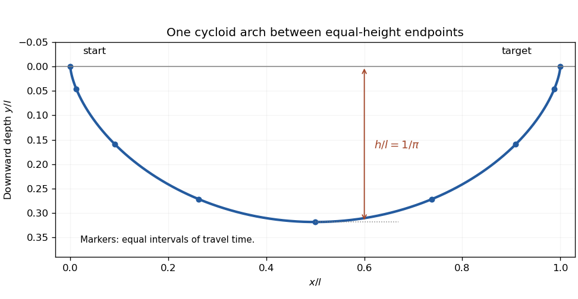

<h1 id="10/solution">Solution</h1>

↑ **Parent:** [10](../10.md)

For fixed endpoint values, stationarity requires the [Euler-Lagrange equation](../../../../euler-lagrange-equation.md) $f_y-d(f_{y'})/dx=0$. Differentiate $y'f_{y'}-f$ along an extremal: its derivative is $y'[d(f_{y'})/dx-f_y]-f_x$. Thus when $f_x=0$ the [Beltrami identity](../../../../beltrami-identity.md) makes that quantity constant.

Take $y$ as depth measured downward. [Conservation of energy](../../../../conservation-of-energy.md) from rest gives $mv^2/2-mgy=0$, hence speed $v=\sqrt{2gy}$. With [arc length](../../../../arc-length.md) $ds=\sqrt{1+y'^2}\,dx$, the [travel time](../../../../travel-time.md) is $T=(2g)^{-1/2}\int_0^{x_B}\sqrt{(1+y'^2)/y}\,dx$. For $f=\sqrt{(1+y'^2)/y}$, the Beltrami quantity is $-1/\sqrt{y(1+y'^2)}$. Thus $y(1+y'^2)=c>0$.

Put $y=c\sin^2\theta$ and take $y'=\cot\theta$ along the first arch. Since $dy/d\theta=2c\sin\theta\cos\theta$, one obtains $dx/d\theta=2c\sin^2\theta$. Integrating from the initial cusp gives the [cycloid](../../../../cycloid.md) solving the [brachistochrone problem](../../../../brachistochrone-problem.md):

$$
\boxed{x=c(\theta-\tfrac12\sin2\theta),\qquad y=c\sin^2\theta.}
$$

For the equal-height target, the first complete arch has $\theta_B=\pi$, so $c=l/\pi$. Also $ds/d\theta=2c\sin\theta$ and $v=\sqrt{2gc}\sin\theta$ for $0<\theta<\pi$. Therefore

$$
\boxed{T_{\min}=\pi\sqrt{\frac{2c}{g}}=\sqrt{\frac{2\pi l}{g}}.}
$$

The endpoint zeros of speed cancel the zeros of $ds/d\theta$, leaving finite travel time. Global minimality follows from the [maximum-depth bound for a brachistochrone](../../../../maximum-depth-bound-for-a-brachistochrone.md): any competing track with maximum depth $h$ satisfies $T\geq[l/\sqrt h+\pi\sqrt h]/\sqrt{2g}\geq\sqrt{2\pi l/g}$. The displayed cycloid attains both inequalities with $h=l/\pi$.

**[Figure 2](#10/image-the-equal-height-brachistochrone-is-one-complete-cycloid-arch). The equal-height brachistochrone is one complete cycloid arch**. Original curve with depth drawn downward. The maximum depth is $l/\pi$, and markers equally spaced in the cycloid parameter are equally spaced in travel time. The bead starts and ends at rest in the ideal energy-conserving model.

## ↑ Ancestors (12)

1. [10](../10.md)
2. [Paper 1](../../paper-1-split.md)
3. [2006](../../split.md)
4. [Past exam of the mathematics course of the year 2 of the natural sciences course of the University of Cambridge](../../../split.md)
5. [Mathematics course of the year 2 of the natural sciences course of the University of Cambridge](../../../../mathematics-course-of-the-year-2-of-the-natural-sciences-course-of-the-university-of-cambridge.md)
6. [Year 2 of the natural sciences course of the University of Cambridge](../../../../year-2-of-the-natural-sciences-course-of-the-university-of-cambridge.md)
7. [Year of the natural sciences course of the University of Cambridge](../../../../year-of-the-natural-sciences-course-of-the-university-of-cambridge.md)
8. [Natural sciences course of the University of Cambridge](../../../../natural-sciences-course-of-the-university-of-cambridge.md)
9. [Course of the University of Cambridge](../../../../course-of-the-university-of-cambridge.md)
10. [University of Cambridge](../../../../university-of-cambridge-split.md)
11. [List of universities](../../../../list-of-universities.md)
12. [Codex Wiki](../../../../split.md)
