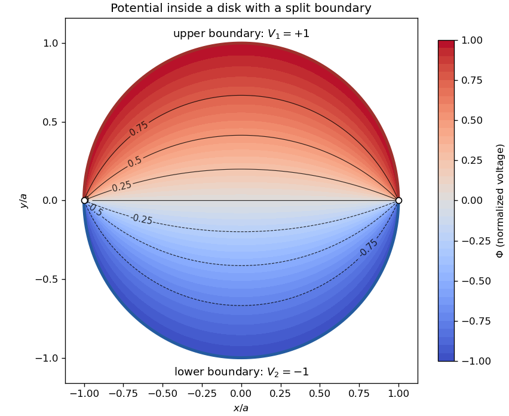

<h1 id="2/solution">Solution</h1>

↑ **Parent:** [2](../2.md)

For [Laplace's equation](../../../../laplace-equation.md) in [polar coordinates](../../../../polar-coordinates.md), put $\Phi=R(r)\Theta(\theta)$. [Separation of variables](../../../../separation-of-variables.md) gives $\Theta''+n^2\Theta=0$ and $r^2R''+rR'-n^2R=0$. Periodicity selects integers $n\geq0$. For $n>0$, the radial solutions are $r^n,r^{-n}$; for $n=0$, they are $1,\ln r$, while a term linear in $\theta$ is excluded by periodicity. Their superposition is

$$
\Phi=A_0+C_0\ln r+\sum_{n\geq1}[(A_nr^n+C_nr^{-n})\cos n\theta+(B_nr^n+D_nr^{-n})\sin n\theta].
$$

Inside the disk, boundedness at the origin removes the logarithm and all negative powers. The separately biased semicircular boundary values have mean $(V_1+V_2)/2$, no nonconstant cosine coefficients, and sine coefficients $2(V_1-V_2)/(\pi n)$ for odd $n$, zero for even $n$. The [disk potential with two semicircular boundary values](../../../../disk-potential-with-two-semicircular-boundary-values.md) is therefore

$$
\Phi=\frac{V_1+V_2}{2}+\frac{2(V_1-V_2)}\pi\sum_{m\geq0}\frac{(r/a)^{2m+1}\sin((2m+1)\theta)}{2m+1}.
$$

Put $w=(r/a)e^{i\theta}$. The odd logarithmic series sums to $\sum_{m\geq0}w^{2m+1}/(2m+1)=\frac12\log[(1+w)/(1-w)]$. The quotient has positive real part for $|w|<1$, so its argument is the principal [arctangent](../../../../inverse-tangent.md) of $2(r/a)\sin\theta/[1-(r/a)^2]$. Taking imaginary parts gives

$$
\boxed{\Phi=\frac{V_1+V_2}{2}+\frac{V_1-V_2}\pi\arctan\frac{2ar\sin\theta}{a^2-r^2}.}
$$

The boundary limits away from the two voltage jumps are $V_1,V_2$. Along the diameter through a jump the value is the mean; incompatible adjacent boundary limits prevent a continuous extension at the junctions.

**[Figure 1](#2/image-harmonic-potential-inside-a-disk-with-two-semicircular-boundary-voltages). Harmonic potential inside a disk with two semicircular boundary voltages**. Original normalized example with upper voltage $+1$ and lower voltage $-1$. White circles mark the two boundary jumps; the black curves are equipotentials.

## ↑ Ancestors (12)

1. [2](../2.md)
2. [Paper 2](../../paper-2-split.md)
3. [2006](../../split.md)
4. [Past exam of the mathematics course of the year 2 of the natural sciences course of the University of Cambridge](../../../split.md)
5. [Mathematics course of the year 2 of the natural sciences course of the University of Cambridge](../../../../mathematics-course-of-the-year-2-of-the-natural-sciences-course-of-the-university-of-cambridge.md)
6. [Year 2 of the natural sciences course of the University of Cambridge](../../../../year-2-of-the-natural-sciences-course-of-the-university-of-cambridge.md)
7. [Year of the natural sciences course of the University of Cambridge](../../../../year-of-the-natural-sciences-course-of-the-university-of-cambridge.md)
8. [Natural sciences course of the University of Cambridge](../../../../natural-sciences-course-of-the-university-of-cambridge.md)
9. [Course of the University of Cambridge](../../../../course-of-the-university-of-cambridge.md)
10. [University of Cambridge](../../../../university-of-cambridge-split.md)
11. [List of universities](../../../../list-of-universities.md)
12. [Codex Wiki](../../../../split.md)
