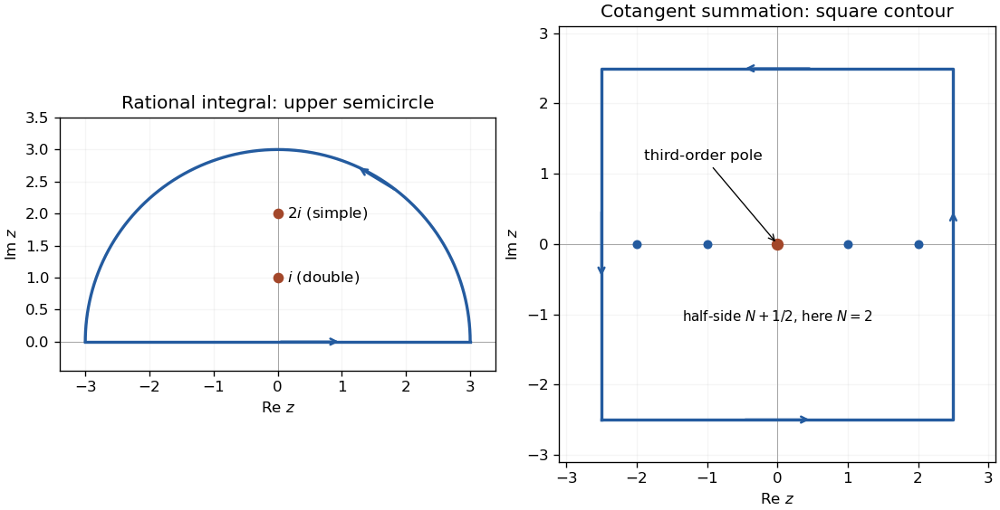

<h1 id="4/solution">Solution</h1>

↑ **Parent:** [4](../4.md)

For a pole of order $N$ at $z_0$, the [residue](../../../../residue.md) is $\operatorname{Res}_{z_0}F=\frac1{(N-1)!}\lim_{z\to z_0}\frac{d^{N-1}}{dz^{N-1}}[(z-z_0)^NF(z)]$. For the rational integral, close the real-axis contour with an upper semicircle. The poles are double at $i$ and simple at $2i$, with

$$
\operatorname{Res}_iF=\left.\frac d{dz}\frac1{(z+i)^2(z^2+4)}\right|_{z=i}=-\frac i{36},\qquad \operatorname{Res}_{2i}F=\frac1{(4i)(-3)^2}=-\frac i{36}.
$$

The arc integral vanishes as $O(R^{-5})$. By the [residue theorem](../../../../residue-theorem.md) the whole real-axis integral is $\pi/9$, and evenness gives

$$
\boxed{\int_0^\infty\frac{dx}{(x^2+1)^2(x^2+4)}=\frac\pi{18}.}
$$

For the second calculation, reciprocal expansion of the sine gives $1/\sin z=z^{-1}+z/6+O(z^3)$. Multiplying by $\cos z=1-z^2/2+O(z^4)$ yields $\cot z=z^{-1}-z/3+O(z^3)$. Therefore

$$
\frac{\pi\cot\pi z}{z^2}=z^{-3}-\frac{\pi^2}{3}z^{-1}+O(z),\qquad\boxed{\operatorname{Res}_0=-\frac{\pi^2}{3}.}
$$

At every nonzero integer $n$, $\pi\cot\pi z$ has a simple pole with residue one, giving residue $1/n^2$ after division by $z^2$.

The [cotangent contour summation](../../../../cotangent-contour-summation.md) uses the positively oriented square of half-side $R=N+1/2$. Its length is $8R$ and $|z|\geq R$ on its boundary. The supplied cotangent bound implies $|\oint Fdz|\leq8\pi C/R\to0$. Its enclosed residues sum to $-\pi^2/3+2\sum_{n=1}^Nn^{-2}$. The [residue theorem](../../../../residue-theorem.md) therefore proves the [Basel problem](../../../../basel-problem.md) value

$$
\boxed{\sum_{n=1}^\infty\frac1{n^2}=\frac{\pi^2}{6}.}
$$

**[Figure 2](#4/image-upper-half-plane-and-square-contours-for-the-rational-integral-and-the-basel-sum). Upper-half-plane and square contours for the rational integral and the Basel sum**. Original contour diagrams. Both are counterclockwise. The upper semicircle encloses poles at $i$ and $2i$; the example square has half-side $5/2$, enclosing the integer poles from $-2$ to $2$.

## ↑ Ancestors (12)

1. [4](../4.md)
2. [Paper 2](../../paper-2-split.md)
3. [2006](../../split.md)
4. [Past exam of the mathematics course of the year 2 of the natural sciences course of the University of Cambridge](../../../split.md)
5. [Mathematics course of the year 2 of the natural sciences course of the University of Cambridge](../../../../mathematics-course-of-the-year-2-of-the-natural-sciences-course-of-the-university-of-cambridge.md)
6. [Year 2 of the natural sciences course of the University of Cambridge](../../../../year-2-of-the-natural-sciences-course-of-the-university-of-cambridge.md)
7. [Year of the natural sciences course of the University of Cambridge](../../../../year-of-the-natural-sciences-course-of-the-university-of-cambridge.md)
8. [Natural sciences course of the University of Cambridge](../../../../natural-sciences-course-of-the-university-of-cambridge.md)
9. [Course of the University of Cambridge](../../../../course-of-the-university-of-cambridge.md)
10. [University of Cambridge](../../../../university-of-cambridge-split.md)
11. [List of universities](../../../../list-of-universities.md)
12. [Codex Wiki](../../../../split.md)
