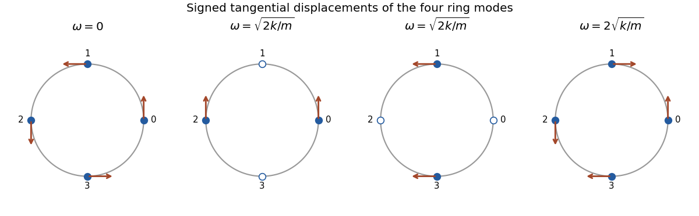

<h1 id="7/solution">Solution</h1>

↑ **Parent:** [7](../7.md)

For small oscillations with quadratic kinetic and potential energies, a [normal mode](../../../../normal-mode.md) has a fixed spatial amplitude pattern and one angular [normal frequency](../../../../eigenfrequency.md). Its amplitude is a [normal coordinate](../../../../normal-coordinate.md); choosing all modes diagonalizes the two quadratic forms and decouples their equations. A zero frequency describes a free symmetry motion.

Let $q_j=R[\theta_j-j\pi/2]$ be the small signed arc displacements, with cyclic indices $j=0,1,2,3$. The springs follow arcs, so their extensions are $q_{j+1}-q_j$. The [Lagrangian](../../../../lagrangian.md) of the [normal modes of a four-bead spring ring](../../../../normal-modes-of-a-four-bead-spring-ring.md) is

$$
\boxed{L=\frac m2\sum_{j=0}^3\dot q_j^2-\frac k2\sum_{j=0}^3(q_{j+1}-q_j)^2.}
$$

The stiffness matrix divided by $k$ is the cycle [graph Laplacian](../../../../laplacian-matrix.md), with diagonal entries two, adjacent entries minus one, and zero opposite entries. An [orthonormal basis](../../../../orthonormal-basis.md) of mode vectors and their frequencies is

$$
\boxed{u_0=\tfrac12(1,1,1,1),\quad\omega_0=0;\qquad u_1=\tfrac1{\sqrt2}(1,0,-1,0),\quad u_2=\tfrac1{\sqrt2}(0,1,0,-1),\quad\omega_{1,2}=\sqrt{2k/m};\qquad u_3=\tfrac12(1,-1,1,-1),\quad\omega_3=2\sqrt{k/m}.}
$$

The [normal mode coordinates](../../../../normal-coordinate.md) are $Q_\alpha=u_\alpha\cdot q$, with equations $\ddot Q_\alpha+\omega_\alpha^2Q_\alpha=0$. The zero mode rotates all beads together without stretching a spring and has $Q_0=A+Bt$. In each of the two degenerate middle modes, opposite beads have opposite signed arc displacements while the other pair remains stationary. Any fixed linear combination is another mode of that frequency. The last mode alternates the signed displacement of adjacent beads. The radius cancels from the frequencies because arc length supplies the same factor $R^2$ to the angular kinetic and spring energies.

**[Figure 3](#7/image-tangential-displacement-patterns-of-the-four-normal-modes-of-a-spring-ring). Tangential displacement patterns of the four normal modes of a spring ring**. Original mode diagrams, with arrows showing signed arc displacements in an arbitrary common scale. Filled beads move in the displayed phase; hollow beads have zero displacement. The two middle patterns have the same frequency.

## ↑ Ancestors (12)

1. [7](../7.md)
2. [Paper 2](../../paper-2-split.md)
3. [2006](../../split.md)
4. [Past exam of the mathematics course of the year 2 of the natural sciences course of the University of Cambridge](../../../split.md)
5. [Mathematics course of the year 2 of the natural sciences course of the University of Cambridge](../../../../mathematics-course-of-the-year-2-of-the-natural-sciences-course-of-the-university-of-cambridge.md)
6. [Year 2 of the natural sciences course of the University of Cambridge](../../../../year-2-of-the-natural-sciences-course-of-the-university-of-cambridge.md)
7. [Year of the natural sciences course of the University of Cambridge](../../../../year-of-the-natural-sciences-course-of-the-university-of-cambridge.md)
8. [Natural sciences course of the University of Cambridge](../../../../natural-sciences-course-of-the-university-of-cambridge.md)
9. [Course of the University of Cambridge](../../../../course-of-the-university-of-cambridge.md)
10. [University of Cambridge](../../../../university-of-cambridge-split.md)
11. [List of universities](../../../../list-of-universities.md)
12. [Codex Wiki](../../../../split.md)
