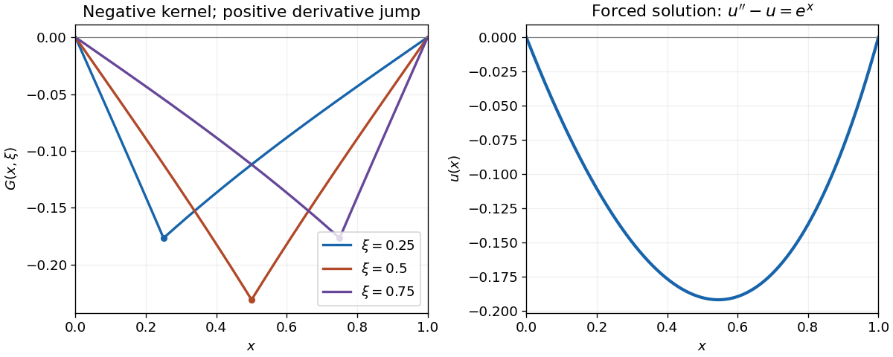

<h1 id="8/solution">Solution</h1>

↑ **Parent:** [8](../8.md)

Choose the left homogeneous solution $v(x)=\sinh x$ and the right one $w(x)=\sinh(1-x)$. Their [Wronskian](../../../../wronskian.md) is $vw'-v'w=-\sinh1$. The [Dirichlet modified Helmholtz Green function on an interval](../../../../dirichlet-modified-helmholtz-green-function-on-an-interval.md), with operator sign $D_x^2-1$, is therefore

$$
G(x,\xi)=-\frac{\sinh(x_<)\sinh(1-x_>)}{\sinh1},\qquad x_<=\min(x,\xi),\quad x_>=\max(x,\xi).
$$

It vanishes at both endpoints, is continuous at $x=\xi$, and its first [derivative](../../../../derivative.md) jumps by $+1$, giving $(D_x^2-1)G=\delta(x-\xi)$. The [Green-function representation](../../../../green-function-representation.md) then gives

$$
u(x)=-\frac{\sinh(1-x)}{\sinh1}\int_0^xe^\xi\sinh\xi\,d\xi-\frac{\sinh x}{\sinh1}\int_x^1e^\xi\sinh(1-\xi)\,d\xi.
$$

The two [integrals](../../../../integral-split.md) are $(e^{2x}-1)/4-x/2$ and $e(1-x)/2-(e-e^{2x-1})/4$, respectively. Substituting them and simplifying gives

$$
\boxed{u(x)=\frac12\left[xe^x-\frac{e\sinh x}{\sinh1}\right].}
$$

Direct [differentiation](../../../../differentiation.md) verifies $u''-u=e^x$ and both zero boundary values. The negative kernel also explains why the solution is negative inside the interval despite the positive right-hand side.

**[Figure 1](#8/image-a-negative-dirichlet-green-kernel-produces-a-negative-response-to-positive-forcing). A negative Dirichlet Green kernel produces a negative response to positive forcing**. Left: three source locations give continuous kernels with derivative jump $+1$. Right: the integrated solution of $u''-u=e^x$ returns to zero at both boundaries.

## ↑ Ancestors (12)

1. [8](../8.md)
2. [Paper 1](../../paper-1-split.md)
3. [2007](../../split.md)
4. [Past exam of the mathematics course of the year 2 of the natural sciences course of the University of Cambridge](../../../split.md)
5. [Mathematics course of the year 2 of the natural sciences course of the University of Cambridge](../../../../mathematics-course-of-the-year-2-of-the-natural-sciences-course-of-the-university-of-cambridge.md)
6. [Year 2 of the natural sciences course of the University of Cambridge](../../../../year-2-of-the-natural-sciences-course-of-the-university-of-cambridge.md)
7. [Year of the natural sciences course of the University of Cambridge](../../../../year-of-the-natural-sciences-course-of-the-university-of-cambridge.md)
8. [Natural sciences course of the University of Cambridge](../../../../natural-sciences-course-of-the-university-of-cambridge.md)
9. [Course of the University of Cambridge](../../../../course-of-the-university-of-cambridge.md)
10. [University of Cambridge](../../../../university-of-cambridge-split.md)
11. [List of universities](../../../../list-of-universities.md)
12. [Codex Wiki](../../../../split.md)
