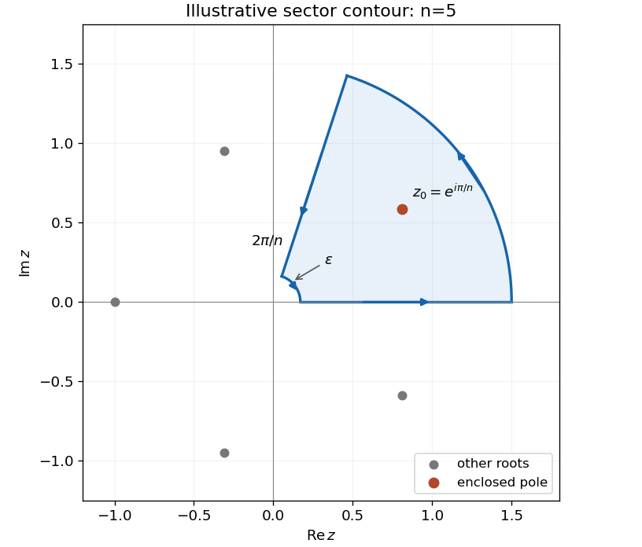

<h1 id="4/solution">Solution</h1>

↑ **Parent:** [4](../4.md)

The [residue theorem](../../../../residue-theorem.md) states that the [contour integral](../../../../contour-integral.md) of a [meromorphic function](../../../../meromorphic-function.md) around a positively oriented simple closed contour equals $2\pi i$ times the sum of its enclosed [residues](../../../../residue.md), provided there are no singularities on the contour. The roots of $1+z^n$ are $z_k=e^{(2k+1)i\pi/n}$, $k=0,\ldots,n-1$. They are simple [poles](../../../../pole.md), with [residues](../../../../residue.md) $1/(nz_k^{n-1})=-z_k/n$.

Use the sector contour of angle $2\pi/n$, running outward along the positive axis and inward along the rotated ray. It encloses only $z_0=e^{i\pi/n}$. The large-arc contribution is $O(R^{1-n})$, hence vanishes. With $J=\int_0^\infty dx/(1+x^n)$, the two ray contributions give

$$
(1-e^{2\pi i/n})J=-\frac{2\pi i}{n}e^{i\pi/n}.
$$

Since $1-e^{2i\alpha}=-2ie^{i\alpha}\sin\alpha$,

$$
\boxed{J=\frac\pi{n\sin(\pi/n)}.}
$$

For the second integral, use $z^{n/2}/(1+z^n)$ on a branch continuous across the sector away from zero, with a small inner arc of radius $\epsilon$. Its large arc is $O(R^{1-n/2})$ and its small arc is $O(\epsilon^{1+n/2})$, both vanishing for $n\geq3$. On the rotated ray, $z^{n/2}$ changes by $e^{i\pi}=-1$, so the two radial contributions add rather than subtract. The enclosed [residue](../../../../residue.md) is $z_0^{1-n/2}/n=-ie^{i\pi/n}/n$. Consequently

$$
(1+e^{2\pi i/n})I=\frac{2\pi}{n}e^{i\pi/n},\qquad\boxed{I=\frac\pi{n\cos(\pi/n)}}.
$$

Both answers are instances of the [Mellin integral of a reciprocal binomial](../../../../mellin-integral-of-a-reciprocal-binomial.md). The direct contour argument also tracks the branch needed when $n$ is odd.

**[Figure 1](#4/image-a-sector-encloses-exactly-one-root-of-the-denominator). A sector encloses exactly one root of the denominator**. An original illustrative contour for $n=5$, with outward and inward rays, an outer arc, and the inner indentation needed for a fractional power. Only the root at angle $\pi/n$ is enclosed.

## ↑ Ancestors (12)

1. [4](../4.md)
2. [Paper 2](../../paper-2-split.md)
3. [2007](../../split.md)
4. [Past exam of the mathematics course of the year 2 of the natural sciences course of the University of Cambridge](../../../split.md)
5. [Mathematics course of the year 2 of the natural sciences course of the University of Cambridge](../../../../mathematics-course-of-the-year-2-of-the-natural-sciences-course-of-the-university-of-cambridge.md)
6. [Year 2 of the natural sciences course of the University of Cambridge](../../../../year-2-of-the-natural-sciences-course-of-the-university-of-cambridge.md)
7. [Year of the natural sciences course of the University of Cambridge](../../../../year-of-the-natural-sciences-course-of-the-university-of-cambridge.md)
8. [Natural sciences course of the University of Cambridge](../../../../natural-sciences-course-of-the-university-of-cambridge.md)
9. [Course of the University of Cambridge](../../../../course-of-the-university-of-cambridge.md)
10. [University of Cambridge](../../../../university-of-cambridge-split.md)
11. [List of universities](../../../../list-of-universities.md)
12. [Codex Wiki](../../../../split.md)
