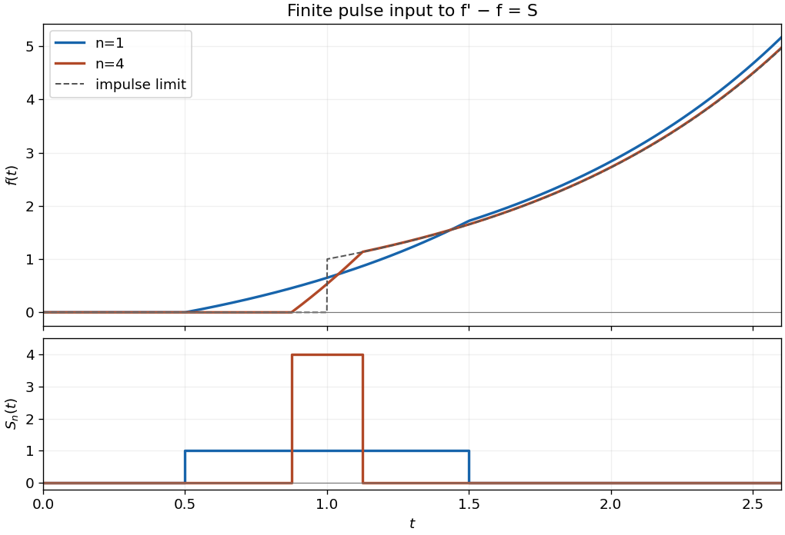

<h1 id="5/ii/solution">Solution</h1>

↑ **Parent:** [Ii](../ii.md)

Set $a_n=1-1/(2n)$, $b_n=1+1/(2n)$. The finite pulse has [Laplace transform](../../../../../laplace-transform.md) $\bar S_n(p)=n(e^{-pa_n}-e^{-pb_n})/p$. Since $f(0)=0$, transforming the equation gives

$$
\bar f(p)=\frac{n(e^{-pa_n}-e^{-pb_n})}{p(p-1)}.
$$

The [partial fraction decomposition](../../../../../partial-fraction-decomposition.md) $1/[p(p-1)]=1/(p-1)-1/p$ has inverse $e^t-1$. By the [Laplace transform time-shift rule](../../../../../laplace-transform-time-shift-rule.md),

$$
f(t)=n[(e^{t-a_n}-1)H(t-a_n)-(e^{t-b_n}-1)H(t-b_n)].
$$

This [finite-pulse response of a first-order linear equation](../../../../../finite-pulse-response-of-a-first-order-linear-equation.md) gives the requested outer regions:

$$
\boxed{f(t)=0\quad(t<a_n),\qquad f(t)=2n\sinh\left(\frac1{2n}\right)e^{t-1}\quad(t>b_n).}
$$

For completeness, while the pulse is active the solution is $n(e^{t-a_n}-1)$. It is continuous at both switching times. After the forcing stops it grows as $e^t$, because the homogeneous equation is $f'=f$. The apparent pole at $p=0$ in the full transform is removable; the [Bromwich contour](../../../../../bromwich-contour.md) may be taken with $c>1$.

**[Figure 2](#5/ii/image-a-unit-area-pulse-excites-an-exponentially-growing-response). A unit-area pulse excites an exponentially growing response**. Original calculated responses for two pulse widths and their limiting impulse response. The lower panel shows the prescribed rectangular inputs; their areas are both one.

## ↑ Ancestors (13)

1. [Ii](../ii.md)
2. [5](../../5.md)
3. [Paper 2](../../../paper-2-split.md)
4. [2007](../../../split.md)
5. [Past exam of the mathematics course of the year 2 of the natural sciences course of the University of Cambridge](../../../../split.md)
6. [Mathematics course of the year 2 of the natural sciences course of the University of Cambridge](../../../../../mathematics-course-of-the-year-2-of-the-natural-sciences-course-of-the-university-of-cambridge.md)
7. [Year 2 of the natural sciences course of the University of Cambridge](../../../../../year-2-of-the-natural-sciences-course-of-the-university-of-cambridge.md)
8. [Year of the natural sciences course of the University of Cambridge](../../../../../year-of-the-natural-sciences-course-of-the-university-of-cambridge.md)
9. [Natural sciences course of the University of Cambridge](../../../../../natural-sciences-course-of-the-university-of-cambridge.md)
10. [Course of the University of Cambridge](../../../../../course-of-the-university-of-cambridge.md)
11. [University of Cambridge](../../../../../university-of-cambridge-split.md)
12. [List of universities](../../../../../list-of-universities.md)
13. [Codex Wiki](../../../../../split.md)
