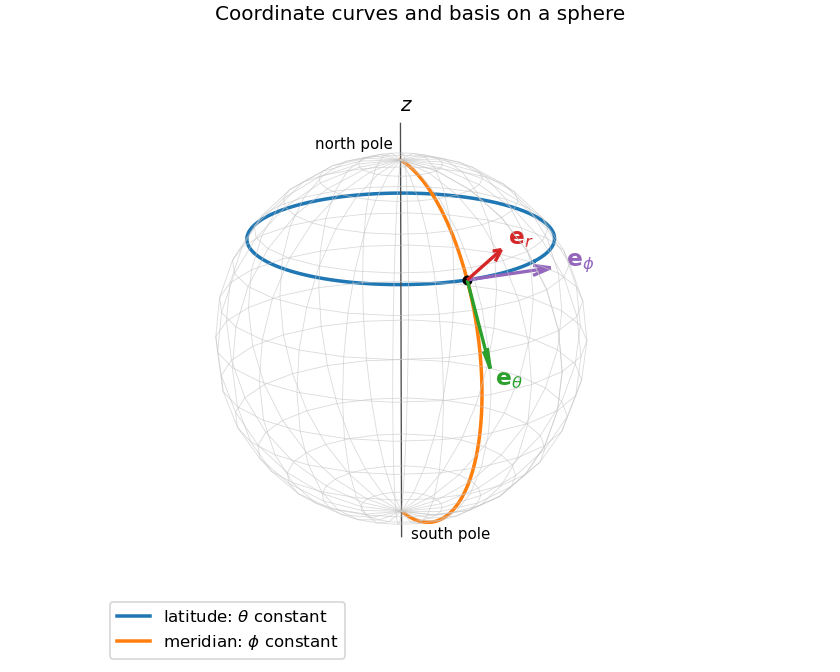
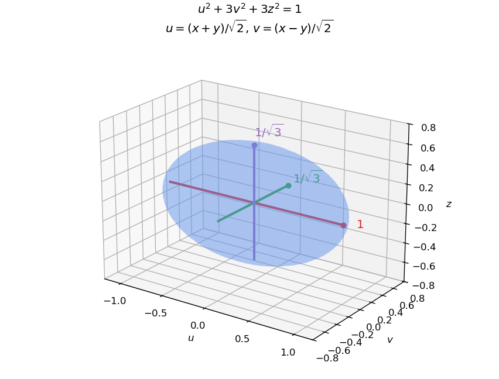

# Paper 1

↑ **Parent:** [2008](../2008.md)

[https://www.maths.cam.ac.uk/undergradnst/files/2008/PaperNST_IB_1.pdf](https://www.maths.cam.ac.uk/undergradnst/files/2008/PaperNST_IB_1.pdf)

**Table of contents**

- [1](#1)
  - [a](#1/a)
    - [Solution](#1/a/solution)
  - [b](#1/b)
    - [Solution](#1/b/solution)
  - [c](#1/c)
    - [Solution](#1/c/solution)
  - [d](#1/d)
    - [Solution](#1/d/solution)
- [2](#2)
  - [a](#2/a)
    - [Solution](#2/a/solution)
  - [b](#2/b)
    - [Solution](#2/b/solution)
  - [c](#2/c)
    - [Solution](#2/c/solution)
- [3](#3)
  - [Solution](#3/solution)
  - [i](#3/i)
    - [Solution](#3/i/solution)
  - [ii](#3/ii)
    - [Solution](#3/ii/solution)
- [4](#4)
  - [a](#4/a)
    - [Solution](#4/a/solution)
    - [i](#4/a/i)
      - [Solution](#4/a/i/solution)
    - [ii](#4/a/ii)
      - [Solution](#4/a/ii/solution)
  - [b](#4/b)
    - [Solution](#4/b/solution)
- [5](#5)
  - [Solution](#5/solution)
- [6](#6)
  - [Solution](#6/solution)
- [7](#7)
  - [a](#7/a)
    - [Solution](#7/a/solution)
  - [b](#7/b)
    - [1](#7/b/1)
      - [Solution](#7/b/1/solution)
    - [2](#7/b/2)
      - [Solution](#7/b/2/solution)
    - [i](#7/b/i)
      - [Solution](#7/b/i/solution)
    - [ii](#7/b/ii)
      - [Solution](#7/b/ii/solution)
    - [iii](#7/b/iii)
      - [Solution](#7/b/iii/solution)
- [8](#8)
  - [Solution](#8/solution)
- [9](#9)
  - [Solution](#9/solution)
- [10](#10)
  - [Solution](#10/solution)

## 1

↑ **Parent:** [Paper 1](paper-1.md)

<h3 id="1/a">a</h3>

↑ **Parent:** [1](#1)

<h4 id="1/a/solution">Solution</h4>

↑ **Parent:** [A](#1/a)

On the [sphere](../../euclidean-geometry.md#sphere), constant $\theta$ gives a latitude [circle](../../topology.md#circle) of radius $a\sin\theta$ and height $a\cos\theta$. Constant $\phi$ gives a meridian semicircle in a vertical plane through the $z$ axis. The [orthonormal basis](../../inner-product.md#orthonormal-basis) of [spherical coordinates](../../multivariable-calculus.md#spherical-coordinate-system) is

$$
\boldsymbol e_r=(\sin\theta\cos\phi,\sin\theta\sin\phi,\cos\theta),\quad
\boldsymbol e_\theta=(\cos\theta\cos\phi,\cos\theta\sin\phi,-\sin\theta),\quad
\boldsymbol e_\phi=(-\sin\phi,\cos\phi,0).
$$

Here $\boldsymbol e_r$ points outward, $\boldsymbol e_\theta$ along increasing [polar angle](../../multivariable-calculus.md#polar-angle), and $\boldsymbol e_\phi$ along increasing [azimuth](../../astrophysics.md#azimuth). At either pole the radial [unit vector](../../vector-space.md#unit-vector) is unambiguous, but the two tangential coordinate vectors depend on the undefined longitude. The figure shows their directions away from the poles.

**[Figure 1](#1/a/image-latitude-and-meridian-curves-with-the-three-spherical-coordinate-unit-vectors-at-a-regular-point). Latitude and meridian curves with the three spherical coordinate unit vectors at a regular point**.

This coordinate ambiguity does not make a vector field singular if its tangential coefficient vanishes suitably. In [Cartesian coordinates](../../linear-algebra.md#cartesian-coordinate-system),

$$
\boldsymbol A^{(+)}=\frac{(-y,x,0)}{r(r+z)},\qquad
\boldsymbol A^{(-)}=\frac{(y,-x,0)}{r(r-z)}.
$$

The first is smooth at the north pole and zero there; the second is smooth and zero at the south pole. Their actual singular axes are the opposite ones. These are the regular patches of a [two-patch vector potential for a radial monopole](../../mathematical-physics.md#two-patch-vector-potential-for-a-radial-monopole).

<h3 id="1/b">b</h3>

↑ **Parent:** [1](#1)

<h4 id="1/b/solution">Solution</h4>

↑ **Parent:** [B](#1/b)

Along the [circle](../../topology.md#circle) with increasing $\phi$, the [line element](../../riemannian-metric.md#line-element) is $d\boldsymbol r=a\sin\alpha\,\boldsymbol e_\phi d\phi$. Thus the two [circulations](../../vorticity.md#circulation-physics) are

$$
\oint_C\boldsymbol A^{(+)}\cdot d\boldsymbol r=2\pi\sin\alpha\tan(\alpha/2),\qquad
\oint_C\boldsymbol A^{(-)}\cdot d\boldsymbol r=-2\pi\sin\alpha\cot(\alpha/2).
$$

The half-angle identities simplify them to

$$
\boxed{\oint_C\boldsymbol A^{(+)}\cdot d\boldsymbol r=2\pi(1-\cos\alpha),\qquad
\oint_C\boldsymbol A^{(-)}\cdot d\boldsymbol r=-2\pi(1+\cos\alpha).}
$$

Here $0<\alpha<\pi$ so both potentials are defined on the whole curve.

<h3 id="1/c">c</h3>

↑ **Parent:** [1](#1)

<h4 id="1/c/solution">Solution</h4>

↑ **Parent:** [C](#1/c)

For an axisymmetric azimuthal [vector field](../../multivariable-calculus.md#vector-field), the [curl in spherical coordinates](../../multivariable-calculus.md#curl-in-spherical-coordinates) has components

$$
(\nabla\times\boldsymbol A)_r=\frac1{r\sin\theta}\partial_\theta(\sin\theta A_\phi),\qquad
(\nabla\times\boldsymbol A)_\theta=-\frac1r\partial_r(rA_\phi),\qquad
(\nabla\times\boldsymbol A)_\phi=0.
$$

The angular expressions are $\sin\theta A_\phi^{(+)}=(1-\cos\theta)/r$ and $\sin\theta A_\phi^{(-)}=-(1+\cos\theta)/r$, each with $\theta$ derivative $\sin\theta/r$. Also $rA_\phi$ is independent of $r$, so the second component vanishes. Consequently, on each potential's regular patch,

$$
\boxed{\nabla\times\boldsymbol A^{(+)}=\nabla\times\boldsymbol A^{(-)}=\frac{\boldsymbol e_r}{r^2}=\boldsymbol B.}
$$

<h3 id="1/d">d</h3>

↑ **Parent:** [1](#1)

<h4 id="1/d/solution">Solution</h4>

↑ **Parent:** [D](#1/d)

The outward [area element](../../differential-geometry.md#area-element-of-a-surface) is $d\boldsymbol S=a^2\sin\theta\,d\theta\,d\phi\,\boldsymbol e_r$. Therefore

$$
\boxed{\int_S\boldsymbol B\cdot d\boldsymbol S=\int_0^{2\pi}\int_0^\pi\sin\theta\,d\theta\,d\phi=4\pi.}
$$

Split the sphere into the northern cap $0\leq\theta\leq\alpha$ and the southern cap $\alpha\leq\theta\leq\pi$. Their induced boundary orientations are $+C$ and $-C$, respectively. The [Stokes theorem](../../multivariable-calculus.md#stokes-theorem) applies to $\boldsymbol A^{(+)}$ on the north and $\boldsymbol A^{(-)}$ on the south. Adding their fluxes gives $2\pi(1-\cos\alpha)+2\pi(1+\cos\alpha)=4\pi$, agreeing with direct integration.

There is no contradiction with the flux of a globally smooth [curl](../../multivariable-calculus.md#curl) through a closed surface: neither potential is regular on the entire sphere. On their overlap they differ by $2\boldsymbol e_\phi/(r\sin\theta)=2\nabla\phi$, a local [gauge transformation](../../electromagnetism.md#gauge-transformation). The longitude is not a globally single-valued scalar, so that difference can have nonzero circulation around $C$.

## 2

↑ **Parent:** [Paper 1](paper-1.md)

<h3 id="2/a">a</h3>

↑ **Parent:** [2](#2)

<h4 id="2/a/solution">Solution</h4>

↑ **Parent:** [A](#2/a)

Take a nonzero separated solution $\varphi=X(x)Y(y)$. Dividing by $XY$ separates the [Laplacian eigenfunction](../../partial-differential-equation.md#laplacian-eigenfunction) equation into $X''=-\mu X$ and $Y''=-(\lambda-\mu)Y$. The zero-endpoint [Dirichlet boundary conditions](../../differential-equation.md#dirichlet-boundary-condition) admit no nonzero linear or hyperbolic factors, so both separation constants must be positive squares. Hence

$$
\boxed{\varphi_{mn}(x,y)=C\sin\frac{m\pi x}{\ell}\sin\frac{n\pi y}{\ell},\qquad
\lambda_{mn}=\frac{\pi^2(m^2+n^2)}{\ell^2},\quad m,n\geq1.}
$$

All separated nonzero solutions have this form. At a repeated [eigenvalue](../../linear-operator-theory.md#eigenvalue), linear combinations of the corresponding modes are also solutions, though they need not remain separable.

<h3 id="2/b">b</h3>

↑ **Parent:** [2](#2)

<h4 id="2/b/solution">Solution</h4>

↑ **Parent:** [B](#2/b)

Multiply by the $(m,n)$ sine product and integrate over the square. [Fourier orthogonality](../../fourier-series.md#fourier-orthogonality) gives squared norm $\ell^2/4$, and thus

$$
c_{mn}=\frac4{\ell^2}\left(\int_0^\ell\sin\frac{m\pi x}{\ell}dx\right)\left(\int_0^\ell\sin\frac{n\pi y}{\ell}dy\right)
=\frac{4[1-(-1)^m][1-(-1)^n]}{\pi^2mn}.
$$

Therefore

$$
\boxed{c_{mn}=\begin{cases}16/(\pi^2mn),&m,n\text{ both odd},\\0,&\text{otherwise}.\end{cases}}
$$

This [double Fourier sine series](../../fourier-series.md#double-fourier-sine-series) equals one at interior points. At boundary points every summand vanishes, consistent with the endpoint value of the sine extension.

<h3 id="2/c">c</h3>

↑ **Parent:** [2](#2)

<h4 id="2/c/solution">Solution</h4>

↑ **Parent:** [C](#2/c)

Each spatial [eigenfunction](../../linear-operator-theory.md#eigenfunction) acquires the temporal factor $e^{-\kappa\lambda_{mn}t}$ under the [heat equation](../../diffusion-equation.md#heat-equation). Expanding the initial constant using the preceding coefficients gives the [cooling of an initially uniform square](../../diffusion-equation.md#cooling-of-an-initially-uniform-square):

$$
\boxed{T(x,y;t)=\frac{16T_0}{\pi^2}\sum_{\substack{m,n\geq1\\m,n\text{ odd}}}\frac1{mn}\sin\frac{m\pi x}{\ell}\sin\frac{n\pi y}{\ell}\,e^{-\kappa\pi^2(m^2+n^2)t/\ell^2}.}
$$

For $t>0$ the exponential factors justify differentiating the series and enforce the zero boundary temperature. As $t\downarrow0$, it tends to $T_0$ at every interior point and in [L2 space](../../measure-theory.md#l2-space-is-a-hilbert-space); the instantaneous boundary cooling is incompatible with continuity at the initial boundary corners, which is expected for this idealization.

The slowest decaying nonzero mode is $(1,1)$, giving

$$
\boxed{T(x,y;t)\sim\frac{16T_0}{\pi^2}\sin\frac{\pi x}{\ell}\sin\frac{\pi y}{\ell}\,e^{-2\kappa\pi^2t/\ell^2}}
$$

at each fixed interior point when $T_0\ne0$. The next contributing modes have $(m,n)=(1,3),(3,1)$ and decay as $e^{-10\kappa\pi^2t/\ell^2}$, making the leading-mode approximation exponentially accurate.

## 3

↑ **Parent:** [Paper 1](paper-1.md)

<h3 id="3/solution">Solution</h3>

↑ **Parent:** [3](#3)

Let $L=d^2/dx^2+x^{-1}d/dx-x^{-2}$. A [Green's function](../../green-s-function.md) $G(x,\xi)$ satisfies $L_xG=\delta(x-\xi)$ and the chosen homogeneous [boundary conditions](../../differential-equation.md#boundary-condition) in $x$. Away from $x=\xi$, it is a linear combination of $x$ and $x^{-1}$. It must be continuous there and obey the unit derivative jump $G_x(\xi^+,\xi)-G_x(\xi^-,\xi)=1$, because the leading differential coefficient is one. Then

$$
y(x)=\int_0^\infty G(x,\xi)f(\xi)\,d\xi
$$

solves $Ly=f$ whenever the integral and boundary limits are valid. The [Wronskian](../../linear-ordinary-differential-equation.md#wronskian) of $x,x^{-1}$ is $-2/x$. The [Green kernels for a radial dipole Euler equation](../../green-s-function.md#green-kernels-for-a-radial-dipole-euler-equation) implement the two different choices of boundary conditions below.

<h3 id="3/i">i</h3>

↑ **Parent:** [3](#3)

<h4 id="3/i/solution">Solution</h4>

↑ **Parent:** [I](#3/i)

The factor satisfying the left condition is $x$, while $x^{-1}$ satisfies decay at infinity. Matching the value and unit derivative jump gives

$$
\boxed{G_1(x,\xi)=\begin{cases}-x/2,&x\leq\xi,\\-\xi^2/(2x),&x\geq\xi.\end{cases}}
$$

For the specified compactly supported forcing, integrating over $0<\xi<1$ gives

$$
\boxed{y_1(x)=\begin{cases}x^2/3-x/2,&0<x\leq1,\\-1/(6x),&x\geq1.\end{cases}}
$$

For example, on $0<x<1$, the two pieces contribute $-x^2/6$ and $-x(1-x)/2$. Both $y_1$ and $y_1'$ match at one, and the function tends to zero at both ends. A homogeneous difference $ax+b/x$ with those two limits must vanish, establishing uniqueness.

<h3 id="3/ii">ii</h3>

↑ **Parent:** [3](#3)

<h4 id="3/ii/solution">Solution</h4>

↑ **Parent:** [Ii](#3/ii)

The zero initial value and slope select a forward [Green's function](../../green-s-function.md): set it to zero for $x<\xi$, and choose the right piece to start at zero with slope one. This gives

$$
\boxed{G_2(x,\xi)=\begin{cases}0,&x\leq\xi,\\\tfrac12(x-\xi^2/x),&x\geq\xi.\end{cases}}
$$

For $f=1$ on $(0,1)$ and zero elsewhere,

$$
\boxed{y_2(x)=\begin{cases}x^2/3,&0<x\leq1,\\x/2-1/(6x),&x\geq1.\end{cases}}
$$

Indeed $y_2=\int_0^{\min(x,1)}(x-\xi^2/x)d\xi/2$. It and its first [derivative](../../calculus.md#derivative) match at one, while $y_2,y_2'\to0$ at zero. The only homogeneous solution with these two initial limits is zero, so this solution too is unique. Its growth at infinity is allowed by these boundary conditions.

## 4

↑ **Parent:** [Paper 1](paper-1.md)

<h3 id="4/a">a</h3>

↑ **Parent:** [4](#4)

<h4 id="4/a/solution">Solution</h4>

↑ **Parent:** [A](#4/a)

Use the angular-frequency [Fourier transform](../../fourier-transform.md) convention

$$
\widetilde f(k)=\int_{-\infty}^{\infty}f(x)e^{-ikx}\,dx,\qquad
f(x)=\frac1{2\pi}\int_{-\infty}^{\infty}\widetilde f(k)e^{ikx}\,dk.
$$

For the piecewise smooth functions here, the inverse gives the function at continuity points and the mean of one-sided limits at a jump. Values assigned at individual points do not affect the transform.

<h4 id="4/a/i">i</h4>

↑ **Parent:** [A](#4/a)

<h5 id="4/a/i/solution">Solution</h5>

↑ **Parent:** [I](#4/a/i)

The even extension is the [triangular function](../../fourier-analysis.md#triangular-function) $f(x)=(1-|x|)$ for $|x|<1$ and zero outside. Its [Fourier transform](../../fourier-transform.md) is real and even:

$$
\widetilde f(k)=2\int_0^1(1-x)\cos(kx)\,dx,
\qquad\boxed{\widetilde f(k)=\frac{2(1-\cos k)}{k^2}=\left(\frac{\sin(k/2)}{k/2}\right)^2.}
$$

At zero the removable limiting value is one, also obtained directly by integrating the triangle. This is the [Fourier transform of a triangular function](../../fourier-analysis.md#fourier-transform-of-a-triangular-function).

<h4 id="4/a/ii">ii</h4>

↑ **Parent:** [A](#4/a)

<h5 id="4/a/ii/solution">Solution</h5>

↑ **Parent:** [Ii](#4/a/ii)

For the odd extension, the cosine integral vanishes and the sine integral doubles. [Integration by parts](../../calculus.md#integration-by-parts) gives

$$
\widetilde f(k)=-2i\int_0^1(1-x)\sin(kx)\,dx,
\qquad\boxed{\widetilde f(k)=-\frac{2i(k-\sin k)}{k^2}.}
$$

The value at $k=0$ is zero by the [odd function](../../calculus.md#odd-function) symmetry, or by the [Maclaurin series](../../calculus.md#maclaurin-series) of the sine. The transform is purely imaginary and odd.

<h3 id="4/b">b</h3>

↑ **Parent:** [4](#4)

<h4 id="4/b/solution">Solution</h4>

↑ **Parent:** [B](#4/b)

For the chosen [Fourier transform](../../fourier-transform.md) convention, [Parseval's identity](../../fourier-analysis.md#parseval-identity) is $\int|f|^2dx=(2\pi)^{-1}\int|\widetilde f|^2dk$. For smooth rapidly decaying functions its bilinear form follows by inserting the inverse transform of $g$ into $\int f\overline g\,dx$ and interchanging the integrals:

$$
\int f(x)\overline{g(x)}dx=\frac1{2\pi}\int\widetilde f(k)\overline{\widetilde g(k)}dk.
$$

Take $g=f$. Approximation by such functions extends the identity to [L2 space](../../measure-theory.md#l2-space-is-a-hilbert-space), which includes the compact triangular function here.

For that triangle, $\int|f|^2dx=2\int_0^1(1-x)^2dx=2/3$, while $\widetilde f(k)=[\sin(k/2)/(k/2)]^2$. Thus

$$
\frac23=\frac1{2\pi}\int_{-\infty}^{\infty}\left(\frac{\sin(k/2)}{k/2}\right)^4dk
=\frac2\pi\int_0^\infty\left(\frac{\sin u}u\right)^4du,
$$

giving

$$
\boxed{\int_0^\infty\frac{\sin^4u}{u^4}du=\frac\pi3.}
$$

The continuous limiting integrand at zero is one. This is the [sinc fourth-power integral](../../fourier-transform.md#sinc-fourth-power-integral).

## 5

↑ **Parent:** [Paper 1](paper-1.md)

<h3 id="5/solution">Solution</h3>

↑ **Parent:** [5](#5)

A complex $3\times3$ [matrix](../../vector-space.md#matrix) is [diagonalizable](../../linear-operator-theory.md#diagonalizable-matrix) exactly when it has a basis of three linearly independent [eigenvectors](../../linear-operator-theory.md#eigenvector). If all its [eigenvalues](../../linear-operator-theory.md#eigenvalue) are one, a diagonalization would have $D=I$ and hence $A=PIP^{-1}=I$. Therefore the specified matrix, which is not a scalar [identity matrix](../../vector-space.md#identity-matrix), is **not diagonalizable**.

For the displayed real symmetric matrix, choose the [orthogonal matrix](../../linear-algebra.md#orthogonal-matrix)

$$
Q=\begin{pmatrix}1/\sqrt2&1/\sqrt2&0\\1/\sqrt2&-1/\sqrt2&0\\0&0&1\end{pmatrix}.
$$

Its columns form an [orthonormal eigenbasis](../../linear-operator-theory.md#orthonormal-eigenbasis), and

$$
\boxed{Q^TAQ=\operatorname{diag}(1,3,3).}
$$

In the [orthogonal coordinates](../../multivariable-calculus.md#orthogonal-coordinates) $u=(x+y)/\sqrt2$, $v=(x-y)/\sqrt2$, the [quadric surface](../../euclidean-geometry.md#quadric-surface) has equation $u^2+3v^2+3z^2=1$. It is a [prolate spheroid](../../euclidean-geometry.md#prolate-spheroid), with long semiaxis one in direction $(1,1,0)$ and two equal short semiaxes $1/\sqrt3$. The figure gives its principal-axis sketch.

**[Figure 2](#5/image-the-diagonalized-quadric-is-a-prolate-spheroid-with-semiaxes-one-and-one-over-the-square-root-of-three). The diagonalized quadric is a prolate spheroid with semiaxes one and one over the square root of three**.

A diagonalizable matrix can certainly have exactly two distinct [eigenvalues](../../linear-operator-theory.md#eigenvalue): $\operatorname{diag}(1,1,2)$ is already diagonal and has an eigenbasis despite its repeated eigenvalue.

## 6

↑ **Parent:** [Paper 1](paper-1.md)

<h3 id="6/solution">Solution</h3>

↑ **Parent:** [6](#6)

A [Hermitian matrix](../../hilbert-space.md#hermitian-operator) satisfies $A^\dagger=\overline A^T=A$. If $Av=\lambda v$ with $v\ne0$, then $v^\dagger Av=\lambda v^\dagger v$ is real because its conjugate equals $v^\dagger A^\dagger v=v^\dagger Av$. Since $v^\dagger v>0$, its [eigenvalue](../../linear-operator-theory.md#eigenvalue) $\lambda$ is real. If $Aw=\mu w$ with $\mu\ne\lambda$, then

$$
\mu v^\dagger w=v^\dagger Aw=(Av)^\dagger w=\lambda v^\dagger w,
$$

so $v^\dagger w=0$: distinct eigenspaces are [orthogonal](../../inner-product.md#orthogonal-vectors) for the standard complex [inner product](../../inner-product.md).

The converse is false. For example $\begin{pmatrix}1&1\\0&2\end{pmatrix}$ has the two real [eigenvalues](../../linear-operator-theory.md#eigenvalue) one and two but is not a [Hermitian matrix](../../hilbert-space.md#hermitian-operator). It can be embedded as a block in a $3\times3$ example if desired.

For Hermitian $A,B$, $(AB)^\dagger=B^\dagger A^\dagger=BA$. Thus $AB$ is Hermitian exactly when $AB=BA$, equivalently when their [commutator](../../lie-algebra.md#commutator) vanishes. Also $(AB+BA)^\dagger=AB+BA$, so a value that works for every such pair is

$$
\boxed{c=1.}
$$

This sum is their [anticommutator](../../vector-space.md#anticommutator).

## 7

↑ **Parent:** [Paper 1](paper-1.md)

<h3 id="7/a">a</h3>

↑ **Parent:** [7](#7)

<h4 id="7/a/solution">Solution</h4>

↑ **Parent:** [A](#7/a)

For $f=u+iv$ holomorphic in $z=x+iy$, the [Cauchy-Riemann equations](../../analysis.md#cauchy-riemann-equations) are $u_x=v_y$ and $u_y=-v_x$. Therefore the normal [vectors](../../vector-space.md#vector) to the two level curves obey

$$
\nabla u\cdot\nabla v=u_xv_x+u_yv_y=u_x(-u_y)+u_yu_x=0.
$$

At a point where $f'\ne0$, both [gradients](../../multivariable-calculus.md#gradient) are nonzero, so their perpendicular tangent lines are also perpendicular. At critical points this argument does not assert that regular level curves exist.

Take

$$
\boxed{f(z)=z^2.}
$$

Its [real part](../../complex-analysis.md#real-part) is $u=x^2-y^2$, so the specified first family is $u=-\alpha$. Its [imaginary part](../../complex-analysis.md#imaginary-part) is $v=2xy$, so the second family is $v=2\beta$. Since $\beta\ne0$, their intersections exclude the origin, where $f'(z)=2z$ would vanish. Thus these [hyperbolas](../../euclidean-geometry.md#hyperbola) meet orthogonally as required.

<h3 id="7/b">b</h3>

↑ **Parent:** [7](#7)

<h4 id="7/b/1">1</h4>

↑ **Parent:** [B](#7/b)

<h5 id="7/b/1/solution">Solution</h5>

↑ **Parent:** [1](#7/b/1)

For an isolated [pole](../../isolated-singularity.md#pole) of order $N\geq1$, the [Laurent coefficients](../../analysis.md#laurent-coefficient) must satisfy

$$
\boxed{a_{-N}\ne0,\qquad a_n=0\quad(n<-N).}
$$

Then the [principal part of a Laurent series](../../analysis.md#principal-part-of-a-laurent-series) is a finite sum with lowest power $-N$. The classification at the center assumes analyticity on a punctured neighborhood $0<|z-z_0|<b$, or an analytic continuation there. A Laurent expansion on an annulus with positive inner radius alone does not imply that the center is an isolated singularity.

<h4 id="7/b/2">2</h4>

↑ **Parent:** [B](#7/b)

<h5 id="7/b/2/solution">Solution</h5>

↑ **Parent:** [2](#7/b/2)

On a punctured neighborhood of the center, an [essential singularity](../../isolated-singularity.md#essential-singularity) occurs exactly when **infinitely many negative-power Laurent coefficients are nonzero**. If all negative-power coefficients vanish, the singularity is removable; if finitely many are nonzero, the singularity is a [pole](../../isolated-singularity.md#pole). The punctured-neighborhood assumption matters: an annulus separated from its center cannot by itself classify the function there.

<h4 id="7/b/i">i</h4>

↑ **Parent:** [B](#7/b)

<h5 id="7/b/i/solution">Solution</h5>

↑ **Parent:** [I](#7/b/i)

Put $w=z-i\pi$. Since $\sinh(w+i\pi)=-\sinh w$ and $\sinh w=w(1+w^2/6+O(w^4))$, the local [Laurent series](../../analysis.md#laurent-series) is

$$
\frac1{\sinh^3z}=-w^{-3}(1+w^2/6+O(w^4))^{-3}=-w^{-3}+\frac12w^{-1}+O(w).
$$

Thus all singular terms are

$$
\boxed{-\frac1{(z-i\pi)^3}+\frac1{2(z-i\pi)}.}
$$

There is a third-order [pole](../../isolated-singularity.md#pole), with no second-order term.

<h4 id="7/b/ii">ii</h4>

↑ **Parent:** [B](#7/b)

<h5 id="7/b/ii/solution">Solution</h5>

↑ **Parent:** [Ii](#7/b/ii)

Use the local coordinate $w=1/z$ at infinity. For positive integer $N$,

$$
f(1/w)=w^{-N}e^{-w}=\sum_{m=0}^\infty\frac{(-1)^m}{m!}w^{m-N}.
$$

The negative powers of this local coordinate are precisely $m=0,\ldots,N-1$. The singular part at infinity is therefore

$$
\boxed{\sum_{m=0}^{N-1}\frac{(-1)^m}{m!}w^{m-N}=\sum_{m=0}^{N-1}\frac{(-1)^m}{m!}z^{N-m}.}
$$

Infinity is a [pole at infinity](../../isolated-singularity.md#pole-at-infinity) of order $N$. In the original $z$ variable these singular terms are positive powers; it is the negative powers of $w=1/z$ that define the local [principal part of a Laurent series](../../analysis.md#principal-part-of-a-laurent-series). For $N=0$ the point at infinity is regular, and for negative integer $N$ it is a zero rather than a pole.

<h4 id="7/b/iii">iii</h4>

↑ **Parent:** [B](#7/b)

<h5 id="7/b/iii/solution">Solution</h5>

↑ **Parent:** [Iii](#7/b/iii)

The exponential [power series](../../sequence-and-series.md#power-series) gives $e^{-1/z}=\sum_{m=0}^\infty(-1)^m/(m!z^m)$ for $z\ne0$. Hence all singular terms are

$$
\boxed{\sum_{m=1}^\infty\frac{(-1)^m}{m!z^m}=-\frac1z+\frac1{2z^2}-\frac1{6z^3}+\cdots.}
$$

Infinitely many negative powers occur, so zero is an [essential singularity](../../isolated-singularity.md#essential-singularity).

## 8

↑ **Parent:** [Paper 1](paper-1.md)

<h3 id="8/solution">Solution</h3>

↑ **Parent:** [8](#8)

Termwise differentiation of the convergent [Frobenius series](../../complex-analysis.md#frobenius-solution) and collection of powers in the [Bessel differential equation](../../bessel-function.md#bessel-differential-equation) gives the lowest coefficient $(\sigma^2-\nu^2)a_0$, the next coefficient $[(\sigma+1)^2-\nu^2]a_1$, and, for $n\geq2$, the coefficient $[(\sigma+n)^2-\nu^2]a_n+a_{n-2}$. Since $a_0\ne0$, the stated choices $\sigma=\pm\nu$, $a_1=0$ and the recurrence make all coefficients vanish.

For $\nu=1/2$, the two resulting even-coefficient series are

$$
\sigma=\tfrac12:\quad a_0x^{1/2}\left(1-\frac{x^2}{3!}+\frac{x^4}{5!}-\cdots\right)=a_0\frac{\sin x}{\sqrt x},
$$

and

$$
\sigma=-\tfrac12:\quad a_0x^{-1/2}\left(1-\frac{x^2}{2!}+\frac{x^4}{4!}-\cdots\right)=a_0\frac{\cos x}{\sqrt x}.
$$

These are linearly independent on $x>0$ and give the [Bessel functions of order one half](../../bessel-function.md#bessel-functions-of-order-one-half), up to normalization. The specified condition $a_1=0$ is sufficient; in the negative-exponent branch at this particular order the next coefficient equation alone would allow $a_1$ to be free, adding a multiple of the positive-exponent solution.

For the [Legendre differential equation](../../linear-ordinary-differential-equation.md#legendre-differential-equation), substitution gives the full conditions

$$
\boxed{\sigma(\sigma-1)=0,\qquad \sigma(\sigma+1)a_1=0,\qquad
a_{n+2}=\frac{(\sigma+n)(\sigma+n+1)-\lambda(\lambda+1)}{(\sigma+n+2)(\sigma+n+1)}a_n\quad(n\geq0).}
$$

Thus $\sigma=0$ permits arbitrary $a_1$, while $\sigma=1$ requires $a_1=0$. This [Frobenius recurrence for the Legendre equation](../../linear-ordinary-differential-equation.md#frobenius-recurrence-for-the-legendre-equation) separates the even and odd series. The nearest singular points of the differential equation are $\pm1$, so the series about zero has radius at least one, and the generic nonterminating solutions have radius exactly one. Particular cancellations can give a larger radius.

Termination occurs when the degree reaches a nonnegative integer $N$ with $\lambda(\lambda+1)=N(N+1)$. For $\lambda\geq0$ this gives

$$
\boxed{\lambda=N\in\{0,1,2,\ldots\}.}
$$

Choose the even branch for even $N$ or the odd branch for odd $N$ to obtain a [Legendre polynomial](../../linear-ordinary-differential-equation.md#legendre-polynomial). The recurrence then terminates and gives a solution for all real $x$, with infinite radius of convergence. A nonzero entire solution at other $\lambda\geq0$ is impossible: each nonterminating parity has coefficient ratio tending to one in the variable $x^2$, and so radius one.

## 9

↑ **Parent:** [Paper 1](paper-1.md)

<h3 id="9/solution">Solution</h3>

↑ **Parent:** [9](#9)

Take fixed-endpoint variations $y_\varepsilon=y+\varepsilon\eta$ with $\eta(a)=\eta(b)=0$. The [first variation](../../calculus-of-variations.md#first-variation) is

$$
\delta I=\int_a^b(f_y\eta+f_{y'}\eta')dx=\int_a^b\left(f_y-\frac d{dx}f_{y'}\right)\eta\,dx.
$$

The boundary term vanishes by the endpoint conditions. The [fundamental lemma of the calculus of variations](../../calculus-of-variations.md#fundamental-lemma-of-the-calculus-of-variations) gives the [Euler-Lagrange equation](../../analysis.md#euler-lagrange-equation) $f_y-d(f_{y'})/dx=0$. Along its solutions,

$$
\frac d{dx}(f-y'f_{y'})=f_x+y'\left(f_y-\frac d{dx}f_{y'}\right)=f_x.
$$

When $f_x=0$, this proves the [Beltrami identity](../../analysis.md#beltrami-identity) $f-y'f_{y'}=\text{constant}$.

For the surface $z=F(y)$, the [line element](../../riemannian-metric.md#line-element) is $ds^2=dx^2+[1+F'(y)^2]dy^2$. The arc-length integrand for a graph $y(x)$ is $\mathcal L=\sqrt{1+[1+F'(y)^2]y'^2}$. It has no explicit $x$ dependence and satisfies $\mathcal L-y'\mathcal L_{y'}=1/\mathcal L$. Thus $[1+F'(y)^2]y'^2$ is constant. Choosing the fixed direction along a smooth nonconstant segment and integrating yields

$$
\boxed{\int^y\sqrt{1+F'(s)^2}\,ds=ax+b.}
$$

The same result follows by defining the transverse arc coordinate $u(y)=\int^y\sqrt{1+F'(s)^2}ds$, which changes the metric to $ds^2=dx^2+du^2$. Its [geodesics](../../riemannian-geometry.md#geodesic) are straight lines in $(x,u)$ coordinates. This proves the formula for [geodesics on a generalized cylinder](../../geometry-and-topology.md#geodesics-on-a-generalized-cylinder) and shows it gives locally shortest paths. The additional straight lines $x=\text{constant}$ in the unrolled plane are also geodesics, but cannot be represented as graphs $y(x)$. Classical differential-geometric statements assume the surface has sufficient smoothness; the arc-length coordinate itself only requires the displayed integral to be well defined.

## 10

↑ **Parent:** [Paper 1](paper-1.md)

<h3 id="10/solution">Solution</h3>

↑ **Parent:** [10](#10)

For nonzero $y$ with $G[y]>0$, the [first variation](../../calculus-of-variations.md#first-variation) of the [Rayleigh quotient](../../linear-operator-theory.md#rayleigh-quotient) under $y\mapsto y+\varepsilon h$ is

$$
\delta\Lambda=\frac2{G[y]}\left\{\int_a^b[-(py')'+qy-\Lambda wy]h\,dx+[py'h]_a^b\right\}.
$$

Choose fixed admissible homogeneous [boundary conditions](../../differential-equation.md#boundary-condition) that make the variation boundary term vanish, such as zero endpoint values or zero endpoint derivatives. Compactly supported $h$ then show that a stationary function satisfies the [Sturm-Liouville equation](../../sturm-liouville-theory.md#sturm-liouville-equation) with $\lambda=\Lambda[y]$. Conversely an [eigenfunction](../../linear-operator-theory.md#eigenfunction) satisfying those admissible conditions makes the variation zero. Multiplying its differential equation by $y$ and integrating by parts gives

$$
F[y]-[pyy']_a^b=\lambda G[y],
$$

so the stipulated energy boundary term yields $\Lambda[y]=\lambda$. The displayed energy condition alone is not a full specification of the admissible variations; it must be paired with boundary conditions for this variational equivalence.

For the final Dirichlet problem take the trial function $y=\sin x$, with $p=1,q=0,w=x$. Then

$$
\int_0^\pi y'^2dx=\frac\pi2,\qquad \int_0^\pi xy^2dx=\frac{\pi^2}4,
\qquad\boxed{\lambda_e=\frac2\pi\approx0.63662.}
$$

The [Rayleigh-Ritz variational principle](../../linear-operator-theory.md#rayleigh-ritz-variational-principle) makes this an upper bound for the lowest [eigenvalue](../../linear-operator-theory.md#eigenvalue). It is strictly above the true value: equality would require $\sin x$ itself to be a lowest [eigenfunction](../../linear-operator-theory.md#eigenfunction), but $y''+\lambda xy=(-1+\lambda x)\sin x$ cannot vanish throughout $(0,\pi)$ for a constant $\lambda$. Therefore

$$
\boxed{\lambda_e-\lambda_t>0.}
$$

Although the weight vanishes at the left endpoint, it is positive in the interior and its weighted quadratic norm is positive for every nonzero admissible continuous function; this does not obstruct the stated Dirichlet variational comparison.

## ↑ Ancestors (10)

1. [2008](../2008.md)
2. [Past exam of the mathematics course of the year 2 of the natural sciences course of the University of Cambridge](../../past-exam-of-the-mathematics-course-of-the-year-2-of-the-natural-sciences-course-of-the-university-of-cambridge.md)
3. [Mathematics course of the year 2 of the natural sciences course of the University of Cambridge](../../university-of-cambridge.md#mathematics-course-of-the-year-2-of-the-natural-sciences-course-of-the-university-of-cambridge)
4. [Year 2 of the natural sciences course of the University of Cambridge](../../university-of-cambridge.md#year-2-of-the-natural-sciences-course-of-the-university-of-cambridge)
5. [Year of the natural sciences course of the University of Cambridge](../../university-of-cambridge.md#year-of-the-natural-sciences-course-of-the-university-of-cambridge)
6. [Natural sciences course of the University of Cambridge](../../university-of-cambridge.md#natural-sciences-course-of-the-university-of-cambridge)
7. [Course of the University of Cambridge](../../university-of-cambridge.md#course-of-the-university-of-cambridge)
8. [University of Cambridge](../../university-of-cambridge.md)
9. [List of universities](../../README.md#list-of-universities)
10. [Codex Wiki](../../README.md)
