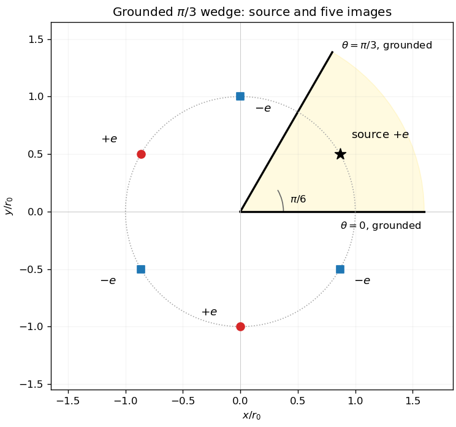

<h1 id="3/solution">Solution</h1>

↑ **Parent:** [3](../3.md)

Away from its source, a radial two-dimensional [Green's function](../../../../green-s-function-split.md) satisfies $G''+G'/r=0$, so $G=C\log r+C_0$. The [divergence theorem](../../../../divergence-theorem.md) on a disk of radius $\rho$ around the source requires $\int\nabla^2G\,dA=1$, hence $2\pi\rho G'(\rho)=1$ and $C=1/(2\pi)$. Choosing the additive constant gives

$$
\boxed{G(\boldsymbol x,\boldsymbol x_0)=\frac1{2\pi}\log|\boldsymbol x-\boldsymbol x_0|.}
$$

The equality with the [Dirac delta](../../../../dirac-delta-function.md) is distributional; away from the source the [Laplacian](../../../../laplacian.md) vanishes.

For the wedge, use the [finite image construction for a planar wedge](../../../../finite-image-construction-for-a-planar-wedge.md). In complex coordinates $z_0=r_0e^{i\theta_0}$, place three positive sources at $z_0e^{2k\pi i/3}$ and three negative sources at $\overline{z_0}e^{2k\pi i/3}$, $k=0,1,2$. The positive source at $k=0$ is the actual charge. The five images are therefore

$$
\boxed{\begin{array}{c|c|c}r_j&\theta_j\pmod{2\pi}&s_j\\\hline
r_0&\theta_0+2\pi/3&+1\\r_0&\theta_0+4\pi/3&+1\\
r_0&-\theta_0&-1\\r_0&2\pi/3-\theta_0&-1\\r_0&4\pi/3-\theta_0&-1
\end{array}.}
$$

On either grounded ray, reflection pairs each positive source with an equally distant negative source, so their logarithmic potentials cancel. All images lie outside the open physical wedge. Summing their contributions with coefficient $-e/(2\pi\varepsilon_0)$ gives the required potential. The figure shows the bisecting-source configuration.

**[Figure 1](#3/image-five-image-charges-outside-the-grounded-sixty-degree-wedge-shown-for-a-source-on-its-bisector). Five image charges outside the grounded sixty-degree wedge, shown for a source on its bisector**.

For $r_0=1$, $\theta_0=\pi/6$, the positive points are the three roots of $z^3=i$ and the negative points are the roots of $z^3=-i$. Thus the logarithmic sum is

$$
\Phi=-\frac{e}{2\pi\varepsilon_0}\log\left|\frac{z^3-i}{z^3+i}\right|
=\boxed{-\frac{e}{4\pi\varepsilon_0}\log\frac{r^6-2r^3\sin(3\theta)+1}{r^6+2r^3\sin(3\theta)+1}.}
$$

Both boundaries have $\sin(3\theta)=0$, verifying the zero potential directly. An arbitrary reference length inside the individual logarithms cancels because the six signed charges sum to zero.

## ↑ Ancestors (12)

1. [3](../3.md)
2. [Paper 2](../../paper-2-split.md)
3. [2008](../../split.md)
4. [Past exam of the mathematics course of the year 2 of the natural sciences course of the University of Cambridge](../../../split.md)
5. [Mathematics course of the year 2 of the natural sciences course of the University of Cambridge](../../../../mathematics-course-of-the-year-2-of-the-natural-sciences-course-of-the-university-of-cambridge.md)
6. [Year 2 of the natural sciences course of the University of Cambridge](../../../../year-2-of-the-natural-sciences-course-of-the-university-of-cambridge.md)
7. [Year of the natural sciences course of the University of Cambridge](../../../../year-of-the-natural-sciences-course-of-the-university-of-cambridge.md)
8. [Natural sciences course of the University of Cambridge](../../../../natural-sciences-course-of-the-university-of-cambridge.md)
9. [Course of the University of Cambridge](../../../../course-of-the-university-of-cambridge.md)
10. [University of Cambridge](../../../../university-of-cambridge-split.md)
11. [List of universities](../../../../list-of-universities.md)
12. [Codex Wiki](../../../../split.md)
