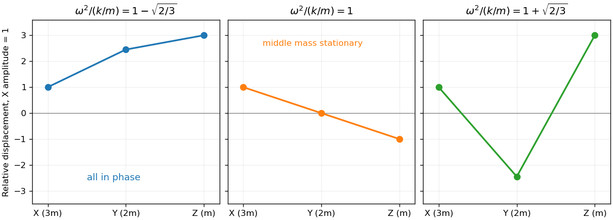

<h1 id="7/solution">Solution</h1>

↑ **Parent:** [7](../7.md)

With downward position as the vertical coordinate, the full [potential energy](../../../../potential-energy.md) is

$$
\begin{aligned}
V={}&k(a+x-\ell)^2+\frac k2(b+y-x-\ell)^2+\frac k2(c+z-y-\ell)^2\\
&-3mg(a+x)-2mg(a+b+y)-mg(a+b+c+z).
\end{aligned}
$$

The equilibrium tensions are $2k(a-\ell)=6mg$, $k(b-\ell)=3mg$ and $k(c-\ell)=mg$. On expanding, these relations cancel every term linear in the displacements, leaving $V=kx^2+k(x-y)^2/2+k(y-z)^2/2+V_0$. [Newton's second law](../../../../newton-s-second-law.md) therefore gives

$$
\boxed{3m\ddot x=-k(3x-y),\quad2m\ddot y=-k(2y-x-z),\quad m\ddot z=-k(z-y).}
$$

For a [normal mode](../../../../normal-mode.md) $\boldsymbol q=\boldsymbol v e^{i\omega t}$, set $s=m\omega^2/k$. The [generalized eigenvalue problem](../../../../generalized-eigenvalue-problem.md) is

$$
\left[\begin{pmatrix}3&-1&0\\-1&2&-1\\0&-1&1\end{pmatrix}-s\operatorname{diag}(3,2,1)\right]\boldsymbol v=0.
$$

Its determinant is $2(1-s)[3(1-s)^2-2]$, so the [angular frequencies](../../../../angular-frequency.md) and mode directions are

$$
\boxed{\begin{array}{c|c}
\omega^2&\boldsymbol v\\\hline
(k/m)(1-\sqrt{2/3})&(1,\sqrt6,3)^T\\
k/m&(1,0,-1)^T\\
(k/m)(1+\sqrt{2/3})&(1,-\sqrt6,3)^T
\end{array}.}
$$

The square roots of these positive values give the requested frequencies. Only the lowest mode has all components of the same sign, so **all three particles oscillate in phase at the lowest frequency**. The mode shapes are shown below.

**[Figure 2](#7/image-the-three-relative-displacement-patterns-of-the-unequal-mass-chain-from-lowest-to-highest-frequency). The three relative displacement patterns of the unequal-mass chain, from lowest to highest frequency**.

For release from rest with $Y$ remaining at equilibrium, choose

$$
\boxed{y(0)=0,\qquad z(0)=-x(0).}
$$

This excites only the middle-frequency mode, so $y(t)=0$ for all time. It is a [stationary middle mass in a three-mass spring chain](../../../../stationary-middle-mass-in-a-three-mass-spring-chain.md): the equal and opposite adjacent spring forces cancel on $Y$.

## ↑ Ancestors (12)

1. [7](../7.md)
2. [Paper 2](../../paper-2-split.md)
3. [2008](../../split.md)
4. [Past exam of the mathematics course of the year 2 of the natural sciences course of the University of Cambridge](../../../split.md)
5. [Mathematics course of the year 2 of the natural sciences course of the University of Cambridge](../../../../mathematics-course-of-the-year-2-of-the-natural-sciences-course-of-the-university-of-cambridge.md)
6. [Year 2 of the natural sciences course of the University of Cambridge](../../../../year-2-of-the-natural-sciences-course-of-the-university-of-cambridge.md)
7. [Year of the natural sciences course of the University of Cambridge](../../../../year-of-the-natural-sciences-course-of-the-university-of-cambridge.md)
8. [Natural sciences course of the University of Cambridge](../../../../natural-sciences-course-of-the-university-of-cambridge.md)
9. [Course of the University of Cambridge](../../../../course-of-the-university-of-cambridge.md)
10. [University of Cambridge](../../../../university-of-cambridge-split.md)
11. [List of universities](../../../../list-of-universities.md)
12. [Codex Wiki](../../../../split.md)
