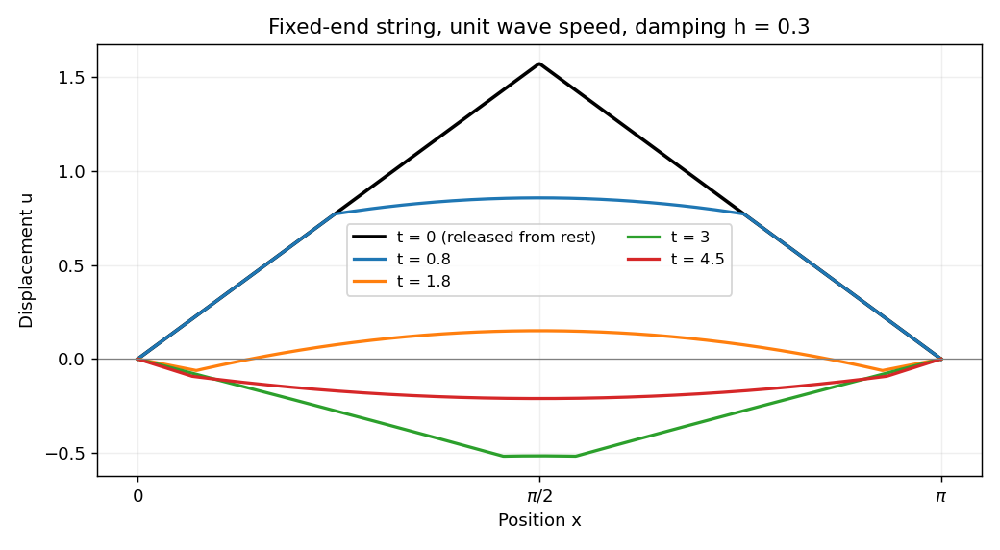

# Paper 1

↑ **Parent:** [2009](../2009.md)

[https://www.maths.cam.ac.uk/undergradnst/files/2009/PaperNST_IB_1.pdf](https://www.maths.cam.ac.uk/undergradnst/files/2009/PaperNST_IB_1.pdf)

**Table of contents**

- [1](#1)
  - [a](#1/a)
    - [Solution](#1/a/solution)
  - [b](#1/b)
    - [Solution](#1/b/solution)
- [2](#2)
  - [Solution](#2/solution)
- [3](#3)
  - [Solution](#3/solution)
- [4](#4)
  - [Solution](#4/solution)
- [5](#5)
  - [Solution](#5/solution)
- [6](#6)
  - [Solution](#6/solution)
- [7](#7)
  - [a](#7/a)
    - [Solution](#7/a/solution)
  - [b](#7/b)
    - [Solution](#7/b/solution)
  - [c](#7/c)
    - [Solution](#7/c/solution)
  - [d](#7/d)
    - [Solution](#7/d/solution)
- [8](#8)
  - [a](#8/a)
    - [Solution](#8/a/solution)
  - [b](#8/b)
    - [Solution](#8/b/solution)
- [9](#9)
  - [Solution](#9/solution)
- [10](#10)
  - [a](#10/a)
    - [Solution](#10/a/solution)
  - [b](#10/b)
    - [Solution](#10/b/solution)

## 1

↑ **Parent:** [Paper 1](paper-1.md)

<h3 id="1/a">a</h3>

↑ **Parent:** [1](#1)

<h4 id="1/a/solution">Solution</h4>

↑ **Parent:** [A](#1/a)

For a differentiable [vector field](../../multivariable-calculus.md#vector-field) in [Cartesian coordinates](../../linear-algebra.md#cartesian-coordinate-system), the [divergence](../../multivariable-calculus.md#divergence) and [curl](../../multivariable-calculus.md#curl) are

$$
\nabla\cdot F=\partial_iF_i,\qquad(\nabla\times F)_i=\epsilon_{ijk}\partial_jF_k,
$$

with summation over repeated indices. In components the curl is $(\partial_yF_z-\partial_zF_y,\partial_zF_x-\partial_xF_z,\partial_xF_y-\partial_yF_x)$. The [contraction of two Levi-Civita symbols](../../multivariable-calculus.md#contraction-of-two-levi-civita-symbols) and the [product rule](../../calculus.md#product-rule) give

$$
\begin{aligned}
[\nabla\times(F\times G)]_i
&=\epsilon_{ijk}\epsilon_{k\ell m}\partial_j(F_\ell G_m)\\
&=(\delta_{i\ell}\delta_{jm}-\delta_{im}\delta_{j\ell})\partial_j(F_\ell G_m)\\
&=G_j\partial_jF_i+F_i\partial_jG_j-G_i\partial_jF_j-F_j\partial_jG_i.
\end{aligned}
$$

Recognizing the [directional derivatives](../../multivariable-calculus.md#directional-derivative) gives the [curl of a cross product](../../multivariable-calculus.md#curl-of-a-cross-product) identity

$$
\nabla\times(F\times G)=(G\cdot\nabla)F-G(\nabla\cdot F)-(F\cdot\nabla)G+F(\nabla\cdot G).
$$

<h3 id="1/b">b</h3>

↑ **Parent:** [1](#1)

<h4 id="1/b/solution">Solution</h4>

↑ **Parent:** [B](#1/b)

The [divergence](../../multivariable-calculus.md#divergence) is $y^2+z^2+x^2$. Over the cube $[-1/2,1/2]^3$, each squared-coordinate term has integral $\int_{-1/2}^{1/2}s^2ds=1/12$, while the other two coordinate integrals have length one. Thus

$$
\boxed{\int_V\nabla\cdot F\,dV=3\cdot\frac1{12}=\frac14.}
$$

Compute the surface [flux](../../mathematical-physics.md#flux) separately. On $x=1/2$, the outward normal is $e_x$ and $F\cdot n=y^2/2$, giving flux $1/24$. On $x=-1/2$, the normal is $-e_x$, so $F\cdot n=-xy^2=y^2/2$, again giving $1/24$. The two $y$ faces similarly give $z^2/2$ each, and the two $z$ faces give $x^2/2$ each. All six face integrals therefore give

$$
\boxed{\int_{\partial V}F\cdot dS=6\cdot\frac1{24}=\frac14.}
$$

The independently evaluated values agree, verifying the [divergence theorem](../../multivariable-calculus.md#divergence-theorem) for this field and cube.

## 2

↑ **Parent:** [Paper 1](paper-1.md)

<h3 id="2/solution">Solution</h3>

↑ **Parent:** [2](#2)

Use [separation of variables](../../partial-differential-equation.md#separation-of-variables) $u=X(x)T(t)$. The fixed-end [Dirichlet boundary conditions](../../differential-equation.md#dirichlet-boundary-condition) select $X_n=\sin(nx)$, $n\geq1$, and each mode satisfies $T_n''+2hT_n'+n^2T_n=0$. In the physical resistance range $0\leq h<1$, all [normal modes](../../wave-equation.md#normal-mode) are underdamped, with $\omega_n=\sqrt{n^2-h^2}>0$. The modal factor normalized by $T_n(0)=1$, $T_n'(0)=0$ is

$$
T_n(t)=e^{-ht}\left[\cos(\omega_nt)+\frac h{\omega_n}\sin(\omega_nt)\right].
$$

Consequently the [linearly damped string](../../wave-equation.md#linearly-damped-string) has solution

$$
\boxed{u(x,t)=\sum_{n=1}^\infty b_n\sin(nx)e^{-ht}\left[\cos(\omega_nt)+\frac h{\omega_n}\sin(\omega_nt)\right],\quad b_n=\frac2\pi\int_0^\pi f(x)\sin(nx)dx.}
$$

The coefficients are those of the initial [Fourier sine series](../../fourier-series.md#fourier-sine-series). Differentiating each normalized modal factor at zero confirms that the string starts from rest. Suitable initial data give convergence in the string's energy space; the piecewise linear profile here need not give a twice differentiable solution along every characteristic from its corner.

For the specified tent profile, integrating its two linear pieces by parts gives

$$
\int_0^\pi f(x)\sin(nx)dx=\frac{2}{n^2}\sin\frac{n\pi}{2}.
$$

For example the first piece gives $-\pi\cos(n\pi/2)/(2n)+\sin(n\pi/2)/n^2$, and the second gives the opposite cosine term and the same sine term. Hence

$$
\boxed{b_n=\frac4{\pi n^2}\sin\frac{n\pi}{2},\qquad b_{2m}=0,\quad b_{2m+1}=\frac{4(-1)^m}{\pi(2m+1)^2}.}
$$

The zero even coefficients also follow from reflection symmetry about the midpoint. This is the [Fourier sine series of a symmetric tent](../../fourier-series.md#fourier-sine-series-of-a-symmetric-tent). If $h<1$ were read without the physical assumption $h\geq0$, the same modal solution extends by replacing imaginary-frequency sine and cosine by their hyperbolic counterparts, and taking $\sin(\omega t)/\omega=t$ when $\omega=0$.

**[Figure 1](#2/image-evolution-of-a-tent-shaped-string-released-from-rest-with-linear-damping). Evolution of a tent-shaped string released from rest with linear damping**.

## 3

↑ **Parent:** [Paper 1](paper-1.md)

<h3 id="3/solution">Solution</h3>

↑ **Parent:** [3](#3)

The homogeneous [Cauchy-Euler equation](../../linear-ordinary-differential-equation.md#cauchy-euler-equation) has solutions $x$ and $x^{-1}$. Choose $y_L=x$, which vanishes at zero, and $y_R=x-x^{-1}$, which vanishes at one. Their [Wronskian](../../linear-ordinary-differential-equation.md#wronskian) is $W(s)=y_L(s)y_R'(s)-y_L'(s)y_R(s)=2/s$. For a [Green function](../../green-s-function.md) integrated against the unweighted measure $ds$, continuity at $x=s$ and the jump condition $s^2[G_x]_{s^-}^{s^+}=1$ give

$$
\boxed{G(x,s)=\begin{cases}
\dfrac{x}{2}(1-s^{-2}),&0<x\leq s<1,\\[4pt]
\dfrac12(x-x^{-1}),&0<s\leq x<1.
\end{cases}}
$$

It satisfies $L_xG=\delta(x-s)$ for $L=x^2\partial_x^2+x\partial_x-1$. Therefore the candidate solution is

$$
\boxed{u(x)=\frac{x-x^{-1}}2\int_0^xf(s)ds+\frac x2\int_x^1(1-s^{-2})f(s)ds.}
$$

The leading coefficient vanishes at zero, so the endpoint condition needs care. If $f$ extends continuously to $[0,1]$, this expression has limit $-f(0)$ as $x\downarrow0$. Indeed $x^{-1}\int_0^xf(s)ds\to f(0)$ and $x\int_x^1f(s)s^{-2}ds\to f(0)$, while the remaining terms vanish. Thus the continuous zero-endpoint problem in this class requires **$f(0)=0$**. With that compatibility condition the formula gives both boundary values and is unique: a difference of two bounded solutions is $Ax+B/x$, whose two endpoint conditions force both constants to vanish. For incompatible forcing such as $f\equiv1$, the bounded solution with $u(1)=0$ is $x-1$, which cannot also vanish at zero. Pointwise vanishing of $G(x,s)$ for fixed $s$ does not justify interchanging the singular endpoint limit with its integral. This issue is treated in [Green kernel and endpoint compatibility for a singular Euler equation](../../green-s-function.md#green-kernel-and-endpoint-compatibility-for-a-singular-euler-equation).

For the supplied compatible forcing $f(s)=s$, the integrals are $x^2/2$ and $(1-x^2)/2+\log x$. Their polynomial pieces cancel, giving

$$
\boxed{u(x)=\frac{x\log x}{2}.}
$$

Direct differentiation gives $Lu=x$, and $x\log x\to0$ at zero. Its derivative diverges there, which is allowed because the boundary condition requires the value, not a finite derivative.

## 4

↑ **Parent:** [Paper 1](paper-1.md)

<h3 id="4/solution">Solution</h3>

↑ **Parent:** [4](#4)

Choose the [Fourier transform](../../fourier-transform.md) convention $\widehat f(k)=\int_{\mathbb R}e^{-ikx}f(x)dx$, with inverse $(2\pi)^{-1}\int e^{ikx}\widehat f(k)dk$. For absolutely integrable $f_1,f_2$, [Fubini's theorem](../../measure-theory.md#fubini-s-theorem) permits the substitution $s=x-y$ in the convolution transform:

$$
\begin{aligned}
\widehat{f_1*f_2}(k)
&=\int_{\mathbb R}\int_{\mathbb R}e^{-ikx}f_1(y)f_2(x-y)dy\,dx\\
&=\left[\int_{\mathbb R}e^{-iky}f_1(y)dy\right]\left[\int_{\mathbb R}e^{-iks}f_2(s)ds\right].
\end{aligned}
$$

This proves the [convolution theorem](../../fourier-analysis.md#convolution-theorem) in the chosen convention.

Take $q(x)=\tfrac12e^{-|x|}$. Splitting its transform at zero gives $\widehat q(k)=\tfrac12[(1+ik)^{-1}+(1-ik)^{-1}]=(1+k^2)^{-1}$. Thus the desired inverse is $q*q$. For $x\geq0$, split the convolution integral at $y=0$ and $y=x$:

$$
(q*q)(x)=\frac14\left[\frac{e^{-x}}2+xe^{-x}+\frac{e^{-x}}2\right]=\frac14(1+x)e^{-x}.
$$

The result is even, so

$$
\boxed{\mathcal F^{-1}\!\left[\frac1{(1+k^2)^2}\right](x)=\frac14(1+|x|)e^{-|x|}.}
$$

Different normalization conventions alter the transform prefactors, which is why the convention was stated explicitly.

## 5

↑ **Parent:** [Paper 1](paper-1.md)

<h3 id="5/solution">Solution</h3>

↑ **Parent:** [5](#5)

The [spectral theorem for real symmetric matrices](../../linear-algebra.md#spectral-theorem-for-real-symmetric-matrices) supplies an [orthonormal basis](../../inner-product.md#orthonormal-basis) of real [eigenvectors](../../linear-operator-theory.md#eigenvector). Put these in the columns of $Q$, so $Q^TQ=I$ and $Q^TAQ=\operatorname{diag}(\lambda_1,\ldots,\lambda_n)$. In the question's coordinate convention choose $O=Q^T$ and $y=Ox$. Since $x=O^Ty$,

$$
x^TAx=y^TOAO^Ty=\sum_{i=1}^n\lambda_i y_i^2.
$$

Reorder the [eigenvalues](../../linear-operator-theory.md#eigenvalue) with $m$ positive, $\ell-m$ negative and $n-\ell$ zero. For nonzero eigenvalues set $z_i=\sqrt{|\lambda_i|}y_i$, and retain the remaining coordinates as $z_i=y_i$. This is an invertible real transformation $z=DOx$, where $D$ is the diagonal rescaling; the combined matrix $L=DO$ gives $z=Lx$. It gives

$$
x^TAx=\sum_{i=1}^mz_i^2-\sum_{i=m+1}^{\ell}z_i^2,
$$

with the zero coordinates absent. The general allowed range is **$0\leq m\leq\ell\leq n$**. The printed restriction $m\geq1$ is not valid for every real symmetric matrix: a negative-definite or zero form has no positive square. The invariance of these counts is [Sylvester's law of inertia](../../quadratic-form.md#sylvester-s-law-of-inertia).

For the specified form, a particularly simple change is

$$
\boxed{z=Lx,\quad L=\begin{pmatrix}1/2&1/2&1/2\\1/2&-1/2&-1/2\\0&1&-1\end{pmatrix},\qquad x_1x_2+x_1x_3=z_1^2-z_2^2.}
$$

Subtracting the first two squared coordinates verifies the identity directly, and $\det L=1$ proves invertibility. Thus $m=1$, $\ell=2$ and there is one zero direction. The final rescaling need not remain orthogonal.

## 6

↑ **Parent:** [Paper 1](paper-1.md)

<h3 id="6/solution">Solution</h3>

↑ **Parent:** [6](#6)

A square [complex matrix](../../vector-space.md#complex-matrix) $U$ is a [unitary matrix](../../linear-operator-theory.md#unitary-matrix) when $U^\dagger U=I$, so it preserves the [Euclidean norm](../../normed-vector-space.md#euclidean-norm). If $Uv=\mu v$ with $v\ne0$, then $\|v\|=\|Uv\|=|\mu|\|v\|$, giving **$|\mu|=1$**. For a [Hermitian matrix](../../hilbert-space.md#hermitian-operator) $A=A^\dagger$ and $Ae_j=\lambda_je_j$,

$$
\lambda_j=\frac{e_j^\dagger Ae_j}{e_j^\dagger e_j}\in\mathbb R,
$$

because the numerator equals its complex conjugate. Hence no eigenvalue of $A+iI$ is zero, proving it is invertible.

For $V=(A-iI)(A+iI)^{-1}$, the [Hermitian conjugate](../../hilbert-space.md#hermitian-conjugation) is $V^\dagger=(A-iI)^{-1}(A+iI)$. The factors and their inverses commute, since they are rational functions of $A$. Thus $V^\dagger V=I$. Its action on the same [eigenvectors](../../linear-operator-theory.md#eigenvector) is

$$
\boxed{Ve_j=\frac{\lambda_j-i}{\lambda_j+i}e_j.}
$$

These eigenvalues have modulus one. This is the [Cayley transform of a Hermitian matrix](../../linear-operator-theory.md#cayley-transform-of-a-hermitian-matrix) in the convention that avoids the unitary eigenvalue one.

For the inverse direction, $U^\dagger=U^{-1}$ gives

$$
(I-U^{-1})^{-1}=-(I-U)^{-1}U,\qquad I+U^{-1}=U^{-1}(I+U).
$$

Taking the conjugate transpose of $B=i(I+U)(I-U)^{-1}$ therefore yields

$$
B^\dagger=-i(I-U^{-1})^{-1}(I+U^{-1})=i(I-U)^{-1}(I+U)=B.
$$

The last equality uses commutativity of the two factors. This proves that the [inverse Cayley transform of a unitary matrix without eigenvalue one](../../linear-operator-theory.md#inverse-cayley-transform-of-a-unitary-matrix-without-eigenvalue-one) is Hermitian. Solving for $U$ gives $U=(B-iI)(B+iI)^{-1}$. An orthonormal [eigenbasis](../../linear-operator-theory.md#eigenbasis) of $B$ therefore diagonalizes $U$, with diagonal entries $(b_j-i)/(b_j+i)$.

The result extends even when a unitary matrix has eigenvalue one: choose $|\alpha|=1$ so that $\alpha U$ does not. There are only finitely many forbidden phases, since the matrix has finitely many [eigenvalues](../../linear-operator-theory.md#eigenvalue). Diagonalizing $\alpha U$ also diagonalizes $U$ in the same basis. Thus **every unitary matrix is unitarily diagonalizable**.

## 7

↑ **Parent:** [Paper 1](paper-1.md)

<h3 id="7/a">a</h3>

↑ **Parent:** [7](#7)

<h4 id="7/a/solution">Solution</h4>

↑ **Parent:** [A](#7/a)

Use $\pi/12=\pi/3-\pi/4$ to multiply the elementary complex exponentials:

$$
2\sqrt2e^{i\pi/12}=2\sqrt2\left(\frac12+\frac{i\sqrt3}{2}\right)\left(\frac1{\sqrt2}-\frac i{\sqrt2}\right).
$$

Collecting real and imaginary parts gives

$$
\boxed{2\sqrt2e^{i\pi/12}=(1+\sqrt3)+i(\sqrt3-1).}
$$

<h3 id="7/b">b</h3>

↑ **Parent:** [7](#7)

<h4 id="7/b/solution">Solution</h4>

↑ **Parent:** [B](#7/b)

Factor $1-z^3=(1-z)(1+z+z^2)$. The [geometric series](../../sequence-and-series.md#geometric-series) gives, for $|z|<1$,

$$
\frac1{1+z+z^2}=\frac{1-z}{1-z^3}=1-z+z^3-z^4+z^6-z^7+\cdots.
$$

Thus the first three nonzero terms are **$1-z+z^3$**. If “first three terms” means the coefficients through degree two, that Taylor polynomial is $1-z+0z^2$. The distinction matters because the quadratic coefficient vanishes. The nearest singularities are the two nontrivial cube [roots of unity](../../algebra.md#root-of-unity), so the [radius of convergence](../../sequence-and-series.md#radius-of-convergence) is exactly one.

<h3 id="7/c">c</h3>

↑ **Parent:** [7](#7)

<h4 id="7/c/solution">Solution</h4>

↑ **Parent:** [C](#7/c)

Put $w=z-\pi$. The identity $\cosh^2(1/w)=[1+\cosh(2/w)]/2$ gives a [Laurent series](../../analysis.md#laurent-series) containing a constant and only even negative powers $w^{-2},w^{-4},\ldots$. There is no $w^{-1}$ coefficient, so

$$
\boxed{\operatorname{Res}_{z=\pi}\cosh^2\!\left(\frac1{z-\pi}\right)=0.}
$$

The singularity is an [essential singularity](../../isolated-singularity.md#essential-singularity), not a pole: infinitely many negative Laurent coefficients are nonzero. The residue is still defined as the coefficient of $w^{-1}$.

<h3 id="7/d">d</h3>

↑ **Parent:** [7](#7)

<h4 id="7/d/solution">Solution</h4>

↑ **Parent:** [D](#7/d)

For $z=re^{i\theta}\ne0$, fix one argument $\theta$. Every value of the [complex logarithm](../../analysis.md#complex-logarithm) is $\log r+i(\theta+2\pi k)$, $k\in\mathbb Z$. By [complex exponentiation](../../analysis.md#complex-exponentiation), $z^z=\exp[z(\log r+i(\theta+2\pi k))]$. Taking the real part of its exponent gives all possible [moduli](../../complex-analysis.md#modulus):

$$
\boxed{|z^z|=\exp\!\left[r\cos\theta\log r-r\sin\theta(\theta+2\pi k)\right],\qquad k\in\mathbb Z.}
$$

Equivalently these are $r^{\operatorname{Re}z}e^{-\operatorname{Im}z(\theta+2\pi k)}$. If $z$ is real and nonzero the modulus is the single value $r^{\operatorname{Re}z}$; otherwise the values form a geometric progression with ratio $e^{-2\pi\operatorname{Im}z}$. Changing the initially chosen argument just reindexes the same set. The logarithmic definition excludes $z=0$. This is the [modulus of a complex self-power](../../analysis.md#modulus-of-a-complex-self-power).

## 8

↑ **Parent:** [Paper 1](paper-1.md)

<h3 id="8/a">a</h3>

↑ **Parent:** [8](#8)

<h4 id="8/a/solution">Solution</h4>

↑ **Parent:** [A](#8/a)

For a nonzero solution on a branch where the real power is differentiable, set $v=u^{1-\alpha}$. Multiplying the [Bernoulli differential equation](../../differential-equation.md#bernoulli-differential-equation) by $(1-\alpha)u^{-\alpha}$ gives the linear equation

$$
v'+(1-\alpha)f(x)v=(1-\alpha)g(x).
$$

It can be solved by an [integrating factor](../../linear-ordinary-differential-equation.md#integrating-factor). For the specified cubic equation take $\alpha=3$, $f=g=x$, so $v=u^{-2}$ satisfies $v'-2xv=-2x$. Its integrating factor is $e^{-x^2}$, giving $(ve^{-x^2})'=-2xe^{-x^2}$ and hence $v=1+Ce^{x^2}$. Thus all nonzero real solutions are

$$
\boxed{u(x)=\pm\frac1{\sqrt{1+Ce^{x^2}}},}
$$

on connected intervals where the denominator is positive, with a fixed sign on each interval. Also **$u\equiv0$** solves the original equation and must be restored because the substitution excluded it. The choices $C=0$ give the constant solutions $u=\pm1$. Smoothness of the original right-hand side gives uniqueness, so a nonzero solution cannot cross through the zero solution at a finite regular point.

<h3 id="8/b">b</h3>

↑ **Parent:** [8](#8)

<h4 id="8/b/solution">Solution</h4>

↑ **Parent:** [B](#8/b)

Write the analytic solution as $w(z)=\sum_{n\geq0}a_nz^n$. The constant term in the differential equation gives $a_1=0$, and matching the coefficient of $z^{n+1}$ gives

$$
(n+2)^2a_{n+2}+4a_n=0,\qquad n\geq0.
$$

All odd coefficients therefore vanish; $a_2=-a_0$ and $a_4=a_0/4$. The first three nonzero terms are

$$
\boxed{w(z)=a_0\left(1-z^2+\frac{z^4}{4}+O(z^6)\right).}
$$

In full, $a_{2j}=(-1)^ja_0/(j!)^2$, so $w=a_0J_0(2z)$, a [Bessel function of the first kind](../../bessel-function.md#bessel-function-of-the-first-kind). The [ratio test](../../sequence-and-series.md#ratio-test) proves convergence for every complex $z$. The other independent solution has a logarithmic singularity at zero and does not satisfy the analyticity requirement.

## 9

↑ **Parent:** [Paper 1](paper-1.md)

<h3 id="9/solution">Solution</h3>

↑ **Parent:** [9](#9)

Introduce a [Lagrange multiplier](../../mathematical-optimization.md#lagrange-multiplier) for the constraint $G=1$ and vary $F-\lambda G$ with $y\mapsto y+\epsilon\eta$, where $\eta(a)=\eta(b)=0$. The first variation is

$$
\delta(F-\lambda G)=2\int_a^b[py'\eta'+(q-\lambda w)y\eta]dx
=2\int_a^b[-(py')'+qy-\lambda wy]\eta\,dx.
$$

The [fundamental lemma of the calculus of variations](../../calculus-of-variations.md#fundamental-lemma-of-the-calculus-of-variations) gives the [Sturm-Liouville equation](../../sturm-liouville-theory.md#sturm-liouville-equation) $-(py')'+qy=\lambda wy$. Multiplying by $y$, integrating by parts and using the endpoint conditions gives $F=\lambda G$. Therefore the normalization implies **$\lambda=F$**. Assume the coefficient and function regularity needed for these variations and integrations; the condition $w>0$ makes the constraint derivative nonzero at a normalized function.

For the radial problem, set $\sigma=r\psi$. A direct differentiation gives $\sigma''=r\psi''+2\psi'$, so

$$
-\sigma''=E\sigma,\qquad\sigma(0)=\sigma(1)=0.
$$

Finite $\psi(0)$ supplies the first boundary value. The [Rayleigh quotient](../../linear-operator-theory.md#rayleigh-quotient) is $R[\sigma]=\int_0^1\sigma'^2dr/\int_0^1\sigma^2dr$. For the two trials, $\sigma_1=r(1-r)$ and $\sigma_2=r(1-r^2)$, the numerator-denominator pairs are $(1/3,1/30)$ and $(4/5,8/105)$, respectively. Hence

$$
\boxed{E_1=10,\qquad E_2=\frac{21}{2}.}
$$

The exact eigenvalues are $n^2\pi^2$, so $E_{\min}=\pi^2\simeq9.86960$. Both trials give upper bounds by the [Rayleigh-Ritz variational principle](../../linear-operator-theory.md#rayleigh-ritz-variational-principle), and **the first estimate is more accurate**, since it is smaller. Trial admissibility uses the Dirichlet energy form for $\sigma$; the first trial's nonzero radial derivative at the origin does not invalidate this variational calculation.

To improve, add independent trial functions and minimize the quotient over their span. Here merely combining the two supplied trials gives no improvement: their two-dimensional stiffness and mass matrices are

$$
K=\begin{pmatrix}1/3&1/2\\1/2&4/5\end{pmatrix},\quad
M=\begin{pmatrix}1/30&1/20\\1/20&8/105\end{pmatrix},\quad
\det(K-EM)=\frac{(E-10)(E-42)}{25200}.
$$

The lowest Ritz value is still ten. Instead add the symmetric quartic $\tau=r^2(1-r)^2$. On the span of $\sigma_1,\tau$, the [generalized eigenvalue problem](../../linear-operator-theory.md#generalized-eigenvalue-problem) has

$$
K=\begin{pmatrix}1/3&1/15\\1/15&2/105\end{pmatrix},\qquad
M=\begin{pmatrix}1/30&1/140\\1/140&1/630\end{pmatrix}.
$$

Its determinant is $(E^2-112E+1008)/529200$, so the least root gives

$$
\boxed{E_{\rm improved}=56-4\sqrt{133}\simeq9.86974962.}
$$

This is strictly better than both original estimates. The [symmetry obstruction in a polynomial Rayleigh-Ritz trial space](../../linear-operator-theory.md#symmetry-obstruction-in-a-polynomial-rayleigh-ritz-trial-space) explains why the cubic addition failed while the quartic helps. It is also the shifted-interval version of the [polynomial Rayleigh-Ritz trial space for a one-dimensional box](../../linear-operator-theory.md#polynomial-rayleigh-ritz-trial-space-for-a-one-dimensional-box).

**[Figure 2](#9/image-original-and-improved-polynomial-trial-functions-compared-with-the-lowest-sine-eigenfunction). Original and improved polynomial trial functions compared with the lowest sine eigenfunction**.

## 10

↑ **Parent:** [Paper 1](paper-1.md)

<h3 id="10/a">a</h3>

↑ **Parent:** [10](#10)

<h4 id="10/a/solution">Solution</h4>

↑ **Parent:** [A](#10/a)

At a regular constrained extremum, the method of [Lagrange multipliers](../../mathematical-optimization.md#lagrange-multiplier) makes $I+\lambda J$ stationary for a constant $\lambda$. For an endpoint-vanishing variation $\eta$, integration by parts gives

$$
\delta(I+\lambda J)=\int_{x_1}^{x_2}\left[f_y+\lambda g_y-\frac d{dx}(f_{y'}+\lambda g_{y'})\right]\eta\,dx.
$$

The [fundamental lemma of the calculus of variations](../../calculus-of-variations.md#fundamental-lemma-of-the-calculus-of-variations) therefore yields

$$
\boxed{\frac d{dx}(f_{y'}+\lambda g_{y'})-(f_y+\lambda g_y)=0.}
$$

This [Euler-Lagrange equation](../../analysis.md#euler-lagrange-equation) must be supplemented by the two endpoint conditions and the prescribed integral constraint, which determine the constants and multiplier. Existence of the normal multiplier assumes that the first variation of $J$ is not identically zero. If that regularity fails, the general multiplier equation uses $\alpha I+\lambda J$, with $(\alpha,\lambda)\ne(0,0)$; one cannot automatically set $\alpha=1$.

<h3 id="10/b">b</h3>

↑ **Parent:** [10](#10)

<h4 id="10/b/solution">Solution</h4>

↑ **Parent:** [B](#10/b)

Write the speed as $v=\sqrt{\dot x^2+\dot y^2}>0$ and take

$$
\mathcal L=\frac12(x\dot y-y\dot x)+\lambda v.
$$

The two [Euler-Lagrange equations](../../analysis.md#euler-lagrange-equation) are

$$
\boxed{\dot y-\lambda\frac d{dt}\left(\frac{\dot x}{v}\right)=0,\qquad
-\dot x-\lambda\frac d{dt}\left(\frac{\dot y}{v}\right)=0.}
$$

For example $\mathcal L_x=\dot y/2$ and $\mathcal L_{\dot x}=-y/2+\lambda\dot x/v$, yielding the first equation. Integrating once gives constants $c_1,c_2$ with $\lambda\dot x/v=y+c_1$ and $\lambda\dot y/v=-x+c_2$. The case $\lambda=0$ would force both velocities to vanish, contrary to a regular curve. Squaring and adding therefore gives

$$
\boxed{(x-c_2)^2+(y+c_1)^2=\lambda^2.}
$$

Thus every regular stationary curve is a circle, whose center is set by the integration constants. A simple closed traversal of length $L$ has radius $L/(2\pi)$ and positive enclosed area $L^2/(4\pi)$. The [planar isoperimetric inequality](../../euclidean-geometry.md#planar-isoperimetric-inequality) proves that this stationary candidate is the global maximum; the necessary variational equations alone would not prove that inequality. The [stationary curves of the planar isoperimetric problem](../../analysis.md#stationary-curves-of-the-planar-isoperimetric-problem) give this argument independently of the chosen parametrization.

## ↑ Ancestors (10)

1. [2009](../2009.md)
2. [Past exam of the mathematics course of the year 2 of the natural sciences course of the University of Cambridge](../../past-exam-of-the-mathematics-course-of-the-year-2-of-the-natural-sciences-course-of-the-university-of-cambridge.md)
3. [Mathematics course of the year 2 of the natural sciences course of the University of Cambridge](../../university-of-cambridge.md#mathematics-course-of-the-year-2-of-the-natural-sciences-course-of-the-university-of-cambridge)
4. [Year 2 of the natural sciences course of the University of Cambridge](../../university-of-cambridge.md#year-2-of-the-natural-sciences-course-of-the-university-of-cambridge)
5. [Year of the natural sciences course of the University of Cambridge](../../university-of-cambridge.md#year-of-the-natural-sciences-course-of-the-university-of-cambridge)
6. [Natural sciences course of the University of Cambridge](../../university-of-cambridge.md#natural-sciences-course-of-the-university-of-cambridge)
7. [Course of the University of Cambridge](../../university-of-cambridge.md#course-of-the-university-of-cambridge)
8. [University of Cambridge](../../university-of-cambridge.md)
9. [List of universities](../../README.md#list-of-universities)
10. [Codex Wiki](../../README.md)
