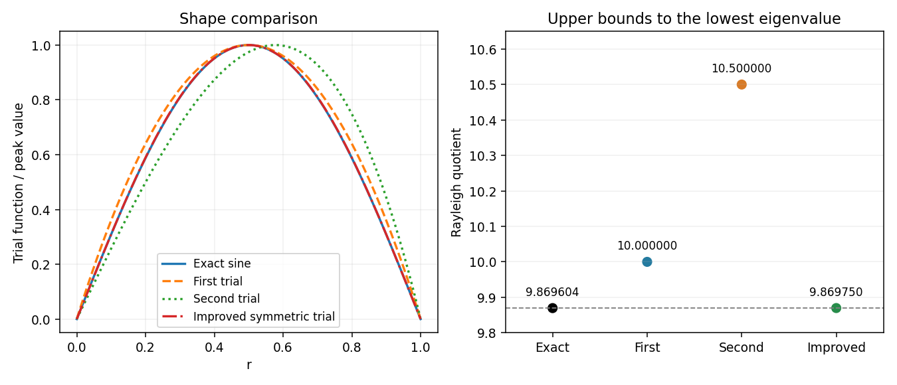

<h1 id="9/solution">Solution</h1>

↑ **Parent:** [9](../9.md)

Introduce a [Lagrange multiplier](../../../../lagrange-multiplier.md) for the constraint $G=1$ and vary $F-\lambda G$ with $y\mapsto y+\epsilon\eta$, where $\eta(a)=\eta(b)=0$. The first variation is

$$
\delta(F-\lambda G)=2\int_a^b[py'\eta'+(q-\lambda w)y\eta]dx
=2\int_a^b[-(py')'+qy-\lambda wy]\eta\,dx.
$$

The [fundamental lemma of the calculus of variations](../../../../fundamental-lemma-of-the-calculus-of-variations.md) gives the [Sturm-Liouville equation](../../../../sturm-liouville-equation.md) $-(py')'+qy=\lambda wy$. Multiplying by $y$, integrating by parts and using the endpoint conditions gives $F=\lambda G$. Therefore the normalization implies **$\lambda=F$**. Assume the coefficient and function regularity needed for these variations and integrations; the condition $w>0$ makes the constraint derivative nonzero at a normalized function.

For the radial problem, set $\sigma=r\psi$. A direct differentiation gives $\sigma''=r\psi''+2\psi'$, so

$$
-\sigma''=E\sigma,\qquad\sigma(0)=\sigma(1)=0.
$$

Finite $\psi(0)$ supplies the first boundary value. The [Rayleigh quotient](../../../../rayleigh-quotient.md) is $R[\sigma]=\int_0^1\sigma'^2dr/\int_0^1\sigma^2dr$. For the two trials, $\sigma_1=r(1-r)$ and $\sigma_2=r(1-r^2)$, the numerator-denominator pairs are $(1/3,1/30)$ and $(4/5,8/105)$, respectively. Hence

$$
\boxed{E_1=10,\qquad E_2=\frac{21}{2}.}
$$

The exact eigenvalues are $n^2\pi^2$, so $E_{\min}=\pi^2\simeq9.86960$. Both trials give upper bounds by the [Rayleigh-Ritz variational principle](../../../../rayleigh-ritz-variational-principle.md), and **the first estimate is more accurate**, since it is smaller. Trial admissibility uses the Dirichlet energy form for $\sigma$; the first trial's nonzero radial derivative at the origin does not invalidate this variational calculation.

To improve, add independent trial functions and minimize the quotient over their span. Here merely combining the two supplied trials gives no improvement: their two-dimensional stiffness and mass matrices are

$$
K=\begin{pmatrix}1/3&1/2\\1/2&4/5\end{pmatrix},\quad
M=\begin{pmatrix}1/30&1/20\\1/20&8/105\end{pmatrix},\quad
\det(K-EM)=\frac{(E-10)(E-42)}{25200}.
$$

The lowest Ritz value is still ten. Instead add the symmetric quartic $\tau=r^2(1-r)^2$. On the span of $\sigma_1,\tau$, the [generalized eigenvalue problem](../../../../generalized-eigenvalue-problem.md) has

$$
K=\begin{pmatrix}1/3&1/15\\1/15&2/105\end{pmatrix},\qquad
M=\begin{pmatrix}1/30&1/140\\1/140&1/630\end{pmatrix}.
$$

Its determinant is $(E^2-112E+1008)/529200$, so the least root gives

$$
\boxed{E_{\rm improved}=56-4\sqrt{133}\simeq9.86974962.}
$$

This is strictly better than both original estimates. The [symmetry obstruction in a polynomial Rayleigh-Ritz trial space](../../../../symmetry-obstruction-in-a-polynomial-rayleigh-ritz-trial-space.md) explains why the cubic addition failed while the quartic helps. It is also the shifted-interval version of the [polynomial Rayleigh-Ritz trial space for a one-dimensional box](../../../../polynomial-rayleigh-ritz-trial-space-for-a-one-dimensional-box.md).

**[Figure 2](#9/image-original-and-improved-polynomial-trial-functions-compared-with-the-lowest-sine-eigenfunction). Original and improved polynomial trial functions compared with the lowest sine eigenfunction**.

## ↑ Ancestors (12)

1. [9](../9.md)
2. [Paper 1](../../paper-1-split.md)
3. [2009](../../split.md)
4. [Past exam of the mathematics course of the year 2 of the natural sciences course of the University of Cambridge](../../../split.md)
5. [Mathematics course of the year 2 of the natural sciences course of the University of Cambridge](../../../../mathematics-course-of-the-year-2-of-the-natural-sciences-course-of-the-university-of-cambridge.md)
6. [Year 2 of the natural sciences course of the University of Cambridge](../../../../year-2-of-the-natural-sciences-course-of-the-university-of-cambridge.md)
7. [Year of the natural sciences course of the University of Cambridge](../../../../year-of-the-natural-sciences-course-of-the-university-of-cambridge.md)
8. [Natural sciences course of the University of Cambridge](../../../../natural-sciences-course-of-the-university-of-cambridge.md)
9. [Course of the University of Cambridge](../../../../course-of-the-university-of-cambridge.md)
10. [University of Cambridge](../../../../university-of-cambridge-split.md)
11. [List of universities](../../../../list-of-universities.md)
12. [Codex Wiki](../../../../split.md)
