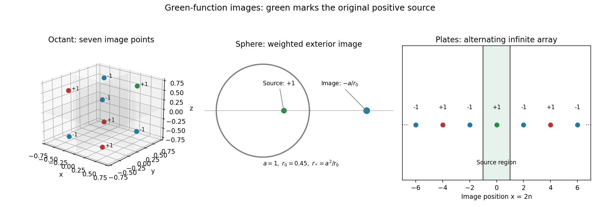

<h1 id="3/iii/solution">Solution</h1>

↑ **Parent:** [Iii](../iii.md)

Take the source at the origin and write $\rho^2=y^2+z^2$. Repeated reflection in $x=\pm1$ places the sources at $(2n,0,0)$ with strengths $(-1)^n$, $n\in\mathbb Z$. There are **countably infinitely many images**; $n=0$ is the original source. A convergent prescription groups adjacent opposite charges:

$$
\boxed{G(x,y,z;0)=-\frac1{4\pi}\sum_{m\in\mathbb Z}\left[\frac1{\sqrt{(x-4m)^2+\rho^2}}-\frac1{\sqrt{(x-4m-2)^2+\rho^2}}\right].}
$$

Each bracket is $O(|m|^{-2})$ on compact sets away from the source, so the paired series converges absolutely. The individual unsigned point-charge terms would not be absolutely summable. On $x=1$, reflection pairs the index $n$ with $1-n$; on $x=-1$, it pairs $n$ with $-1-n$. Their distances agree and signs oppose. Symmetric finite cutoffs leave only a vanishing far-tail contribution, proving both zero boundary values. All nonzero-index sources lie outside the slab. This is the centered-source version of the [Dirichlet Green function between parallel planes](../../../../../dirichlet-green-function-between-parallel-planes.md), selected to decay at large transverse distance.

**[Figure 1](#3/iii/image-image-locations-and-strengths-for-an-octant-an-interior-spherical-source-and-two-parallel-plates). Image locations and strengths for an octant, an interior spherical source and two parallel plates**.

## ↑ Ancestors (13)

1. [Iii](../iii.md)
2. [3](../../3.md)
3. [Paper 2](../../../paper-2-split.md)
4. [2009](../../../split.md)
5. [Past exam of the mathematics course of the year 2 of the natural sciences course of the University of Cambridge](../../../../split.md)
6. [Mathematics course of the year 2 of the natural sciences course of the University of Cambridge](../../../../../mathematics-course-of-the-year-2-of-the-natural-sciences-course-of-the-university-of-cambridge.md)
7. [Year 2 of the natural sciences course of the University of Cambridge](../../../../../year-2-of-the-natural-sciences-course-of-the-university-of-cambridge.md)
8. [Year of the natural sciences course of the University of Cambridge](../../../../../year-of-the-natural-sciences-course-of-the-university-of-cambridge.md)
9. [Natural sciences course of the University of Cambridge](../../../../../natural-sciences-course-of-the-university-of-cambridge.md)
10. [Course of the University of Cambridge](../../../../../course-of-the-university-of-cambridge.md)
11. [University of Cambridge](../../../../../university-of-cambridge-split.md)
12. [List of universities](../../../../../list-of-universities.md)
13. [Codex Wiki](../../../../../split.md)
