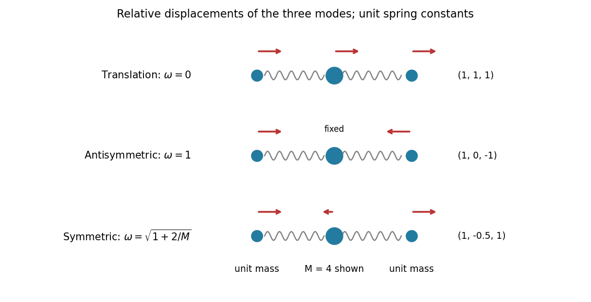

<h1 id="7/solution">Solution</h1>

↑ **Parent:** [7](../7.md)

The quadratic [Lagrangian](../../../../lagrangian.md) gives $\partial L/\partial\dot q=T\dot q$ and $\partial L/\partial q=-Vq$. Thus the [Euler-Lagrange equations](../../../../euler-lagrange-equation.md) are

$$
T\ddot q+Vq=0.
$$

A nonzero mode [vector](../../../../vector.md) $v$ has a common [harmonic](../../../../harmonic-function.md) time factor and satisfies the [generalized eigenvalue problem for small oscillations](../../../../generalized-eigenvalue-problem-for-small-oscillations.md) $Vv=\omega^2Tv$; $\omega$ is its [normal frequency](../../../../eigenfrequency.md). A zero-frequency mode instead admits a constant or linear time factor.

Measure the three coordinates as displacements from a configuration with both springs unstretched. The [kinetic energy](../../../../kinetic-energy.md) is $\tfrac12\dot x_1^2+\tfrac12M\dot x_2^2+\tfrac12\dot x_3^2$, and the [potential energy](../../../../potential-energy.md) is $\tfrac12(x_2-x_1)^2+\tfrac12(x_3-x_2)^2$. Expansion gives

$$
T=\begin{pmatrix}1&0&0\\0&M&0\\0&0&1\end{pmatrix},\qquad
V=\begin{pmatrix}1&-1&0\\-1&2&-1\\0&-1&1\end{pmatrix}.
$$

For $M>0$, direct substitution yields the three [normal modes](../../../../normal-mode.md):

$$
\boxed{\begin{array}{c|c|c}
&v&\omega\\\hline
\text{translation}&(1,1,1)^T&0\\
\text{antisymmetric outer motion}&(1,0,-1)^T&1\\
\text{symmetric outer motion}&(1,-2/M,1)^T&\sqrt{1+2/M}
\end{array}.}
$$

The three [vectors](../../../../vector.md) are independent and orthogonal in the mass inner product $v^TTw$, so they exhaust the motion. Their squared mass norms are $M+2,2,2+4/M$; division by the corresponding square roots gives normalized modes. This is the unit-spring, unit-outer-mass case of the [normal modes of three masses connected by two equal springs](../../../../normal-modes-of-three-masses-connected-by-two-equal-springs.md).

As $M\to\infty$, the central displacement in the symmetric oscillatory mode tends to zero and both nonzero frequencies tend to one. The two limiting shapes $(1,0,1)$ and $(1,0,-1)$ span independent motions of the outer masses against an effectively fixed centre; each unit mass has its own unit spring frequency. The translational mode remains at zero frequency. Under a bounded kinetic-energy condition its common velocity tends to zero as $M^{-1/2}$, while a static common displacement is still an equilibrium shift. One must specify that energy condition before concluding that an arbitrary freely translating heavy mass remains stationary.

**[Figure 2](#7/image-mode-shapes-of-a-free-three-mass-chain-including-the-zero-frequency-translation). Mode shapes of a free three-mass chain, including the zero-frequency translation**.

## ↑ Ancestors (12)

1. [7](../7.md)
2. [Paper 2](../../paper-2-split.md)
3. [2009](../../split.md)
4. [Past exam of the mathematics course of the year 2 of the natural sciences course of the University of Cambridge](../../../split.md)
5. [Mathematics course of the year 2 of the natural sciences course of the University of Cambridge](../../../../mathematics-course-of-the-year-2-of-the-natural-sciences-course-of-the-university-of-cambridge.md)
6. [Year 2 of the natural sciences course of the University of Cambridge](../../../../year-2-of-the-natural-sciences-course-of-the-university-of-cambridge.md)
7. [Year of the natural sciences course of the University of Cambridge](../../../../year-of-the-natural-sciences-course-of-the-university-of-cambridge.md)
8. [Natural sciences course of the University of Cambridge](../../../../natural-sciences-course-of-the-university-of-cambridge.md)
9. [Course of the University of Cambridge](../../../../course-of-the-university-of-cambridge.md)
10. [University of Cambridge](../../../../university-of-cambridge-split.md)
11. [List of universities](../../../../list-of-universities.md)
12. [Codex Wiki](../../../../split.md)
