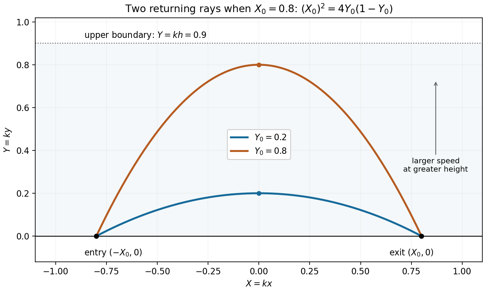

<h1 id="9/solution">Solution</h1>

↑ **Parent:** [9](../9.md)

For fixed endpoint values, the [Euler-Lagrange equation](../../../../euler-lagrange-equation.md) is $f_y-df_{y'}/dx=0$. Along a stationary curve, the [chain rule](../../../../chain-rule.md) gives

$$
\frac{d}{dx}(y'f_{y'}-f)=y'\left(\frac{df_{y'}}{dx}-f_y\right)-f_x.
$$

When $f_x=0$, the [Beltrami identity](../../../../beltrami-identity.md) therefore takes the requested sign convention

$$
\boxed{y'f_{y'}-f=A.}
$$

By [Fermat principle](../../../../fermat-principle.md), the elapsed-time integrand for the given speed is $f=c_0^{-1}\sqrt{1-ky}\sqrt{1+(y')^2}$. Thus

$$
y'f_{y'}-f=-\frac{\sqrt{1-ky}}{c_0\sqrt{1+(y')^2}}=A.
$$

The constant is negative for a finite regular ray. Squaring gives $(1-ky)/(1+(y')^2)=c_0^2A^2$. At a maximum height $y_0$, the slope is zero, so $c_0^2A^2=1-ky_0>0$. Hence

$$
(y')^2=\frac{k(y_0-y)}{1-ky_0}.
$$

Separate variables on either side of the turning point. Integration gives the [parabolic light rays in a reciprocal-square-root speed profile](../../../../parabolic-light-rays-in-a-reciprocal-square-root-speed-profile.md)

$$
\boxed{y(x)=y_0-\frac{k(x-x_c)^2}{4(1-ky_0)}.}
$$

The quadratic opens downwards, with its greatest height $y_0$ at $x=x_c$. The positive index condition holds throughout the layer because $kh<1$. Vertical rays are a separate zero-horizontal-momentum case, outside the regular graph representation $y(x)$; they are not returning rays of the type considered below.

Equal endpoint heights at $x=\pm x_0$ force $x_c=0$. Setting $y(\pm x_0)=0$ gives

$$
\boxed{(kx_0)^2=4ky_0(1-ky_0).}
$$

For nonzero separation, a real returning ray requires $kx_0\leq1$ and has candidate turning heights

$$
\boxed{y_0=\frac{1\pm\sqrt{1-k^2x_0^2}}{2k}.}
$$

Only choices satisfying $0<y_0<h$ are rays wholly within the specified layer. Depending on its thickness there may be two, one, or no admissible choices; at zero discriminant the two algebraic candidates coincide. The entry and exit points at $y=0$ are interpreted as limiting boundary points of the open medium.

**[Figure 1](#9/image-two-possible-returning-parabolic-rays-subject-to-the-optical-layer-height). Two possible returning parabolic rays, subject to the optical layer height**.

## ↑ Ancestors (12)

1. [9](../9.md)
2. [Paper 1](../../paper-1-split.md)
3. [2010](../../split.md)
4. [Past exam of the mathematics course of the year 2 of the natural sciences course of the University of Cambridge](../../../split.md)
5. [Mathematics course of the year 2 of the natural sciences course of the University of Cambridge](../../../../mathematics-course-of-the-year-2-of-the-natural-sciences-course-of-the-university-of-cambridge.md)
6. [Year 2 of the natural sciences course of the University of Cambridge](../../../../year-2-of-the-natural-sciences-course-of-the-university-of-cambridge.md)
7. [Year of the natural sciences course of the University of Cambridge](../../../../year-of-the-natural-sciences-course-of-the-university-of-cambridge.md)
8. [Natural sciences course of the University of Cambridge](../../../../natural-sciences-course-of-the-university-of-cambridge.md)
9. [Course of the University of Cambridge](../../../../course-of-the-university-of-cambridge.md)
10. [University of Cambridge](../../../../university-of-cambridge-split.md)
11. [List of universities](../../../../list-of-universities.md)
12. [Codex Wiki](../../../../split.md)
