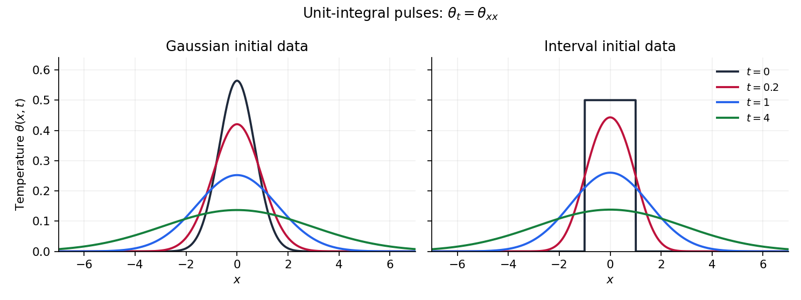

<h1 id="5/iv/solution">Solution</h1>

↑ **Parent:** [Iv](../iv.md)

For the [Gaussian initial data for the heat equation](../../../../../gaussian-initial-data-for-the-heat-equation.md), substitute the initial profile into the [heat-kernel solution](../../../../../heat-kernel-solution.md). Completing the square in $y$ gives

$$
a_0(y-x_0)^2+\frac{(x-y)^2}{4t}
=\left(a_0+\frac1{4t}\right)(y-\mu)^2+\frac{a_0(x-x_0)^2}{1+4a_0t},\qquad
\mu=\frac{4a_0tx_0+x}{1+4a_0t}.
$$

The remaining [Gaussian integral](../../../../../gaussian-integral.md) yields

$$
\boxed{\theta_G(x,t)=\frac{A_0}{\sqrt{1+4a_0t}}\exp\left[-\frac{a_0(x-x_0)^2}{1+4a_0t}\right].}
$$

The centre stays at $x_0$ and the squared width grows linearly with time.

For the interval pulse, the convolution reduces to $B\int_a^bG(x-y,t)dy$. Using $u=(y-x)/(2\sqrt t)$ and the [error function](../../../../../error-function.md) gives

$$
\boxed{\theta_I(x,t)=\frac B2\left[\operatorname{erf}\left(\frac{x-a}{2\sqrt t}\right)-\operatorname{erf}\left(\frac{x-b}{2\sqrt t}\right)\right],\qquad t>0.}
$$

This is the translated and scaled [heat equation with interval-indicator initial data](../../../../../heat-equation-with-interval-indicator-initial-data.md). At its jump points the $t\downarrow0$ limits are $B/2$; away from them the initial data are recovered pointwise.

For fixed $a<x<b$ at late time, both [error function](../../../../../error-function.md) arguments are small. Since $\operatorname{erf}u=2u/\sqrt\pi+O(u^3)$,

$$
\boxed{\theta_I(x,t)=\frac{B(b-a)}{\sqrt{4\pi t}}+O(t^{-3/2})\quad(t\to\infty).}
$$

The estimate is uniform for $x\in[a,b]$. Equivalently, on this fixed interval the Gaussian in the convolution is $1+O((b-a)^2/t)$.

The spreading distance is more apparent on the growing spatial scale. For the Gaussian pulse the exponent is order one when $|x-x_0|=O(\sqrt t)$. For the interval pulse, set $x=c+\xi\sqrt t$ with $c=(a+b)/2$ and fixed $\xi$. Uniformly for bounded $\xi$, its convolution gives

$$
\theta_I(c+\xi\sqrt t,t)\sim\frac{B(b-a)}{\sqrt{4\pi t}}e^{-\xi^2/4}.
$$

Thus both nonzero pulses spread over a distance **$O(\sqrt t)$**, while their heights are $O(t^{-1/2})$ and their total integrals remain constant. More quantitatively, the variances of their normalized profiles are $1/(2a_0)+2t$ and $(b-a)^2/12+2t$, respectively, confirming the same width law.

**[Figure 1](#5/iv/image-gaussian-and-interval-initial-profiles-broaden-under-the-heat-equation-while-conserving-their-integrals). Gaussian and interval initial profiles broaden under the heat equation while conserving their integrals**.

## ↑ Ancestors (13)

1. [Iv](../iv.md)
2. [5](../../5.md)
3. [Paper 2](../../../paper-2-split.md)
4. [2010](../../../split.md)
5. [Past exam of the mathematics course of the year 2 of the natural sciences course of the University of Cambridge](../../../../split.md)
6. [Mathematics course of the year 2 of the natural sciences course of the University of Cambridge](../../../../../mathematics-course-of-the-year-2-of-the-natural-sciences-course-of-the-university-of-cambridge.md)
7. [Year 2 of the natural sciences course of the University of Cambridge](../../../../../year-2-of-the-natural-sciences-course-of-the-university-of-cambridge.md)
8. [Year of the natural sciences course of the University of Cambridge](../../../../../year-of-the-natural-sciences-course-of-the-university-of-cambridge.md)
9. [Natural sciences course of the University of Cambridge](../../../../../natural-sciences-course-of-the-university-of-cambridge.md)
10. [Course of the University of Cambridge](../../../../../course-of-the-university-of-cambridge.md)
11. [University of Cambridge](../../../../../university-of-cambridge-split.md)
12. [List of universities](../../../../../list-of-universities.md)
13. [Codex Wiki](../../../../../split.md)
