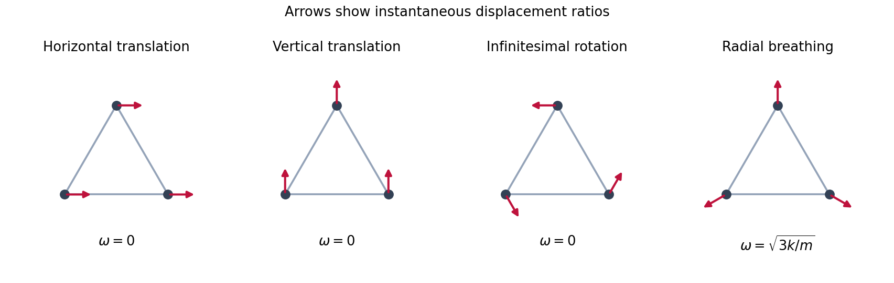

<h1 id="7/solution">Solution</h1>

↑ **Parent:** [7](../7.md)

Translate the [generalized coordinates](../../../../generalized-coordinate.md) so that the [equilibrium](../../../../equilibrium-point-of-a-dynamical-system.md) is at zero. Its potential gradient vanishes, and its quadratic [potential energy](../../../../potential-energy.md) is $q^T\mathsf Vq/2$, where $\mathsf V$ is the symmetric [Hessian matrix](../../../../hessian-matrix.md). The [Euler-Lagrange equations](../../../../euler-lagrange-equation.md) for small motion are

$$
\mathsf T\ddot q+\mathsf Vq=0.
$$

A [normal mode](../../../../normal-mode.md) has fixed component ratios, $q(t)=v\cos(\omega t+\phi)$, with

$$
\mathsf Vv=\omega^2\mathsf Tv.
$$

The [angular frequency](../../../../angular-frequency.md) $\omega$ is its [eigenfrequency](../../../../eigenfrequency.md). A zero mode instead admits a constant or linear time factor. For modes $v_\alpha,v_\beta$, symmetry gives

$$
v_\alpha^T\mathsf Vv_\beta=\omega_\beta^2v_\alpha^T\mathsf Tv_\beta
=\omega_\alpha^2v_\alpha^T\mathsf Tv_\beta.
$$

Hence [mass-matrix orthogonality of normal modes](../../../../mass-matrix-orthogonality-of-normal-modes.md) is

$$
\boxed{v_\alpha^T\mathsf Tv_\beta=0\quad\text{if }\omega_\alpha^2\ne\omega_\beta^2.}
$$

Within a degenerate eigenspace, a basis can be chosen orthogonal in this positive [weighted inner product](../../../../weighted-inner-product.md).

For three masses connected pairwise, the exact energies are

$$
T=\frac m2\sum_{i=1}^3|\dot x_i|^2,\qquad
V=\frac k2\sum_{i<j}(|x_i-x_j|-\sqrt3)^2.
$$

A fixed common [translation](../../../../translation-geometry.md) $x_i\mapsto x_i+a$ preserves all differences and velocities. A fixed rigid [rotation](../../../../rotation-mathematics.md) $x_i\mapsto Qx_i$ preserves their [Euclidean norms](../../../../euclidean-norm.md). Thus both energies have these symmetries. Here the transformation is fixed in time; a moving reference frame would change the kinetic energy. Every equilateral configuration of side $\sqrt3$ has zero spring extensions, hence zero force and minimum potential, proving that it is an [equilibrium](../../../../equilibrium-point-of-a-dynamical-system.md).

For the specified displacement coordinates, write

$$
\begin{aligned}
d_{23}&=\sqrt{(\sqrt3+q_3-q_5)^2+(q_4-q_6)^2},\\
d_{13}&=\sqrt{(\sqrt3/2+q_1-q_5)^2+(3/2+q_2-q_6)^2},\\
d_{12}&=\sqrt{(-\sqrt3/2+q_1-q_3)^2+(3/2+q_2-q_4)^2}.
\end{aligned}
$$

The exact potential is $V=(k/2)\sum_{ij=12,13,23}(d_{ij}-\sqrt3)^2$. For an equilibrium edge vector $d$ and small perturbation $\delta d$,

$$
|d+\delta d|-|d|=\frac d{|d|}\cdot\delta d+O(|\delta d|^2).
$$

Thus only each first-order extension is needed for the quadratic potential. These extensions, with an immaterial sign choice for the horizontal edge, are

$$
s_1=q_5-q_3,\qquad
s_2=\frac12(q_1-q_5)+\frac{\sqrt3}{2}(q_2-q_6),\qquad
s_3=-\frac12(q_1-q_3)+\frac{\sqrt3}{2}(q_2-q_4).
$$

Consequently $V_2=(k/2)(s_1^2+s_2^2+s_3^2)$, with remainder $O(|q|^3)$. If $s=Bq$, then $\mathsf V=kB^TB$. Expanding the squares gives

$$
\boxed{\mathsf V=\frac k4\begin{pmatrix}
2&0&-1&\sqrt3&-1&-\sqrt3\\
0&6&\sqrt3&-3&-\sqrt3&-3\\
-1&\sqrt3&5&-\sqrt3&-4&0\\
\sqrt3&-3&-\sqrt3&3&0&0\\
-1&-\sqrt3&-4&0&5&\sqrt3\\
-\sqrt3&-3&0&0&\sqrt3&3
\end{pmatrix}.}
$$

The [small-oscillation mass and stiffness matrices](../../../../small-oscillation-mass-and-stiffness-matrices.md) are $\mathsf T=mI_6$ and the displayed $\mathsf V$. Hence

$$
\boxed{L_2=\frac m2\sum_{j=1}^6\dot q_j^2-\frac12q^T\mathsf Vq,\qquad \mathsf Vv=m\omega^2v.}
$$

The two common translations give zero-mode vectors

$$
v_x=(1,0,1,0,1,0)^T,\qquad v_y=(0,1,0,1,0,1)^T.
$$

An infinitesimal counterclockwise rotation sends each equilibrium vertex $r_i$ to $Jr_i$, where $J(x,y)=(-y,x)$. Therefore a third zero-mode vector is

$$
\boxed{v_{\rm rot}=(-1,0,\tfrac12,\tfrac{\sqrt3}{2},\tfrac12,-\tfrac{\sqrt3}{2})^T,\qquad\omega_x=\omega_y=\omega_{\rm rot}=0.}
$$

Each vector makes all three $s_j$ vanish, so lies in the [kernel of a linear map](../../../../kernel-of-a-linear-map-split.md) $B$ and therefore in the kernel of $\mathsf V$. The rows of $B$ are independent: the $q_4$ and $q_6$ entries first force the coefficients of its last two rows to vanish, then the first coefficient vanishes. Thus $\operatorname{rank}B=3$, and the [rank-nullity theorem](../../../../rank-nullity-theorem.md) proves that these are exactly the three zero modes.

For radial motion take

$$
v_b=(0,1,\tfrac{\sqrt3}{2},-\tfrac12,-\tfrac{\sqrt3}{2},-\tfrac12)^T,
$$

so that $x_i(t)=(1+a(t))r_i$ to first order. The force on mass $i$ is $-ka\sum_{j\ne i}(r_i-r_j)=-3ka r_i$, since $\sum_i r_i=0$. Newton's equation therefore gives $m\ddot a=-3ka$. Equivalently $\mathsf Vv_b=3kv_b$. Hence the breathing [normal mode](../../../../normal-mode.md) has

$$
\boxed{\omega_b=\sqrt{\frac{3k}{m}}.}
$$

All three masses move radially outward together, then inward together, preserving the triangular shape. The remaining two [normal modes of an equilateral spring triangle](../../../../normal-modes-of-an-equilateral-spring-triangle.md) are shear deformations with squared frequency $3k/(2m)$; together with the breathing mode and three rigid zero modes they account for all six degrees of freedom.

**[Figure 2](#7/image-two-translations-an-infinitesimal-rotation-and-the-radial-breathing-mode-of-the-equilateral-spring-triangle). Two translations, an infinitesimal rotation and the radial breathing mode of the equilateral spring triangle**.

## ↑ Ancestors (12)

1. [7](../7.md)
2. [Paper 2](../../paper-2-split.md)
3. [2010](../../split.md)
4. [Past exam of the mathematics course of the year 2 of the natural sciences course of the University of Cambridge](../../../split.md)
5. [Mathematics course of the year 2 of the natural sciences course of the University of Cambridge](../../../../mathematics-course-of-the-year-2-of-the-natural-sciences-course-of-the-university-of-cambridge.md)
6. [Year 2 of the natural sciences course of the University of Cambridge](../../../../year-2-of-the-natural-sciences-course-of-the-university-of-cambridge.md)
7. [Year of the natural sciences course of the University of Cambridge](../../../../year-of-the-natural-sciences-course-of-the-university-of-cambridge.md)
8. [Natural sciences course of the University of Cambridge](../../../../natural-sciences-course-of-the-university-of-cambridge.md)
9. [Course of the University of Cambridge](../../../../course-of-the-university-of-cambridge.md)
10. [University of Cambridge](../../../../university-of-cambridge-split.md)
11. [List of universities](../../../../list-of-universities.md)
12. [Codex Wiki](../../../../split.md)
